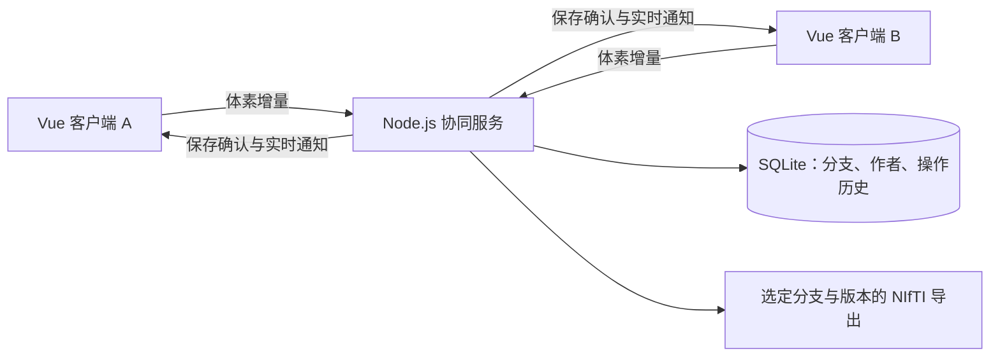

# 多人协同标注架构

Vue 迁移和小团队协同原型已实现并通过双浏览器验证；公网部署、正式账号认证和大规模性能验证尚未完成。

## 协同规则

- 团队内部自行划分工作，所有人员编辑权限相同，不设置任务区域锁。
- 服务器是已确认标注状态的来源。
- 不同体素修改直接合并；冲突时保留现有版本并新建应用新修改的版本，不静默丢弃任一方。
- 后续编辑同步到所有现存版本，未被本次操作修改的位置保留差异。切换查看版本不代表仅向该版写入。
- 各版可分别导出；历史查看只读，不回退其他人的工作。

## 实现结构

Vue 3 单文件组件与 Composition API 管理界面。框架无关的 NIfTI、画笔与阈值核心得到复用；大体积数组使用 shallowRef。

Node.js 24 接收体素增量，WebSocket 通知工程成员刷新。SQLite WAL 事务保存身份、工程、分支快照、事件与每位作者的独立成果空间；IndexedDB 保存完整本地工作副本、原始影像、继续位置及未确认队列。

## 编辑事务

1. 本机即时绘制，笔画结束生成索引、前值、后值。协同画笔也记录同色重画，使其他版对应位置得到更新。
2. 给操作分配唯一 ID、源版本和操作类型，在同一个 IndexedDB 事务内保存完整副本与全部待提交操作，再按序发送。已确认操作移出队列时不删除完整副本。
3. 服务端会话确定作者；校验索引和标签，在一个数据库事务内识别冲突、更新各版、个人成果层、日志及版本。
4. 成功后才确认和广播。重复 ID 返回原提交结果，不重复执行。
5. 正常状态不显示保存成功提示，仅提示待上传与异常。远端刷新保留本地覆盖层；绘制时暂缓替换视图，并拒绝用比已确认版本更旧的响应覆盖缓存。

## 冲突示例

原值 0，A 提交 1，B 基于旧值 0 提交 2：保留原版本的 1，新冲突版本为 2；同一笔其他不冲突的位置仍合并。

之后在别处画 3，两版该位置都变成 3，原来的 1/2 差异保留。之后在差异位置重画 1，则两版该位置都成为 1；历史仍然保留。

事件记录各分支实际前后值及分支来源，可从初始标注重放历史。撤销和重做也是新事件；如果依据的旧值已被别人改变，同样保留分支，不强制覆盖他人结果。当前撤销栈限本浏览器会话，跨会话历史支持只读查看。

## 保存与恢复

- 工程同时绑定数据集 ID 和影像内容摘要；原文件被替换后不错误复用旧标注。
- 当前各分支是压缩快照，历史是压缩的分支增量、作者、时间、类型和版本。
- 原始影像、完整标注、标签、视图和操作队列分别缓存在本地，可从“本地工作缓存”恢复，不必再次下载原影像。连续笔画还会生成中途检查点。
- 个人空间以 `(project, author)` 为键，包含本人最后写入的标签层和编辑位置标记（擦除为 0 也有位置标记），以及完整工作副本归档。个人归档不参与整体覆盖共享成品。
- 退出前先缓存并等待操作确认，再上传个人检查点；失败时保留本地并允许暂时退出。强关页面不保证继续上传，下次恢复缓存后续传。
- 当前会话注销后，可以用浏览器持有、服务器以摘要保存的恢复凭据回到同一作者。请求同时检查会话作者与客户端作者，避免同浏览器切换用户后把待提交记录写入其他作者名下。
- 导出从服务器读取明确的分支及版本，文件名同时标识二者。
- 当前昵称会话适用于可信团队，人员 ID 由服务端签发；正式账号与跨设备身份恢复尚待接入。

## 当前边界

WebSocket 发通知后读取压缩完整分支状态，尚非分块差量广播。单次编码编辑上限 32 MB，计算同步执行。大影像、多分支、高并发需后续压测和优化。

已验证共享与个人空间隔离、个人检查点、旧版本拒绝、注销与同身份恢复、重复操作去重、完整本地缓存、上传失败后的安全退出和页面关闭后恢复；原有单人标注、冲突分支、历史、导出与双客户端联动也保留验证。
