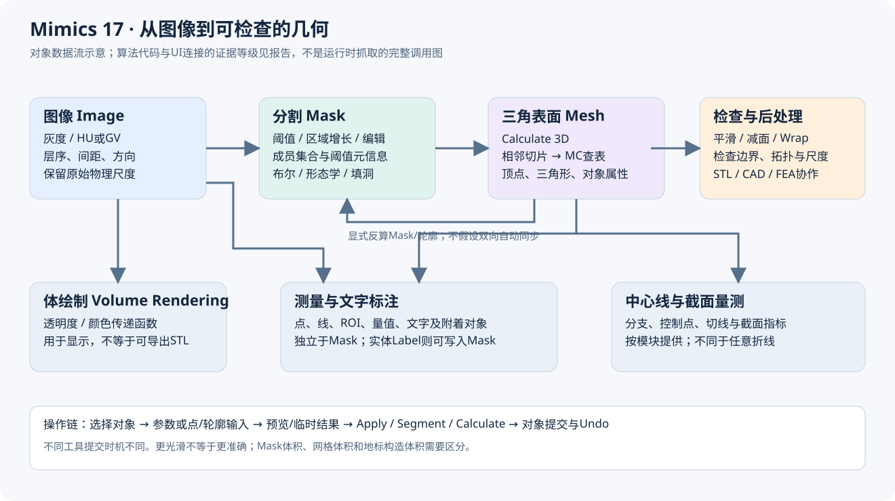
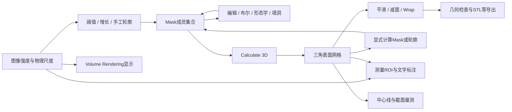
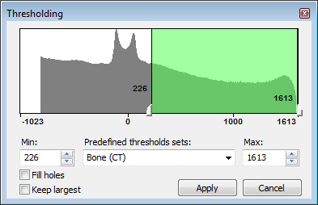
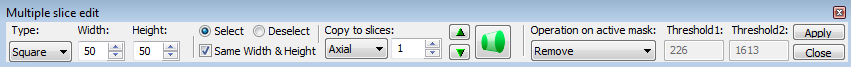
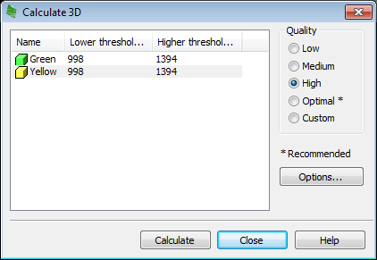
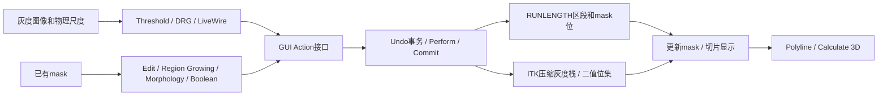
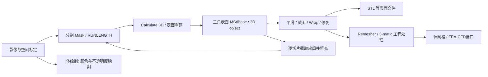
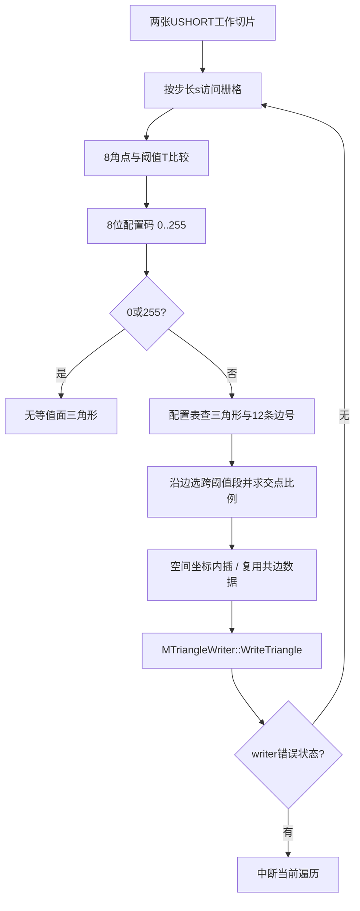
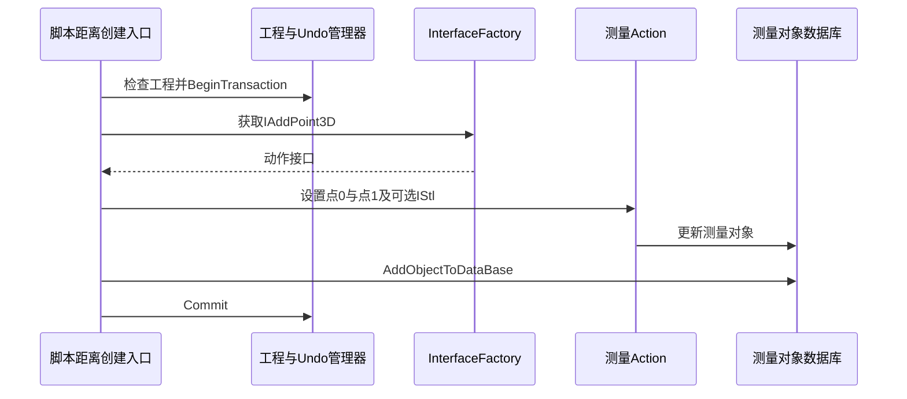
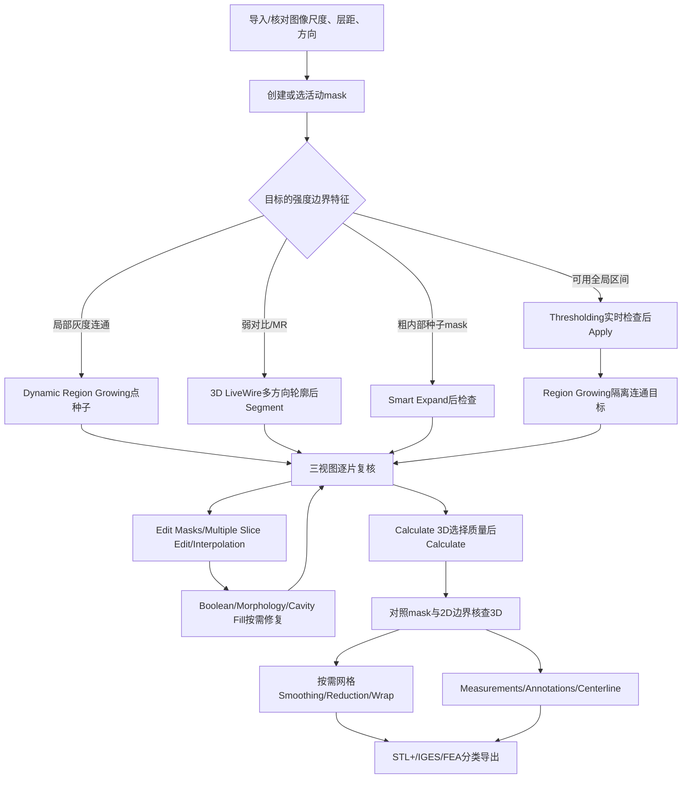

# Mimics Research 17.0 标注与三维重建：工具级实现和操作分析

分析日期：2026-11-04。目标：用户提供的本地 Mimics Research 17.0 安装目录及随包帮助。主程序文件版本 **17.0.0.435**，x64，Visual C++ 2010 系列编译线索。分析采用 reverse-skill-router → R0；三个 GPT‑6.1 Sol xhigh 子代理分别分析分割内核、三维内核、官方帮助，主代理进行补充反编译、交叉核查与汇总。

## 2026-11-05 后续进展：正文为11月4日静态快照

**下文保留2026-11-04的静态分析快照及各章证据日期。** 当时的“未确认”需要结合以下后续材料阅读；后续独立实现也不代表原版数值等价或完整验收。

- [Smart Expand后续内核深挖](../../mimics-vue-reconstruction/notes/native-segmentation-depth.md#new-confirmed-smart-expand-chain)已从延迟调用推进到Random Walker、Jacobi预条件共轭梯度（Jacobi-PCG）以及严格的“概率大于70%”结果判定，补充了原报告当时尚未确认的算法链。
- [LiveWire后续恢复与高斯缺口](../../mimics-vue-reconstruction/notes/native-segmentation-depth.md#remaining-exactness-gap-in-zero-crossing-preprocessing)补充了强度/梯度归一化及零交叉取边规则；离散高斯的系数生成与截断细节仍未完全恢复，自动预处理保留近似边界。
- [三维插值与体积补偿深挖](../../mimics-vue-reconstruction/notes/native-geometry-depth.md)补充了局部插值分段公式、5×5邻域与粗边采样，以及平滑体积补偿的三次多项式设计；GUI字段映射和逐位数值一致性仍有未确认项。
- [当前Vue实现与验收进度](../../../docs/mimics-reconstruction-progress.md)记录后续实现、回归和验收状态；这些更新不改变本报告旧章的证据日期，也不把独立实现冒充为完整原生内核恢复。



## 先读这几个结论

Mimics 的主链是 **图像强度 → Mask 分割 → 表面重建 → 网格处理与测量/导出**。标注既可能指组织分割，也可能指文本、测量或实体文字 Label；它们分别修改不同对象。所谓“三维重建”也至少有三种含义：由 Mask 求三角表面、由图像灰度做体绘制、为 FEA/CFD 生成体网格。本包能直接证实前两者的操作区别，第三类常与 3-matic 协作。

本次并非只根据工具名称讲算法：分割部分核查到区间阈值、扫描行区段的区域增长、动态区域增长的队列及在线均值；三维部分核查到相邻切片组成立方体、查表、插值并写三角面的 Marching Cubes 路径，以及平滑、减面、Wrap 等代表函数。测量部分核查到创建端点、加入对象数据库、提交 Undo 事务的调用链。

**证据边界必须保留：Mimics.exe 受 Wibu CodeMeter 保护。** 主程序多数业务节高熵，主程序静态 IAT 和随机字符串不能完整反映其业务。未运行本软件或附带启动器，也未尝试改变其许可。报告中的操作步骤来自本地 17.0 帮助；外围 DLL/插件算法来自可读代码；不能把“DLL 中存在算法”升级成“已逐个观察到 UI 调用了该算法”。

分析成果采用三个层次：先看本总览建立对象与工作流，再按工具阅读实现模块，最后用帮助工作流模块查菜单、参数、提交时机和原图。所有地址均附模块名；不同 DLL 默认基址相同，不能只看裸 VA。截图、参数例图、旧教程文字与实际本机开放模块之间也做了区分。

## 证据等级与阅读方式

| 标记/表述 | 代表什么 | 不代表什么 |
|---|---|---|
| 文档 D / H编号 | 提供目录内 CHM 明确描述的功能、操作或约束 | 已在当前机器逐次点击复现；当前许可证一定开放 |
| 二进制 B：导入/导出/字符串 | 模块接口、类名、参数或诊断文本存在 | 算法每条分支已恢复；UI必定走该函数 |
| 二进制 B：反编译/反汇编 | 特定地址的控制流、参数、循环和调用实际可见 | 自动恢复类型全部正确；运行时效果已量化验证 |
| 推断 I / 候选 | 与证据相容的实现解释或数学等价模型 | Mimics源码原样实现 |
| 未确认 | 证据不足、受保护调用边界、版本描述冲突 | 不存在该能力 |

模块编号有独立命名空间：分割实现 A、重建实现 R、测量实现 M；官方工作流另用 S/R/A/C/P/X 等编号。不要仅凭相同数字把两章工具直接配对，以名称为准。

## 数据对象与修改边界

| 对象 | 主要内容 | 哪些工具修改它 | 关键区别 |
|---|---|---|---|
| Image / Volume | 原始灰度、层序、像素尺度、方向、HU/GV转换信息 | 图像导入、过滤、重采样等 | 窗宽窗位通常是显示映射，不能当作原始灰度 |
| Mask | 体素/像素成员集合，颜色、名称、阈值等元信息 | Threshold、Region Growing、Edit、Morphology、Boolean等 | 阈值属性不是成员集合本身；Clear可清成员而保留阈值 |
| Polyline | 单层或多层有序轮廓 | LiveWire、Calculate Polylines、轮廓编辑 | 轮廓需转为成员集合或参与重建，不能等同完整体积 |
| 3D Object / Part / STL | 顶点、三角形及对象属性 | Calculate 3D、Smooth、Reduce、Wrap、Cut、Split等 | 改网格不会自动证明原Mask同步改变；需显式反算Mask |
| Measurement | 点、线、ROI、对象关联、量值 | Distance、Angle、Diameter、Area、Density等 | 独立于分割；显示小数位不等于实际测量精度 |
| Annotation | 附着对象、文字、引线、样式和可见性 | Add Text Annotations | 注释不会直接改Mask，也不天然写入STL |
| Label | 写入Mask的实体字符形状 | Label | 与Annotation不同，可经重建成为几何文字 |
| Centerline | 分支、控制点、切线、截面量 | Fit/Edit/Grow/Split Centerline及测量 | 不是任意自由手绘折线；相关测量有Analysis模块前提 |
| FE volume mesh | 体单元、材料及求解器格式 | FEA/CFD、3-matic配合 | 表面STL仅是壳；不等于四面体/体网格 |

Mask 的底层并非必然是每个体素一个独立字节。本包 `MatImageOperations.dll` 的已核查分支使用带成员位的扫描行区段（run-length）结构：连续区间用起止位置与mask位描述。阈值、布尔、编辑和形态学可以沿区段操作；另一些算法为局部遍历建立临时体素访问状态。**“整体用RLE”不意味着所有模块只存在RLE一种表示。**

物理坐标解释应始终考虑像素间距、切片间距与方向。一般可写作 `p = origin + direction × diag(spacing) × index`；这是几何解释模型，未宣称已恢复本包完整 DICOM 仿射实现。二维、MPR、三维拾取、测量和STL导出需要统一物理坐标；厚层插值能改善连续外观，不能创造真实采集分辨率。

## 从用户操作到内部处理

大多数工具可按以下状态理解：选择目标对象 → 输入参数/点/轮廓 → 预览或临时结果 → 应用/计算 → 将动作写入工程 → 更新视图和Undo历史。具体提交时机因工具而异：Threshold 的 Apply、LiveWire 的 Segment、Multiple Slice Edit 的临时mask与Copy/Apply，以及单次点击即执行的 Region Growing 不能混成同一个“确定按钮”。

已核查的分割插件与脚本插件通过 `Mimics::InterfaceFactory` 请求动作接口，再对工程对象执行；框架提供 `MMF::Undo::Manager / Transaction`、`Mimics::IDocument`、`NotificationCenter` 等导出。由此可确证其具有对象接口、命令动作与撤销事务机制。对于未追踪的工具，是否采取相同的预览隔离、取消回滚及增量刷新实现，仍需单独验证。



这是对象数据流图，并非已经逐个动态跟踪的函数调用图。Volume Rendering 的分支来自图像透明度/颜色映射，不会自然产生可导出的三角网格。

## 主要代码模块如何分工

| 模块 | 本次可见职责 | 依据与边界 |
|---|---|---|
| Mimics.exe | 应用主程序，版本17.0.0.435 | CodeMeter保护，主业务UI事件链没有完整静态恢复 |
| Mimics.Segmentation.plugin | Threshold、Dynamic Region Grow等工具控制、校验与动作组装 | 反编译与RTTI；它不直接导入MatImageOperations，连接到具体内核的部分由工厂/主程序隐藏 |
| MimicsBase.dll | IObject、IMask、IMeasurement、IDocument、InterfaceFactory、Undo扩展 | 129文件分诊库中的导出/依赖及代表函数反编译 |
| MatMedicalFramework.dll | 工程对象、动作、事务、通知 | BeginTransaction/Commit/Rollback等导出；被多个插件导入 |
| MatImageOperations.dll | 阈值、RLE区域增长、布尔、形态学、掩码填洞和编辑算子 | 有代表性代码核查，分割实现章详述 |
| Mat2D.dll / Mat2DSlices.dll | 图像及切片/区段相关结构和操作 | 大量导出；不把每个泛型符号都当成UI功能 |
| MatLiveWire.dll | LiveWire代价图、交互路径与相关分割实现 | 对应帮助与代码证据，见分割章 |
| MatOperationsStlImages.dll | 体素/Mask与STL的转换及重建调度 | 实际导入MatImageOperations、MatStlMarchingCubes、MatStlOperations |
| MatStlMarchingCubes.dll | 相邻图像层到三角面、插值、Wrap等实现 | TwoImagesToStl、阈值参数、插值模式与Wrap代码已核查 |
| MatStlOperations.dll / MatSDK.Triangles.* | 三角网格数据、平滑、减面、修复等 | 算子实现和多模块依赖证据 |
| MatIVRender*.dll | 图像与表面显示相关层 | 文件/导出线索；未据此认定特定GPU ray casting实现 |
| Mimics.Script.plugin | 操作和对象的脚本封装 | Distance创建/移动、Mask GetVolume等入口已反编译 |
| MatCenterline3D.dll | 中心线相关结构与操作 | 导出、被脚本/Base引用；本轮没有恢复全部中心线内核 |
| MatStlMaskOperations.dll | 网格上的scalar/vector mask操作 | **不能仅因名称有Mask，就当作CT分割的形态学内核** |

“导入”是模块链接证据，“动作工厂”是可见动态分派方式；未见的连接在报告里保持推断。ITK、Qt、MFC等库出现也只说明依赖，不等于全部分割都是ITK或全部窗口都是Qt。

## 工具分组与阅读顺序

| 任务 | 优先读的工具模块 | 输出检查重点 |
|---|---|---|
| 得到组织初始分割 | Threshold / Region Growing / Dynamic Region Growing | 灰度标度、种子、连通性、局部泄漏 |
| 逐片或跨片修边 | Edit Masks / Multiple Slice Edit / Interpolation / LiveWire | 临时mask、起止层、轮廓拓扑和漏层 |
| 修复成员集合 | Boolean / Morphology / Cavity Fill / Smart Expand / Smooth Mask | 是否误接两结构、填掉真实腔隙、丢失薄壁 |
| 生成可加工几何 | Calculate 3D / 质量与插值参数 | 输入分辨率、边界定位、三角数、方向和单位 |
| 优化表面 | Smoothing / Triangle Reduction / Wrap / Cut / Split | 体积偏差、拓扑变化、孔洞与法向 |
| 做量测 | Distance / Angle / Diameter / Ellipse / Area / Density / Surface distance | 量的定义、物理坐标、附着对象、采样范围 |
| 写注释或实体文字 | Annotation / Label | 是否改变Mask、是否需要进入最终几何 |
| 做血管/气道分析 | Centerline及截面测量、肺模块专用工具 | 分支拓扑、端点、截面位置、模块许可 |

## 版本与文档冲突的处理

1. 本报告只把已确认的本包行为归于17.0。文档全文中未找到 Smart Fill 或 Split Mask 名称；实际存在 Cavity Fill、Smart Expand、Region Growing / 3D Separate，以及对3D对象操作的Split。这是本包检查结果，不是对以后版本的否定。
2. Multiple Slice Edit 的 Interpolation 修改临时Mask成员；View > Interpolated Images 是图像显示相关功能，两者不同。
3. Calculate 3D 的原图、`Quality.htm` 和 `3D objects.htm`使用 **Optimal**；独立的 `STL+ - STL/VRML Parameters` 对话框说明使用 **Maximum**。这是不同对话框的预设命名，尚未证实逐项等价，不能合并成一个菜单。帮助明确 Calculate 3D 的 **High 仍有 XY matrix reduction**，更平滑或更好看不等于最高几何精度。
4. 同一 CHM 包含Mimics与3-matic协作教程。Mimics `Tools > Smoothing / Triangle Reduction / Wrap` 与教程 `Design / Fix / Remesh` 的操作不能合并成同一软件菜单。Tools三项有Simulation模块前提，中心线测量有Analysis模块前提。
5. 截图中的HU、半径、迭代次数、网格误差是当时示例状态，除非正文或反编译明确其默认初始化，不能标成通用默认值。源帮助本身存在旧菜单和图片沿用，工作流章逐条保留。

## 如何判断结果是否正确

分割首先回到原始切片检查，而不是只旋转三维外观：检查目标每一层的归属、薄桥、分叉、空腔、局部灰度变化及闭合情况。阈值误分造成的结构错误通常不能靠后续平滑消除。

三维重建后将表面叠回二维切片检查边界，再检查孤立壳、开放边、法向、退化/非流形三角及尺寸尺度。平滑、减面和Wrap是不同操作：平滑移动几何，减面降低离散复杂度，Wrap可能重新包络并改变拓扑。三者即使让模型“更整齐”，也可能改变测量与体积。

测量需明确对象与量的定义：直线距离、曲面路径长度、三点圆直径、截面等效直径互不替代；Mask体积、网格体积、地标凸体体积也互不替代。报表小数格式与底层计算精度不同，源图像分辨率和人工点位误差仍决定可信程度。

## 本次分析范围与可复现性

范围契约：[scope.md](../scope.md)。阶段记录：[timeline.md](../timeline.md)。只读分析原始目录，副本、IDB、提取文本和报告保存在本案例；没有修改当前项目业务代码、原始软件或患者数据。

分诊覆盖 Mimics 主安装目录下129个 PE 文件（不含另行排除的附带启动器及递归子目录）：共记录131,917项导出、55,831项导入。这是符号盘点规模，**不表示逐一反编译了13万函数**。CHM 解包得到562个HTML主题。深度核查聚焦分割、重建及测量事务的代表路径，具体地址与原始反编译文件见各章。

主程序SHA256：`faed50f99e74926de007299db0bdf58470213b1ee79654d06ea2b9b1ee6e6004`。帮助SHA256：`be16fa266f1f1eeb8fe705ced35a7da7c461512650354fe184cd7709af902b59`。文件版本来自资源，不能据此单独证明安装包供应链真实性。

工具链：已安装的 IDA Professional 9.3 / Hex-Rays MCP、Python 3.12.7（pefile、Capstone等）、Detect It Easy 3.21，以及子代理使用的 radare2/rabin2。CHM 经系统现有7-Zip 26.01解包，作为文档容器工具记录，不安装新依赖。工具索引和脚本执行限制已按用户独立完成要求在本案例内落实。

最小复现命令（PowerShell；只写案例目录）：

```powershell
& 'C:\Users\wwulli\Tools\reverse-skill-python\Scripts\python.exe' 'C:\Users\wwulli\Desktop\deepmark\work\mimics-17-analysis\notes\triage.py'
& 'C:\Users\wwulli\Tools\detect-it-easy\diec.exe' 'C:\Users\wwulli\Desktop\mimics\Mimics Research 17.0\Mimics.exe'
```

反编译复核：将模块副本打开到IDA，用报告给出的 `模块名!VA` 定位；默认DLL ImageBase通常是`0x180000000`，RVA=`VA-ImageBase`。原始证据JSON保存反编译地址标记和引用，导入导出TSV有精确符号和IAT/入口地址；ASLR下运行时地址需要重新加实际模块基址。

本轮没有进行实机UI逐工具复现、真实病例效果评估、主程序解保护、中心线全算法恢复、所有专业模块深挖或医学准确性认证。上述未验证部分已逐模块标明，不影响对已取得文档和外围代码证据的使用。


---

## 帮助原图：核对实际交互语义

以下为用户提供CHM中的说明图，**不是本轮实机操作截图**。图中的阈值、尺寸等是示例状态，不是通用默认值。








---

## 分割与掩码编辑：Mimics Research 17.0 模块逆向报告

本文针对用户提供的 Mimics Research 17.0 安装包，结合本地官方 CHM 与原生 x64 DLL/插件的只读静态分析。它记录了实际导出、RTTI、反汇编/反编译与界面的可核查关系；没有运行 Mimics 或启动器，没有加载患者项目，没有安装工具、连接目标网络、修改许可或原始二进制。所有地址是对应文件首选基址 `0x180000000` 下的 VA；运行时若发生 ASLR，应使用 RVA=VA−基址重新定位。

### A00 证据等级、数据模型与模块边界

使用以下三类标签，避免把文档说明或通用图像处理知识写成已恢复源码：

- **已确认·代码**：反编译正文中存在实际分支、循环、位运算或调用，并有导出/RTTI/调用上下文支持；仍不等同于本机实测。
- **已确认·文档**：本包 CHM 明确说明步骤/语义；不能证明本机许可证开放、截图数值是默认，或实现符合某一特定数学算法。
- **强推断 / 未证实**：分别表示证据支持但调用链不完整，或尚未恢复关键实现。主程序受保护处不通过猜测填补。

真实分割后端的重要发现是 `MatImageOperations.dll`。名称相近的 `MatStlMaskOperations.dll` 主要处理三角网格的 scalar/vector/color mask（例如 `MStlMaskOperatorVectorMaskApply`、`MStlMaskOperatorMorphLocal`），**不能把它的“mask”直接等同于医学图像分割体素**。`Mat2DSlices.dll` 具有二维轮廓、切片栈、hatch、boolean、split 操作；仅见这些导出，不能认定其 Split 就是用户界面中的 mask 分离。

代码显示两套可并存的数据路径：

1. 旧式后端以 `RUNLENGTH` / `RUNLENGTH_LINE` 保存切片行区段。代表区段为8字节：16位起点、16位终点、32位 mask 位集合；行对象含区段数及区段指针。阈值、布尔、形态学和普通连通域可在此压缩表示上操作。这里的32位 mask 位与形态学临时槽扫描一致，不能外推为整个产品只能创建32个用户 mask。
2. 插件中还存在 ITK `ImageStack<unsigned short, ImageStackAirCompressionContainer<...>>` 与 `ImageStack<bool, ImageStackBitsetContainer<__int64>>`、单 bit 容器等模板。它们证明灰度栈与二值栈有压缩/位集专用实现；不证明每一个工具都采用相同容器。

GUI 与算法之间通常经 `Mimics::InterfaceFactory` 获取 action 接口，交由 `MMF::Undo::ManagerEx::Perform` 执行。Threshold/DRG 的具体反编译已看到事务、锁、Perform 和 Commit；其他工具的撤销只按文档通用 Ctrl+Z/Ctrl+Y 描述，不冒称逐项实测。只关闭对话框通常不能视作取消之前已提交的编辑。

#### 二进制证据清单

| 文件 | 规模/导出 | 本次实际用途 |
|---|---:|---|
| Mimics.Segmentation.plugin | 6,765,056字节；284导出 | Threshold/DRG界面与 action 调度，SmartExpand/CTBone/ThresholdRegionGrow的类及控件 |
| MatImageOperations.dll | IDA 1846函数；导出见全包索引 | 阈值、RLE、Boolean、Grow、Morphology、Edit、Cavity 与自动孔洞填充 |
| MatLiveWire.dll | 4,263,424字节；444导出 | 最短路径树、梯度/拉普拉斯代价图、轮廓控制点/回溯 |
| Mat2DSlices.dll | 1,333,248字节；2266导出 | 切片轮廓数据结构与布尔/分割接口的范围核验 |
| MatStlMaskOperations.dll | 648,704字节；424导出 | 排除三角网格 mask 与体素 mask 的混淆 |
| Mat2D.dll | 459,264字节；365导出 | 二维轮廓/布尔基础层核验 |

哈希、节熵与导入表见 [pe-survey.json](../evidence/annotation/pe-survey.json)，补充库 MatImageOperations 的 SHA256 为 `daf1a5af2f1953c0709374cba216641f89d2e471021d2817c2b8e58d0624ce76`。插件的 ITK、MimicsBase、MimicsControls、MatMedicalFramework、Qt5/MFC、VC100、OpenMP 导入与上述分层吻合。各库完整导入导出、带文件偏移的字符串、代码交叉引用和 RTTI 保存在 [annotation证据目录](../evidence/annotation)，完整操作文档证据见 [workflows.md](modules/workflow/workflows.md)。



上图为对象和动作层的架构示意；尚未逐一追通的GUI动作到具体存储后端连接，不视作运行时已验证调用。

### A01 Thresholding：全局阈值

**用途与输入输出。** 由项目灰度/HU区间生成活动 mask；它是按强度选体素，不判断解剖归属。输入为图像与 Min/Max，输出为新建或覆盖的目标 mask，并保存其阈值信息。

**操作。** 选活动 mask 或 Masks > New；进入 Segmentation > Thresholding；选预设组织或调 Min/Max（数值可双击/微调后 Enter）；三正交视图翻片检查实时着色；Apply 提交。预设值受项目实际灰度范围约束。改变全局阈值会丢失之前针对该 mask 的手工分割编辑，应先保存副本。图中226/1613和教程270 HU等是病例值，不能当通用骨阈值或安装默认。

**已确认·代码。** 插件 `sub_180169990` 在 `0x1801699D3` 调 `CWnd::UpdateData`；`0x180169A7D/0x180169A93` 调 `ImageFns::GetPixelAsGreyvalue`；`0x180169AA6` 校验下限不大于上限；`0x180169AE2` 经工厂取得 action，设置目标与上下阈值，`0x180169B84` BeginTransaction，必要时先创建新 mask，`0x180169D05` Perform，`0x180169D35` Commit。这是可撤销的正式提交路径，而实时颜色预览另有 `IPreviewThreshold` / `VIThresholdActivePreview_deprecated` 类型，不能把预览等同于已写 mask。

后端 `MImageBaseOperatorThreshold<unsigned short>::Operate` 位于 `MatImageOperations.dll!0x180020A00`。`0x180020E2A` 读取16位灰度，`0x180020E40/0x180020E5C` 排除 `<lower` 或 `>upper`，确认端点包含：`lower ≤ I ≤ upper`。它沿行把连续命中体素收集为 `(start,end,maskbits)`，随后 `0x180020FD0` 调 `RUNLENGTH_LINE::MERGE`，而非简单把全体图像逐字节写成另一张原尺寸图。

**边界与未证实。** Lower=0时代码对无存储灰度段有专门处理；压缩灰度空段不应被误认为永远不属于阈值。该导出内核与插件 action 的最后一跳未直接展开，故“此 GUI 在所有条件都固定使用该旧式导出”只属强推断；插件也内含 ITK BinaryThreshold 路径。HU转换具体偏移/斜率未在本节完整恢复。

证据：[提交反编译](../evidence/annotation/seg-0x180169990.c)、[阈值内核](../evidence/annotation/imageops-0x180020a00.c)；帮助：[Thresholding1.htm](../evidence/help/chm/Mimics%20Reference%20Guide/Thresholding1.htm)、[With the thresholding toolbar.htm](../evidence/help/chm/Mimics%20Reference%20Guide/With%20the%20thresholding%20toolbar.htm)。

### A02 Advanced Threshold：Keep largest / Fill holes / 预设

**操作与参数。** Thresholding 截图可见 Fill holes、Keep largest；预定义组织管理见 Predefined Thresholds。选择区间及后处理后 Apply；这些不是单独重新定义灰度窗口的显示工具。预览和提交仍依A01。

**已确认·代码。** `CDialogBarThresholdAdvanced` RTTI位于插件 `0x1806256E0`。`sub_18016C530` 先开启名为 `Thresholding` 的事务并调用基本阈值；随后记录 `keep largest`、`fill holes`、`range min/max`、`predefined set`。在 `0x18016CA37–0x18016CAC1` 根据开关创建并 Perform `IKeepLargest` action；`0x18016CAF5` 起经 `sub_18015F570` 创建填孔 action。说明它们是阈值之后的可组合处理，不是调整同一个比较运算符。

**未证实。** “Keep largest”按体素数还是物理体积排序、并列分量如何取舍、连通度选择、填孔是否对所有维度/ROI生效，本次未完整反编相应 action，不能从按钮名硬写。`MatImageOperations` 的自动孔洞填充另有A14，但尚未直接证实它就是该按钮每次调用的唯一内核。完整 CHM 正文没有独立 advanced threshold说明页；本节高级项存在性的依据为截图与代码两类证据。

证据：[高级提交路径](../evidence/annotation/seg-0x18016c530.c)、[插件RTTI与字符串](../evidence/annotation/Mimics.Segmentation.plugin.anchors.txt)；帮助：[Predefined Thresholds.htm](../evidence/help/chm/Mimics%20Reference%20Guide/Predefined%20Thresholds.htm)。

### A03 Region Growing：已有 mask 连通域提取

**用途与操作。** 对已有 source mask 点种子，提取包含种子的连通部分到 target。设 Source/Target；Multiple Layer关为单片、开为3D；选6或26连通；决定 Leave Original Mask；在目标内部左键点击即执行，无独立 Apply。Leave Original Mask开为复制，关为移动，后者会移除源体素。可在 Target累加，Source/Target双箭头用于交换。

**已确认·代码。** `MImageBaseOperatorGrow<unsigned short>::Operate` 位于 `MatImageOperations.dll!0x18000C9D0`；mask生长分支从 `0x18000D22B` 起，把 source/target编号换为bit，按物理像素尺寸/层距把种子转整数索引，限制边界与单层范围，然后调用 `RUNLENGTH::REGION_GROW_PHYSICAL`（导出 `0x18004A680`）。后者以RLE段为单位：找包含种子的段；邻行/邻层查找与当前X区间相接或重叠的段；用可扩容环形队列保存 `(z,y,segment index)`；设置 `targetBits | oldBits & ~sourceBits` 后入队，避免重复处理，并累计命中体素数。邻接扩张量受连接设置影响；这与“原 mask 内连通域”相符，未重新对原灰度做同一轮全局阈值。

**边界。** 错误细桥会使两个解剖部位成为同一个连通域；先 Edit断桥。种子应属于source；种子越界、单层范围不含种子、源目标冲突及临时mask使用有早退路径。6/26是文档确认选项；本次未把所有 EConnectivity枚举数值逐一对应到每一分支。RLE内核和GUI action最后一跳未完整联通，内核机制确认、每种界面设置到内部flag的映射保留为强推断。

证据：[Grow分发](../evidence/annotation/imageops-0x18000c9d0.c)、[RLE连通域](../evidence/annotation/imageops-0x18004a680.c)；帮助：[Region Growing1.htm](../evidence/help/chm/Mimics%20Reference%20Guide/Region%20Growing1.htm)。

### A04 Edit Masks：Draw / Erase 与刷子

**用途与操作。** 编辑活动mask的当前切片。进入 Edit Masks（Ctrl+D/Ctrl+E/Ctrl+T或工具内D/E/T）；选择 Square/Circle/Lasso/Flood-Fill/LiveWire及 Width/Height，Same Width & Height联动；按住左键绘制/擦除。Alt临时切Draw/Erase，Ctrl+左拖改大小，Shift+左键临时导航。右键 Erase full slice清整片。编辑直接改变mask，不等待全局Apply；Close退出工具。

**已确认·代码。** `MImageBaseOperatorEdit<unsigned short>::_Edit` (`MatImageOperations!0x18000A520`) 根据坐标标志调用 `_ConvertPointListToPixelCoordinates`；遇多平面帧有专门分支；必要时申请一bit/体素的已处理标志以免同一操作重复处理。`_DrawMaskLine@0x18000A260` 的 EDrawType分支中，数值2调用 `RUNLENGTH::AddMaskLineLogical`，数值0调用 `ClearMaskLineLogical`；其输入是行起止点和目标mask编号。说明手工填充最终可下降为X向区段增删，而不是网格雕刻。`_DrawInPolyPlane@0x18000A6F0`、`_DrawInPolyPlaneLine@0x18000AD00`的导出证明斜平面/帧路径另有实现，不能只按Axial行坐标理解所有编辑视图。

**边界与未证实。** Lasso、圆/方刷光栅化的精确取整/边界包含、Flood-Fill的Tolerance与Impatience数学定义未反编。文档说明Tolerance越高越需要锐利边界阻止扩张，Impatience控制扩张速度，不能把它们偷换为DRG的HU偏差。刷子显示区域与物理体素之间存在转换，缩放或斜切视图不应直接拿屏幕像素数当物理尺寸。

证据：[_Edit](../evidence/annotation/imageops-0x18000a520.c)、[_DrawMaskLine](../evidence/annotation/imageops-0x18000a260.c)、[完整导出](../evidence/triage/MatImageOperations.dll.symbols.tsv)；帮助：[Edit Masks.htm](../evidence/help/chm/Mimics%20Reference%20Guide/Edit%20Masks.htm)。

### A05 Local Threshold：编辑区域内重新判阈

**用途与操作。** 在Edit Masks或Multiple Slice Edit选Threshold，只对刷到/临时选中的区域按灰度区间更新活动mask。三组区间中，中间组继承活动mask原阈值且不可改；自定义区间双击数值，Enter确认。刷到区域内原有但超区间的体素也可被删去，并非只能增加。

**内部证据。** `MImageBaseOperatorThresholdSettings::SetThresholds`、`MImageBaseOperatorProcessMaskedAreaSettings::SetThresholds`、编辑EDrawType和源图/目标mask设置共同证明后端存在区域处理与阈值参数接口；A01内核证明闭区间强度选择的实现。但本次未恢复从Edit的Threshold模式到具体局部判定的完整分支，因此其“只影响选择区”的语义为文档确认，精确算法/阈值端点是否与A01完全一致仍未证实。

**边界。** 它不改变全局数据集阈值，不等同于只改Windowing显示。对局部选区之外的原mask行为需按文档理解；不可直接把A01整图重算路径当局部编辑实现。

帮助：[Edit Masks.htm](../evidence/help/chm/Mimics%20Reference%20Guide/Edit%20Masks.htm)、[The multiple slice edit interface.htm](../evidence/help/chm/Mimics%20Reference%20Guide/The%20multiple%20slice%20edit%20interface.htm)；代码锚点：[MatImageOperations导出](../evidence/triage/MatImageOperations.dll.symbols.tsv)。

### A06 Multiple Slice Edit：临时mask与批量提交

**输入输出与步骤。** 输入活动mask，工具建立临时mask。选择Axial/Coronal/Sagittal方向；Select/Deselect涂临时选区；填Number of slices并用上下箭头复制，必要时到目标层继续改；选择Operation on active mask=Add/Remove/local Threshold；Apply才改变活动mask。临时与活动mask交集为第三色。复制数0表示向该方向所有层，非0会跳到最后复制层；右键可Select full slice。

**代码证据与推断。** `MImageBaseOperatorCopySlice<...>::Operate@0x180008AB0`、`SetNumSlices@0x180008750`、`SetIncreasingDirection@0x180008760`、`SetStartSliceIndex@0x180006C20`、`SetSliceType@0x180008740`提供方向/层数/起点的后端接口；`SliceEditMeasureSettings`同时有mask list、slice image list、frame与transform设置。故“复制临时选区→在原mask执行某操作”的两阶段数据模型与接口吻合。未对 `Operate@0x180008AB0`反编，不能声称已证实零层数或临时mask的所有内部生命周期。

**提交/撤销与边界。** 临时颜色不是已改原mask；Apply是文档明确提交点。Close是否丢弃尚未Apply的选区正文不详，不补造。方向和层数错误可批量影响远多于当前显示层的体素；应逐片检查结果。

帮助：[Multiple slice edit.htm](../evidence/help/chm/Mimics%20Reference%20Guide/Multiple%20slice%20edit.htm)、[The multiple slice edit interface.htm](../evidence/help/chm/Mimics%20Reference%20Guide/The%20multiple%20slice%20edit%20interface.htm)；锚点：[MatImageOperations导出](../evidence/triage/MatImageOperations.dll.symbols.tsv)。

### A07 Interpolation：Multiple Slice Edit内选区插值

**步骤。** 在不同层画临时mask/轮廓，选择Copy to slices方向，按插值按钮，查看中间层，再选Add/Remove/local Threshold并Apply。完成当前插值后再处理另一组选区。

**已确认与未证实。** 文档明确插值作用于临时mask；`GetImageSliceOfMaskSliceInterpolated`与 `EInterpolationMethod`导出仅说明后端另有切片采样映射，不能证明此处是线性、距离场、形状匹配或样条插值。`Mat2DSlices`的Contour/Boolean/Stack接口也不足以唯一归属此工具。**本次未恢复其数学插值公式。**

**易混边界。** View > Interpolated Images仅改善XZ/YZ灰度显示，帮助明确mask不变；它与本模块的分割插值不是同一动作。

帮助：[The multiple slice edit interface.htm](../evidence/help/chm/Mimics%20Reference%20Guide/The%20multiple%20slice%20edit%20interface.htm)、[Interpolated images.htm](../evidence/help/chm/Mimics%20Reference%20Guide/Interpolated%20images.htm)。

### A08 Dynamic Region Growing：强度条件生长

**用途与操作。** 可直接从原灰度图生长，不要求先全局Threshold。设Target、Fill Cavities、Multiple Layer、Deviation Min/Max，在内部点种子即开始，Ctrl+第二次点击可加入另一种子。Multiple Layer关为单片、开为完整数据集；最后选中种子的HU/GV会显示。结果mask阈值设为所选体素灰度最小/最大值；已有target体素灰度可参与。没有文档说明的独立Apply预览。

**已确认·GUI代码。** 插件 `sub_180170D80` 更新对话框数据，验证种子、坐标系转换后检查ROI bounds（`0x180170F12`越界早退）；创建 `IDynamicRegionGrow` action、开启undo事务，按情形复制mask；`0x180171167`传ROI，`0x1801711EF`传三维种子，`0x1801712FC/0x180171328`传两个偏差值，后续Perform。只有生长成功才按Fill Cavities开关创建填孔action；失败时若刚创建目标则有删除清理分支，最终Commit。不同入口的功能通过接口与参数组合，而非一次无条件填洞。

**已确认·算法。** `MatImageOperations!_DynamicRegionGrow@0x18000DB40`为3D整数坐标队列生长：物理坐标按平面像素间距和层距转索引，申请packed 2-bit visited图，初始化种子；枚举−1..1邻域、按连接/单层条件筛选，边界合法且未访问的候选调用predicate；通过者写target并入环形队列，队列满时扩容。失败候选也置已访问标志，故不是每轮无限重新检查所有像素。

predicate `sub_180003A60`先按当前平面/层范围、层内半径平方和层间距离拒绝候选，再读灰度 `I`。`0x180003EAC`拒绝 `I≤μ−dmin`，末尾要求 `I<μ+dmax`，即严格开区间 `μ−dmin < I < μ+dmax`。accepted回调 `sub_180003F30`通过flag决定是否更新在线均值：`μ'=(n·μ+I)/(n+1)`，并维护计数及最小/最大灰度。该实现实际支持固定种子参考与动态均值参考模式；本次未恢复GUI中哪个选项在每一入口设置该flag，**不把所有模式一概写成每一步都更新均值**。这也解释CHM同时用“平均灰度”公式与“相对种子偏差”的表述为何不能仅凭文字推断完整机制。

**边界。** 低对比组织可通过窄灰度桥泄漏；均值更新模式对增长顺序有潜在依赖，但本次未以病例实测量化。偏差零与严格比较可能导致无增长，不能简单当与A01的闭区间等价。分辨率/层距决定物理范围转换。只有部分路径核查了历史“12-bit”灰度说明，不能把任意输入像素格式硬限制为4095。

证据：[DRG提交](../evidence/annotation/seg-0x180170d80.c)、[队列生长](../evidence/annotation/imageops-0x18000db40.c)、[接纳谓词](../evidence/annotation/imageops-0x180003a60.c)、[均值更新](../evidence/annotation/imageops-0x180003f30.c)；帮助：[Dynamic Region Growing.htm](../evidence/help/chm/Mimics%20Reference%20Guide/Dynamic%20Region%20Growing.htm)。

### A09 Boolean Operations：Union / Intersection / Minus

**输入与步骤。** 选择Mask A、Mask B、Minus/Intersection/Union及Result，Apply写结果，检查后Close。减法A−B不能交换顺序；Target可新建。它作用于mask集合，不是STL曲面布尔。

**已确认·代码。** `MImageBaseOperatorBoolean<...>::Operate@0x180005910`的op=0/1/2分支分别进入union/intersection/difference helper。三个helper逐RLE段读取32位mask位：

- `sub_180005FB0`：`inA || inB`则置target bit，否则清target；
- `sub_1800061C0`：`inA && inB`；
- `sub_1800063D0`：`inA && !inB`。

每行最后调用 `RUNLENGTH_LINE::FuseAdjacentElements`，合并布尔后相邻同类区段。它对同一区段的其他mask位进行保留和定点改写，不是全局清空全部mask。

**阈值元数据。** 文档和代码均有并集取 `min(lowerA,lowerB), max(upperA,upperB)`，交集取 `max(lowerA,lowerB), min(upperA,upperB)`，减法沿用A。交集的代码若下限大于上限会交换数值，因此阈值元数据不能反推实际集合非空；集合布尔由mask bits决定。结果已有thresholded标志也并非一定被强制重置。

证据：[Boolean分发](../evidence/annotation/imageops-0x180005910.c)、[Union](../evidence/annotation/imageops-0x180005fb0.c)、[Intersection](../evidence/annotation/imageops-0x1800061c0.c)、[Minus](../evidence/annotation/imageops-0x1800063d0.c)；帮助：[Boolean Operations.htm](../evidence/help/chm/Mimics%20Reference%20Guide/Boolean%20Operations.htm)。

### A10 Erode：形态学腐蚀

**操作。** Segmentation > Morphology Operations，选Source、Erode、Target、Number of pixels、8/26-connectivity，必要时Limited to另一个mask，Apply。输出边界缩小的mask，阈值元数据继承源；小细枝可能完全消失。

**已确认·代码。** `MImageBaseOperatorMorphology<...>::Operate@0x180017050`中op=0，source/target编号转换成bit后于 `0x180017423`调用 `RUNLENGTH::BinaryErodeMaskerPhysical@0x180049E10`；Number of pixels与限制mask被传入；函数保存原连接设置并在结束恢复，复制阈值元数据。8连接开关映射为内部值8，否则26（`0x1800171FB–0x18001720F`）。

**未证实与限制。** 本次未反编 `0x180049E10`全部核循环，故不声称核一定为球/立方体或完全等价于某个开源ITK结构元素。帮助指出Limited to配合Erode可造成与限制mask的交集效应，不应仅按几何ROI裁剪想象。

证据：[形态学分发](../evidence/annotation/imageops-0x180017050.c)；帮助：[Morphology Operations.htm](../evidence/help/chm/Mimics%20Reference%20Guide/Morphology%20Operations.htm)。

### A11 Dilate：形态学膨胀

**操作/输出。** 同A10，选择Dilate后Apply，增加mask边缘体素；Limited to约束结果范围。Number of pixels为操作尺度；不能把膨胀后几何膨胀量直接认定为所有方向相同的毫米值。

**已确认·代码。** 同一Operate的op=1于 `0x180017389`调用 `RUNLENGTH::BinaryDilateMaskPhysical@0x18004BD50`，该接口另有bit形式 `BinaryDilateMaskerPhysical@0x1800497E0`，和行段层 `RUNLENGTH_LINE::BinaryDilate@0x180041B10/0x1800424A0`。这些是图像mask路径，不是 `MStlMaskOperatorMorphLocal`。

**边界。** 文档8-connectivity为逐平面邻域但遍历整个数据集；26为3D。层间距大于pixel size×Number of pixels时，文档说明跨层效果不能简单按连续球形膨胀解释。确切内核和非等距处理本次未恢复。

证据：[形态学分发](../evidence/annotation/imageops-0x180017050.c)、[导出](../evidence/triage/MatImageOperations.dll.symbols.tsv)；帮助同A10。

### A12 Open / Close：复合形态学

**Open操作。** 选择Open后设Source/Target、Limited to、像素数、连接度，Apply。用于去除细小突出/细桥时，应检查真实细结构是否也被移除。

**Close操作。** 选择Close，以同样参数Apply；填合小断口时也可能把相邻结构连接。

**已确认·代码。** 分发op=2/3分别调用Open/Close。`RUNLENGTH::BinaryOpenMaskerPhysical@0x18004BC40`明确 `clear temp → erode(source,temp) → dilate(temp,target) → clear temp`，若有Limited to还与其做intersection。`BinaryCloseMaskerPhysical@0x18004BB60`明确 `clear temp → dilate(source,temp) → erode(temp,target) → clear temp`，不是凭通用形态学定义推断。

**资源边界。** 两个复合操作需临时mask位。Operate `0x1800170BB`起扫描32槽并检查保留位，找不到可用编号或编号≥32时于 `0x18001711D` return0；正常完成才清临时mask、恢复连接/限制设置、复制阈值、视需要Optimise RLE。此失败路径是实际代码证据，不能仅以“内存不足”概括所有失败。

证据：[Open](../evidence/annotation/imageops-0x18004bc40.c)、[Close](../evidence/annotation/imageops-0x18004bb60.c)、[分发与临时槽](../evidence/annotation/imageops-0x180017050.c)；帮助同A10。

### A13 Cavity Fill：指定腔体填充

**输入与操作。** 输入包围腔体的Source mask，建议先Duplicate；设Target及Multiple Layer，用桶形光标点腔内部即执行。Multiple Layer决定单片/3D。它处理所点腔体，不应与阈值后“自动填所有孔”混为一谈。

**已确认·代码。** `MImageBaseOperatorGrow::_CavityFill@0x18000E520`把物理种子转体素坐标，依单层/方向设置计算有效范围并截至图像边界，然后调用 `RUNLENGTH::FILL_CAVITY_MASK_PHYSICAL@0x18004D7E0`。进一步的 `FILL_CAVITY_PHYSICAL@0x18004C9B0`先规范化XYZ上下界、验证种子，调用 `RUNLENGTH_LINE::CREATE_SINGLE`形成种子行段，再用动态容器传播行段并更新mask位，具 `bad_alloc`异常与progress接口。不是通过网格封洞后再回体素。

**失败边界。** 种子不在范围内、首段创建失败会return0；开口腔体可向外围泄漏——帮助要求各方向封闭，可先Edit封口。Single-slice“封闭”不证明整个3D空间封闭；应在设定维度检查。源/目标/bit编号的封装调用关系已确认，所有Flood连接判定未逐条恢复。

证据：[_CavityFill](../evidence/annotation/imageops-0x18000e520.c)、[底层Fill](../evidence/annotation/imageops-0x18004c9b0.c)；帮助：[Cavity Fill.htm](../evidence/help/chm/Mimics%20Reference%20Guide/Cavity%20Fill.htm)。

### A14 Fill holes：自动孔洞填充与2D/3D分流

**入口。** Threshold高级选项与DRG的Fill Cavities是本包可见入口，但对应action到本导出的唯一映射尚未确认。勿把所有“fill”视作同一个工具。

**已确认·代码。** `MImageBaseOperatorMaskHoleFilling::Operate@0x18005E090`先检查mask指针；X/Y/Z中任一固定slice索引非−1即转 `_Operate2D@0x18005D320`。3D分支裁定bbox、拒绝空范围，分配packed标志容器，将mask占据/空区编码，枚举边界并传播可达状态，随后回写内部未与外部连通的区段；代表传播helper为 `sub_180015420`，RLE行段写入可在正文后半核查。已确认它具有“边界连通状态区分+内部回填”的实现形态，未把全部bit状态语义恢复为带类型源码。

**边界。** 空mask引用、无体积bbox早退；2D分支不能当3D封腔。ROI若截断腔体，可改变所谓“外部”的定义；这点由bbox参与算法强推断，未动态复现。

证据：[MaskHoleFilling](../evidence/annotation/imageops-0x18005e090.c)、[DRG成功后填洞](../evidence/annotation/seg-0x180170d80.c)、[高级阈值](../evidence/annotation/seg-0x18016c530.c)。

### A15 Cavity Fill from Polylines

**操作。** 选择Source polyline set与Target mask，执行填充。帮助未写确切提交按钮名；不把其他工具的Apply或双击手势移植过来。

**数据流。** 文档确认逐条封闭polyline填为mask。它的边界可经过插值，因此比由原mask直接Cavity Fill得到的结果更大。`Mat2DSlices.dll`的Contour/ContourLayer/Boolean数据结构支持轮廓层存在，但未反编此GUI调用链与光栅化，算法细节未证实。不要把“填轮廓内部”描述成已确认的扫描线奇偶/非零绕数算法。

帮助：[Cavity Fill from Polylines.htm](../evidence/help/chm/Mimics%20Reference%20Guide/Cavity%20Fill%20from%20Polylines.htm)；代码接口证据：[Mat2DSlices导出](../evidence/annotation/Mat2DSlices.dll.exports.txt)。

### A16 2D LiveWire：边缘吸附与路径树

**输入输出和操作。** 在Edit Masks的Type选LiveWire，当前切片沿边界放控制点，轮廓吸附图像边缘，以当前Draw/Erase/Threshold作用于区域。CHM未给2D LiveWire独立闭合提交手势，因此此处不擅自引用3D工具的双击规则。

**已确认·算法调用。** `MImageOperatorLiveWire2D<unsigned short>::CalculatePathMatrix@MatLiveWire!0x180022080`读取最后种子与参数，调用 `MImageOperatorEdgeDetection2D::Operate@0x1800073A0`，保存 `PathMatrix`、`GradMagnCostImage`、`LaplacianCostImage`。Edge Operate要求输入图非空、梯度混合参数处于[0,1]、复用图region匹配；成功返回E_OK=0，否则1。

`_CalculatePathMatrix@0x180007A30`实际分配访问状态和累计代价图，种子代价0；用24字节项`(double cost,x,y)`组成二叉堆，pop当前最小项并标记完成，枚举3×3邻域，对未完成邻点做更低代价松弛，写入反向 `(dx,dy)` 路径矩阵并push堆。堆helper `0x18001B6D0`、`0x180013AC0`已反编。该证据足以确认**Dijkstra式非负累计代价最短路径树**，不是仅凭工具名猜测。

**具体代价。** 反编译 `0x180007FE3–0x1800080C9`显示，取邻边两端梯度代价均值 `g`、另一代价图均值 `l`，吸引参数 `a`、混合权重 `w`，增量可整理为：

`ΔC = exp(−(1−g)·a) · [(1−w)·l + k·w·g] + ε`

其中正交/对角对应代码中的`k=0.7071067811865476/1.0`，`ε=2.220446049250313e−16`；以 `Cnew=Ccurrent+ΔC`松弛，写回前驱偏移。此处g/l是预处理**代价图**，不能未经恢复就认定g等于原始梯度幅值、或将k改成通用欧氏边长。`_InitImage@0x180007560`串联多ITK filter并复用代价图；RTTI有ZeroCrossingBasedEdgeDetection，但所有预处理归一化公式尚未恢复。

**交互数据流。** `UpdateMovablePoints@0x1800241E0`、`GetPixelPointsBetweenSeeds@0x1800259C0`、`MLiveWireContour2D`保存seed、pixel points、smoothed points、closed flag；鼠标移动可沿已算前驱树回溯，不要求每次移动重新从零计算全图。平滑参数与MatNurbs导入存在，但曲线类型/拟合权重未确证。

**边界。** 弱边界可能吸向别处；图像region、输入空值、参数范围会失败；增大吸引不是任意精度保证。路径受种子与局部代价约束，不含解剖知识标签。

证据：[CalculatePathMatrix](../evidence/annotation/livewire-0x180022080.c)、[Dijkstra内核](../evidence/annotation/livewire-0x180007a30.c)、[输入检查](../evidence/annotation/livewire-0x1800073a0.c)、[代价预处理](../evidence/annotation/livewire-0x180007560.c)、[路径取点](../evidence/annotation/livewire-0x1800259c0.c)；帮助：[Edit Masks.htm](../evidence/help/chm/Mimics%20Reference%20Guide/Edit%20Masks.htm)。

### A17 3D LiveWire：跨方向轮廓约束到mask

**操作。** Segmentation > 3D LiveWire，选Target及Automatic contour方向（如Axial）；在另外两正交视图放点并双击闭合，多层重复；检查自动方向turtle map；拖点或加constraint line修正，设Start/Stop，Segment生成mask。可选生成的mask重开工具继续改控制点。

**参数。** Gradient magnitude 0%偏暗边缘、100%偏亮；Attraction约−3保留小凹陷、约3排除；Apply parameters to all contours决定改当前/全部轮廓。Ctrl+移动可画直线。截图60%/0不是正文声明的通用默认。

**实现等级。** A16确认该包有二维最短路径/种子/轮廓存储后端，适合构成3D工具中每条切片轮廓；但从两方向轮廓到自动方向turtle map、轮廓融合及最终3D mask内核未反编，所以这部分仅文档确认/架构强推断，不能声称3D分割等于对所有体素做一次Dijkstra。线至少与另一条turtle线相交才参与分割，constraint line只修当前层。

帮助：[3D LiveWire.htm](../evidence/help/chm/Mimics%20Reference%20Guide/3D%20LiveWire.htm)、[The 3D LiveWire Interface.htm](../evidence/help/chm/Mimics%20Reference%20Guide/The%203D%20LiveWire%20Interface.htm)。

### A18 Smart Expand

**步骤和输入。** 用粗略内部Source mask开始：New定义阈值、Clear后在间隔Axial/Sagittal层只画目标内部；进入Smart Expand，选Source/Target、Maximum Expand Distance，Apply，检查后必要时再次Apply，最后可Smooth Mask。源mask不要误画到邻接解剖。

**已确认·文档。** 向外扩展至图像灰度梯度边界，最大扩张距离限制搜索区且越大越慢。教程10 pixels与画每10层、998/1394阈值均是病例示例。不能把Smart Expand改称Smart Fill。

**已确认·二进制。** 插件含`SmartExpandAction` RTTI与`ISmartExpand`、Model/Form/Tool；`sub_18014F750`从延迟算法函数取得结果并创建可撤销mask更新 action。控件 `spinMaximumExpandDistance`，UI信号 `_OnMaximumExpandDistanceSpinBoxChanged(int)` 与 `_OnApply()`，错误串明确包括Wrong maximum expand distance、Source mask is empty、Mimics has no mask、Insufficient memory、Try to reduce the expand distance parameter。插件还含该区间 `FastMorphologyImageFilter` / `SingleDirectionMorphologyImageFilter`特化。

**未证实。** 算法通过boost函数对象延迟执行，未展开到完整主循环；不能仅从梯度停止描述认定它是某种特定level set、随机游走、graph cut或形态学重建。最大距离的所有检查范围/默认值也未确认。空mask和内存限制有直接字符串证据，确切错误触发阈值未实测。

证据：[SmartExpand更新action](../evidence/annotation/seg-0x18014f750.c)、[延迟函数封装](../evidence/annotation/seg-0x1800a56e0.c)、[控件/失败文本](../evidence/annotation/Mimics.Segmentation.plugin.interesting-strings.txt)；帮助：[Smart Expand.htm](../evidence/help/chm/Mimics%20Reference%20Guide/Smart%20Expand.htm)、[Launch smart expand.htm](../evidence/help/chm/Mimics%20Reference%20Guide/Launch%20smart%20expand.htm)。

### A19 Smooth Mask

**操作与作用。** 选活动mask，Segmentation > Smooth Mask，点击即应用，检查边界后可重复，再Calculate 3D。帮助说明滤除手工分割离群点/伪影并尽量保留重要边界；未列可调参数对话框。

**边界与实现缺口。** 这是体素mask平滑，与Tools > Smoothing三角网格后处理不同。当前外围导出和字符串未唯一定位该工具内核；本次不能把它确定为高斯滤波、median、majority、曲率流或某种组合。重复可改变细枝/小洞，应观察结果而非根据“保边”说明推定解剖尺寸恒定。具体撤销实现未逐项反编。

帮助：[Smooth Mask.htm](../evidence/help/chm/Mimics%20Reference%20Guide/Smooth%20Mask.htm)、[Smooth mask2.htm](../evidence/help/chm/Mimics%20Reference%20Guide/Smooth%20mask2.htm)。

### A20 Crop Mask

**操作。** 选活动mask，打开Crop Mask，指定ROI，检查范围后执行。删除ROI外mask，保留原灰度图；本地帮助未给确切按钮名与ROI各手势，不能补造Apply/OK。

**接口与未证实。** 脚本插件存在 `CropMask`、`Could not perform CropMask` 和 `ICropMask@Actions@Segmentation` RTTI，证明17.0确有action级接口，非从现代文档引入。具体bbox边界是否包含、斜ROI如何处理、裁剪内核与undo保存形式未恢复。它与Crop Project不同，后者涉及项目图像。

帮助：[Crop Mask.htm](../evidence/help/chm/Mimics%20Reference%20Guide/Crop%20Mask.htm)；二进制锚点：[Script插件字符串](../evidence/triage/Mimics.Script.plugin.strings.tsv)。

### A21 Calculate Mask from 3D/object

**操作/数据流。** Segmentation toolbar称Calculate Mask from object，正文称Calculate Mask from 3D。选Source 3D object/STL、Target mask，执行并逐片检查。文档确认按项目各切片取网格轮廓再填成mask，输出为项目采样网格上的体素集合。

**实现等级。** Mat2DSlices/Mat2D的轮廓对象、布尔接口与MatStlSlicer类库证明包内具备网格切片基础设施；但本模块未恢复GUI到网格相交/填充的调用链，不能指定三角形与平面求交的退化策略或内部点奇偶判定算法。从mask重建网格再回mask不保证体素完全相同，尤其经历平滑、减面及不同采样尺度后。

帮助：[Calculate mask from 3D.htm](../evidence/help/chm/Mimics%20Reference%20Guide/Calculate%20mask%20from%203D.htm)、[Segmentation toolbar.htm](../evidence/help/chm/Mimics%20Reference%20Guide/Segmentation%20toolbar.htm)。

### A22 Edit Mask in 3D / Separate 与“Split”边界

**操作。** 进入Edit Mask in 3D，在2D调整ROI，在3D预览用Square/Circle/Lasso做Select/Deselect，必要时Grow保留所点模型、Invert反选、Hide/Show观察，然后Remove删除或Separate移入新mask。选择预览与正式Remove/Separate是两个阶段。ROI只为局部处理/速度，ROI外没显示不代表不存在。

**名称边界。** 本包完整帮助未检出“Split Mask”名称；实际mask分离路径为Region Growing或这里的Separate。Simulation > Split是把已Cut的3D对象分裂，输入是表面对象，不能当本工具。`Mat2DSlices!M2DSliceOperatorSplit`等导出不能推翻此对象类型区分。3D选区命中、表面到体素映射与连通提取内核本次未恢复。

帮助：[Edit Mask in 3D.htm](../evidence/help/chm/Mimics%20Reference%20Guide/Edit%20Mask%20in%203D.htm)、[Splitting.htm](../evidence/help/chm/Mimics%20Reference%20Guide/Splitting.htm)。

### A23 Calculate Polylines / Update Polylines / 由3D生成轮廓

**操作。** Calculate Polylines中选mask并Calculate，得到高分辨率polyline set；改当前片后Update只更新当前层（Ctrl+U见菜单图）；改全局阈值应重算整个集合。Calculate Polylines from 3D则从3D object/STL按项目切片相交取轮廓。

**数据类型与实现边界。** `Mat2DSlices`有`M2DSliceContour`、`ContourLayer`、`ComponentContours`、`SliceStackOperatorBoolean`、`ScanArea`；它们证实切片、轮廓层和区域是独立对象，不等于RLE mask行。帮助说明轮廓与STL+分割轮廓一致，且回填可能含插值。具体轮廓追踪、亚体素边界定位、marching squares或其他算法本次未验证，不借Marching Cubes的名字替代二维轮廓分析。

帮助：[Calculate Polylines.htm](../evidence/help/chm/Mimics%20Reference%20Guide/Calculate%20Polylines.htm)、[Update Polylines.htm](../evidence/help/chm/Mimics%20Reference%20Guide/Update%20Polylines.htm)、[Calculate polylines from 3D.htm](../evidence/help/chm/Mimics%20Reference%20Guide/Calculate%20polylines%20from%203D.htm)；证据：[Mat2DSlices导出](../evidence/annotation/Mat2DSlices.dll.exports.txt)。

### A24 CT Bone Segmentation：实际存在但未完整恢复的专用流程

**已确认·二进制。** `Mimics.Segmentation.plugin`明确含 `CT Bone Segmentation` UI、`CTBone.StateMachine`、MaskThresholdPage、BoneSelectionState、Finish Segmentation；控件/信号涉及Seed Threshold、Desired/Undesired seed、Lower/Upper Threshold、Gap Closing Distance、Fill Long Bones、Apply For All与Finish。脚本插件亦含`CTBoneSegmentationObject`和阈值接口。这证明该供给包有CTBone实现线索，不能因CHM未检出就断言不存在。

**可确认的内部层次。** 存在状态机→种子/阈值页→算法信息→完成分割；该插件同样含 ConnectedThreshold/ConditionalRegionGrow、ThresholdAndKeepLargestPart以及形态学的ITK特化。函数/源路径锚点如 `0x1800A9C20`引用CTBone.StateMachine，`0x1800D1340`引用`CTBone\States\BoneSelectionState_AlgorithmInfo.cpp:615`，`0x1800D34F0`引用LowerThreshold/UpperThreshold。**这些共存不构成已确认完整算法序列**。

**未证实。** 本地562页CHM没有独立CT Bone操作说明，未实机打开；可用菜单路径、许可模块、参数默认/范围、desired与undesired种子的竞争规则、骨桥闭合/长骨填充公式、Apply For All适用对象、撤销粒度均未确认。故不编造用户逐步流程或把CTBone与简单Thresholding合并。实机UI与标准样本结果可用于补证；本次在已记录的只读静态范围内分析。

证据：[插件锚点/RTTI](../evidence/annotation/Mimics.Segmentation.plugin.anchors.txt)、[插件字符串](../evidence/annotation/Mimics.Segmentation.plugin.interesting-strings.txt)、[脚本插件](../evidence/triage/Mimics.Script.plugin.strings.tsv)。

### A25 Smart Fill、专用器官分割与分析范围

| 名称/范围 | 本地证据 | 本次结论边界 |
|---|---|---|
| Smart Fill | 完整帮助未检出；实际有Smart Expand、Cavity Fill | 不建立虚构独立工具、不套新版本同名实现 |
| Threshold Region Growing | 肺部帮助页及插件`ThresholdRegionGrowToolBar`、`IThresholdRegionGrow`、Fill Cavities、In-/Inter-slice Distance控件 | 操作见工作流专业模块；内核未完整恢复，不自动等同普通RG或DRG |
| Airways/Pulmonary | `MatAirwaysSegmentation.dll`、Mimics.Pulmonary.plugin及帮助 | 原生模块实际存在；未展开专用气道/肺叶完整算法 |
| Coronary/Aorta/CTBone | Segmentation插件中实际类/控件与专用过滤器线索 | 类名/ITK模板不等同完整器官分割算法确认 |
| Heart/Cardiac/Stent | MatCardiac、MatCardiacStent及相关帮助/导出 | 未执行/未完成算法核查 |
| 4D mask morphing | 本地帮助有该工具 | 时序配准、运动模型、形变插值未分析 |
| Label | 帮助为可进入STL的实体文字mask | 与Add Text Annotations不同；交互/几何另见测量标注工作流 |

### A26 可复现性、覆盖度与剩余风险

本次得到并落盘了三十余个代表性反编译函数。已真正核查的算法包括：阈值闭区间判定/RLE构建、普通RG的扫描段队列、DRG的2-bit访问状态/队列/强度predicate/可选均值更新、三种Boolean位逻辑、Open/Close实际调用序列、Edit的行段增删、Cavity范围与传播路径、LiveWire的二叉堆最短路径/代价松弛/前驱矩阵。未恢复的工具明确保留为文档确认或接口证据，不用通用算法补齐。

主要限制是主程序受保护、若干GUI action的实现驻留位置尚未连通，以及本次没有执行目标，未检验病例结果/参数默认/线程行为/异常与Undo恢复后的完整数据一致性。这些限制不影响上述函数“包含什么代码”的静态结论，但限制了“某界面在所有输入上必然走某内核”的结论。

复现脚本：[pe_survey.py](../notes/annotation/pe_survey.py)、[code_index.py](../notes/annotation/code_index.py)。前者只读PE/导入导出/解名/字符串，后者读取`.pdata`定位函数并用Capstone记录RIP引用/调用、RTTI COL/vtable；反编译保存在`evidence/annotation/{seg,imageops,livewire}-0x....json`及`.c`。所有原样本保持只读，IDA仅对本工作区副本建库，已保存并关闭独立会话。检查记录见 [journal.md](../notes/annotation/journal.md)。

---

## 三维重建、表面处理与网格接口逆向报告

### RC-R00　结论范围与证据规则

分析对象是本地 `Mimics Research 17.0` 目录中的 x64 PE DLL。原目录只读；没有运行 Mimics、启动器、计算引擎或未知 DLL，没有安装软件，没有接触许可逻辑。为建立 IDA 数据库，仅复制了四个 DLL 到案件工作区。本文将帮助文档的用户操作与原生二进制的实现分别说明，不把函数名字当作已经验证的完整算法。

证据强度约定：**D**＝随附 CHM 明文/说明图；**B2**＝已读关键函数指令或完整反编译及其数据；**B1**＝PE 导入导出、类型/符号和依赖；**I**＝据上述材料作出的推断；**U**＝未验证。D 不代表操作已在本机执行，B2 不代表主程序一定通过该入口调用。`Mimics.exe` 受保护，本文未把 Calculate 3D 对话框到 DLL 的整条 UI 调用链宣称为已追通。

所有地址均为对应 DLL 的**首选 VA**，本批 DLL 的首选基址都是 `0x180000000`；RVA＝VA−基址。它们不能直接当成实际进程中的 ASLR 地址。源码式函数名来自真实 C++ 导出和反编译，并非获得了厂商源代码。

|证据|位置（相对案件根目录）|内容|
|---|---|---|
|E-RC01|`evidence/reconstruction/inventory.json`|18 个 DLL 的 SHA-256、架构、基址、导出数量、导入模块|
|E-RC02|`evidence/reconstruction/<DLL名>.json`、`*-exports.tsv`|完整导入、节熵、原始/解名导出及 VA/RVA|
|E-RC03|`evidence/reconstruction/decompiled/MC-*.c`|Marching Cubes、Wrap、三角形写出全文|
|E-RC04|`evidence/reconstruction/decompiled/IMG-*.c`|影像/Mask 到 STL 的上层调用与不同分支全文|
|E-RC05|`evidence/reconstruction/decompiled/OPS-*.c`|平滑、补偿、减面、修复全文|
|E-RC06|`evidence/reconstruction/decompiled/IO-*.c`|STL 多格式读写分派全文|
|E-RC07|`evidence/reconstruction/disassembly/*.asm`|由原 DLL 字节独立生成的 Capstone 反汇编|
|E-RC08|`evidence/reconstruction/marching-cubes-table.json`|256 项真实配置表、每项边号和三角形数|
|E-RC09|`notes/reconstruction/inventory.py`、`static_evidence.py`|可复现静态提取脚本|
|E-RC10|`notes/reconstruction/journal.md`|阶段记录、工具限制、验证和未完成项|
|H-RC|`evidence/help/text/Mimics Reference Guide/*.txt`|本机 CHM 提取的对应帮助页；原 HTML/图片在 `evidence/help/chm/`|

重点 DLL 导出数：`MatStlMarchingCubes` 660、`MatStlOperations` 6905、`MatMesh` 2144、`MatOperationsStlImages` 173、`MatStlSlicer` 5645、`MatStl` 479。大量导出是容器模板、构造/析构、赋值、同地址别名，不能把数量解释为用户工具数量。`MatSDK.Triangles.DataWrappers.dll` 没有 PE 导出，也不表示没有功能。

### RC-R01　先区分 Mask、3D/Part、STL、体网格和体绘制

Mask 是与项目影像栅格对应的分割标签；3D object/Part 是经重建得到的表面实体；STL 是三角面文件/表面对象语境；FEA volume mesh 才是用于体计算的单元网格。`Calculate mask from 3D.txt` 明确把表面逐切片取轮廓后填成 Mask；`STL STL VRML Parameters.txt` 明确 STL/VRML 接口在所选体积周围生成三角网格。它们不是同一种存储对象。

二进制也有相应层次：影像路径使用 `RUNLENGTH`、`IMAGE<unsigned short>`；表面路径使用 `MStlBase/MStlPoint/MStlTriangle/MStlSurface`；工程网格路径使用 `MMeshBase` 及 tet/element 导入导出操作。注意 `MDataMask<MStlPoint,...>`、triangle scalar/color mask 是**网格属性容器**，不能因为名字中有 Mask 就认作分割 Mask。`MatStlMaskOperations.dll` 的大部分接口处理的正是此类属性掩码。（D+B1，高）



这是数据关系图，不意味着所有箭头都已由主程序的同一执行轨迹验证。尤其体绘制没有自动变成可导出的表面，见 RC-R11。

### RC-R02　Calculate 3D 与质量/自定义参数

**用途、输入、输出。** 输入为一个或多个已分割 Mask，以及像素间距、切片位置和计算设置；输出为列在 3D Objects 中的三角表面。Mask 的可见性、表面透明度、轮廓显示和三角边显示是显示设置，并不等同于几何重算。（`Calculate 3D.txt`、`Calculating a 3D.txt`、`3D objects.txt`，D，高）

**用户顺序。** 在 Masks 页、Segmentation 菜单或工具条点 Calculate 3D；在列表的 Selected 列标记需要的 Mask；选择质量；若用 Custom，进入 Options 修改参数，OK 返回后再点 Calculate。帮助中肝脏示例明确是“Custom→Options→勾 triangle reduction/smoothing→OK→Calculate”。帮助没有给出足够证据证明该对话框具有实时几何预览，因此不能把眼镜图标、显示切换或选中模型视作计算预览。（D，高；实时预览 U）

**High 与 Optimal 的重要区别。** `Quality.txt` 说明：Low/Medium 为缩短时间使用 matrix reduction，会影响尺寸；High **仍在 XY 平面做矩阵缩减**，某些情况下视觉上更平滑；Optimal 给出最准确的重建；Custom 才允许自行选择计算参数。推荐项旁的星号表示按计算机推荐，不是几何质量认证。Calculate 3D 原说明图和 `3D objects.txt` 的质量列表为 Low/Medium/High/Optimal/Custom。另一个独立的 STL+ 参数页列 Low/Medium/High/**Maximum**/Custom：这是两个对话框的命名，本文不主张 Maximum 与 Optimal 的每个数值参数逐项等价，也没有从 DLL 恢复整张预设常数表。（D，高；预设数值 U）

以下是 Calculate 3D 与 STL+ 等相关参数页的对照解释；Calculate 3D 的本地操作例明确确认 Custom 下的 smoothing / triangle reduction。其余详细项主要来自 STL+ 参数页，**不据此宣称这些控件全部同时出现在 Calculate 3D 对话框**。

|参数组|相关参数页定义的控制含义|精度/失败边界|
|---|---|---|
|Method：Contour / Grey value interpolation|帮助称前者在图像平面内插值再向第三维扩展，后者做三维灰度插值|帮助推荐医学 CT 用 contour、技术 CT 用 grey；这是本版本帮助建议，不能推出所有医学数据都必须如此|
|Slices / first-last position|限定参加重建的切片区间，Reset 恢复全范围|截断目标会改变几何范围|
|XY / Z matrix reduction|按栅格尺度分组/重采样，减少计算数据|帮助指出过度缩减会损失细小结构；grey 分支可能出现人造孔，contour 分支可能看起来平滑但尺寸偏大|
|Smoothing iterations / factor / compensate shrinkage|几何平滑次数、局部几何权重和收缩补偿|高 factor 时帮助建议少迭代；体积接近不等于每个局部尺寸不变|
|Triangle reduction mode / tolerance / angle / iterations / buffer|后续减少表面三角形和控制保留细节|与影像矩阵缩减是不同阶段；不能通过加大 tolerance 无损地无限减面|
|Shell reduction|帮助建议清除很小的壳层，属于重建后清理语境|示例数值 1 是特定教程建议，不是所有项目默认值|

这些详细语义见 `STL STL VRML Parameters.txt` 和 `Remesh.txt`。缩放参数在 STL+ 页被定义为**导出时缩放**，不应直接套成 Calculate 3D 默认行为。

**真实内核数据流。** `MatOperationsStlImages.dll!MImageBaseOperatorToStl<unsigned short>::_Operate`，VA `0x180002630`，实读 14,292 字符反编译：

1. 清写出状态并 `_FindBoundingBox`；只有相应成功状态、范围至少三张切片时进入该路径。此条件是此函数的分支条件，不是全部 Mimics 重建入口的普遍限制。
2. 构造 `MMarchingCubes`，设置 writer、阈值/编码、XY 步长和空间间距；源数据有特定分支使用 2048、32000 等中间编码，不能把这些值说成 HU 临床阈值。
3. `_MakeImage` 生成第一张工作图；循环中交换两个图像缓冲，制作下一张，并在 `0x180002B48` **直接调用** `MMarchingCubes::TwoImagesToStl`。
4. 向 writer 通知切片进度；有写出错误时记录错误状态、退出。即使循环执行完成，如果三角形计数为零，还会检查 `RUNLENGTH::IsMaskEmpty` 等情况，而非一律成功。

该函数把设置结构 `+296` 的值 1 映射到 MC 插值 mode 0、值 2 映射到 mode 1；**尚未将这组内部枚举与两个 UI 文本完整交叉映射**。还存在 `MImageBaseOperatorToStlMM<unsigned short>::_Operate`（`0x1800062D0`）与 `MUserOperatorSurfaceMeshFromMask::Operate`（`0x1800135B0`）等独立路径，因此不能把旧的两图像函数说成所有 non-manifold/多材料重建唯一算法。（B2，高；主程序 UI 入口 U）

### RC-R03　Marching Cubes：已经读到的真实实现

**关键函数与证据。** `MatStlMarchingCubes.dll!MMarchingCubes::TwoImagesToStl` VA `0x180017330`、RVA `0x17330`、函数体大小 `0x613`；全文 12,479 字符，另有原字节反汇编。符号原型是两个 `IMAGE<unsigned short>*`、一个 `unsigned long` 与六个 `float`。反编译把两个浮点形参错误显示为 `int`，本文优先采用真实导出原型和浮点指令，不把反编译类型错误当设计事实。



**A. 采样。** `_ReductionSamplingSize` 在 `0x180017320` 直接实现 `(N−1)/s+1`（整数除法）。`TwoImagesToStl` 对图像两个维度采用同样公式。`SetThresholdParameters` 在 `0x180017260` 将阈值放到对象 `+8`、步长放到 `+16`，把物理间距乘以步长缓存于 `+28/+32`；还依据对象 `+44` 的标志翻转一个方向。`SetMarchingCubesInterpolationMethod`（`0x180017240`）写对象 `+52`。这些小 setter 给较大函数中的字段提供了锚点。（B2，高）

**B. 阈值编码与配置复用。** 遍历到相邻 cube 时，代码用 `(旧码 >> 1) & 0x55` 保留共享侧角点，再根据四个新的 unsigned-short 样本是否 `>=T` 设置 `2/8/0x20/0x80` 位；0 和 255 跳过产面。共边插值结果也在相邻格间复制复用。由此可确证是“阈值比较→8位 case→查表→三角形写出”，并非仅依据 DLL 文件名猜测。

**C. 配置表。** 原 DLL RVA `0x142A20` 的 `CubeConfigFull::m_tabel` 为 256 项，步长 19 字节：首字节为三角形数，随后是每三角形三条边的 **1-based** 编号。真实表解析后的分布为：0 三角形 2 项、1 三角形 16 项、2 三角形 50 项、3 三角形 80 项、4 三角形 76 项、5 三角形 32 项；最大为 5。case 0、255 都为 0。`sub_180002310`（`0x180002310`）按 `19*case` 定位表，边号减 1 后调用坐标转换，按反向顶点索引写三个点，再调用 writer 虚函数。表和函数彼此印证。（B2，高）

**D. 内插确实存在两个分支。** `sub_1800011F0` 按边 0..11 分派到 XY/Z 方向求交函数。XY 函数 `sub_180002400`、`sub_1800025C0` 会读取缩减边上原始采样序列，寻找与起点内外方向一致的跨阈值段；若存在多段，保留该方向上灰度变化最大的段，再进入通用内插。它不是简单地只拿缩减后两个端点做平均。

通用函数 `sub_1800013C0` 在内部 mode=0 时可还原为：

`u = p0 + (T−v0)*(p1−p0)/(v1−v0)`，随后限制到 `[0,1]`。

mode=1 时会调用 `sub_180002880` 获取局部平面邻域的统计上下界，按相对边界距离的 0.1 判断修改比例；局部范围小于约 `1.1920929e−7` 时返回 0.5。该通用函数有 Hex-Rays “local variable allocation failed”警告，因此**只把用指令复核清楚的分支/常数及外层数据流列为确证，不把它的整个伪 C 直接当可编译源代码**。mode=0 的阈值线性分支在独立 Capstone 反汇编中可直接复核。（B2；复杂 mode=1 的完整数学模型仍部分 U）

还有一个容易遗漏的实现细节：方向求交函数返回前再次用 DLL 中的 float 常数限制到约 **0.001..0.999**（RVA `0x1C7700/0x1C7704` 实读值为 `0.001000000047...` 和 `0.999000012875...`）。所以内部交点不会严格落在边端点。这是该路径的数值实现特征，不能由普通教科书 MC 公式代替。（B2，高）

**E. 坐标、结果与失败。** `sub_180001610` 对选中边执行 `(1−u)*坐标0+u*坐标1`，同时考虑两个切片的端点坐标。函数末尾返回的是 writer 的三角形计数，**不是完整成功布尔值**；中途 writer 失败也可以带着已写入的计数返回，上层另查错误状态。源码级公式中的 `s=0`、非法图像大小等在此局部函数内没有全面防御；本次未运行异常输入，不据此主张 UI 可触发崩溃或构成漏洞。扫描分辨率、切片间距、阈值、缩减和边界裁剪的误差会进入表面，后续变漂亮并不消除这些误差。（前半 B2；误差传递 I）

### RC-R04　Smoothing：邻域位移、体积补偿和一致性恢复

**用户流程与参数。** `Smoothing.txt` 写明 Tools 菜单或对象列表 context action 可打开此工具，输入为 3D object/STL，输出回到 3D Objects 列表。选择对象、Iterations、Smooth factor、Compensate shrinkage、Keep originals 后执行。Keep originals 控制保留来源。帮助在此项沿用了“cut objects”措辞，不能据此解释为发生切割。`Smoothing1.txt` 另写 Design 菜单，属于帮助中另一上下文；本文不把它混成当前 Mimics 主窗口的第二个必然入口。文档没有足够证据确认实时几何预览及特定提交按钮名称。（D，高；预览/精确按钮 U）

**已读内核链。** `MatStlOperations.dll!MStlOperatorSmooth::Operate`（`0x180414040`）按 `MStlItem::GetType` 分派到整 STL、surface、triangle list、feature 和 marked triangles 容器。整实体分支 `MStlBaseOperatorSmooth<MStlBaseContainer>::Operate`（`0x1804024B0`）做以下事情：

1. 验证输入和 Smooth factor 在 `0..1`。factor=0 或 iteration=0 可直接作为成功的无操作返回。
2. 建邻接/待处理点及边信息；若启用补偿，先记录 `_Volume`。
3. 每轮执行 `_DoGaussianStep`；启用补偿时每轮再执行补偿步骤，并允许用户取消。
4. 按相应标志清除 free points、重排点表、合并重复点并重新计算 normals，恢复 STL 一致性；取消时返回失败状态。

`_DoGaussianStep`（`0x180402DB0`）真正计算邻域 Laplacian，按算法/边界/特征参数选择分支。最直接的一阶均匀邻域函数 `_CalculateNbhdLaplacian1st`（`0x180405180`）实读可还原为：

`L(p) = Σ(q−p)/邻点数`，邻点数为零时失败；随后按平滑系数生成位移并更新点坐标。部分路径先缓存所有位移再应用，部分路径直接写点，不能概括成只有一种更新次序。内部 `MStlPoint` 坐标写入存在整数化，空间量化也是误差来源。（B2，高）

**补偿不是一句“恢复原体积”就结束。** `_CalculateMu`（`0x180404200`）会构造并评价多项式候选值，筛选 `[-1,0]` 区间内的候选，使预测体积与记录体积的差更小，并有接近 −0.95 的限制分支。这支实现说明它是基于几何/体积计算补偿系数，而非简单把包围盒统一放大。帮助只承诺平滑前后体积相似；不能提升为局部边界、孔径或薄壁厚度逐点守恒。（B2+D，高）

库内还存在实读的 `MStlOperatorSmoothTaubin<...>::Operate`（`0x180088FF0`），按迭代交替应用两个系数，并有 `SetTaubinSmoothingParameters(double,double)` 导出。这能证明库具有 Taubin 路径，**不能证明 Mimics 的普通 Smoothing 对话框固定调用 Taubin**，也不能把它和上述体积补偿代码简单等同。（B2/B1，高；UI 算法选择 U）

### RC-R05　Triangle Reduction：三种界面模式与实际边折叠

**用途与操作。** `Triangle Reduction.txt`：对 3D/STL 减面，结果回到 3D Objects；Tools 或对象 action 打开；选 Point / Edge / Advanced Edge、Tolerance、Edge Angle、Iterations 后执行。Tolerance 在帮助中定义为相关三角形加入同一近似平面的最大偏离（mm），Edge Angle 决定应保留的边；不要直接把 Tolerance 宣称为整模型严格的 Hausdorff 距离保证。（D，高）

`STL STL VRML Parameters.txt` 进一步说明 Point 删除点，Edge 删除边；Advanced Edge 往往噪声更少、模型更小，Point/Edge 对技术零件可得较均匀网格。帮助称多次迭代用于更大平面，约 15 次后趋稳，并建议很嘈杂对象先平滑。这里的 15 是帮助的经验描述，不是本次从代码发现的硬编码上限。

**实读路径。** `MStlOperatorReduce::Operate`（`MatStlOperations` VA `0x1804B6150`）把输入容器/动态参数封装后经 `OperatorRegister::Create("MStlBaseOperatorReduceEx",...)` 创建实际操作；不能仅从这个 wrapper 得到全算法。继续读取：

`MStlBaseOperatorReduceEx<MStlBaseContainer>::Operate`（`0x180499140`）→ `_DoPreprocessing`（`0x18049D130`）→ `_DoLocalEdgesCollapses`（`0x180499AD0`）→ `_ProcessPoint`/可选 `_DoBorderEdgesCollapses`。

预处理可建立 `MDataMask<MStlPoint,MStlBaseOperatorReduceExBase::Quadric*>`，局部折叠循环逐点处理、迭代和检查取消。这里能确证**存在用 Quadric 结构辅助的边折叠实现分支**。但目前未完整恢复每种 UI Reducing mode 到内部类/枚举的映射，也未完成 Quadric 权重矩阵、误差函数、所有拓扑/翻转检查的逐条证明，因此不把全工具武断命名为某个标准 QEM 论文算法。（B2，高；完整目标函数与模式映射 U）

输入有噪声、边界非流形、保留角度过低或 tolerance 过大时，减面可能抹掉薄结构/锐边；这些是文档约束和几何推断。减面减少三角形数量，重网格改善单元形状，是两个不同目标；三角形少并不自动适合体网格。（D+I）

### RC-R06　Wrap：影像偏移链与薄壁保护

**用户界面。** `Wrap.txt` 定义为为所选实体创建包裹表面，常用于去小夹杂、封小孔和获得 FEA 包络。Tools 或对象 action 打开；选对象后设置 Smallest Detail（新表面的三角形尺度）、Closing Distance（要包掉的间隙尺度）、Dilate result、Protect thin walls、Keep originals。选薄壁保护会保留薄结构，但模型可能比原来略厚，影响程度随 smallest detail 而变。帮助没有给出“任意大孔均能正确封闭”的保证，也没有证明这种封闭对应原始解剖边界。（D，高）

**真正的执行链。** `MatStlMarchingCubes!MStlBaseOperatorShrinkWrap::_Operate`（`0x1800CEA10`）不是单纯沿法线拉一层三角面，而是：

`MParametersAdvanced::Initialize` → `CreateThickness` → 若干可选中间处理 → `InternalOffset` → 可选 `RestoreSharpFeatures` → `RestoreColors` / 可选 `RestoreSurfaces` → 清理/返回。

`CreateThickness`（`0x1800D1B00`）实际构造 `MStlBaseOperatorOffsetUsingImagesNew` 并调用 `Operate`，把外偏移、解析分辨率、图像类型等传入。`InternalOffset`（`0x1800D1F00`）完成回偏移相关处理。两个主要阶段失败会阻止后续依赖阶段，因此它具有明确的状态/取消传播，不能仅以“函数名叫Wrap”说明成功。（B2，高）

**分辨率与内存不是无关参数。** `MParametersAdvanced::Initialize`（`0x1800CE4D0`）先复制 0x90 字节基础参数；一个分支根据实体扩展包围盒体积、预算和 8 字节/体素因子取三次方根估计栅格尺度，再取整；另一个分支按内部单位换算用户尺度。其内存预算分支对一个参数使用至少 20×1048576 的下限。这里只确证内核可按内存/空间尺寸派生栅格解析度，**不把原始字段强行映射为本版GUI中不存在的控件**。（B2，高）

**偏移公式的可复核部分。** 令 `U=StdBase::MInternalUnits::Get()`；`r=GetResolution_IE()`，`g=GetGapSize_IE()`，`t=GetThicknessCreationUser_IE()`；getter 和指令分别锚定 `r=对象+0x110`、`g=U*(+0x48)`、`t=U*(+0x60)`。外偏移函数 `GetOffsetDistanceOutside_IE`（`0x1800CFBE0`）先取：

`b=ceil(r*0.5*1.42)`，`d=0.5*1.05*g`；再组合 `max(d,b,t')`，其中内核 `+88` 标志打开时 `t'=max(t,b)`，否则 `t'=t`。内偏移 `GetOffsetDistanceInside_IE`（`0x1800CF950`）为 `t'−外偏移`，相等则返回 0。由符号和薄壁相关 getter 可把 `+88` 解释为薄壁保护相关标志；从受保护主程序到该字段的 UI 连线仍未追通。（公式 B2；UI 字段映射 I）

`GetThicknessOfWallsThatCanDissapear_IE`（`0x1800CFA00`）在该标志打开时返回 0；关闭时返回 `max(0,r−2*(外偏移+内偏移))`。`GetMustRestoreSharpFeatures`（`0x1800CFB30`）还要求内部开关开启、内外偏移之和绝对值小于 1，才允许锐特征恢复。可见“恢复锐边”是条件路径，不是 Wrap 后无条件完全还原。（B2，高）

不要把帮助中 Smallest Detail 字段直接说成上述 `r` 的一对一数值复制：算法还存在内部单位、内存驱动尺度、保护薄壁及投影容差。精确 GUI 值到最终网格误差的换算需要运行时验证，本次没有做。

### RC-R07　修补、法线、拼接与补洞：能力与可见工具的边界

`MatStlOperations!MStlBaseOperatorFixer::Operate`（`0x180445F10`）已完整读取，按参数标志依次执行：Normals→Stitch→第一次 NoiseShellRemoval→HoleFill→Unify→SharpTriangles→第二次 NoiseShellRemoval。它是一个可组合的修复管线，顺序有代码依据；**不表示本版 Mimics 一定有名称相同、全部开关可见的“自动修复向导”**。（B2，高；UI U）

`MStlBaseOperatorFixNormals::Operate`（`0x18044CEA0`）存在按位选择的 edge-based、shell raycast、supershell raycast、shell positive-volume 检查，以及 STL positive-volume 检查；它遍历三角形，统计被标记面，并依据另一个标志决定是否真正 `MStlTriangle::Invert`，最后更新成员。这说明“检测/统计”与“应用反转”在内核是可以区分的。（B2，高）

补洞方面，`MatStlMarchingCubes` 导出 `MStlOperatorFillHoleDiffusion`、`MStlOperatorFillHoleReconstruction`、`MStlBaseOperatorGridHolefiller`；其中重建补洞的 vtable 明确包含 `MInterpolatedSurfaceTmpl<RBF_Cubic>`、`MMarchingCubesGrid::IEvaluationFunction`，并导出 `_Interpolate`、`Evaluate`、`_Triangulate`、`_TrimExtrapolatedSurface` 等入口。可确证库中同时存在扩散和隐式曲面/RBF 重建补洞路线；本次未将它们全部反编译到可复现数学求解器，因此不主张任何孔洞形状都可成功修复。（B1，高；完整补洞算法 U）

**用户可据文档采取的顺序。** `Remesh.txt` 的 3-matic/Remesher 工程协议建议先处理薄壁/夹杂、必要时平滑后 Reduce、查看单元质量、Auto Remesh，再检查自交；自交可标记相交三角形、删去适当面并填洞，随后再次检查质量。此顺序属于重网格环境。不能把这些 Fix toolbar 功能直接写成 Mimics 主程序 Tools 菜单的固有项。（D，高）

几何误差包括法线反转改变内外定义、拼接阈值把邻近但不同的面粘在一起、补洞创建推断表面、删除壳层丢失小结构；后两者会改变拓扑。检查“无孔、无自交”与判断结构符合原影像，是不同验证问题。（I）

### RC-R08　Calculate Mask from 3D / Part→Mask

**输入输出与操作。** `Calculate mask from 3D.txt` 明确：在对话框指定 source 3D object/STL 和 target mask；算法在项目每张切片上取该表面的轮廓，再填充轮廓得到 Mask。这不是把表面顶点逐点贴到图像，也不是无损逆转 Calculate 3D。（D，高）

二进制侧 `MatStlSlicer.dll` 有真实导出：`MSliceMediumZ::CalculateIntersection`（`0x1800CC880`）、`MStlOperatorSlicerZ::Operate` 的 compact STL 到 LAYER/CONTOUR_LAYER/VECTOR_LAYER 重载（例如 `0x1800CD700/0x1800CD710/0x1800CD720`），以及 arbitrary-plane slicer、`_SliceFrom`、`_PassContourToTarget` 等。符号结构吻合“网格与切片平面求交→组轮廓→目标层”的设计；本次未把 Mimics 的 target Mask 填充调用直接追到这些 slicer 重载，因此这里只给 B1 支撑，不冒充完整调用链。（B1+与D一致，中高）

逆变换受目标影像分辨率限制，表面移动/缩放后也必须使用正确项目空间。平滑/Wrap 生成的表面再体素化会把这些几何修改带回 Mask；薄壁可能只剩不到一个体素，开放/自交表面的轮廓填充可能有歧义。这些是可解释的几何限制，不是本次对目标软件实际失败测试的结果。（I）

### RC-R09　STL+ 导出与真实三角形写出

**用户顺序。** `STL procedures.txt`：来源可为 `.3dd`、Mask 或 3D Objects；在 STL+ 对话框选择对应 tab，选择来源并 Add 到输出区，必要时重命名输出，再选格式、Next 进入参数页，最后 Finish 开始生成。可以多选 Mask 或多选 3D，帮助明确**不能在同一批中混合添加 Mask 和 3D**。`.3dd` 中间文件不是所有导出必经步骤。`STL.txt` 列出 Binary STL、ASCII STL、DXF、VRML 2.0、PLY。（D，高）

STL+ 的 Quality 页面按其自身文字使用 Low/Medium/High/Maximum/Custom；与 Calculate 3D 的 Optimal 是不同对话框，未证实每档配置逐项对应。导出参数中 Scaling=0.5 会生成半尺寸示例，导出后的尺寸验证必须考虑缩放。影像矩阵缩减、平滑和减面也可能在从 Mask 导出时参与计算，导出绝非只有改文件后缀。

**文件分派层。** `MatStl.dll!MStlFileIOMulti::Save`（`0x180016000`）检查是否有 STL/assembly、文件指针和写模式，再 `SaveHeader`，按 mode 0/1/2/3 分派 STL、Materialise compression mode1、mode2、Materialise STL；未知模式错误、无对象/无文件/非写模式也各有状态。`SaveStlFormat`（`0x180016A80`）最终调用 `MatSDK::Triangles::Data::MStlBaseFileUtilities::Write`；特定标志还先写内存、Compress 后写外层流。**内部压缩/项目序列化模式不应全部等同于标准交换用 STL**。（B2，高）

**直接三角 writer。** 另一路 `MatStlMarchingCubes!MTriangleWriterToFile::WriteTriangle`（`0x18006A0B0`）已读全文：

1. 已有错误状态立即返回；由三个顶点差向量叉积计算法线并归一化，零长度时计入退化三角形计数并拒写。
2. ASCII 分支实际输出 `facet normal`、`outer loop`、三个 `vertex`、`endloop/endfacet`；不是从字符串列表推测格式。
3. binary 分支 `fwrite(Buffer,4,12)` 写 12 个 float（法线3＋顶点9），再写 2 字节 attribute，合计 **50 字节/三角形**。可选单位栅格量化在写顶点前执行。
4. 每次写失败置错误状态；成功才增加计数。`Close`（`0x180069F10`）在 ASCII 追加 `endsolid`，在 binary seek 回计数位置写入最终 triangle count，再关闭流并返回状态。

这证实内核能从流式产面直接写标准 STL 记录。它与 `MTriangleWriterToStlDirectly::WriteTriangle`（`0x18006AA90`，写内存实体）是两类 writer，因此“重建出三角形”和“文件成功保存”应分别检查。（B2，高）

失败边界包括退化面、写入中断、无输出权限/空间不足、只计算出部分三角形。帮助 `STL1.txt` 也列出输出目录权限、隐藏扩展名和磁盘空间排查。STL 记录本身不包含原 CT 灰度体、分割历史或一般工程材料；保存 STL 不是保存完整 Mimics 项目。（前半D+B2；格式语义为标准结构与本次记录布局一致的推论）

### RC-R10　Non-Manifold、Remesh 与 3-matic/MatMesh 边界

**Non-Manifold 的输入与含义。** `Calculate Non Manifold.txt` 说明用于两个或多个体共享界面，例如相接组织/材料。先完成各 Mask 分割，在 Assembly 列添加；第一个加入的 Mask 保持，后加入与之相交的 Mask 会被扣除交叠区。随后 FEA/CFD→Create Non-Manifold，设置 Pre-smoothing、Matrix reduction、Post-smoothing。Pre 在 Mask 层处理孤立体素/薄区，Post 尽量保细节；帮助的 `[1,1]` 是常见 matrix reduction 建议，非不变默认。（D，高）

`MatOperationsStlImages!MUserOperatorSurfaceMeshFromMask::Operate`（`0x1800135B0`）实读可见 RUNLENGTH 尺寸/切片距离、可选 `_ReduceZDistances`、空间生成、取消清理和最终输出 STL；其内部大量模板/未命名过程尚未全解释。加上 `MImageBaseOperatorToStlMM`，足以说明多 Mask/共享面路径不能粗暴套成“对每个 Mask 分别跑旧 MC 再叠起来”，但**尚不能把该特定函数认定为 UI 的 Create Non-Manifold 唯一入口**。（B2；后半 U）

**Remesh 的用户顺序与环境。** `Remesh.txt`：选一个或多个 3D/STL，OK 后自动启动 remesher；`Remeshing the 3D Object.txt` 明说随后进入 **3-matic interface**。`3-matic.txt` 明确其菜单会选对象、OK 后启动 3-matic 并加载对象。`General preferences.txt` 还有关联的 3-matic 版本/路径设置。因此教程把某些环境称作“Mimics Remesher”，不代表所有工程操作在 Mimics.exe 内部完成。（D，高）

帮助的典型工程顺序是：检查闭合/薄壁→必要 Wrap→Smooth→Reduce→inspection 场景看边长与单元形状→Auto Remesh→quality-preserving reduction→自交与局部修复→volume mesh→质量验证。`Auto remesh.txt` 教程用 Height/Base (N)、quality threshold 0.4、geometry error 0.2、3 iterations、关闭 edge-length control；`Quality preserving triangle.txt` 的示例用 threshold 0.4、3次、max geometry error 0.3 mm、max edge length 5 mm。**这些是特定教程参数，不能推广为所有人体模型的合格标准。**

`Creating a volume mesh.txt` 的例子在重网格界面用 Init and Refine、控制最大边长，并明确把 mesh 从 3-matic 复制回 Mimics。`MatMesh.dll` 中真实导出也支持工程网格层：`MMeshGeneralImportExportOperator::Export`（`0x1800CEBC0`）、Abaqus/Ansys/Fluent/Patran 等导出类、`MMeshOperatorCreateFromMask`、表面提取与 tet 单元相关接口。这些为架构能力证据，不是本次已经反编译验证所有体网格生成算法，更不能由 DLL 同时存在就推断本机每个 UI 功能都可用。（B1，中高）

### RC-R11　Volume rendering 是显示管线，不是重建/导出

`Volume rendering.txt` 明确：不必分割即可把 2D 数据快速显示成体绘制；依灰度/HU 控制不透明度；它是纯可视化工具，不能用于导出。用户在 Volume rendering 页的直方图上拖动 opacity 控制点，左键在线上添点、右键删点；颜色图控制点可改色，控制点间插色；可选/保存 CT 的 bone/soft-tissue 预设。（D，高）

输入是灰度体和颜色/不透明度函数，输出是显示结果。与 RC-R02/03 的三角形 writer 链不同，调整 opacity 并未生成 `MStlBase`。本次未反编译 GPU 光线投射或纹理采样 shader，因此不把具体 GPU 算法名称、采样步长、early termination 等行业常识当成本版本实现确证。（U，明确保留）

### RC-R12　RP slicing 与表面切片输出

`RP Slice STL to CLI SLI SLC.txt` 说明另一种输出是面向 RP 系统的 CLI/SLI/SLC/IGES 向量/轮廓，可能包含内填 hatchings。可设置 first/last slice、ascending/descending、标签和 cubic/linear inter-slice interpolation。帮助称 linear 默认更快，小间距常可用；切片间距达到约 2 mm 或更大时建议试 cubic 以更平滑。这是 RP slice 页的建议，**不能把其 cubic 选项搬成 Calculate 3D 的 MC 插值 mode 1 的同义词**。（D，高）

`MatStlSlicer.dll` 的 source/medium/target 模板、Z 切片与任意平面重载，以及创建 slice stack、CLI/SLI/SLC 等文件/容器类型吻合此层职责。这里只提取导入导出，没有完整逆向全部 RP 格式和制造补偿路径；实际机器适配、支撑、扫描策略、误差预算未验证。（B1，中；后半 U）

### RC-R13　精度与置信度汇总

|工具/结论|文档操作|二进制实现|尚未证明的部分|
|---|---|---|---|
|Calculate 3D 与 High/Optimal|D，明确|B2，影像工作缓冲到 MC 调用|受保护主程序 UI 完整调用栈、预设常数表|
|MC 双切片、case表、线性分支、写出|—|B2，函数、指令、原表三方一致|复杂局部修正分支的完整数学重建/运行验证|
|Smoothing|D，参数明确|B2，邻域平均Laplacian、补偿与一致性恢复|普通 UI 具体算法枚举、是否调用Taubin|
|Triangle Reduction|D，三模式明确|B2，ReduceEx分派、预处理、局部边折叠/Quadric结构|三模式逐项映射、完整误差度量与拓扑保证|
|Wrap|D，作用和参数明确|B2，影像偏移链、尺度/偏移/保护分支|GUI参数到最终内核字段全链、实际误差曲线|
|修复/补洞|D，Remesher协议|B2修复顺序/法线；B1补洞家族|所有可见UI入口、RBF/扩散完整求解过程|
|3D→Mask|D，逐切片轮廓填充|B1，匹配的slicer类型/入口|Mimics填充调用与slicer的完整连线|
|STL导出|D，来源/步骤/格式|B2，文件分派和50字节记录/ASCII/错误状态|受保护导出向导到这些writer的全链|
|Non-Manifold/体网格|D，Assembly与工程流程|B2部分Mask生成；B1 MatMesh接口|共享面/四面体求解器细节|
|体绘制/RP切片|D，边界明确|B1相关模块能力|GPU内核/全部RP格式与机型算法|

本报告没有“实机操作已成功”的结论。可复现的是样本哈希、PE 结构、导入导出、关键函数/指令和配置表解析；临床/工程尺寸误差、性能和所有失败表现均未做运行测量。最关键的使用原则来自本版帮助本身：**看起来更光滑不等于尺寸更准确，High 不等于 Optimal；表面质量、单元质量和影像真实性需要分别验证。**

---

## 测量、文字标注与对象事务

分析对象为本地 Mimics Research 17.0.0.435。这里的“标注”分为两种数据：分割 Mask 决定组织成员关系；Measurement / Annotation 保存几何量或文字。两者不应混为同一标签层。本章操作依据随包帮助，代码依据 Mimics.Script.plugin 与 MimicsBase.dll 的静态反编译；未实际运行软件界面。

证据分级：**D**＝本地帮助直接描述；**B**＝本地二进制符号或反编译直接支持，分别说明是哪一种；**I**＝可实现同类功能的合理算法解释，尚未证实是本版本的精确实现。下列数学式如标 I，不表示已经恢复原始源代码。

### M01 文字标注 Add Text Annotations

**输入与输出。** 输入为二维图像或三维对象上的附着位置、文字及样式；输出为独立 Annotation 对象，包含 Name、Visible、Object、Text。它不会直接增加或删除 Mask 像素。[D：Add Text Annotations、Annotation]

**用户流程。** 激活标注工具 → 在二维/三维结构上左键点选 → Annotation Properties 弹窗填写 Text，设置 Arrow Style、Text Rotation、Text alignment → 完成后显示引线和文字。长文字在视图中显示省略号，悬停显示全文，双击可编辑。右键可 Delete、Hide、Properties、Annotation List；项目列表还有 Duplicate 和 Locate，Locate 会把视图定位到标注处。

**实现解释。** 工具至少需要保留“附着对象引用＋空间位置＋文本＋显示样式”，再由视图将空间锚点投影到屏幕、绘制引线和标签。[I] 帮助直接证明 Object 关联存在，但没有证明内部存储的是世界坐标、三角形重心坐标还是其他锚定方式；对象变形或被删除时的自动跟随规则也未确认。不能据此写成“文字烘焙进 CT 像素”。

**边界。** 隐藏文字与删除文字是不同操作；调整颜色或文字不会改变组织分割。截图上能见到文字不等于 STL 导出包含文字。来源：[文字标注](../evidence/help/text/Mimics%20Reference%20Guide/Add%20Text%20Annotations.txt)、[标注列表](../evidence/help/text/Mimics%20Reference%20Guide/Annotation.txt)。

### M02 直线距离 Measure Distance

**操作。** Measurements > Measure Distance 或测量工具栏 → 第一次左键设端点 → 移动鼠标显示长度预览 → 第二次左键固定另一个端点；拖动任一端点细调。结果单位 mm；右键可删除、隐藏、进入 Measurements 列表。[D]

**数据与数学。** 两个空间点 p、q 定义距离，等价实现为 `d = sqrt((px-qx)^2+(py-qy)^2+(pz-qz)^2)`。[I：公式；D：两点结构、mm] 三维模型上点选还涉及命中对象引用；二维视图中应先把显示坐标转换为图像/物理坐标，不能直接以屏幕像素距离作为 mm。实际拾取和欧氏距离求值函数在本次未恢复。

**真正恢复的创建路径。** `Mimics.Script.plugin!sub_18004A9A0` 把 `CreateDistanceMeasurement` 绑定到 `sub_180049440`。后者检查工程已加载，开启名为 `Create Distance 3D` 的 Undo transaction，创建测量包装对象，分别以索引 0 和 1 调用 `sub_18003D220` 加入端点，把对象加入数据库后 Commit。[B：反编译]

`sub_18003D220` 从 InterfaceFactory 获得 `Mimics::Measurements::Actions::IAddPoint3D`，校验 Measurement 对象，解析可选 `IStl`，把三个 double 坐标转换为 float，设置点坐标、点序号和关联对象，然后执行 Action。该证据确证这一脚本入口的坐标转换与对象操作，不代表整条软件计算链都只用 float。

**编辑路径。** `sub_18003D500` 对 MovePoint 进行工程校验、坐标转换、对象关联，然后走 `IDocument::GetUndoManagerEx → ManagerEx::Perform`；失败抛出明确的 Cannot move point 错误。因此端点编辑具有对象级操作封装，而非仅修改一行显示文本。[B]

**边界。** 点在不同切片或不同三维对象上时，要识别三维实际位置；二维投影看似重合不等于真实距离为零。脚本入口证据不等价于已经追通所有鼠标事件。来源：[帮助](../evidence/help/text/Mimics%20Reference%20Guide/Measure%20distance.txt)、[创建函数](../evidence/ida/script-0x180049440.json)、[加点](../evidence/ida/script-0x18003d220.json)、[移动点](../evidence/ida/script-0x18003d500.json)。

### M03 角度 Measure Angle

**操作。** Measurements > Measure Angle → 连续左键点三个点 → 显示度数；拖动中心点或两端点调整。适用 CT 图像、alignment image 和三维模型。[D]

**实现解释。** 保存三点及对应对象/视图上下文，形成两条从角顶点出发的向量，利用点积或叉积求夹角，再转为 degrees。[I] 例如 `atan2(|u×v|,u·v)` 是可行实现，未确认 Mimics 用 atan2 还是 acos；不能将此式当作其原函数。帮助的 Matlab 对象结构明确 `Mimics.Measurements.Angle` 用三行三维点；脚本插件也含 MeasurementAngleObject / Measurement2dAngleObject / CreateAngleMeasurement 字符串。[D+B：符号]

**边界。** 两个点重合会出现零长度向量；三个点、四点定义两条线的模板角度不是同一工具。拖动改变输入点，应重新求量值。来源：[帮助](../evidence/help/text/Mimics%20Reference%20Guide/Measure%20angle.txt)、[脚本符号](../evidence/triage/Mimics.Script.plugin.strings.tsv)。

### M04 三点直径 Measure Diameter

**操作。** Measurements > Measure Diameter → 沿目标轮廓左键选三点 → 显示 mm 直径；拖动任意一点调整，支持 CT 与三维对象。[D]

**实现解释。** 三个非共线点在其平面内确定圆，输出两倍半径；可用 `D = abc/(2Δ)`，其中 a、b、c 是三边长、Δ 为三角形面积。[I] 这不是对整个轮廓做自动最佳拟合圆，也不是“点两个端点量最大径”。插件中区分 Measurement2dDiameterObject 和 Measurement3dDiameterObject。[B：字符串]

**边界。** 三点近共线时半径病态放大；三维曲面上的点不一定反映真实横截面。来源：[帮助](../evidence/help/text/Mimics%20Reference%20Guide/Measure%20diameter.txt)。

### M05 椭圆 Measure Ellipse

**操作。** Measurements > Measure Ellipse → 两次点击确定长轴两端 → 移动鼠标设置短轴；可拖长短轴端点缩放，拖角旋转，拖中心平移，标签位置可单独拖动。帮助明确此工具没有 context menu；不要套用其他测量工具的右键操作。[D]

**输出。** D1 最大径、D2 最小径、E ellipticity、P 周长、A 面积、DP 周长等效圆直径、DA 面积等效圆直径。A 与长度单位分别为 mm²、mm。[D]

**实现解释。** 保存中心、平面/方向、长短半轴 `a,b`；`A=πab`、`DP=P/π`、`DA=2sqrt(A/π)` 是与帮助定义相符的数学等价表达。[I] 椭圆周长一般需数值积分或近似，具体公式未恢复。E 经核查源帮助公式图片，精确为 `E=sqrt((R1²−R2²)/R1²)`，R1最大半径、R2最小半径。[D：公式定义；二进制求值实现未核查] 圆的E为0，短轴趋近0时E趋近1。

**边界。** 椭圆是人工设定几何对象，不自动保证贴合病灶边缘；二维斜切面上长短轴需按该平面物理尺度计算。来源：[帮助](../evidence/help/text/Mimics%20Reference%20Guide/Measure%20Ellipse.txt)、[原公式图](../evidence/help/chm/Resources/Images/Measure%20ellipse/03000001.png)、[核查记录](../notes/help/ellipse-formula-check.md)。

### M06 多边形面积 Measure Area

**操作。** Measurements > Measure Area → 在单一二维切片上逐点绘制闭合多边形，双击闭合 → 即时显示测量并加入 Measurements。拖动控制点即重算，右键控制点可增删点；支持常规切片及重切 MPR 视图。[D]

**输出。** Area、Perimeter、Da、Dp、Centroid、Lmax，以及与 Lmax 垂直且通过质心的长度 L。[D] 这是闭合二维 ROI，不是体积轮廓，也不是涂抹 Mask。

**实现解释。** 在物理平面中以鞋带公式计算多边形有向面积、逐边长度求周长、面积加权求质心，再计算穿过质心的方向截距；Da、Dp 分别从等面积圆、等周长圆反解直径。[I] Lmax 的方向搜索策略、自交多边形处理规则及像素边界取舍未确认。

**边界。** 自交、未闭合、点重复、斜面采样与物理尺度都会影响结果；不要用包围盒面积替代该轮廓面积。来源：[帮助](../evidence/help/text/Mimics%20Reference%20Guide/Measure%20Area.txt)。

### M07 矩形密度 Measure Density in Rectangle

**操作。** 本地帮助给出的入口为 Tools > Measure Density in Rectangle → 点击放置或左键拖动设置矩形 → 松开鼠标显示面积、平均密度与标准差；拖边/角调整大小，拖黄色边框平移；翻切片时数值更新。右键 Delete / Hide / Measurements List。[D：Tools为该旧页记载；Measurements toolbar也提供密度入口，未动态校验菜单位置]

**实现解释。** 把 ROI 投到当前切片 → 枚举被包含像素 → 使用当前 GV 或 HU 标度 → 计算计数、和、平方偏差与面积。[I] 对 N 个采样点，均值为 `ΣI/N`；标准差用 N 还是 N−1、边界像素是否部分加权，均未查证。帮助支持“HU 或 Gray Values”，因此 MRI 灰度不能无条件称作 HU。

**边界。** 滚轮换层会改变采样数据；矩形仍显示不表示沿用上一层结果。窗宽窗位是显示映射，不应直接拿屏幕亮度作原始灰度统计。来源：[帮助](../evidence/help/text/Mimics%20Reference%20Guide/Measure%20density%20in%20rectangle.txt)。

### M08 椭圆密度 Measure Density in Ellipse

**操作。** Tools > Measure Density in Ellipse → 放置或拖出椭圆 → 松开显示统计；拖四个标记改变形状，拖非标记黄色边界移动，翻层更新。[D：Tools为该旧页记载，另有Measurements toolbar入口]

**实现解释。** 与 M07 共享 ROI 统计问题，但成员判定变成椭圆内部，如局部坐标满足 `(x/a)^2+(y/b)^2≤1`。[I] 与 M05 的椭圆几何测量不同：本工具主要查询图像强度分布，不只报告椭圆长短轴。

**边界。** 组织混合、部分容积及 ROI 超出有效图像时的处理未恢复。来源：[帮助](../evidence/help/text/Mimics%20Reference%20Guide/Measure%20density%20in%20ellipse.txt)。

### M09 曲面最短距离 Measure Distance Over the Surface

**操作。** Measurements > Measure Distance Over the Surface → 在三维表面指示若干路径点 → 显示 mm；拖点调整，在端点上右键显示菜单。[D]

**实现解释。** 输入是表面网格及约束点，求受表面约束的路径长度，而非端点欧氏直线。可以用网格图最短路或连续曲面测地线算法实现，但本次未确认使用哪种，不能直接声称 Dijkstra、Fast Marching 或精确测地线。[I]

**二进制支持。** 脚本插件存在 Measurement3dDistanceOverSurfaceObject、GetValue、MovePoint 与“传入正确 STL 对象”的错误文本，支持其对三维表面对象的依赖。[B：字符串；未反编核心寻路器]

**边界。** 用户指示多个点会约束所沿路线；不能将结果表述为完全无约束的两点全局最短路径。网格孔洞、连通性与粗化可能改变可行路线。来源：[帮助](../evidence/help/text/Mimics%20Reference%20Guide/Shortest%20distance%20over%20surface.txt)。

### M10 分割面积导出 2D Mask Area

**操作。** 在工具窗选 Mask → 选视图 Images → 选所有切片、当前切片或指定 Range → 设 Filename / Path → 输出每层 Mask 面积文本。[D]

**实现解释。** 输入已有 Mask，而非重新画多边形；在所选视图平面统计属于该 Mask 的成员面积。[I] 规则正交采样下可近似/等价写成“成员像素数 × 单像素物理面积”，对重切视图如何插值和计边界尚未证实。

**边界。** 面积随视图、层范围改变；不应把单层面积直接当体积。来源：[帮助](../evidence/help/text/Mimics%20Reference%20Guide/2D%20Mask%20Area.txt)。

### M11 Mask 属性与体积

**操作。** 项目 Masks 列表选择对象 → Properties；查看下/上阈值、最小/最大/平均灰度、标准差、Number of pixels、Mask volume、GV/HU 标度。[D]

**实现证据。** 脚本 `Mask` 的注册函数 `sub_180032200` 明确注册 GetLowerThreshold、GetHigherThreshold、GetVolume。GetVolume 包装器 `sub_180032580` 将 IObject 转为 IMaskWrapper，调用其虚表偏移 `+0x130`。这证明体积是对象接口结果；不能从此包装器反推出内部计数代码。[B：反编译]

**算法解释。** 等间距轴对齐体素下，Mask 体积通常为 `N·sx·sy·sz`；非均匀采样、重采样与边界定义需要另行处理。[I] 体素 Mask 体积与平滑后封闭三角网格积分体积可能不同；Measure and Analyse 的点集体积又是第三种对象。

**边界。** Mask Clear 会清空成员但保留阈值；因此“阈值属性还在”不表示 Mask 仍包含组织。来源：[帮助](../evidence/help/text/Mimics%20Reference%20Guide/Masks.txt)、[GetVolume 包装器](../evidence/ida/script-0x180032580.json)。

### M12 地标与模板 Measure and Analyse

**操作。** Simulation > Measure and Analyze；在 Overview 创建或复制模板，先定义 Points，再用已有点/平面定义 Planes，最后配置 Measurements。选择模板后 Indicate 放点，Locate 联动视图，Edit 修改坐标/颜色，Clear 清除点。默认模板不能直接编辑或删除，需要先 Copy。[D]

**输入输出与依赖。** 支持两点距离、点到平面距离、三点角、两条线的角度；至少四点可产生凸几何并计算体积。该体积来自模板地标构造，不等于原始 Mask 体积。[D] 技术上可组织为 `点 → 平面/线 → 测量表达式` 的依赖图：移动上游点后，相关派生对象失效并重算。[I：具体增量更新实现未恢复]

**边界。** 需要先定义依赖对象；未指示的点与已指示点在列表中颜色不同。模板名、点名、导出字段和坐标单位需要保持一致。来源：[帮助](../evidence/help/text/Mimics%20Reference%20Guide/Measure%20and%20Analyse.txt)、[Matlab 数据契约](../evidence/help/text/Mimics%20Reference%20Guide/Object%20structures.txt)。

### M13 中心线测量

中心线相关测量属于 Analysis Module；操作从已有中心线与分支出发，按控制点、横截面或区段计算，详细工作流见本报告工作流与重建模块。[D]

帮助的导出结构直接列出 BranchSets、BranchSegments、控制点坐标、切线，以及 Dfit、Dmin、Dmax、Curvature、Dh、Xh、Scf、Area 等结果字段。它是带分支拓扑和截面指标的对象，不只是一条屏幕折线。帮助还声明此 Matlab 接口不支持导入 Centerlines。[D]

不能根据 `MatCenterline3D.dll` 文件名断定内部使用骨架细化、Voronoi 或最短路径中的某一个；本轮未完整恢复中心线算法。来源：[菜单](../evidence/help/text/Mimics%20Reference%20Guide/Measurements%20Menu.txt)、[结构](../evidence/help/text/Mimics%20Reference%20Guide/Object%20structures.txt)。

### M14 Undo、对象提交与数值显示

**操作。** Edit > Undo 撤销最后动作，菜单会显示动作类型；Show Undo List 将最新动作排在最上方。[D] 多个内部步骤是否合并为一个撤销项，要看工具如何组织事务，不能笼统说“每次鼠标移动都是一条Undo”。

**直接证据。** `MimicsBase.dll!MMF::Undo::ManagerEx::Perform`，VA `0x1800C9D90`，检查 MOperationWrapper、构造 MMF::IAction 包装后调用 Perform。`MatMedicalFramework.dll` 导出 `BeginTransaction@0x18002DCD0`、`Commit@0x180030DD0`、`Rollback@0x180030E20`。距离创建函数确实在同一事务中加入两端点与数据库对象后提交，单点移动则走 ManagerEx。这足以支撑“命令/动作＋事务式撤销”架构，尚不足以断言其全部存储策略是整对象快照或体素差分。[B]

**显示不等于精度。** `MimicsBase.dll!IMeasurement::GetValueString`，VA `0x1800C93D0`，先调用虚函数取值；遇 `DBL_MAX` 哨兵显示 `n/a`，否则以 `%.2f` 转为字符串。这是这一基础实现的默认格式，不能推导为所有测量仅精确到 0.01 mm，也不能说所有派生测量必定沿用此显示函数。[B]

证据：[动作包装](../evidence/ida/base-0x1800c9d90.json)、[值格式化](../evidence/ida/base-0x1800c93d0.json)、[框架导出](../evidence/triage/MatMedicalFramework.dll.symbols.tsv)。



图只表达已反编译的脚本创建路径；UI 的鼠标事件连接采用帮助文档解释，未伪装为已追踪的运行时调用。

---

## Mimics Research 17.0：官方本地帮助驱动的用户操作逻辑

本报告只整理用户提供安装目录内 `Help/Mimics.chm`。未启动 Mimics、启动器或任何许可工具；未操作患者数据或修改原文件。帮助说明的软件行为属于文档证据，不等同于本机许可证实际开放功能，也不等同于逐项实机复现。

### 证据与复现

- 原文件：`C:\Users\wwulli\Desktop\mimics\Mimics Research 17.0\Help\Mimics.chm`，96,654,283字节，SHA256 `be16fa266f1f1eeb8fe705ced35a7da7c461512650354fe184cd7709af902b59`。
- 现有系统 `C:\Program Files\7-Zip\7z.exe` 26.01仅作CHM归档解包，未安装新工具、未改共享tool-index。两次 `hh.exe -decompile` 输出为空后切换。执行命令与计数见 [extraction.json](../evidence/help/extraction.json)。
- 解包 2,775文件/25目录，总展开111,781,942字节；其中562个HTML主题。HTML原页和PNG/JPG原图保留，纯文本由Python标准库HTMLParser生成；表格、公式图片需回原HTML/图核对。
- [全帮助索引TSV](../evidence/help/help-index.tsv)、[全文/链接/图片JSON](../evidence/help/help-index.json)、[目录树索引](../evidence/help/toc-index.json)、[工具清单TSV](../evidence/help/tool-catalog.tsv)、[结构化操作JSON](../evidence/help/tool-catalog.json)。提取脚本在 [notes/help](../notes/help/extract_help_text.py)。

### 先理解对象与交互

图像是强度数据；mask是分割体素集合；polyline是切片轮廓；3D object/STL是表面三角网格；CAD centerline是中心线与分支；measurement/annotation另作可编辑项目对象。Project Management各tab列出同类对象，底部Action列相关操作。选中活动mask决定大多数分割工具目标；眼镜只控制可见性，不等于删除或活动对象切换。

`Masks > New`同时打开阈值栏；`Duplicate`保留副本；`Clear`清空mask但保留阈值。mask属性报告范围、像素数、体积、平均/标准差及HU/GV尺度。3D Objects属性另报体积、面积、外形尺寸、点/三角数。两类体积来自不同离散表示，不能不经核对当作同一数值。

共同撤销为Ctrl+Z、重做Ctrl+Y；Edit菜单会显示可撤销动作名称，Preferences > General设Maximum Undo Disk Space。帮助没有逐项证明所有计算都进入撤销栈；Close不等于Cancel，导出产生的外部文件也不能假设可撤销。以下每项均写出文档确认的提交时刻，未列出的按钮/默认值明确保留缺口。

### 17.0版本与产品边界

1. 当前包的 `Centerline properties.htm`明确写“Mimics 17”，且Cubic spline为默认；旧图文件夹/HTML文件名含15.0是帮助沿用旧资源，不是把整个包判成15。截图数值仅是示例配置，只有正文明确default者才当默认。
2. 本地562页全文未检出名称“Smart Fill”“Split Mask”“CT Bone”或“Advanced Thresholding”。Bone(CT)可见于阈值预设截图。实际为Cavity Fill、Smart Expand，以及mask的Region Growing/3D Separate；Simulation的Split作用于已Cut的3D对象。不能据此断言后续版本无同名功能。
3. Interpolation在Multiple Slice Edit临时mask中；View > Interpolated Images仅改变XZ/YZ灰度显示，明确不改mask。
4. [H097 Tools Menu](../evidence/help/chm/Mimics%20Reference%20Guide/Tools%20Menu.htm)明确Smoothing/Triangle Reduction/Wrap需Simulation模块；中心线测量需Analysis模块；STL+也有模块前提。报告记载功能，不更改许可。
5. 同帮助包含Mimics与3-matic工作流。Mimics减面依据`Triangle Reduction.htm`的Tools路径；`Reduce.htm`是Fix toolbar示例，不能把其参数当Mimics默认。`Smoothing1.htm`和`Triangle Reduction1.htm`的Design路径与Tools页并存，需保留上下文，不混成单一菜单。
6. 文档存在旧菜单、例图与正文不一致：密度页写Tools，而Tools Menu页只列网格三项；Split正式页写Apply而教程写OK。报告照录并标注，实机重现前不宣称按钮完全相同。

### 核心工作流



阈值是初始定义而非解剖真值。普通连通生长前先断开错误细桥；三视图逐片确认归属；重建后若见漂浮颗粒，回到mask清理/连通提取后再算。量测用于具体几何量；线、面、密度ROI、中心线与沿表面距离都应保留各自定义。

帮助原页证据编号为H001起，见 [H编号映射](../evidence/help/reference-map.md)；这些编号只指文档页，不表示代码地址或运行验证。完整检索清单见 [catalog.json](modules/workflow/catalog.json)。

### 工具级步骤与参数

下列清单按分割、重建导出、测量标注、中心线与模块专用工具分组。每项原始HTML链接指向当前本地CHM解包内容；对应纯文本在同名 `evidence/help/text`。通用撤销边界见前文，结构化JSON也为每项保存。

#### S01 Thresholding（全局阈值）

**入口：** Segmentation > Thresholding；Segmentation toolbar；Masks > New。

**输入：** 活动 mask，图像强度及 HU/GV 单位。

1. 在 Masks 选活动 mask 或 New。
2. 打开 Thresholding。
3. 选预定义组织或拖 Min/Max 滑块。
4. 必要时双击数值/用微调箭头并 Enter。
5. 在三正交视图翻片检查。
6. 点 Apply。

**关键参数：** Min/Max：包含区间内体素；单下限时包含所有不低于下限者；预设可继续修改；边界限制在项目实际最小/最大强度。截图还显示 Fill holes、Keep largest，正文未解释其算法或作用域。

**预览/提交：** 滑块有实时颜色反馈；Apply 才使用阈值；截图存在 Cancel。

**默认与快捷键：** 预设依组织和项目；不提供通用 HU 数值。图中 Bone(CT)、226/1613 是截图状态。

**限制/易错点：** 改变全局阈值会丢失此前分割编辑；先阈值后 Region Growing。270 HU、538 HU、211 HU、-444 HU 等分别为教程病例数值，并非通用阈值。

**原页：** [H095 Thresholding1](../evidence/help/chm/Mimics%20Reference%20Guide/Thresholding1.htm)；[H101 With the thresholding toolbar](../evidence/help/chm/Mimics%20Reference%20Guide/With%20the%20thresholding%20toolbar.htm)；[H100 With a Profile Line](../evidence/help/chm/Mimics%20Reference%20Guide/With%20a%20Profile%20Line.htm)；[H078 Region growing2](../evidence/help/chm/Mimics%20Reference%20Guide/Region%20growing2.htm)。

#### S02 Region Growing（已有 mask 连通域提取）

**入口：** Segmentation > Region Growing；Segmentation toolbar。

**输入：** 先有非空 source mask；种子必须在其中。

1. 设 Source。
2. 设 Target 为 New Mask 或已有 mask。
3. 设 Multiple Layer 和6/26-connectivity。
4. 决定 Leave Original Mask。
5. 左键单击对象内部。
6. 检查各切片后 Close。

**关键参数：** Multiple Layer off=单片，on=全体3D；6连接只邻面；26连接含面/边/顶点。Target 可累加；双箭头交换已有 source/target。

**预览/提交：** 单击即生长和写入 target，无独立 Apply。

**默认与快捷键：** 正文未规定固定默认值。截图所示为文档示例状态，不能据此认定安装默认值。 Ctrl+R

**限制/易错点：** Leave Original Mask 勾选=复制粘贴；不勾=剪切粘贴，源体素会移除。残余细桥会把结构连在一起，必须先编辑断开。

**原页：** [H077 Region Growing1](../evidence/help/chm/Mimics%20Reference%20Guide/Region%20Growing1.htm)；[H078 Region growing2](../evidence/help/chm/Mimics%20Reference%20Guide/Region%20growing2.htm)；[H035 Editing Thresholding](../evidence/help/chm/Mimics%20Reference%20Guide/Editing%20Thresholding.htm)。

#### S03 Edit Masks：Draw / Erase / local Threshold

**入口：** Segmentation > Edit Masks；Segmentation toolbar。

**输入：** 仅活动 mask；选当前切片。

1. 选 Square/Circle/Lasso/Flood-Fill/LiveWire。
2. 设 Width/Height。
3. 选 Draw、Erase 或 Threshold。
4. 在图像按住左键画/擦。
5. 逐片或跨视图复核。
6. 需要时 Update Polylines 后 Close。

**关键参数：** Same Width & Height 锁宽高；Lasso 按住左键描绘，松开结束；Flood-Fill 按住生长到边缘，Tolerance 越高需越锐利边界才阻止增长，Impatience 控制扩张速度；local Threshold 有三组区间，中间=活动mask原阈值不可改，自定义组双击数值后 Enter。

**预览/提交：** 编辑直接改变 mask；右键 Erase full slice 清整片；local Threshold 在刷到区域内按强度加入或移除体素。

**默认与快捷键：** local Threshold 中间组继承活动 mask 阈值；不是固定 226/1613。截图刷子50×50不是经正文确认的默认。 Ctrl+D / Ctrl+E / Ctrl+T；编辑内 D/E/T；Alt 切 Draw/Erase；Ctrl+左拖改刷子大小；Shift+左键临时1-click导航

**限制/易错点：** local Threshold 只当前图像局部，不能当全数据集阈值。刷子包含并不代表都加入：已有但超区间的体素也会删去。

**原页：** [H032 Edit Masks](../evidence/help/chm/Mimics%20Reference%20Guide/Edit%20Masks.htm)；[H034 Edit](../evidence/help/chm/Mimics%20Reference%20Guide/Edit.htm)；[H036 Editing](../evidence/help/chm/Mimics%20Reference%20Guide/Editing.htm)。

#### S04 Multiple Slice Edit（临时 mask 批量编辑）

**入口：** Segmentation > Multiple Slice Edit；Segmentation toolbar。

**输入：** 活动 mask + 由工具自动创建的临时 mask。

1. 选 Copy to slices 方向 Axial/Coronal/Sagittal。
2. 用 Select/Deselect 在临时 mask 选区域。
3. 填 Number of slices。
4. 点击向上/下箭头复制到其他层。
5. 按需在目标层再改再复制。
6. 选 Operation on active mask。
7. Apply。

**关键参数：** Type/刷子尺寸/Tolerance/Impatience 同编辑工具；临时与原mask交集用第三色显示；Operation=Remove/Add/local Threshold；右键 Select full slice；复制数量0代表向该方向所有层，非0会跳到最后复制层。

**预览/提交：** 临时 mask 是预选，Apply 才将所选操作写回活动mask；截图提供 Close。

**默认与快捷键：** 正文未规定固定默认值。截图所示为文档示例状态，不能据此认定安装默认值。 菜单截图显示 Ctrl+M

**限制/易错点：** 确定方向和层数后再复制。不要把临时色、交集色误认为已改动源mask；Close 的未应用选择处理正文未详述。

**原页：** [H064 Multiple slice edit](../evidence/help/chm/Mimics%20Reference%20Guide/Multiple%20slice%20edit.htm)；[H094 The multiple slice edit interface](../evidence/help/chm/Mimics%20Reference%20Guide/The%20multiple%20slice%20edit%20interface.htm)。

#### S05 Interpolation（Multiple Slice Edit 内）

**入口：** Multiple Slice Edit 对话框的插值按钮。

**输入：** 在不同切片已画出的临时 mask 轮廓/区域。

1. 先按 S04 选择方向并在间隔层画临时区域。
2. 点击插值按钮。
3. 检查各中间层。
4. 选择 Add/Remove/local Threshold。
5. Apply。
6. 完成当前插值后再处理另一组选区。

**关键参数：** 插值方向取 Copy to slices 当前方向；正文没有给插值次数、数学方法或独立默认参数。

**预览/提交：** 插值作用于临时mask；需 Apply 才进入下一轮其他区域插值。

**默认与快捷键：** 正文未规定固定默认值。截图所示为文档示例状态，不能据此认定安装默认值。

**限制/易错点：** View > Interpolated Images 只插值XZ/YZ灰度显示，mask不变；它与此工具不是同一功能。

**原页：** [H094 The multiple slice edit interface](../evidence/help/chm/Mimics%20Reference%20Guide/The%20multiple%20slice%20edit%20interface.htm)；[H064 Multiple slice edit](../evidence/help/chm/Mimics%20Reference%20Guide/Multiple%20slice%20edit.htm)；[H045 Interpolated images](../evidence/help/chm/Mimics%20Reference%20Guide/Interpolated%20images.htm)。

#### S06 Dynamic Region Growing

**入口：** Segmentation > Dynamic Region Growing。

**输入：** 原图强度；不要求先全局阈值。

1. 设 Target。
2. 设 Fill Cavities/Multiple Layer。
3. 设 Deviation Min/Max。
4. 在目标内部左键选种子。
5. 需要第二种子时 Ctrl+单击。
6. 检查新mask。
7. Close。

**关键参数：** 比较邻域灰度，正文规则 |平均灰度-候选灰度|<d；Target 可新建或已有，其已有体素灰度也参与；Multiple Layer off=单片、on=全数据；Seed point显示最后种子HU/GV；偏差相对灰度范围。

**预览/提交：** 选种子即开始生成，未描述独立预览/Apply。结果mask以已选体素最小/最大灰度设阈值。

**默认与快捷键：** 文档截图 Target=<New Mask>、Fill Cavities/Multiple Layer 勾选、Deviation Min=50 HU Max=50 HU；仅可证明截图状态。

**限制/易错点：** 与普通Region Growing不同，它直接看灰度连通性。正文沿用平均灰度公式又将界面Min/Max描述为相对种子偏差，不能据此伪造精确内部实现；需与代码证据互证。

**原页：** [H030 Dynamic Region Growing](../evidence/help/chm/Mimics%20Reference%20Guide/Dynamic%20Region%20Growing.htm)。

#### S07 Boolean Operations（mask布尔）

**入口：** Segmentation > Boolean Operations。

**输入：** Mask A、Mask B。

1. 选择A和B。
2. 选 Minus/Intersection/Union。
3. 设Result。
4. Apply。
5. 检查。
6. Close。

**关键参数：** A-B的结果阈值沿用A；交集low=max(lowA,lowB),high=min(highA,highB)；并集low=min(lowA,lowB),high=max(highA,highB)。

**预览/提交：** Apply 写结果mask；截图 Result 可 New Mask。

**默认与快捷键：** 正文未规定固定默认值。截图所示为文档示例状态，不能据此认定安装默认值。

**限制/易错点：** 减法顺序不可交换。教程下颌骨去两侧假体需要连续两次减法，不是一次同时选3个输入。

**原页：** [H009 Boolean Operations](../evidence/help/chm/Mimics%20Reference%20Guide/Boolean%20Operations.htm)；[H010 Boolean Operations1](../evidence/help/chm/Mimics%20Reference%20Guide/Boolean%20Operations1.htm)。

#### S08 Morphology Operations

**入口：** Segmentation > Morphology Operations。

**输入：** Source mask。

1. 选Source。
2. 选Erode/Dilate/Open/Close。
3. 设Target。
4. 按需Limited to另一个mask。
5. 设Number of pixels和8/26-connectivity。
6. Apply。

**关键参数：** Erode减边缘，Dilate加边缘；Open先腐蚀后膨胀；Close先膨胀后腐蚀；8连接逐平面邻域但执行完整数据集；26连接3D，仅层距≤pixel size×number of pixels时才能体现跨层作用；target阈值继承source。

**预览/提交：** Apply 生成目标mask；Close退出。

**默认与快捷键：** 图示Number of pixels=1、8-connectivity、Limited to=None，非正文保证的固定默认。

**限制/易错点：** 不能把这里8连接与Region Growing的6连接混写。Limited to配合Erode会执行布尔交集，不能简单当一般几何裁剪。

**原页：** [H063 Morphology Operations](../evidence/help/chm/Mimics%20Reference%20Guide/Morphology%20Operations.htm)。

#### S09 Cavity Fill

**入口：** Segmentation > Cavity Fill。

**输入：** 包围腔体的Source mask。

1. 先Duplicate源mask。
2. 设Source/Target。
3. 设Multiple Layer。
4. 用桶形光标左键单击腔体。
5. 检查外溢及各切片。

**关键参数：** Multiple Layer决定3D或单片2D；结果可放新mask。

**预览/提交：** 单击选腔后执行；帮助没有单独预览说明。

**默认与快捷键：** 正文未规定固定默认值。截图所示为文档示例状态，不能据此认定安装默认值。

**限制/易错点：** 腔体必须各方向被mask封闭，否则会向周围外溢。可先Edit Masks封口。

**原页：** [H017 Cavity Fill](../evidence/help/chm/Mimics%20Reference%20Guide/Cavity%20Fill.htm)。

#### S10 Cavity Fill from Polylines

**入口：** Segmentation > Cavity Fill from Polylines。

**输入：** polyline set。

1. 选Source polyline set。
2. 设Target mask。
3. 执行填充。
4. 检查与原mask边界。

**关键参数：** 逐条封闭polyline填充成mask。正文未写具体提交按钮名称。

**预览/提交：** 结果为mask；按钮及Cancel语义不补造。

**默认与快捷键：** 正文未规定固定默认值。截图所示为文档示例状态，不能据此认定安装默认值。

**限制/易错点：** polyline在计算时经过插值，回填mask可能比原mask大；需要原mask精确范围时用Cavity Fill。

**原页：** [H016 Cavity Fill from Polylines](../evidence/help/chm/Mimics%20Reference%20Guide/Cavity%20Fill%20from%20Polylines.htm)。

#### S11 2D LiveWire（Edit Masks 类型）

**入口：** Edit Masks > Type: LiveWire。

**输入：** 当前切片；活动mask；当前 Draw/Erase/Threshold 操作。

1. 在Edit Masks选LiveWire。
2. 沿目标边界点若干点。
3. 检查吸附轮廓。
4. 以当前编辑操作作用于轮廓区域。

**关键参数：** 连接线吸附图像边缘；它是编辑光标类型，非独立3D自动轮廓工具。

**预览/提交：** 正文未给2D LiveWire专门闭合/提交手势，不能把3D LiveWire双击步骤无证据移植。

**默认与快捷键：** 正文未规定固定默认值。截图所示为文档示例状态，不能据此认定安装默认值。

**限制/易错点：** 与3D LiveWire不同；文档缺失的手势需后续运行验证，不写成已确认。

**原页：** [H032 Edit Masks](../evidence/help/chm/Mimics%20Reference%20Guide/Edit%20Masks.htm)；[H094 The multiple slice edit interface](../evidence/help/chm/Mimics%20Reference%20Guide/The%20multiple%20slice%20edit%20interface.htm)。

#### S12 3D LiveWire

**入口：** Segmentation > 3D LiveWire。

**输入：** 原图；在另外两正交方向勾轮廓。

1. 选Target和Automatic contour方向，例如Axial。
2. 在Coronal/Sagittal沿边界点选。
3. 双击闭合。
4. 多层重复。
5. 查看自动方向turtle map。
6. 拖点或加约束线修正。
7. Segment生成mask。

**关键参数：** Gradient magnitude 0%偏暗边界、100%偏亮边界；Attraction近-3包含小凹陷、近3排除；Apply parameters to all contours控制全体或当前轮廓；Start/Stop指定应用层范围；Ctrl+鼠标移动可画直线。

**预览/提交：** 自动轮廓可视反馈；Segment才计算mask。生成后选此mask重开工具仍能改控制点。

**默认与快捷键：** 截图显示Automatic contour=Axial、Gradient magnitude=60%、Attraction=0；正文未声明通用默认。

**限制/易错点：** turtle线至少与另一线相交，否则不用于分割；约束线只修当前层。右键可删当前层/全视图轮廓或construction line。

**原页：** [H002 3D LiveWire](../evidence/help/chm/Mimics%20Reference%20Guide/3D%20LiveWire.htm)；[H093 The 3D LiveWire Interface](../evidence/help/chm/Mimics%20Reference%20Guide/The%203D%20LiveWire%20Interface.htm)。

#### S13 Edit Mask in 3D

**入口：** Segmentation > Edit Mask in 3D。

**输入：** 活动mask；ROI内3D预览。

1. 在2D移动/缩放ROI。
2. 在3D预览用Square/Circle/Lasso框选。
3. Select/Deselect修正。
4. 必要时Grow只保留所点模型、Invert反选。
5. Hide/Show辅助观察。
6. 选Removes或Separate。

**关键参数：** ROI大小可在Preferences > Masks设；Ctrl+左拖调刷子；Removes删除选中体素；Separate把选区移入新mask。

**预览/提交：** 自带3D预览；选区不等于提交，Remove/Separate才改变mask。

**默认与快捷键：** 正文未规定固定默认值。截图所示为文档示例状态，不能据此认定安装默认值。

**限制/易错点：** ROI保证速度，不能把ROI外不可见部分当成不存在。Separate是mask分离，与Simulation > Split的3D对象分裂不同。

**原页：** [H031 Edit Mask in 3D](../evidence/help/chm/Mimics%20Reference%20Guide/Edit%20Mask%20in%203D.htm)；[H049 Masks preferences](../evidence/help/chm/Mimics%20Reference%20Guide/Masks%20preferences.htm)。

#### S14 Smart Expand

**入口：** Segmentation > Smart Expand；Segmentation toolbar。

**输入：** 粗略内部Source mask。

1. Masks > New设阈值。
2. Clear得到空mask。
3. 用Draw在间隔Axial/Sagittal层只画目标内部。
4. 选Smart Expand。
5. 设Source/Target及Maximum Expand Distance。
6. Apply。
7. 检查结果，必要时再次Apply。
8. 按需Smooth Mask。

**关键参数：** 沿源mask外扩，遇图像灰度梯度边界停止；Maximum Expand Distance限制搜索区域且越大越慢；Target可New或覆盖已有mask。

**预览/提交：** Apply执行。教程建议再次运行可改善肝脏结果，不代表所有病例都必须两次。

**默认与快捷键：** 正文未规定固定默认值。截图所示为文档示例状态，不能据此认定安装默认值。

**限制/易错点：** 源mask不要画到邻接解剖。教程10pixels对应其约每10片绘制的病例，998/1394是该教程阈值。没有本地证据表明此功能名叫Smart Fill。

**原页：** [H085 Smart Expand](../evidence/help/chm/Mimics%20Reference%20Guide/Smart%20Expand.htm)；[H025 Creating the source mask](../evidence/help/chm/Mimics%20Reference%20Guide/Creating%20the%20source%20mask.htm)；[H044 Initialize the source mask](../evidence/help/chm/Mimics%20Reference%20Guide/Initialize%20the%20source%20mask.htm)；[H047 Launch smart expand](../evidence/help/chm/Mimics%20Reference%20Guide/Launch%20smart%20expand.htm)；[H087 Smooth mask2](../evidence/help/chm/Mimics%20Reference%20Guide/Smooth%20mask2.htm)。

#### S15 Smooth Mask

**入口：** Segmentation > Smooth Mask。

**输入：** 活动mask。

1. 先选mask。
2. 点Smooth Mask。
3. 检查边界/细枝。
4. 需要时重复。
5. 再Calculate 3D。

**关键参数：** 滤除手工分割产生的离群点和伪影，尽量保持重要边界；文档未给可调参数对话框。

**预览/提交：** 点击即应用；教程说明重复点击会增加平滑。

**默认与快捷键：** 正文未规定固定默认值。截图所示为文档示例状态，不能据此认定安装默认值。

**限制/易错点：** 这是体素mask平滑，区别于Tools > Smoothing对三角网格的后处理。

**原页：** [H086 Smooth Mask](../evidence/help/chm/Mimics%20Reference%20Guide/Smooth%20Mask.htm)；[H087 Smooth mask2](../evidence/help/chm/Mimics%20Reference%20Guide/Smooth%20mask2.htm)。

#### S16 Crop Mask

**入口：** Segmentation > Crop Mask。

**输入：** 活动mask与ROI。

1. 选择mask。
2. 打开Crop Mask。
3. 选定ROI。
4. 检查范围。
5. 执行裁剪。

**关键参数：** 删除ROI外mask；灰度图像保留。正文未写按钮名和ROI交互细节。

**预览/提交：** 根据ROI限制mask；不补造Apply/OK步骤。

**默认与快捷键：** 正文未规定固定默认值。截图所示为文档示例状态，不能据此认定安装默认值。

**限制/易错点：** 不同于Crop Project；后者影响项目图像。

**原页：** [H026 Crop Mask](../evidence/help/chm/Mimics%20Reference%20Guide/Crop%20Mask.htm)。

#### S17 Calculate Polylines / Update Polylines

**入口：** Segmentation > Calculate Polylines；Segmentation > Update Polylines。

**输入：** 选中mask。

1. 打开Calculate Polylines。
2. 选需计算的mask。
3. Calculate。
4. 检查高分辨率轮廓。
5. 改单片mask后用Update。
6. 多片改变先逐片编辑再全部重算。

**关键参数：** 轮廓与STL+使用的分割轮廓一致；可辅助确定阈值。

**预览/提交：** Calculate计算集合；Update只更新当前层。

**默认与快捷键：** 正文未规定固定默认值。截图所示为文档示例状态，不能据此认定安装默认值。 Ctrl+U 更新（菜单截图）

**限制/易错点：** 阈值改变后整个polyline集合都须重算，单层Update不够。

**原页：** [H012 Calculate Polylines](../evidence/help/chm/Mimics%20Reference%20Guide/Calculate%20Polylines.htm)；[H099 Update Polylines](../evidence/help/chm/Mimics%20Reference%20Guide/Update%20Polylines.htm)。

#### S18 Calculate Polylines from 3D

**入口：** Segmentation > Calculate Polylines from 3D。

**输入：** 3D object或STL。

1. 选择源3D/STL。
2. 执行轮廓计算。
3. 在每片检查输出polyline。

**关键参数：** 按项目各切片与3D/STL相交形成轮廓。正文未列数值参数。

**预览/提交：** 输出polyline set；按钮名未给出。

**默认与快捷键：** 正文未规定固定默认值。截图所示为文档示例状态，不能据此认定安装默认值。

**限制/易错点：** 它不是由mask计算polyline；空间采样依项目切片。

**原页：** [H014 Calculate polylines from 3D](../evidence/help/chm/Mimics%20Reference%20Guide/Calculate%20polylines%20from%203D.htm)。

#### S19 Calculate Mask from 3D/object

**入口：** Segmentation > Calculate Mask from object（toolbar名称）；正文页称 Calculate Mask from 3D。

**输入：** 3D object或STL、项目切片。

1. 打开工具。
2. 设Source 3D object/STL。
3. 设Target mask。
4. 执行。
5. 检查填充。

**关键参数：** 逐项目切片取对象轮廓再填充为mask。

**预览/提交：** 写入目标mask；正文未给按钮名。

**默认与快捷键：** 正文未规定固定默认值。截图所示为文档示例状态，不能据此认定安装默认值。

**限制/易错点：** 注意菜单/正文称呼差异；从离散网格回到离散体素，不承诺与原mask完全相同。

**原页：** [H013 Calculate mask from 3D](../evidence/help/chm/Mimics%20Reference%20Guide/Calculate%20mask%20from%203D.htm)；[H082 Segmentation toolbar](../evidence/help/chm/Mimics%20Reference%20Guide/Segmentation%20toolbar.htm)。

#### S20 Label（写入mask的实体文字）

**入口：** Segmentation > Label。

**输入：** 目标mask、文字。

1. 输入Label文字。
2. 选Mask/Font/Size/Depth。
3. 设2D slice-able及方向。
4. 左拖到位置。
5. 需要修改/删去时右键Properties/Delete。

**关键参数：** Size/Depth单位mm；Depth从当前层向上，若到顶则向下复制；2D slice-able限定水平/垂直且不能改font；View from Top/Bottom指图像堆栈上下。

**预览/提交：** 标签可随STL导出；正文未列提交按钮。

**默认与快捷键：** 正文未规定固定默认值。截图所示为文档示例状态，不能据此认定安装默认值。

**限制/易错点：** 这不是Add Text Annotations。若需切层导出可见，必须勾2D slice-able；Mimics3D显示外观可能不正确。

**原页：** [H046 Label](../evidence/help/chm/Mimics%20Reference%20Guide/Label.htm)。

#### S21 Predefined Thresholds（组织阈值预设）

**入口：** Options > Preferences > Predefined Thresholds（帮助设置页）。

**输入：** 预定义阈值列表。

1. 选条目后Edit名称和上下限。
2. Add或Delete增删。
3. Move Up/Down调顺序。
4. Reset恢复原设置。

**关键参数：** 上下限采用General preferences所选HU/GV单位；当前Thresholding可选预设再微调。

**预览/提交：** 设置页动作会更改预设；不等同于已给当前mask Apply。

**默认与快捷键：** 正文未规定固定默认值。截图所示为文档示例状态，不能据此认定安装默认值。

**限制/易错点：** Bone(CT)在阈值截图是预设名称；本地帮助没有证实独立CT Bone工具或Advanced Thresholding。

**原页：** [H065 Predefined Thresholds](../evidence/help/chm/Mimics%20Reference%20Guide/Predefined%20Thresholds.htm)；[H042 General preferences](../evidence/help/chm/Mimics%20Reference%20Guide/General%20preferences.htm)；[H101 With the thresholding toolbar](../evidence/help/chm/Mimics%20Reference%20Guide/With%20the%20thresholding%20toolbar.htm)。

#### R01 Calculate 3D

**入口：** Segmentation > Calculate 3D；Masks > Calculate 3D；Segmentation toolbar。

**输入：** 非空mask，可多选。

1. 打开Calculate 3D。
2. 选mask行。
3. 选Low/Medium/High/Optimal/Custom。
4. Custom时Options设参数。
5. Calculate。
6. 在3D Objects检查、命名、与2D轮廓比较。

**关键参数：** Quality控制矩阵降采样/计算；星号是按电脑推荐。Custom参数可涉及插值、矩阵、平滑、减面；具体详见STL+参数页。

**预览/提交：** Calculate开始计算并自动显示3D；Close退出。

**默认与快捷键：** 没有统一质量默认；星号表示机器推荐。截图High被选、Optimal带*，两者不可混同。

**限制/易错点：** 空mask不能计算。正文说Optimal最准确，High仍有XY矩阵减少；Low/Medium尺寸不精确。重建只生成网格，不代替mask质检。

**原页：** [H011 Calculate 3D](../evidence/help/chm/Mimics%20Reference%20Guide/Calculate%203D.htm)；[H048 Listed masks](../evidence/help/chm/Mimics%20Reference%20Guide/Listed%20masks.htm)；[H075 Quality](../evidence/help/chm/Mimics%20Reference%20Guide/Quality.htm)；[H015 Calculate](../evidence/help/chm/Mimics%20Reference%20Guide/Calculate.htm)；[H003 3D objects](../evidence/help/chm/Mimics%20Reference%20Guide/3D%20objects.htm)；[H079 STL STL VRML Parameters](../evidence/help/chm/Mimics%20Reference%20Guide/STL%20STL%20VRML%20Parameters.htm)。

#### R02 Smoothing（三角网格）

**入口：** Mimics Tools > Smoothing；3D Objects > Action > Smoothing。

**输入：** 3D object或STL。

1. 选对象。
2. 打开Smoothing。
3. 设Iterations、Smooth factor。
4. 选择Compensate shrinkage、Keep originals。
5. 检查结果。

**关键参数：** Iterations为循环数；Smooth factor决定强度；Compensate shrinkage抵消体积收缩；Keep originals不勾会删除源对象。

**预览/提交：** 正文没有逐字说明预览/提交按钮；不写未经证实的Preview/Apply名称。结果进入3D Objects。

**默认与快捷键：** 正文未规定固定默认值。截图所示为文档示例状态，不能据此认定安装默认值。

**限制/易错点：** Tools菜单需Simulation module。不要将Design菜单同名页或3-matic Fix教程步骤替代此路径。

**原页：** [H088 Smoothing](../evidence/help/chm/Mimics%20Reference%20Guide/Smoothing.htm)；[H097 Tools Menu](../evidence/help/chm/Mimics%20Reference%20Guide/Tools%20Menu.htm)。

#### R03 Triangle Reduction（Mimics减面）

**入口：** Mimics Tools > Triangle Reduction；3D Objects > Action > Triangle Reduction。

**输入：** 3D object或STL。

1. 选对象。
2. 选Point/Edge/Advanced Edge based。
3. 设Tolerance、Edge Angle、Iterations。
4. 执行并检查三角数和形状。

**关键参数：** Tolerance单位mm，平面合并最大偏差；Edge Angle界定需保留的棱边；Iterations为迭代数。STL+文档建议容差关联像素尺寸、约15次迭代收敛，不是默认值。

**预览/提交：** 结果进入3D Objects；本页未逐字列提交按钮。

**默认与快捷键：** 正文未规定固定默认值。截图所示为文档示例状态，不能据此认定安装默认值。

**限制/易错点：** 噪声大先平滑；容差过大损失关键几何。Reduce.htm是3-matic Fix toolbar案例，15°/0.1/5是案例参数，不能当Mimics默认。

**原页：** [H098 Triangle Reduction](../evidence/help/chm/Mimics%20Reference%20Guide/Triangle%20Reduction.htm)；[H079 STL STL VRML Parameters](../evidence/help/chm/Mimics%20Reference%20Guide/STL%20STL%20VRML%20Parameters.htm)；[H097 Tools Menu](../evidence/help/chm/Mimics%20Reference%20Guide/Tools%20Menu.htm)；[H076 Reduce](../evidence/help/chm/Mimics%20Reference%20Guide/Reduce.htm)。

#### R04 Wrap

**入口：** Mimics Tools > Wrap；3D Objects > Action > Wrap。

**输入：** 选中3D object/STL。

1. 选对象。
2. 设Smallest Detail与Closing Distance。
3. 选择Dilate result/Protect thin walls/Keep originals。
4. 执行。
5. 检查细壁、孔洞和包络。

**关键参数：** Smallest Detail≈新表面三角形尺寸；Closing Distance决定闭合缝隙尺度；Dilate result纳入mask极值附近像素；Protect thin walls防薄壁塌陷但可能使模型变厚。

**预览/提交：** 创建包络表面；正文未逐字列预览/提交按钮。

**默认与快捷键：** 正文未规定固定默认值。截图所示为文档示例状态，不能据此认定安装默认值。

**限制/易错点：** Tools菜单需Simulation。保护薄壁改变厚度；Keep originals不勾会删源对象，表述“only cut objects”是原文模板措辞，不代表Wrap就是Cut。

**原页：** [H102 Wrap](../evidence/help/chm/Mimics%20Reference%20Guide/Wrap.htm)；[H097 Tools Menu](../evidence/help/chm/Mimics%20Reference%20Guide/Tools%20Menu.htm)。

#### R05 Cut（三种切割）

**入口：** Simulation > Cut > Cut with Polyplane / Cut with Curve / Cut Orthogonal to Screen。

**输入：** 3D object/STL与切割路径。

1. 先选对象。
2. Polyplane在2D/3D画切割路径并Properties调深度厚度延伸。
3. Curve在3D沿对象点选路径，双击或右键结束。
4. 检查黄色延伸不穿过对象。
5. 按各工具执行。

**关键参数：** Keep originals保护原对象；Curve的Extensions设外延；Cutting path Properties有Preview；Orthogonal需先从列表选对象方可预览/应用。

**预览/提交：** Curve检查后OK会同时cut和split；Polyplane等路径可Preview。

**默认与快捷键：** 正文未规定固定默认值。截图所示为文档示例状态，不能据此认定安装默认值。

**限制/易错点：** Curve全部延伸都须浮在模型外才完成切割。普通Split前需先Cut，不能用Split直接任意切面。

**原页：** [H028 Cut](../evidence/help/chm/Mimics%20Reference%20Guide/Cut.htm)。

#### R06 Split（3D cut parts）

**入口：** Simulation > Split（教程也写CMF/Simulation）。

**输入：** 已经Cut过的3D对象。

1. 先Cut。
2. 打开Split。
3. 选Objects to Split。
4. 选All parts/Largest part/Two largest parts。
5. 选择Keep originals。
6. Preview。
7. Apply（教程写OK）。

**关键参数：** 保留全部、最大或两大部分；Keep originals保留原对象。

**预览/提交：** 正式页明确Preview和/或Apply；教程写Preview再OK，属于帮助内部按钮文字差异。

**默认与快捷键：** 正文未规定固定默认值。截图所示为文档示例状态，不能据此认定安装默认值。

**限制/易错点：** 不是Split Mask：本地mask分离靠Region Growing或Edit Mask in 3D > Separate。源页文件名虽含15.0，当前CHM目录仍将它用作Split页。

**原页：** [H062 Mimics 15.0 Reference Guide_track_v2_no_numbers2](../evidence/help/chm/Mimics%20Reference%20Guide/Mimics%2015.0%20Reference%20Guide_track_v2_no_numbers2.htm)；[H090 Splitting](../evidence/help/chm/Mimics%20Reference%20Guide/Splitting.htm)；[H084 Simulation Menu](../evidence/help/chm/Mimics%20Reference%20Guide/Simulation%20Menu.htm)。

#### R07 STL+ triangulated export

**入口：** Export > Binary STL / ASCII STL / DXF / VRML / PLY；File > STL+；Masks或3D Objects > Action > STL+。

**输入：** mask、3D、3dd、CAD或FEA之一类。

1. 选择输入类别与对象。
2. 选Output directory/Output format。
3. Add入队。
4. 可改Output Filename或Remove。
5. 设Scale factor。
6. mask/3dd点Next进入计算参数。
7. 已建3D/CAD/FEA点Finish导出。

**关键参数：** 不能将不同类别混入同一queue；支持Binary/ASCII STL、DXF、VRML2、PLY、single PLY；单PLY能保留多对象颜色；mask/3dd路径会重新计算网格。

**预览/提交：** Add只入队；Next设参数或Finish实际导出。

**默认与快捷键：** 正文未规定固定默认值。截图所示为文档示例状态，不能据此认定安装默认值。

**限制/易错点：** STL+是模块功能；本次不操作许可。若只想导出现有网格，选Start from 3D以避免从mask另算。导出文件不适用Ctrl+Z保证。

**原页：** [H039 Exporting triangulated files](../evidence/help/chm/Mimics%20Reference%20Guide/Exporting%20triangulated%20files.htm)；[H080 STL mask 3D or file selection](../evidence/help/chm/Mimics%20Reference%20Guide/STL%20mask%203D%20or%20file%20selection.htm)；[H079 STL STL VRML Parameters](../evidence/help/chm/Mimics%20Reference%20Guide/STL%20STL%20VRML%20Parameters.htm)。

#### R08 STL+ custom reconstruction参数

**入口：** STL+ > mask/3dd > Next；Calculate 3D的Custom另有Options。

**输入：** mask/3dd以及所选输出。

1. 选插值方法。
2. 设Slices范围。
3. 设XY/Z matrix reduction。
4. 按需Smoothing及Triangle Reduction。
5. 核对Scaling。
6. 开始计算/导出。

**关键参数：** Contour interpolation偏医疗，Gray value偏技术；灰度法需层厚=层距，改Z分辨率可能破坏此条件；XY/Z代表体素分组；平滑Iterations/Factor/Compensate shrinkage；减面模式、容差、角度、迭代、buffer。

**预览/提交：** 页面说明参数意义，没有给Calculate3D Custom所有控件与STL+完全一致的保证。

**默认与快捷键：** STL+ Slices默认首末图像台位、覆盖全部分割；Reset恢复该范围。其他固定默认未给。

**限制/易错点：** 不要把STL+的Maximum quality命名套成Calculate3D的Optimal；它们在帮助中分别出现。过度矩阵减少损细节，轮廓法可能尺寸变大；灰度法薄结构可能破孔。

**原页：** [H079 STL STL VRML Parameters](../evidence/help/chm/Mimics%20Reference%20Guide/STL%20STL%20VRML%20Parameters.htm)；[H075 Quality](../evidence/help/chm/Mimics%20Reference%20Guide/Quality.htm)。

#### R09 IGES导出

**入口：** Export > Iges（mask/3dd轮廓）；MedCAD > Export all Objects to Iges（CAD）。

**输入：** mask/3dd轮廓或CAD objects。

1. 根据目标选Export或MedCAD路径。
2. mask路径选择对象及轮廓参数。
3. 需保持原坐标时First Layer height=first table position。
4. 若只需原层轮廓Layer thickness=slice distance。
5. 导出。

**关键参数：** 轮廓IGES entity type106 form12；mask路径可增加插值层与过滤小轮廓/数据点；CAD可一次导出全部或在CAD Objects各自导出。

**预览/提交：** 选参数后导出；按钮细节正文未列。

**默认与快捷键：** 正文未规定固定默认值。截图所示为文档示例状态，不能据此认定安装默认值。

**限制/易错点：** IGES轮廓不等于封闭三角STL；First Layer height改变会平移坐标。

**原页：** [H092 Starting from the Export menu](../evidence/help/chm/Mimics%20Reference%20Guide/Starting%20from%20the%20Export%20menu.htm)；[H091 Starting from MedCAD menu](../evidence/help/chm/Mimics%20Reference%20Guide/Starting%20from%20MedCAD%20menu.htm)。

#### R10 FEA网格/材料导出

**入口：** FEA > Export（CHM目录树 FEA/CFD > FEA Menu > Export 确认）。

**输入：** 3D/STL/volume mesh及可用材料赋值。

1. 选对象与格式。
2. 按需Edit选择element types及是否含surface。
3. 决定导网格连材料或仅材料。
4. 导出。

**关键参数：** Patran Neutral、Abaqus、ANSYS、Fluent、Nastran等；材料存在时随FEA mesh输出；默认element类型按格式/单元形状不同，详源表。

**预览/提交：** 导出写文件，不能以Undo视为删除外部文件。

**默认与快捷键：** 正文未规定固定默认值。截图所示为文档示例状态，不能据此认定安装默认值。

**限制/易错点：** colored STL为帮助明确标注的invalid STL，只供材料可视化，不能作为通用有效STL网格。

**原页：** [H038 Export](../evidence/help/chm/Mimics%20Reference%20Guide/Export.htm)；[H040 FEA menu1](../evidence/help/chm/Mimics%20Reference%20Guide/FEA%20menu1.htm)。

#### A01 Measure Distance

**入口：** Measurements > Measure Distance；Measurements toolbar。

**输入：** 2D图像或3D模型。

1. 选工具。
2. 左键首点。
3. 移动看mm长度。
4. 左键第二点固定。
5. 拖端点微调。
6. 右键Hide/Delete或Measurements列表。

**关键参数：** 长度单位mm；端点随拖动重算。

**预览/提交：** 第二点固定结果；右键删除为明确撤销途径。

**默认与快捷键：** 正文未规定固定默认值。截图所示为文档示例状态，不能据此认定安装默认值。

**限制/易错点：** 普通直线长度与沿表面/沿中心线长度不可混同。

**原页：** [H058 Measure distance](../evidence/help/chm/Mimics%20Reference%20Guide/Measure%20distance.htm)。

#### A02 Measure Angle

**入口：** Measurements > Measure Angle。

**输入：** CT图像、alignment image或3D模型。

1. 选工具。
2. 左键依次三点。
3. 读角度。
4. 拖中心或端点调整。
5. 右键上下文管理。

**关键参数：** 单位degree。

**预览/提交：** 三点定义后显示；点可拖动。

**默认与快捷键：** 正文未规定固定默认值。截图所示为文档示例状态，不能据此认定安装默认值。

**限制/易错点：** 必须核对选点与视图，2D角度和3D角度不能凭相同标签互换。

**原页：** [H054 Measure angle](../evidence/help/chm/Mimics%20Reference%20Guide/Measure%20angle.htm)。

#### A03 Measure Diameter

**入口：** Measurements > Measure Diameter。

**输入：** CT图像或3D object。

1. 选工具。
2. 沿结构轮廓点三点。
3. 读mm直径。
4. 拖任一点微调。
5. 右键管理。

**关键参数：** 三点定义圆形直径。

**预览/提交：** 第三点后得到直径。

**默认与快捷键：** 正文未规定固定默认值。截图所示为文档示例状态，不能据此认定安装默认值。

**限制/易错点：** 该三点圆径不同于centerline最小/最大/拟合直径。

**原页：** [H057 Measure diameter](../evidence/help/chm/Mimics%20Reference%20Guide/Measure%20diameter.htm)。

#### A04 Measure Ellipse

**入口：** Measurements > Measure Ellipse。

**输入：** 图像或3D模型。

1. 点长轴首点。
2. 再点长轴末点。
3. 移动鼠标定义短轴。
4. 拖轴端点调整。
5. 拖角旋转、拖中心平移、拖标签位置。

**关键参数：** D1/D2长短径，P周长，A面积，DP周长等效圆径，DA面积等效圆径，E椭圆性；单位按量纲mm/mm²。

**公式原图核查：** E = sqrt((R1²−R2²)/R1²)，R1最大半径、R2最小半径，无量纲。已直接查看 [CHM公式PNG](../evidence/help/chm/Resources/Images/Measure%20ellipse/03000001.png)，该图在HTML中被重复插入两次。核查记录见 [ellipse-formula-check.md](../notes/help/ellipse-formula-check.md)。

**预览/提交：** 实时显示；正文没写短轴最后确认点击，保留该文档缺口。

**默认与快捷键：** 正文未规定固定默认值。截图所示为文档示例状态，不能据此认定安装默认值。

**限制/易错点：** 此测量明确没有context menu；不要套用其他测量右键删除流程，可在Measurements tab管理。公式在HTML以图片等表示，纯文本漏式时不补造。

**原页：** [H052 Measure Ellipse](../evidence/help/chm/Mimics%20Reference%20Guide/Measure%20Ellipse.htm)；[H061 Measurements](../evidence/help/chm/Mimics%20Reference%20Guide/Measurements.htm)。

#### A05 Measure Area

**入口：** Measurements > Measure Area。

**输入：** 单个2D平面，包括普通及MPR reslice。

1. 选工具。
2. 沿闭合多边形逐点。
3. 双击闭合。
4. 读取结果和Measurements tab。
5. 拖控制点即时更新。
6. 右键控制点增/删点。

**关键参数：** Area、Perimeter、Da/Dp等效直径、Centroid、Lmax过质心最大距离、L与其垂直且过质心。

**预览/提交：** 双击闭合才显示。

**默认与快捷键：** 正文未规定固定默认值。截图所示为文档示例状态，不能据此认定安装默认值。

**限制/易错点：** 这是2D截面多边形面积，不是3D模型表面积。

**原页：** [H051 Measure Area](../evidence/help/chm/Mimics%20Reference%20Guide/Measure%20Area.htm)。

#### A06 Measure Distance Over the Surface

**入口：** Measurements > Measure Distance Over the Surface。

**输入：** 3D surface。

1. 选工具。
2. 沿所需路径点若干点。
3. 读mm结果。
4. 拖点微调。
5. 右键端点管理。

**关键参数：** 在3D表面求路径最短距离，并由所给点指引路径。

**预览/提交：** 正文未给结束绘制专用手势。

**默认与快捷键：** 正文未规定固定默认值。截图所示为文档示例状态，不能据此认定安装默认值。

**限制/易错点：** 不能把欧氏距离当此值；用户点的路径约束会影响所测路径。

**原页：** [H083 Shortest distance over surface](../evidence/help/chm/Mimics%20Reference%20Guide/Shortest%20distance%20over%20surface.htm)。

#### A07 Measure Density in Rectangle

**入口：** Tools > Measure Density in Rectangle（单页记载）；Measurements toolbar提供测量入口。

**输入：** 2D图像ROI。

1. 选工具。
2. 单击放框或左拖同时放框调尺寸。
3. 松开读数。
4. 拖边角调大小、黄边拖动平移。
5. 翻片看更新。
6. 右键Hide/Delete。

**关键参数：** 面积mm²，平均密度及标准差HU或GV。

**预览/提交：** 释放鼠标重算；翻片也更新。

**默认与快捷键：** 正文未规定固定默认值。截图所示为文档示例状态，不能据此认定安装默认值。

**限制/易错点：** Tools Menu页又只列网格三项，而密度页沿用Tools路径，属帮助内部菜单记载不一致；应优先Measurements工具栏/菜单实机核对。

**原页：** [H056 Measure density in rectangle](../evidence/help/chm/Mimics%20Reference%20Guide/Measure%20density%20in%20rectangle.htm)；[H060 Measurements toolbar](../evidence/help/chm/Mimics%20Reference%20Guide/Measurements%20toolbar.htm)；[H097 Tools Menu](../evidence/help/chm/Mimics%20Reference%20Guide/Tools%20Menu.htm)。

#### A08 Measure Density in Ellipse

**入口：** Tools > Measure Density in Ellipse（单页记载）；Measurements toolbar。

**输入：** 2D图像ROI。

1. 选工具。
2. 单击或左拖放椭圆。
3. 松开读数。
4. 拖四标记调形状、黄边其他处平移。
5. 翻片。
6. 右键Hide/Delete。

**关键参数：** 面积mm²，平均密度及标准差HU或GV。

**预览/提交：** 松开/翻片更新。

**默认与快捷键：** 正文未规定固定默认值。截图所示为文档示例状态，不能据此认定安装默认值。

**限制/易错点：** 同矩形密度页存在旧Tools路径记载；量的是灰度统计，不是经材料标定后的物理密度。

**原页：** [H055 Measure density in ellipse](../evidence/help/chm/Mimics%20Reference%20Guide/Measure%20density%20in%20ellipse.htm)；[H060 Measurements toolbar](../evidence/help/chm/Mimics%20Reference%20Guide/Measurements%20toolbar.htm)。

#### A09 Add Text Annotations

**入口：** annotation tool；Project Management > Annotation > New。

**输入：** 2D/3D图像或对象上锚点。

1. 选annotation工具或New。
2. 左键所指结构。
3. 在Annotation Properties填Text。
4. 设Arrow Style/Text Rotation/Text alignment。
5. 双击文本再编辑。
6. 右键Properties/Hide/Delete。

**关键参数：** Annotation tab记录Name/Visible/Object/Text，支持Duplicate/Locate；Options中可改字体与框背景。

**预览/提交：** 选锚点弹属性；正文未列确定按钮名称。长文本显示省略号，悬停看全文。

**默认与快捷键：** 正文未规定固定默认值。截图所示为文档示例状态，不能据此认定安装默认值。

**限制/易错点：** 这是附着对象的说明，不会像Segmentation > Label那样成为mask实体。

**原页：** [H006 Add Text Annotations](../evidence/help/chm/Mimics%20Reference%20Guide/Add%20Text%20Annotations.htm)；[H007 Annotation](../evidence/help/chm/Mimics%20Reference%20Guide/Annotation.htm)；[H008 Annotation1](../evidence/help/chm/Mimics%20Reference%20Guide/Annotation1.htm)。

#### A10 Profile Line / 阈值剖面

**入口：** Tools toolbar > Profile line。

**输入：** 图像强度剖面。

1. 左键首点和末点画线。
2. 打开Profile graph。
3. Start Thresholding。
4. 拖上下阈值线。
5. End Thresholding保存（教程有保存确认）。
6. 关窗。

**关键参数：** 显示沿线HU/GV强度；上下线代表阈值。

**预览/提交：** 用图形实时调阈值，再End Thresholding并确认。

**默认与快捷键：** 正文未规定固定默认值。截图所示为文档示例状态，不能据此认定安装默认值。

**限制/易错点：** 病例阈值是辅助选择示例；剖面线不是组织分割边界。

**原页：** [H066 Profile line](../evidence/help/chm/Mimics%20Reference%20Guide/Profile%20line.htm)；[H100 With a Profile Line](../evidence/help/chm/Mimics%20Reference%20Guide/With%20a%20Profile%20Line.htm)；[H095 Thresholding1](../evidence/help/chm/Mimics%20Reference%20Guide/Thresholding1.htm)；[H096 Thresholding4](../evidence/help/chm/Mimics%20Reference%20Guide/Thresholding4.htm)。

#### A11 3D Histogram

**入口：** Measurements toolbar > 3D Histogram。

**输入：** 完整数据集强度分布。

1. 打开3D Histogram。
2. 设X/Y范围、Y对数或十进制。
3. Update。
4. 按需保存Text。

**关键参数：** X=HU/GV，Y=像素数；可自动或用户设范围。

**预览/提交：** Update才应用图表设置；可导出txt。

**默认与快捷键：** 正文未规定固定默认值。截图所示为文档示例状态，不能据此认定安装默认值。

**限制/易错点：** 原文说明GV0即-1024HU不纳入直方图，以免背景峰淹没其余分布；不能将图表计数视为含该背景的全体体素计数。

**原页：** [H001 3D Histogram](../evidence/help/chm/Mimics%20Reference%20Guide/3D%20Histogram.htm)；[H060 Measurements toolbar](../evidence/help/chm/Mimics%20Reference%20Guide/Measurements%20toolbar.htm)。

#### A12 2D Mask Area（逐切片分割面积导出）

**入口：** Export > 2D Mask Area（CHM目录树确认）。

**输入：** 已有mask、所选视图及切片范围。

1. 选择Mask。
2. Images中选视图。
3. Range选所有切片、当前切片或指定范围。
4. 设Filename和Path。
5. 导出文本。

**关键参数：** Range按选定视图定义；本页未写面积的显示/导出单位，不据常识补成文档原值。

**预览/提交：** 导出写text文件；本页未给执行按钮文字。

**默认与快捷键：** 正文未给固定默认范围或路径。

**限制/易错点：** 与Measure Area人工多边形不同；单片面积不是体积。Path字段原文误称gray values file，按页首mask area定义解释。

**原页：** [H105 2D Mask Area](../evidence/help/chm/Mimics%20Reference%20Guide/2D%20Mask%20Area.htm)。

#### C01 Fit Centerline

**入口：** MedCAD > Centerline > Fit Centerline。

**输入：** 血管等管状3D object。

1. 选3D object。
2. 设Smooth factor。
3. 通常保持自动解析参数。
4. 需要时Show Params再切Manual。
5. 选Resolving resolution及Control point distance Variable/Fixed。
6. 执行。
7. 在CAD Objects检查。

**关键参数：** Resolving resolution小可识别更细管；Control point distance小捕捉更多细节；Variable推荐。平滑用Fourier，停止阈值mm=smooth factor×average branch radius。

**预览/提交：** 输出分支集合；执行按钮名正文未明确。

**默认与快捷键：** Mimics17 centerline spline明确默认Cubic，可改Quadratic；自动算法设置解析分辨率及控制点间距，非固定全局数值。

**限制/易错点：** 急弯平滑过强会使线跑到管外，需降低factor重算。分支集合按估计平均体积排序，非纯长度。

**原页：** [H023 Centerline](../evidence/help/chm/Mimics%20Reference%20Guide/Centerline.htm)；[H022 Centerline properties](../evidence/help/chm/Mimics%20Reference%20Guide/Centerline%20properties.htm)。

#### C02 Edit Centerline Control Points

**入口：** CAD Objects > 选centerline > Action > Edit Centerline Control Points。

**输入：** 已有centerline。

1. 点控制点变绿。
2. 检查黑色影响边界。
3. 改Influence distance或重新选边界点。
4. 拖绿色点。
5. 双击Apply。
6. 可继续改下一点。
7. Esc/Close/换工具退出。

**关键参数：** Influence distance是控制点到限制点的最小距离；无恰好距离时用更远最近点；branch point可选三个分支边界。

**预览/提交：** 双击提交该次修改。

**默认与快捷键：** 正文未规定固定默认值。截图所示为文档示例状态，不能据此认定安装默认值。

**限制/易错点：** 改中心线会改变各中心线测量，应在CPR截面校正位置后再读数。

**原页：** [H033 Edit centerline control points](../evidence/help/chm/Mimics%20Reference%20Guide/Edit%20centerline%20control%20points.htm)；[H019 Centerline measurements](../evidence/help/chm/Mimics%20Reference%20Guide/Centerline%20measurements.htm)。

#### C03 Centerline Post Processing

**入口：** CAD Objects > centerline > Action > Centerline Post processing。

**输入：** 已有centerline。

1. 选线。
2. 设Additional smoothing。
3. 按需Filter short branches。
4. 检查枝长和几何后执行。

**关键参数：** Fourier平滑0到1低到高；短枝过滤只删外围单端连树或离散枝，长度低于阈值；阈值可从Properties查看噪声枝长后决定。

**预览/提交：** 正文未给专门预览/提交按钮。

**默认与快捷键：** 正文未规定固定默认值。截图所示为文档示例状态，不能据此认定安装默认值。

**限制/易错点：** 过强平滑降低几何准确度；不是按所有短的主干段随意删除。

**原页：** [H021 Centerline post processing](../evidence/help/chm/Mimics%20Reference%20Guide/Centerline%20post%20processing.htm)。

#### C04 Split Centerline

**入口：** CAD Objects > centerline > Action > Split centerline。

**输入：** 已有centerline控制点。

1. 左键选分割控制点。
2. 需要时再点另一控制点。
3. 双击确认。

**关键参数：** 按控制点分裂centerline。

**预览/提交：** 双击确认。

**默认与快捷键：** 正文未规定固定默认值。截图所示为文档示例状态，不能据此认定安装默认值。

**限制/易错点：** 与3D object的Simulation Split、mask Separate是三种不同对象操作。

**原页：** [H089 Split centerline](../evidence/help/chm/Mimics%20Reference%20Guide/Split%20centerline.htm)。

#### C05 Delete Centerline Part

**入口：** CAD Objects > centerline > Action > Delete centerline part。

**输入：** 已有centerline。

1. 左键首控制点。
2. 再点第二控制点。
3. 点已选点可取消。
4. 双击确认删除。

**关键参数：** 两点定义待删除部分。

**预览/提交：** 双击执行。

**默认与快捷键：** 正文未规定固定默认值。截图所示为文档示例状态，不能据此认定安装默认值。

**限制/易错点：** 先检查点序及所指分支，防删错管段。

**原页：** [H029 Delete centerline part](../evidence/help/chm/Mimics%20Reference%20Guide/Delete%20centerline%20part.htm)。

#### C06 Cut Centerline Ending

**入口：** CAD Objects > centerline > Action > Cut Centerline Ending。

**输入：** centerline及关联STL。

1. 打开工具。
2. Indicate。
3. 在3D线末端区选一或多个截面。
4. 执行。
5. 检查平坦入口出口。

**关键参数：** 截面垂直于centerline；只能置于endpoint到branchpoint之间，不能两branchpoint之间。

**预览/提交：** 原STL保留并生成新STL；原centerline被cut版本替换。

**默认与快捷键：** 正文未规定固定默认值。截图所示为文档示例状态，不能据此认定安装默认值。

**限制/易错点：** 该操作可移除提取末端偏向血管壁的不正确部分。保留STL不等于保留原centerline。

**原页：** [H027 Cut centerline endings](../evidence/help/chm/Mimics%20Reference%20Guide/Cut%20centerline%20endings.htm)。

#### C07 Grow Segment / Add Branch to Centerline

**入口：** MedCAD centerline tools；CAD Objects中centerline右键。

**输入：** 已有centerline及STL。

1. Grow：选centerline，再指STL上希望延伸到的点。
2. Add Branch：在STL上指期望新枝的位置。
3. 检查生成分支。

**关键参数：** 用户选STL点作为引导。

**预览/提交：** 点选后显示增长线或自动添加枝。

**默认与快捷键：** 正文未规定固定默认值。截图所示为文档示例状态，不能据此认定安装默认值。

**限制/易错点：** 它们是管线编辑，不是从mask执行Region Growing。

**原页：** [H043 Grow Segment of the Centerline](../evidence/help/chm/Mimics%20Reference%20Guide/Grow%20Segment%20of%20the%20Centerline.htm)；[H005 Add Branch to the Centerline](../evidence/help/chm/Mimics%20Reference%20Guide/Add%20Branch%20to%20the%20Centerline.htm)。

#### C08 Centerline Measurements

**入口：** Measurements menu / toolbar；Measurements tab > New。

**输入：** 已校验centerline和关联3D object；Analysis Module。

1. 先File > Reslice Along Curve进入CPR检查中心位置。
2. 选所需中心线测量。
3. 按工具点一个线点或两个线点。
4. 在CPR对照截面。
5. 需要时修线后重测。

**关键参数：** Dfit最小二乘拟合圆径；Scf截面周长；Area正交面积；Dmin/Dmax为线点到轮廓的最小/最大半径×2；C曲率；T=1-直距/沿枝距；Dh=4Area/Scf；Xh=Dh/Dmax；Dd沿枝距离；E拟合椭圆性；Triad为T/N/B方向；另有Twist Angle。

**预览/提交：** 单点/两点依工具；实际确认手势并非各页全列。

**默认与快捷键：** 正文未规定固定默认值。截图所示为文档示例状态，不能据此认定安装默认值。

**限制/易错点：** Dfit自MIS16起改成least squares；不是MIS15及更早的平均半径×2。不同页对T局部窗和两点定义写法不同，应按当前工具界面核对，不强行统一。

**原页：** [H059 Measurements Menu](../evidence/help/chm/Mimics%20Reference%20Guide/Measurements%20Menu.htm)；[H019 Centerline measurements](../evidence/help/chm/Mimics%20Reference%20Guide/Centerline%20measurements.htm)；[H018 Centerline Measurements 2](../evidence/help/chm/Mimics%20Reference%20Guide/Centerline%20Measurements%202.htm)；[H020 Centerline measurements3](../evidence/help/chm/Mimics%20Reference%20Guide/Centerline%20measurements3.htm)。

#### C09 Centerline Export

**入口：** CAD Objects > centerline Properties > 选branch sets > Export。

**输入：** centerline分支集合。

1. Properties选需导出的branches。
2. Export。
3. 设Output directory/File name/Save as type。
4. 选择输出测量列。
5. 导出。

**关键参数：** Text按branch segment分组，含Px/Py/Pz、T/N/BN向量及Dfit/Dmin/Dmax/C/Dh/Xh/Scf/Area/E；IGES导控制点连接，可附best/min/max径。

**预览/提交：** 写Text或IGES文件。

**默认与快捷键：** 正文未规定固定默认值。截图所示为文档示例状态，不能据此认定安装默认值。

**限制/易错点：** 单位按列含义，不能把Text全当mm；IGES不是三角网格。

**原页：** [H022 Centerline properties](../evidence/help/chm/Mimics%20Reference%20Guide/Centerline%20properties.htm)；[H037 Export of centerline properties](../evidence/help/chm/Mimics%20Reference%20Guide/Export%20of%20centerline%20properties.htm)。

#### M01 Measure and Analyse / Anthropometric Analysis

**入口：** Simulation > Measure and Analyze / Anthropometric Analysis。

**输入：** 分析模板、landmarks、planes。

1. 选择模板。
2. 按列表Indicate各点（2D/3D）。
3. 如模板需面，依提示指点。
4. 选测量并Indicate。
5. Details查看pre/post 2D/3D。
6. Export CSV或Print。

**关键参数：** 自建模板：Overview > New，先建点再建面再建测量；距离点点/点面，角3点或2线，体积≥4点形成凸多边体。模板默认名称不可改，用Copy后编辑。

**预览/提交：** 点可Locate/Edit/Clear；拖动需Indicate模式；Details输出。

**默认与快捷键：** 正文未规定固定默认值。截图所示为文档示例状态，不能据此认定安装默认值。

**限制/易错点：** 默认模板不能直接修改或删除；斜扫描需Change sagittal plane修正。它不是Measurements菜单的简单三点角工具。

**原页：** [H053 Measure and Analyse](../evidence/help/chm/Mimics%20Reference%20Guide/Measure%20and%20Analyse.htm)。

#### P01 Pulmonary Threshold Region Growing

**入口：** Pulmonary模块 > Threshold Region Growing（具体子菜单图片未复核）。

**输入：** 种子、强度区间和Cylinder bounds。

1. 设Target。
2. 设Threshold。
3. 设Fill Cavities及Multiple Layer。
4. 设Bounds圆柱范围。
5. 点种子。
6. 检查增长。

**关键参数：** 仅取连通且在阈值和边界内体素；Target可新建或已有；Multiple Layer决定单片/3D。

**预览/提交：** 点种子生长；正文未列独立提交按钮。

**默认与快捷键：** 正文未规定固定默认值。截图所示为文档示例状态，不能据此认定安装默认值。

**限制/易错点：** 不同于普通Region Growing只在source mask连通域里提取；也不同于Dynamic基于动态灰度范围。

**原页：** [H074 Threshold Region Growing](../evidence/help/chm/Mimics%20Reference%20Guide/Pulmonary/Threshold%20Region%20Growing.htm)。

#### P02 Pulmonary Dynamic Region Growing

**入口：** Pulmonary模块 > Dynamic Region Growing。

**输入：** 原图、种子、圆柱距离界限。

1. 设Target/Deviation。
2. 设Fill Cavities和Multiple Layer。
3. 设Distance圆柱范围。
4. 点种子。
5. Ctrl+第二种子。
6. 复核。

**关键参数：** 一般Dynamic Region Growing参数加Distance限制圆柱。

**预览/提交：** 点种子后计算。

**默认与快捷键：** 正文未规定固定默认值。截图所示为文档示例状态，不能据此认定安装默认值。

**限制/易错点：** 不要把Pulmonary页独有Distance字段写成普通Dynamic Region Growing对话框参数。

**原页：** [H068 Dynamic Region Growing Pulmonary](../evidence/help/chm/Mimics%20Reference%20Guide/Pulmonary/Dynamic%20Region%20Growing%20Pulmonary.htm)。

#### P03 Segment Airway

**入口：** Pulmonary模块 > Segment Airway。

**输入：** 吸气或呼气扫描、气管入口两点。

1. 设Leakage detection等。
2. Start。
3. 任意2D视图在气管起点指两点。
4. 检查2D/3D预览。
5. 缺枝处指起点再Continue。
6. 错枝右键Delete/Delete with children。
7. 泄漏处Put leakage marker或Subdivide in parts后删除并Accept current setting。
8. Calculate 3D。

**关键参数：** Weak leakage detection枝更多但漏更多；Strong枝短漏少；noise preprocessing只在不能启动/缺枝很多时用；3D post processing改善网格。

**预览/提交：** 显式2D/3D预览；手动修正后Calculate3D。

**默认与快捷键：** 正文未规定固定默认值。截图所示为文档示例状态，不能据此认定安装默认值。

**限制/易错点：** 同样重建输出的官方复现参数：Gray Value插值；smooth 0.7×3、compensate on、减面off、matrix1×1；Wrap薄壁on、closing0.35、smallest detail=pixel size。这是此工具复现配方，非全局默认。

**原页：** [H070 Segment Airway](../evidence/help/chm/Mimics%20Reference%20Guide/Pulmonary/Segment%20Airway.htm)。

#### P04 Segment Lungs / Segment Lung Lobes

**入口：** Pulmonary模块相应工具。

**输入：** 肺3D模型、airway centerline。

1. Lungs选airway centerline后Calculate。
2. Lobes选左右肺3D。
3. Detect Fissure。
4. 编辑fissure控制点。
5. Cut lung lobes。

**关键参数：** Lungs输出左右mask和3D；Lobes用拟合自由曲面分割肺裂再切分肺叶。

**预览/提交：** 显式Calculate或Detect Fissure推进阶段；更细编辑参见Segment Lung & Lobes。

**默认与快捷键：** 正文未规定固定默认值。截图所示为文档示例状态，不能据此认定安装默认值。

**限制/易错点：** 不能当成通用一键分割任何器官的功能。

**原页：** [H073 Segment Lungs](../evidence/help/chm/Mimics%20Reference%20Guide/Pulmonary/Segment%20Lungs.htm)；[H072 Segment Lung Lobes](../evidence/help/chm/Mimics%20Reference%20Guide/Pulmonary/Segment%20Lung%20Lobes.htm)；[H071 Segment Lung & Lobes](../evidence/help/chm/Mimics%20Reference%20Guide/Pulmonary/Segment%20Lung%20%26%20Lobes.htm)。

#### P05 Label Centerline（肺支气管命名）

**入口：** Pulmonary模块 > Label Centerline。

**输入：** airway 3D或已有centerline。

1. New选airway3D再Next生成标签线。
2. 核对红枝。
3. 右键枝选标签或双击列表标签改dropdown。
4. Edit选已有线再Next修改。

**关键参数：** IKEDA命名；绿=较高概率，红=需人工核验。

**预览/提交：** 自动线进入CAD Objects，标签可再编辑。

**默认与快捷键：** 正文未规定固定默认值。截图所示为文档示例状态，不能据此认定安装默认值。

**限制/易错点：** 与Segmentation Label实体文字、Annotation文本是三个不同对象。

**原页：** [H069 Label Centerline](../evidence/help/chm/Mimics%20Reference%20Guide/Pulmonary/Label%20Centerline.htm)。

#### CV01 Cardiac Mask Morphing

**入口：** C&V Segmentation tab > Cardiac Mask Morphing。

**输入：** 同一患者心脏CT相位项目；源相位准确mask。

1. 导入各相位并核对顺序/方向。
2. 双击或Go to phase选Source。
3. 在Morph列勾最多10mask。
4. 设Bounds批处理范围和参数。
5. Next开始，过程中按钮变Stop。
6. 完成后Show segments，右键重分类/删除，再Accept。
7. 最后才普通mask编辑。
8. 检查后再下一相位。

**关键参数：** Dilation voxels决定ROI；Leak threshold百分比控制边界灰度允许变化；Hole patch size按体素封孔；Enable orientation preprocessing补方向；Fill holes按体素体积阈值填完全封闭孔；Constrain to threshold按同阈值约束已勾mask。

**预览/提交：** Next只在已选mask后可用；Show segments提供分类编辑；Next/Stop控制批处理。

**默认与快捷键：** Compress images in memory建议勾选。Leak threshold噪声数据20-30%、干净数据8-15%是建议范围非固定默认。

**限制/易错点：** 批处理以前一结果当下一Source，会积累错误；普通手工mask编辑会丢segment信息，应先做segment级编辑。相位像素尺寸/层距/层数不兼容会报错；64位更适合。原文Deviation coefficient未提供说明，不填补。

**原页：** [H004 4D mask morphing](../evidence/help/chm/Mimics%20Reference%20Guide/4D%20mask%20morphing.htm)。

#### CV02 Frame Mask Morphing

**入口：** C&V Segmentation tab > Frame morphing。

**输入：** 支架frame手工mask及同患者相位项目。

1. 导入相位。
2. 双击选Source。
3. Morph列选源mask。
4. 设Connectivity/Intensity threshold/Radius。
5. Apply，必要时Stop。
6. 查看skeleton/frame/threshold三套输出。
7. 按需Rebuild frame。
8. Add link放两点后双击。
9. Remove link选link再双击。

**关键参数：** Connectivity控制节点邻接；Intensity threshold与距骨架位置决定纳入强度；Radius控制从骨架生长范围与厚度；Add link时Esc取消。

**预览/提交：** Apply执行；Add/Remove link后mask和STL重算。

**默认与快捷键：** 正文未规定固定默认值。截图所示为文档示例状态，不能据此认定安装默认值。

**限制/易错点：** 各目标都用初始手工mask，次序不限，与Cardiac链式累积不同。threshold输出不能用Add/Remove link；改变Connectivity后Rebuild会丢手工link更改。

**原页：** [H004 4D mask morphing](../evidence/help/chm/Mimics%20Reference%20Guide/4D%20mask%20morphing.htm)。

#### CV03 Coronary Segmentation

**入口：** C&V Segmentation menu / toolbar > Coronary Segmentation。

**输入：** 增强CT；aorta点、冠脉起止点及心脏ROI。

1. 缩放白框ROI含心腔/心肌/冠脉。
2. Indicate aorta或a指定主动脉点。
3. Add或s指定冠脉起点。
4. 该行+或e指定对应终点。
5. 等待绿色路径和红色模型预览。
6. 调参数后Apply。
7. 需要钙化分离时Calcifications启用并Apply。
8. Save所需points/aorta/coronary/calcification masks。

**关键参数：** 路径参数Average myocardium intensity、Air gray value、Radius范围/step；mask参数Intensity deviation(GV)、Localization radius(mm)、Smoothing coefficient 0-1、Number of iterations；Calcification threshold(GV)。Reset回前值，Defaults回默认，二者之后均需Apply。

**预览/提交：** 先路径再mask/3D预览，保存只保留所选点和mask；coronary path和预览模型不保存，需从mask另算3D。

**默认与快捷键：** 正文明确default示例：Localization radius2mm、iterations20、smoothing0.5、path radius0.5-2mm step0.5mm；默认钙化分离关闭。其他默认未给。 a=主动脉，s=起点，e=终点；原文一处把e误称start point，按上下文记录为终点

**限制/易错点：** 起点不可落在aorta mask内，终点必须关联正确起点；阻塞处可在前方放终点、后方另起点。狭窄可能是真实或欠分割，必须回图像检查。

**原页：** [H024 Coronary Segmentation](../evidence/help/chm/Mimics%20Reference%20Guide/Coronary%20Segmentation.htm)。

#### X01 X-ray registration measurements

**入口：** X-ray > Contour-based Measurement / Measure Matching Points Distance。

**输入：** 配准轮廓或两个同几何3D对象。

1. Contour-based：比较对应轮廓点并读Accuracy/SD/Average/point count。
2. Matching points：两列表选相同几何的两模型，OK后在一个模型点选，结果进Measurements。
3. 重按OK加多项。
4. Cancel结束。

**关键参数：** Accuracy是可建立对应测量的投影轮廓比例；Matching points单位距离mm。

**预览/提交：** Matching points的OK开始点选，Cancel退出。

**默认与快捷键：** 正文未规定固定默认值。截图所示为文档示例状态，不能据此认定安装默认值。

**限制/易错点：** 用于评估配准，不是直接检查分割mask的真值准确率。

**原页：** [H103 Contour-based Measurement](../evidence/help/chm/Mimics%20Reference%20Guide/X-ray/Contour-based%20Measurement.htm)；[H104 Measure Matching Points Distance](../evidence/help/chm/Mimics%20Reference%20Guide/X-ray/Measure%20Matching%20Points%20Distance.htm)。

### 可直接照做的三条路线

#### 骨组织：阈值→连通隔离→修边→3D

1. 在Masks新建并命名基础mask；核对HU/GV。用Profile Line跨骨和软组织看强度，设全局Min/Max，三视图翻片后Apply。
2. 需要保留基础结果时Duplicate，或Region Growing勾Leave Original Mask。设3D Multiple Layer、New Mask、选择连接性，在目标骨内部点种子。
3. 若两个结构一起长出，回基础mask编辑细桥/整片分离，再生长。用Multiple Slice Edit临时选区批量擦除散射；必要时局部Threshold恢复正确骨边缘。
4. 逐片核对活动mask，必要时最后做一次连通生长清漂浮粒；Calculate 3D按用途选Optimal或Custom，Calculate。
5. 在3D Objects查看网格和2D轮廓；若做几何测量，不以Low/Medium的快预览代替准确重建。按需在副本网格平滑/减面，再从Start from 3D导出。

#### 肝脏/弱对比：粗内部mask→Smart Expand或3D LiveWire

1. Smart Expand路线按官方肝脏例先New mask设其范围再Clear，仅画目标内部间隔层，形成3D内部支架；最大扩展距离须与遗漏区域相匹配，Apply后检查外溢和孔洞。
2. 3D LiveWire路线选自动方向，在另外两方向多层勾边并双击闭合；调整Gradient magnitude/Attraction；检查每条turtle线与其他线相交后Segment。
3. 两路线都返回三视图，Edit Masks修误区；如需Smooth Mask应比较边界与细枝损失，再Calculate 3D。教程数值不能无条件用于另一病例。

#### 血管：分割→3D→中心线→截面测量与导出

1. 根据图像选Dynamic Region Growing（灰度连通）或已有mask Region Growing；检查泄漏、连通与端部。3D重建后再Fit Centerline。
2. 先自动提线；若漏细枝再查看Resolving resolution/Control point distance；急弯外逸降低Smooth factor。保留Mimics17默认Cubic spline，除非有明确比较需求。
3. File > Reslice Along Curve进入CPR核对线是否居中；用Edit Control Points限制影响范围，拖动后双击提交。必要时过滤噪声短枝或Cut Centerline Ending。
4. 选择具体截面量或沿中心线量，不混淆Dfit/Dmin/Dmax、直距与Dd；再在Properties选branch sets，Export Text/IGES与所需测量列。

### 自带界面截图定位（仅原路径，不重新生成）

以下五张已查看，足以对应阈值选择、批量mask编辑、三维轮廓分割和3D生成的主要阶段。数值与勾选仅证明图中状态，不证明固定默认。

|用途|从case根的相对路径|所在原页|
|---|---|---|
|阈值直方图、Min/Max、Apply/Cancel|`evidence/help/chm/Resources/Images/Thresholding.png`|With the thresholding toolbar等|
|刷子与局部阈值模式|`evidence/help/chm/Resources/Images/EditMasks.png`|Edit Masks|
|临时mask、多层复制、插值图标、Apply|`evidence/help/chm/Resources/Images/MultipleSliceEdit.png`|Multiple slice edit / interface|
|自动方向、Gradient/Attraction、Segment|`evidence/help/chm/Resources/Images/3DLiveWire.png`|3D LiveWire / interface|
|mask列表、Quality、Options、Calculate|`evidence/help/chm/Resources/Images/Calculate3D_common.png`|Calculate 3D|

另已核对Segmentation Menu旧图以确认Ctrl+R、Ctrl+M、Ctrl+U；DynamicRegionGrowing、MorphologyOperations、BooleanOperations图支持相应对话框字段。所有页面图片完整路径可从help-index.json解析，不仅局限这五张。

### 证据强度与未验证项

- 高：帮助明确叙述的对象输入输出、菜单、参数含义、点击/双击/Apply动作；截屏可见的控件文字；17默认Cubic spline。
- 中：工具在本机可用性取决于版本、模块及有效许可；本次只完成文档重建，不运行软件验证。
- 待验证：帮助未写的终止手势、某些工具提交按钮、所有工具Undo覆盖范围、截图是否对应出厂初始状态；未据此填入现代版本经验。
- 公式：HTML内的公式图片在纯文本中可能缺失。原页可核对；椭圆性公式已通过原图直接核对（A04）；其他未恢复出的公式未臆造。中心线T及曲率在重复页的叙述存在差异，已保留具体来源。
- 功能缺失的表述仅限本地帮助检索结果，并不等同于二进制没有该能力。内部算法、函数地址和数据结构应与其他模块的静态代码证据交叉验证。

---

## 证据链、审核与复现附录

本章为报告的审计层。`validated`用于已由不同证据交叉支持的限定命题，绝不表示临床准确性已获验证；`candidate`保留尚未动态复现的具体算法和调用覆盖范围。所有发现均为普通功能逆向，severity统一为n/a_re。

### 原始证据索引

完整哈希及复现入口见 [证据索引](../evidence/INDEX.md)。

| 证据 | 内容 | 用法 |
|---|---|---|
| E-001 | 129个PE身份、哈希、节与依赖 | 按精确模块核对版本和符号 |
| E-002 / E-009 | 62项工作流、帮助源页与哈希审核 | 核对菜单、参数、提交时刻及版本限制 |
| E-003 | 分割反编译函数清单 | 追溯Threshold、Region Growing、DRG、Morphology、LiveWire等 |
| E-004 | 重建反编译函数清单 | 追溯图像转STL、MC、平滑、减面、Wrap和写出 |
| E-005 / E-006 | 测量创建事务与数值格式化 | 区分对象操作、撤销、量值和显示 |
| E-007 | 主程序CodeMeter与静态分析边界 | 不能把不可读IAT误判为功能缺失 |
| E-008 | 独立文档事实审核 | 纠正不同对话框预设命名和旧菜单描述 |

### Findings

#### F-001 对象分层决定工具行为

- severity: n/a_re
- evidence_ids: [E-001, E-002, E-005]
- confidence: high
- location: MimicsBase.dll, Mimics.Script.plugin, Help/Mimics.chm
- status: validated

Mask、3D对象、Measurement和Annotation各有对象语义。Measure Distance的脚本创建链确实通过工程对象数据库和动作接口执行；帮助中对应列表、编辑方式与之相容。结论限于对象分层，不声称已恢复全部内存布局和持久化格式。

#### F-002 分割并非统一的一个增长算法

- severity: n/a_re
- evidence_ids: [E-002, E-003]
- confidence: high
- location: MatImageOperations.dll, Mimics.Segmentation.plugin
- status: candidate

代表代码确证阈值、普通RLE连通生长、动态队列增长、布尔和形态学使用不同处理机制。每工具详细章节区分可见内核和受保护主程序动作工厂边界；没有对全部UI操作做运行时命中验证。

#### F-003 图像/Mask到MC的外围调用链可恢复

- severity: n/a_re
- evidence_ids: [E-001, E-004]
- confidence: high
- location: MatOperationsStlImages.dll!0x180002630 -> MatStlMarchingCubes.dll!0x180017330
- status: candidate

已恢复相邻图像缓冲的准备/交换和TwoImagesToStl调用，及cube配置、插值、三角写出；这是具体外围模块间调用证据。未把GUI质量预设与每个私有字段完成逐项映射，也未量化具体病例输出误差。

#### F-004 体绘制、表面重建和体网格是不同结果

- severity: n/a_re
- evidence_ids: [E-002, E-004]
- confidence: high
- location: Help Volume rendering / Calculate 3D / FEA pages; MatStlMarchingCubes.dll
- status: validated

帮助直接声明体绘制是显示工具，不能用于导出；MC代码确实生成三角形；FEA/3-matic章节描述另行体网格流程。不能把显示质量、网格质量和分割准确性混为一谈。

#### F-005 测量创建具有事务边界

- severity: n/a_re
- evidence_ids: [E-005, E-006, E-002]
- confidence: high
- location: Mimics.Script.plugin!0x180049440; MimicsBase.dll!0x1800C9D90
- status: validated

已核查脚本Distance创建先开启事务、加两端点、加入数据库再Commit，移动点使用UndoManagerEx。基础量值格式化是独立函数。该结论只约束已核查入口，不能推出每个鼠标预览事件都写入Undo。

#### F-006 主程序保护限制全量反编译结论

- severity: n/a_re
- evidence_ids: [E-001, E-007]
- confidence: high
- location: Mimics.exe __wibu00..__wibu08
- status: validated

DIE识别CodeMeter，PE多个wibu节熵接近8；主业务静态字符串与IAT受限。报告未将这一层声称为完整源码恢复，转而利用未保护外围模块和随包帮助。

#### F-007 原始帮助与新版本名称需要隔离

- severity: n/a_re
- evidence_ids: [E-002, E-008, E-009]
- confidence: high
- location: Help/Mimics.chm; Calculate3D_common.png; STL+ parameters
- status: validated

本包实际工具名称、模块限制和3-matic协作上下文已逐项记录。Calculate 3D的Optimal与STL+的Maximum分属不同对话框，不能当作同一预设一一对应。截图参数仅为示例状态。

### Paths

#### P-001 从分割到三角表面的证据路径

- path_type: callflow
- evidence_ids: [E-002, E-003, E-004]

帮助定义用户选择Mask及Calculate 3D的流程（E-002）；分割内核在其各自算子中更新成员集合（E-003）；`MatOperationsStlImages!_Operate`准备层缓冲并直接调用`MatStlMarchingCubes!TwoImagesToStl`（E-004）。从GUI动作工厂到这个重建算子的完整跳转尚未追通，因此数据流的连接与已证实的代码调用分别标注。

#### P-002 从测量输入到可撤销对象

- path_type: callflow
- evidence_ids: [E-005, E-006, E-002]

`CreateDistanceMeasurement`绑定 → 检查工程 → BeginTransaction → 构造测量对象 → IAddPoint3D分别设点0/1和可选STL → AddObjectToDataBase → Commit（E-005）。对象量值与基础显示字符串分离（E-006）。UI两次点选和拖端点的操作语义由帮助支持（E-002），不冒称鼠标回调已经动态追踪。

#### P-003 文档和代码互相约束

- path_type: solve
- evidence_ids: [E-001, E-002, E-003, E-004, E-007, E-008, E-009]

先固定样本与CHM哈希，盘点导入导出，再按帮助定位工具，再以RTTI/字符串/调用引用定位函数，保存反编译和地址，交叉审查文档与代码差异。无法解释的受保护调用、算法参数、旧菜单和专业模块行为保留缺口，避免把通用医学图像算法填作已恢复实现。

### 复现与交付检查

原始函数快照清单包含每个文件的SHA256，可按对应模块/VA重新反编译对照。完整报告的本地链接、HTML锚点、模块哈希和工具条数由 [report-validation.json](../evidence/report-validation.json) 记录；正式案例契约由 [case-review.json](../evidence/case-review.json) 记录。流程图SVG和Mermaid源码均保留。

报告构建工具：[build_report.py](../notes/build_report.py)。重新生成只写本案例文件，不启动Mimics：

```powershell
& 'C:\Users\wwulli\Tools\reverse-skill-python\Scripts\python.exe' 'C:\Users\wwulli\Desktop\deepmark\work\mimics-17-analysis\notes\archive_evidence.py'
& 'C:\Users\wwulli\Tools\reverse-skill-python\Scripts\python.exe' 'C:\Users\wwulli\Desktop\deepmark\work\mimics-17-analysis\notes\build_report.py'
```

分析过程及局部工具错误见 [timeline.md](../timeline.md)。经验总结写在 [本案例field-journal](../notes/field-journal.md)；遵从本轮不提问和仅分析任务的范围，没有向外提交、发布或改写共享技能索引。
