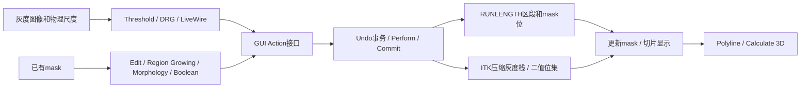

# 分割与掩码编辑：Mimics Research 17.0 模块逆向报告

本文针对用户提供的 Mimics Research 17.0 安装包，结合本地官方 CHM 与原生 x64 DLL/插件的只读静态分析。它记录了实际导出、RTTI、反汇编/反编译与界面的可核查关系；没有运行 Mimics 或启动器，没有加载患者项目，没有安装工具、连接目标网络、修改许可或原始二进制。所有地址是对应文件首选基址 `0x180000000` 下的 VA；运行时若发生 ASLR，应使用 RVA=VA−基址重新定位。

## A00 证据等级、数据模型与模块边界

使用以下三类标签，避免把文档说明或通用图像处理知识写成已恢复源码：

- **已确认·代码**：反编译正文中存在实际分支、循环、位运算或调用，并有导出/RTTI/调用上下文支持；仍不等同于本机实测。
- **已确认·文档**：本包 CHM 明确说明步骤/语义；不能证明本机许可证开放、截图数值是默认，或实现符合某一特定数学算法。
- **强推断 / 未证实**：分别表示证据支持但调用链不完整，或尚未恢复关键实现。主程序受保护处不通过猜测填补。

真实分割后端的重要发现是 `MatImageOperations.dll`。名称相近的 `MatStlMaskOperations.dll` 主要处理三角网格的 scalar/vector/color mask（例如 `MStlMaskOperatorVectorMaskApply`、`MStlMaskOperatorMorphLocal`），**不能把它的“mask”直接等同于医学图像分割体素**。`Mat2DSlices.dll` 具有二维轮廓、切片栈、hatch、boolean、split 操作；仅见这些导出，不能认定其 Split 就是用户界面中的 mask 分离。

代码显示两套可并存的数据路径：

1. 旧式后端以 `RUNLENGTH` / `RUNLENGTH_LINE` 保存切片行区段。代表区段为8字节：16位起点、16位终点、32位 mask 位集合；行对象含区段数及区段指针。阈值、布尔、形态学和普通连通域可在此压缩表示上操作。这里的32位 mask 位与形态学临时槽扫描一致，不能外推为整个产品只能创建32个用户 mask。
2. 插件中还存在 ITK `ImageStack<unsigned short, ImageStackAirCompressionContainer<...>>` 与 `ImageStack<bool, ImageStackBitsetContainer<__int64>>`、单 bit 容器等模板。它们证明灰度栈与二值栈有压缩/位集专用实现；不证明每一个工具都采用相同容器。

GUI 与算法之间通常经 `Mimics::InterfaceFactory` 获取 action 接口，交由 `MMF::Undo::ManagerEx::Perform` 执行。Threshold/DRG 的具体反编译已看到事务、锁、Perform 和 Commit；其他工具的撤销只按文档通用 Ctrl+Z/Ctrl+Y 描述，不冒称逐项实测。只关闭对话框通常不能视作取消之前已提交的编辑。

### 二进制证据清单

| 文件 | 规模/导出 | 本次实际用途 |
|---|---:|---|
| Mimics.Segmentation.plugin | 6,765,056字节；284导出 | Threshold/DRG界面与 action 调度，SmartExpand/CTBone/ThresholdRegionGrow的类及控件 |
| MatImageOperations.dll | IDA 1846函数；导出见全包索引 | 阈值、RLE、Boolean、Grow、Morphology、Edit、Cavity 与自动孔洞填充 |
| MatLiveWire.dll | 4,263,424字节；444导出 | 最短路径树、梯度/拉普拉斯代价图、轮廓控制点/回溯 |
| Mat2DSlices.dll | 1,333,248字节；2266导出 | 切片轮廓数据结构与布尔/分割接口的范围核验 |
| MatStlMaskOperations.dll | 648,704字节；424导出 | 排除三角网格 mask 与体素 mask 的混淆 |
| Mat2D.dll | 459,264字节；365导出 | 二维轮廓/布尔基础层核验 |

哈希、节熵与导入表见 [pe-survey.json](../../../evidence/annotation/pe-survey.json)，补充库 MatImageOperations 的 SHA256 为 `daf1a5af2f1953c0709374cba216641f89d2e471021d2817c2b8e58d0624ce76`。插件的 ITK、MimicsBase、MimicsControls、MatMedicalFramework、Qt5/MFC、VC100、OpenMP 导入与上述分层吻合。各库完整导入导出、带文件偏移的字符串、代码交叉引用和 RTTI 保存在 [annotation证据目录](../../../evidence/annotation/)，完整操作文档证据见 [workflows.md](../workflow/workflows.md)。

上图为对象和动作层的架构示意；尚未逐一追通的GUI动作到具体存储后端连接，不视作运行时已验证调用。

## A01 Thresholding：全局阈值

**用途与输入输出。** 由项目灰度/HU区间生成活动 mask；它是按强度选体素，不判断解剖归属。输入为图像与 Min/Max，输出为新建或覆盖的目标 mask，并保存其阈值信息。

**操作。** 选活动 mask 或 Masks > New；进入 Segmentation > Thresholding；选预设组织或调 Min/Max（数值可双击/微调后 Enter）；三正交视图翻片检查实时着色；Apply 提交。预设值受项目实际灰度范围约束。改变全局阈值会丢失之前针对该 mask 的手工分割编辑，应先保存副本。图中226/1613和教程270 HU等是病例值，不能当通用骨阈值或安装默认。

**已确认·代码。** 插件 `sub_180169990` 在 `0x1801699D3` 调 `CWnd::UpdateData`；`0x180169A7D/0x180169A93` 调 `ImageFns::GetPixelAsGreyvalue`；`0x180169AA6` 校验下限不大于上限；`0x180169AE2` 经工厂取得 action，设置目标与上下阈值，`0x180169B84` BeginTransaction，必要时先创建新 mask，`0x180169D05` Perform，`0x180169D35` Commit。这是可撤销的正式提交路径，而实时颜色预览另有 `IPreviewThreshold` / `VIThresholdActivePreview_deprecated` 类型，不能把预览等同于已写 mask。

后端 `MImageBaseOperatorThreshold<unsigned short>::Operate` 位于 `MatImageOperations.dll!0x180020A00`。`0x180020E2A` 读取16位灰度，`0x180020E40/0x180020E5C` 排除 `<lower` 或 `>upper`，确认端点包含：`lower ≤ I ≤ upper`。它沿行把连续命中体素收集为 `(start,end,maskbits)`，随后 `0x180020FD0` 调 `RUNLENGTH_LINE::MERGE`，而非简单把全体图像逐字节写成另一张原尺寸图。

**边界与未证实。** Lower=0时代码对无存储灰度段有专门处理；压缩灰度空段不应被误认为永远不属于阈值。该导出内核与插件 action 的最后一跳未直接展开，故“此 GUI 在所有条件都固定使用该旧式导出”只属强推断；插件也内含 ITK BinaryThreshold 路径。HU转换具体偏移/斜率未在本节完整恢复。

证据：[提交反编译](../../../evidence/annotation/seg-0x180169990.c)、[阈值内核](../../../evidence/annotation/imageops-0x180020a00.c)；帮助：[Thresholding1.htm](../../../evidence/help/chm/Mimics%20Reference%20Guide/Thresholding1.htm)、[With the thresholding toolbar.htm](../../../evidence/help/chm/Mimics%20Reference%20Guide/With%20the%20thresholding%20toolbar.htm)。

## A02 Advanced Threshold：Keep largest / Fill holes / 预设

**操作与参数。** Thresholding 截图可见 Fill holes、Keep largest；预定义组织管理见 Predefined Thresholds。选择区间及后处理后 Apply；这些不是单独重新定义灰度窗口的显示工具。预览和提交仍依A01。

**已确认·代码。** `CDialogBarThresholdAdvanced` RTTI位于插件 `0x1806256E0`。`sub_18016C530` 先开启名为 `Thresholding` 的事务并调用基本阈值；随后记录 `keep largest`、`fill holes`、`range min/max`、`predefined set`。在 `0x18016CA37–0x18016CAC1` 根据开关创建并 Perform `IKeepLargest` action；`0x18016CAF5` 起经 `sub_18015F570` 创建填孔 action。说明它们是阈值之后的可组合处理，不是调整同一个比较运算符。

**未证实。** “Keep largest”按体素数还是物理体积排序、并列分量如何取舍、连通度选择、填孔是否对所有维度/ROI生效，本次未完整反编相应 action，不能从按钮名硬写。`MatImageOperations` 的自动孔洞填充另有A14，但尚未直接证实它就是该按钮每次调用的唯一内核。完整 CHM 正文没有独立 advanced threshold说明页；本节高级项存在性的依据为截图与代码两类证据。

证据：[高级提交路径](../../../evidence/annotation/seg-0x18016c530.c)、[插件RTTI与字符串](../../../evidence/annotation/Mimics.Segmentation.plugin.anchors.txt)；帮助：[Predefined Thresholds.htm](../../../evidence/help/chm/Mimics%20Reference%20Guide/Predefined%20Thresholds.htm)。

## A03 Region Growing：已有 mask 连通域提取

**用途与操作。** 对已有 source mask 点种子，提取包含种子的连通部分到 target。设 Source/Target；Multiple Layer关为单片、开为3D；选6或26连通；决定 Leave Original Mask；在目标内部左键点击即执行，无独立 Apply。Leave Original Mask开为复制，关为移动，后者会移除源体素。可在 Target累加，Source/Target双箭头用于交换。

**已确认·代码。** `MImageBaseOperatorGrow<unsigned short>::Operate` 位于 `MatImageOperations.dll!0x18000C9D0`；mask生长分支从 `0x18000D22B` 起，把 source/target编号换为bit，按物理像素尺寸/层距把种子转整数索引，限制边界与单层范围，然后调用 `RUNLENGTH::REGION_GROW_PHYSICAL`（导出 `0x18004A680`）。后者以RLE段为单位：找包含种子的段；邻行/邻层查找与当前X区间相接或重叠的段；用可扩容环形队列保存 `(z,y,segment index)`；设置 `targetBits | oldBits & ~sourceBits` 后入队，避免重复处理，并累计命中体素数。邻接扩张量受连接设置影响；这与“原 mask 内连通域”相符，未重新对原灰度做同一轮全局阈值。

**边界。** 错误细桥会使两个解剖部位成为同一个连通域；先 Edit断桥。种子应属于source；种子越界、单层范围不含种子、源目标冲突及临时mask使用有早退路径。6/26是文档确认选项；本次未把所有 EConnectivity枚举数值逐一对应到每一分支。RLE内核和GUI action最后一跳未完整联通，内核机制确认、每种界面设置到内部flag的映射保留为强推断。

证据：[Grow分发](../../../evidence/annotation/imageops-0x18000c9d0.c)、[RLE连通域](../../../evidence/annotation/imageops-0x18004a680.c)；帮助：[Region Growing1.htm](../../../evidence/help/chm/Mimics%20Reference%20Guide/Region%20Growing1.htm)。

## A04 Edit Masks：Draw / Erase 与刷子

**用途与操作。** 编辑活动mask的当前切片。进入 Edit Masks（Ctrl+D/Ctrl+E/Ctrl+T或工具内D/E/T）；选择 Square/Circle/Lasso/Flood-Fill/LiveWire及 Width/Height，Same Width & Height联动；按住左键绘制/擦除。Alt临时切Draw/Erase，Ctrl+左拖改大小，Shift+左键临时导航。右键 Erase full slice清整片。编辑直接改变mask，不等待全局Apply；Close退出工具。

**已确认·代码。** `MImageBaseOperatorEdit<unsigned short>::_Edit` (`MatImageOperations!0x18000A520`) 根据坐标标志调用 `_ConvertPointListToPixelCoordinates`；遇多平面帧有专门分支；必要时申请一bit/体素的已处理标志以免同一操作重复处理。`_DrawMaskLine@0x18000A260` 的 EDrawType分支中，数值2调用 `RUNLENGTH::AddMaskLineLogical`，数值0调用 `ClearMaskLineLogical`；其输入是行起止点和目标mask编号。说明手工填充最终可下降为X向区段增删，而不是网格雕刻。`_DrawInPolyPlane@0x18000A6F0`、`_DrawInPolyPlaneLine@0x18000AD00`的导出证明斜平面/帧路径另有实现，不能只按Axial行坐标理解所有编辑视图。

**边界与未证实。** Lasso、圆/方刷光栅化的精确取整/边界包含、Flood-Fill的Tolerance与Impatience数学定义未反编。文档说明Tolerance越高越需要锐利边界阻止扩张，Impatience控制扩张速度，不能把它们偷换为DRG的HU偏差。刷子显示区域与物理体素之间存在转换，缩放或斜切视图不应直接拿屏幕像素数当物理尺寸。

证据：[_Edit](../../../evidence/annotation/imageops-0x18000a520.c)、[_DrawMaskLine](../../../evidence/annotation/imageops-0x18000a260.c)、[完整导出](../../../evidence/triage/MatImageOperations.dll.symbols.tsv)；帮助：[Edit Masks.htm](../../../evidence/help/chm/Mimics%20Reference%20Guide/Edit%20Masks.htm)。

## A05 Local Threshold：编辑区域内重新判阈

**用途与操作。** 在Edit Masks或Multiple Slice Edit选Threshold，只对刷到/临时选中的区域按灰度区间更新活动mask。三组区间中，中间组继承活动mask原阈值且不可改；自定义区间双击数值，Enter确认。刷到区域内原有但超区间的体素也可被删去，并非只能增加。

**内部证据。** `MImageBaseOperatorThresholdSettings::SetThresholds`、`MImageBaseOperatorProcessMaskedAreaSettings::SetThresholds`、编辑EDrawType和源图/目标mask设置共同证明后端存在区域处理与阈值参数接口；A01内核证明闭区间强度选择的实现。但本次未恢复从Edit的Threshold模式到具体局部判定的完整分支，因此其“只影响选择区”的语义为文档确认，精确算法/阈值端点是否与A01完全一致仍未证实。

**边界。** 它不改变全局数据集阈值，不等同于只改Windowing显示。对局部选区之外的原mask行为需按文档理解；不可直接把A01整图重算路径当局部编辑实现。

帮助：[Edit Masks.htm](../../../evidence/help/chm/Mimics%20Reference%20Guide/Edit%20Masks.htm)、[The multiple slice edit interface.htm](../../../evidence/help/chm/Mimics%20Reference%20Guide/The%20multiple%20slice%20edit%20interface.htm)；代码锚点：[MatImageOperations导出](../../../evidence/triage/MatImageOperations.dll.symbols.tsv)。

## A06 Multiple Slice Edit：临时mask与批量提交

**输入输出与步骤。** 输入活动mask，工具建立临时mask。选择Axial/Coronal/Sagittal方向；Select/Deselect涂临时选区；填Number of slices并用上下箭头复制，必要时到目标层继续改；选择Operation on active mask=Add/Remove/local Threshold；Apply才改变活动mask。临时与活动mask交集为第三色。复制数0表示向该方向所有层，非0会跳到最后复制层；右键可Select full slice。

**代码证据与推断。** `MImageBaseOperatorCopySlice<...>::Operate@0x180008AB0`、`SetNumSlices@0x180008750`、`SetIncreasingDirection@0x180008760`、`SetStartSliceIndex@0x180006C20`、`SetSliceType@0x180008740`提供方向/层数/起点的后端接口；`SliceEditMeasureSettings`同时有mask list、slice image list、frame与transform设置。故“复制临时选区→在原mask执行某操作”的两阶段数据模型与接口吻合。未对 `Operate@0x180008AB0`反编，不能声称已证实零层数或临时mask的所有内部生命周期。

**提交/撤销与边界。** 临时颜色不是已改原mask；Apply是文档明确提交点。Close是否丢弃尚未Apply的选区正文不详，不补造。方向和层数错误可批量影响远多于当前显示层的体素；应逐片检查结果。

帮助：[Multiple slice edit.htm](../../../evidence/help/chm/Mimics%20Reference%20Guide/Multiple%20slice%20edit.htm)、[The multiple slice edit interface.htm](../../../evidence/help/chm/Mimics%20Reference%20Guide/The%20multiple%20slice%20edit%20interface.htm)；锚点：[MatImageOperations导出](../../../evidence/triage/MatImageOperations.dll.symbols.tsv)。

## A07 Interpolation：Multiple Slice Edit内选区插值

**步骤。** 在不同层画临时mask/轮廓，选择Copy to slices方向，按插值按钮，查看中间层，再选Add/Remove/local Threshold并Apply。完成当前插值后再处理另一组选区。

**已确认与未证实。** 文档明确插值作用于临时mask；`GetImageSliceOfMaskSliceInterpolated`与 `EInterpolationMethod`导出仅说明后端另有切片采样映射，不能证明此处是线性、距离场、形状匹配或样条插值。`Mat2DSlices`的Contour/Boolean/Stack接口也不足以唯一归属此工具。**本次未恢复其数学插值公式。**

**易混边界。** View > Interpolated Images仅改善XZ/YZ灰度显示，帮助明确mask不变；它与本模块的分割插值不是同一动作。

帮助：[The multiple slice edit interface.htm](../../../evidence/help/chm/Mimics%20Reference%20Guide/The%20multiple%20slice%20edit%20interface.htm)、[Interpolated images.htm](../../../evidence/help/chm/Mimics%20Reference%20Guide/Interpolated%20images.htm)。

## A08 Dynamic Region Growing：强度条件生长

**用途与操作。** 可直接从原灰度图生长，不要求先全局Threshold。设Target、Fill Cavities、Multiple Layer、Deviation Min/Max，在内部点种子即开始，Ctrl+第二次点击可加入另一种子。Multiple Layer关为单片、开为完整数据集；最后选中种子的HU/GV会显示。结果mask阈值设为所选体素灰度最小/最大值；已有target体素灰度可参与。没有文档说明的独立Apply预览。

**已确认·GUI代码。** 插件 `sub_180170D80` 更新对话框数据，验证种子、坐标系转换后检查ROI bounds（`0x180170F12`越界早退）；创建 `IDynamicRegionGrow` action、开启undo事务，按情形复制mask；`0x180171167`传ROI，`0x1801711EF`传三维种子，`0x1801712FC/0x180171328`传两个偏差值，后续Perform。只有生长成功才按Fill Cavities开关创建填孔action；失败时若刚创建目标则有删除清理分支，最终Commit。不同入口的功能通过接口与参数组合，而非一次无条件填洞。

**已确认·算法。** `MatImageOperations!_DynamicRegionGrow@0x18000DB40`为3D整数坐标队列生长：物理坐标按平面像素间距和层距转索引，申请packed 2-bit visited图，初始化种子；枚举−1..1邻域、按连接/单层条件筛选，边界合法且未访问的候选调用predicate；通过者写target并入环形队列，队列满时扩容。失败候选也置已访问标志，故不是每轮无限重新检查所有像素。

predicate `sub_180003A60`先按当前平面/层范围、层内半径平方和层间距离拒绝候选，再读灰度 `I`。`0x180003EAC`拒绝 `I≤μ−dmin`，末尾要求 `I<μ+dmax`，即严格开区间 `μ−dmin < I < μ+dmax`。accepted回调 `sub_180003F30`通过flag决定是否更新在线均值：`μ'=(n·μ+I)/(n+1)`，并维护计数及最小/最大灰度。该实现实际支持固定种子参考与动态均值参考模式；本次未恢复GUI中哪个选项在每一入口设置该flag，**不把所有模式一概写成每一步都更新均值**。这也解释CHM同时用“平均灰度”公式与“相对种子偏差”的表述为何不能仅凭文字推断完整机制。

**边界。** 低对比组织可通过窄灰度桥泄漏；均值更新模式对增长顺序有潜在依赖，但本次未以病例实测量化。偏差零与严格比较可能导致无增长，不能简单当与A01的闭区间等价。分辨率/层距决定物理范围转换。只有部分路径核查了历史“12-bit”灰度说明，不能把任意输入像素格式硬限制为4095。

证据：[DRG提交](../../../evidence/annotation/seg-0x180170d80.c)、[队列生长](../../../evidence/annotation/imageops-0x18000db40.c)、[接纳谓词](../../../evidence/annotation/imageops-0x180003a60.c)、[均值更新](../../../evidence/annotation/imageops-0x180003f30.c)；帮助：[Dynamic Region Growing.htm](../../../evidence/help/chm/Mimics%20Reference%20Guide/Dynamic%20Region%20Growing.htm)。

## A09 Boolean Operations：Union / Intersection / Minus

**输入与步骤。** 选择Mask A、Mask B、Minus/Intersection/Union及Result，Apply写结果，检查后Close。减法A−B不能交换顺序；Target可新建。它作用于mask集合，不是STL曲面布尔。

**已确认·代码。** `MImageBaseOperatorBoolean<...>::Operate@0x180005910`的op=0/1/2分支分别进入union/intersection/difference helper。三个helper逐RLE段读取32位mask位：

- `sub_180005FB0`：`inA || inB`则置target bit，否则清target；
- `sub_1800061C0`：`inA && inB`；
- `sub_1800063D0`：`inA && !inB`。

每行最后调用 `RUNLENGTH_LINE::FuseAdjacentElements`，合并布尔后相邻同类区段。它对同一区段的其他mask位进行保留和定点改写，不是全局清空全部mask。

**阈值元数据。** 文档和代码均有并集取 `min(lowerA,lowerB), max(upperA,upperB)`，交集取 `max(lowerA,lowerB), min(upperA,upperB)`，减法沿用A。交集的代码若下限大于上限会交换数值，因此阈值元数据不能反推实际集合非空；集合布尔由mask bits决定。结果已有thresholded标志也并非一定被强制重置。

证据：[Boolean分发](../../../evidence/annotation/imageops-0x180005910.c)、[Union](../../../evidence/annotation/imageops-0x180005fb0.c)、[Intersection](../../../evidence/annotation/imageops-0x1800061c0.c)、[Minus](../../../evidence/annotation/imageops-0x1800063d0.c)；帮助：[Boolean Operations.htm](../../../evidence/help/chm/Mimics%20Reference%20Guide/Boolean%20Operations.htm)。

## A10 Erode：形态学腐蚀

**操作。** Segmentation > Morphology Operations，选Source、Erode、Target、Number of pixels、8/26-connectivity，必要时Limited to另一个mask，Apply。输出边界缩小的mask，阈值元数据继承源；小细枝可能完全消失。

**已确认·代码。** `MImageBaseOperatorMorphology<...>::Operate@0x180017050`中op=0，source/target编号转换成bit后于 `0x180017423`调用 `RUNLENGTH::BinaryErodeMaskerPhysical@0x180049E10`；Number of pixels与限制mask被传入；函数保存原连接设置并在结束恢复，复制阈值元数据。8连接开关映射为内部值8，否则26（`0x1800171FB–0x18001720F`）。

**未证实与限制。** 本次未反编 `0x180049E10`全部核循环，故不声称核一定为球/立方体或完全等价于某个开源ITK结构元素。帮助指出Limited to配合Erode可造成与限制mask的交集效应，不应仅按几何ROI裁剪想象。

证据：[形态学分发](../../../evidence/annotation/imageops-0x180017050.c)；帮助：[Morphology Operations.htm](../../../evidence/help/chm/Mimics%20Reference%20Guide/Morphology%20Operations.htm)。

## A11 Dilate：形态学膨胀

**操作/输出。** 同A10，选择Dilate后Apply，增加mask边缘体素；Limited to约束结果范围。Number of pixels为操作尺度；不能把膨胀后几何膨胀量直接认定为所有方向相同的毫米值。

**已确认·代码。** 同一Operate的op=1于 `0x180017389`调用 `RUNLENGTH::BinaryDilateMaskPhysical@0x18004BD50`，该接口另有bit形式 `BinaryDilateMaskerPhysical@0x1800497E0`，和行段层 `RUNLENGTH_LINE::BinaryDilate@0x180041B10/0x1800424A0`。这些是图像mask路径，不是 `MStlMaskOperatorMorphLocal`。

**边界。** 文档8-connectivity为逐平面邻域但遍历整个数据集；26为3D。层间距大于pixel size×Number of pixels时，文档说明跨层效果不能简单按连续球形膨胀解释。确切内核和非等距处理本次未恢复。

证据：[形态学分发](../../../evidence/annotation/imageops-0x180017050.c)、[导出](../../../evidence/triage/MatImageOperations.dll.symbols.tsv)；帮助同A10。

## A12 Open / Close：复合形态学

**Open操作。** 选择Open后设Source/Target、Limited to、像素数、连接度，Apply。用于去除细小突出/细桥时，应检查真实细结构是否也被移除。

**Close操作。** 选择Close，以同样参数Apply；填合小断口时也可能把相邻结构连接。

**已确认·代码。** 分发op=2/3分别调用Open/Close。`RUNLENGTH::BinaryOpenMaskerPhysical@0x18004BC40`明确 `clear temp → erode(source,temp) → dilate(temp,target) → clear temp`，若有Limited to还与其做intersection。`BinaryCloseMaskerPhysical@0x18004BB60`明确 `clear temp → dilate(source,temp) → erode(temp,target) → clear temp`，不是凭通用形态学定义推断。

**资源边界。** 两个复合操作需临时mask位。Operate `0x1800170BB`起扫描32槽并检查保留位，找不到可用编号或编号≥32时于 `0x18001711D` return0；正常完成才清临时mask、恢复连接/限制设置、复制阈值、视需要Optimise RLE。此失败路径是实际代码证据，不能仅以“内存不足”概括所有失败。

证据：[Open](../../../evidence/annotation/imageops-0x18004bc40.c)、[Close](../../../evidence/annotation/imageops-0x18004bb60.c)、[分发与临时槽](../../../evidence/annotation/imageops-0x180017050.c)；帮助同A10。

## A13 Cavity Fill：指定腔体填充

**输入与操作。** 输入包围腔体的Source mask，建议先Duplicate；设Target及Multiple Layer，用桶形光标点腔内部即执行。Multiple Layer决定单片/3D。它处理所点腔体，不应与阈值后“自动填所有孔”混为一谈。

**已确认·代码。** `MImageBaseOperatorGrow::_CavityFill@0x18000E520`把物理种子转体素坐标，依单层/方向设置计算有效范围并截至图像边界，然后调用 `RUNLENGTH::FILL_CAVITY_MASK_PHYSICAL@0x18004D7E0`。进一步的 `FILL_CAVITY_PHYSICAL@0x18004C9B0`先规范化XYZ上下界、验证种子，调用 `RUNLENGTH_LINE::CREATE_SINGLE`形成种子行段，再用动态容器传播行段并更新mask位，具 `bad_alloc`异常与progress接口。不是通过网格封洞后再回体素。

**失败边界。** 种子不在范围内、首段创建失败会return0；开口腔体可向外围泄漏——帮助要求各方向封闭，可先Edit封口。Single-slice“封闭”不证明整个3D空间封闭；应在设定维度检查。源/目标/bit编号的封装调用关系已确认，所有Flood连接判定未逐条恢复。

证据：[_CavityFill](../../../evidence/annotation/imageops-0x18000e520.c)、[底层Fill](../../../evidence/annotation/imageops-0x18004c9b0.c)；帮助：[Cavity Fill.htm](../../../evidence/help/chm/Mimics%20Reference%20Guide/Cavity%20Fill.htm)。

## A14 Fill holes：自动孔洞填充与2D/3D分流

**入口。** Threshold高级选项与DRG的Fill Cavities是本包可见入口，但对应action到本导出的唯一映射尚未确认。勿把所有“fill”视作同一个工具。

**已确认·代码。** `MImageBaseOperatorMaskHoleFilling::Operate@0x18005E090`先检查mask指针；X/Y/Z中任一固定slice索引非−1即转 `_Operate2D@0x18005D320`。3D分支裁定bbox、拒绝空范围，分配packed标志容器，将mask占据/空区编码，枚举边界并传播可达状态，随后回写内部未与外部连通的区段；代表传播helper为 `sub_180015420`，RLE行段写入可在正文后半核查。已确认它具有“边界连通状态区分+内部回填”的实现形态，未把全部bit状态语义恢复为带类型源码。

**边界。** 空mask引用、无体积bbox早退；2D分支不能当3D封腔。ROI若截断腔体，可改变所谓“外部”的定义；这点由bbox参与算法强推断，未动态复现。

证据：[MaskHoleFilling](../../../evidence/annotation/imageops-0x18005e090.c)、[DRG成功后填洞](../../../evidence/annotation/seg-0x180170d80.c)、[高级阈值](../../../evidence/annotation/seg-0x18016c530.c)。

## A15 Cavity Fill from Polylines

**操作。** 选择Source polyline set与Target mask，执行填充。帮助未写确切提交按钮名；不把其他工具的Apply或双击手势移植过来。

**数据流。** 文档确认逐条封闭polyline填为mask。它的边界可经过插值，因此比由原mask直接Cavity Fill得到的结果更大。`Mat2DSlices.dll`的Contour/ContourLayer/Boolean数据结构支持轮廓层存在，但未反编此GUI调用链与光栅化，算法细节未证实。不要把“填轮廓内部”描述成已确认的扫描线奇偶/非零绕数算法。

帮助：[Cavity Fill from Polylines.htm](../../../evidence/help/chm/Mimics%20Reference%20Guide/Cavity%20Fill%20from%20Polylines.htm)；代码接口证据：[Mat2DSlices导出](../../../evidence/annotation/Mat2DSlices.dll.exports.txt)。

## A16 2D LiveWire：边缘吸附与路径树

**输入输出和操作。** 在Edit Masks的Type选LiveWire，当前切片沿边界放控制点，轮廓吸附图像边缘，以当前Draw/Erase/Threshold作用于区域。CHM未给2D LiveWire独立闭合提交手势，因此此处不擅自引用3D工具的双击规则。

**已确认·算法调用。** `MImageOperatorLiveWire2D<unsigned short>::CalculatePathMatrix@MatLiveWire!0x180022080`读取最后种子与参数，调用 `MImageOperatorEdgeDetection2D::Operate@0x1800073A0`，保存 `PathMatrix`、`GradMagnCostImage`、`LaplacianCostImage`。Edge Operate要求输入图非空、梯度混合参数处于[0,1]、复用图region匹配；成功返回E_OK=0，否则1。

`_CalculatePathMatrix@0x180007A30`实际分配访问状态和累计代价图，种子代价0；用24字节项`(double cost,x,y)`组成二叉堆，pop当前最小项并标记完成，枚举3×3邻域，对未完成邻点做更低代价松弛，写入反向 `(dx,dy)` 路径矩阵并push堆。堆helper `0x18001B6D0`、`0x180013AC0`已反编。该证据足以确认**Dijkstra式非负累计代价最短路径树**，不是仅凭工具名猜测。

**具体代价。** 反编译 `0x180007FE3–0x1800080C9`显示，取邻边两端梯度代价均值 `g`、另一代价图均值 `l`，吸引参数 `a`、混合权重 `w`，增量可整理为：

`ΔC = exp(−(1−g)·a) · [(1−w)·l + k·w·g] + ε`

其中正交/对角对应代码中的`k=0.7071067811865476/1.0`，`ε=2.220446049250313e−16`；以 `Cnew=Ccurrent+ΔC`松弛，写回前驱偏移。此处g/l是预处理**代价图**，不能未经恢复就认定g等于原始梯度幅值、或将k改成通用欧氏边长。`_InitImage@0x180007560`串联多ITK filter并复用代价图；RTTI有ZeroCrossingBasedEdgeDetection，但所有预处理归一化公式尚未恢复。

**交互数据流。** `UpdateMovablePoints@0x1800241E0`、`GetPixelPointsBetweenSeeds@0x1800259C0`、`MLiveWireContour2D`保存seed、pixel points、smoothed points、closed flag；鼠标移动可沿已算前驱树回溯，不要求每次移动重新从零计算全图。平滑参数与MatNurbs导入存在，但曲线类型/拟合权重未确证。

**边界。** 弱边界可能吸向别处；图像region、输入空值、参数范围会失败；增大吸引不是任意精度保证。路径受种子与局部代价约束，不含解剖知识标签。

证据：[CalculatePathMatrix](../../../evidence/annotation/livewire-0x180022080.c)、[Dijkstra内核](../../../evidence/annotation/livewire-0x180007a30.c)、[输入检查](../../../evidence/annotation/livewire-0x1800073a0.c)、[代价预处理](../../../evidence/annotation/livewire-0x180007560.c)、[路径取点](../../../evidence/annotation/livewire-0x1800259c0.c)；帮助：[Edit Masks.htm](../../../evidence/help/chm/Mimics%20Reference%20Guide/Edit%20Masks.htm)。

## A17 3D LiveWire：跨方向轮廓约束到mask

**操作。** Segmentation > 3D LiveWire，选Target及Automatic contour方向（如Axial）；在另外两正交视图放点并双击闭合，多层重复；检查自动方向turtle map；拖点或加constraint line修正，设Start/Stop，Segment生成mask。可选生成的mask重开工具继续改控制点。

**参数。** Gradient magnitude 0%偏暗边缘、100%偏亮；Attraction约−3保留小凹陷、约3排除；Apply parameters to all contours决定改当前/全部轮廓。Ctrl+移动可画直线。截图60%/0不是正文声明的通用默认。

**实现等级。** A16确认该包有二维最短路径/种子/轮廓存储后端，适合构成3D工具中每条切片轮廓；但从两方向轮廓到自动方向turtle map、轮廓融合及最终3D mask内核未反编，所以这部分仅文档确认/架构强推断，不能声称3D分割等于对所有体素做一次Dijkstra。线至少与另一条turtle线相交才参与分割，constraint line只修当前层。

帮助：[3D LiveWire.htm](../../../evidence/help/chm/Mimics%20Reference%20Guide/3D%20LiveWire.htm)、[The 3D LiveWire Interface.htm](../../../evidence/help/chm/Mimics%20Reference%20Guide/The%203D%20LiveWire%20Interface.htm)。

## A18 Smart Expand

**步骤和输入。** 用粗略内部Source mask开始：New定义阈值、Clear后在间隔Axial/Sagittal层只画目标内部；进入Smart Expand，选Source/Target、Maximum Expand Distance，Apply，检查后必要时再次Apply，最后可Smooth Mask。源mask不要误画到邻接解剖。

**已确认·文档。** 向外扩展至图像灰度梯度边界，最大扩张距离限制搜索区且越大越慢。教程10 pixels与画每10层、998/1394阈值均是病例示例。不能把Smart Expand改称Smart Fill。

**已确认·二进制。** 插件含`SmartExpandAction` RTTI与`ISmartExpand`、Model/Form/Tool；`sub_18014F750`从延迟算法函数取得结果并创建可撤销mask更新 action。控件 `spinMaximumExpandDistance`，UI信号 `_OnMaximumExpandDistanceSpinBoxChanged(int)` 与 `_OnApply()`，错误串明确包括Wrong maximum expand distance、Source mask is empty、Mimics has no mask、Insufficient memory、Try to reduce the expand distance parameter。插件还含该区间 `FastMorphologyImageFilter` / `SingleDirectionMorphologyImageFilter`特化。

**未证实。** 算法通过boost函数对象延迟执行，未展开到完整主循环；不能仅从梯度停止描述认定它是某种特定level set、随机游走、graph cut或形态学重建。最大距离的所有检查范围/默认值也未确认。空mask和内存限制有直接字符串证据，确切错误触发阈值未实测。

证据：[SmartExpand更新action](../../../evidence/annotation/seg-0x18014f750.c)、[延迟函数封装](../../../evidence/annotation/seg-0x1800a56e0.c)、[控件/失败文本](../../../evidence/annotation/Mimics.Segmentation.plugin.interesting-strings.txt)；帮助：[Smart Expand.htm](../../../evidence/help/chm/Mimics%20Reference%20Guide/Smart%20Expand.htm)、[Launch smart expand.htm](../../../evidence/help/chm/Mimics%20Reference%20Guide/Launch%20smart%20expand.htm)。

## A19 Smooth Mask

**操作与作用。** 选活动mask，Segmentation > Smooth Mask，点击即应用，检查边界后可重复，再Calculate 3D。帮助说明滤除手工分割离群点/伪影并尽量保留重要边界；未列可调参数对话框。

**边界与实现缺口。** 这是体素mask平滑，与Tools > Smoothing三角网格后处理不同。当前外围导出和字符串未唯一定位该工具内核；本次不能把它确定为高斯滤波、median、majority、曲率流或某种组合。重复可改变细枝/小洞，应观察结果而非根据“保边”说明推定解剖尺寸恒定。具体撤销实现未逐项反编。

帮助：[Smooth Mask.htm](../../../evidence/help/chm/Mimics%20Reference%20Guide/Smooth%20Mask.htm)、[Smooth mask2.htm](../../../evidence/help/chm/Mimics%20Reference%20Guide/Smooth%20mask2.htm)。

## A20 Crop Mask

**操作。** 选活动mask，打开Crop Mask，指定ROI，检查范围后执行。删除ROI外mask，保留原灰度图；本地帮助未给确切按钮名与ROI各手势，不能补造Apply/OK。

**接口与未证实。** 脚本插件存在 `CropMask`、`Could not perform CropMask` 和 `ICropMask@Actions@Segmentation` RTTI，证明17.0确有action级接口，非从现代文档引入。具体bbox边界是否包含、斜ROI如何处理、裁剪内核与undo保存形式未恢复。它与Crop Project不同，后者涉及项目图像。

帮助：[Crop Mask.htm](../../../evidence/help/chm/Mimics%20Reference%20Guide/Crop%20Mask.htm)；二进制锚点：[Script插件字符串](../../../evidence/triage/Mimics.Script.plugin.strings.tsv)。

## A21 Calculate Mask from 3D/object

**操作/数据流。** Segmentation toolbar称Calculate Mask from object，正文称Calculate Mask from 3D。选Source 3D object/STL、Target mask，执行并逐片检查。文档确认按项目各切片取网格轮廓再填成mask，输出为项目采样网格上的体素集合。

**实现等级。** Mat2DSlices/Mat2D的轮廓对象、布尔接口与MatStlSlicer类库证明包内具备网格切片基础设施；但本模块未恢复GUI到网格相交/填充的调用链，不能指定三角形与平面求交的退化策略或内部点奇偶判定算法。从mask重建网格再回mask不保证体素完全相同，尤其经历平滑、减面及不同采样尺度后。

帮助：[Calculate mask from 3D.htm](../../../evidence/help/chm/Mimics%20Reference%20Guide/Calculate%20mask%20from%203D.htm)、[Segmentation toolbar.htm](../../../evidence/help/chm/Mimics%20Reference%20Guide/Segmentation%20toolbar.htm)。

## A22 Edit Mask in 3D / Separate 与“Split”边界

**操作。** 进入Edit Mask in 3D，在2D调整ROI，在3D预览用Square/Circle/Lasso做Select/Deselect，必要时Grow保留所点模型、Invert反选、Hide/Show观察，然后Remove删除或Separate移入新mask。选择预览与正式Remove/Separate是两个阶段。ROI只为局部处理/速度，ROI外没显示不代表不存在。

**名称边界。** 本包完整帮助未检出“Split Mask”名称；实际mask分离路径为Region Growing或这里的Separate。Simulation > Split是把已Cut的3D对象分裂，输入是表面对象，不能当本工具。`Mat2DSlices!M2DSliceOperatorSplit`等导出不能推翻此对象类型区分。3D选区命中、表面到体素映射与连通提取内核本次未恢复。

帮助：[Edit Mask in 3D.htm](../../../evidence/help/chm/Mimics%20Reference%20Guide/Edit%20Mask%20in%203D.htm)、[Splitting.htm](../../../evidence/help/chm/Mimics%20Reference%20Guide/Splitting.htm)。

## A23 Calculate Polylines / Update Polylines / 由3D生成轮廓

**操作。** Calculate Polylines中选mask并Calculate，得到高分辨率polyline set；改当前片后Update只更新当前层（Ctrl+U见菜单图）；改全局阈值应重算整个集合。Calculate Polylines from 3D则从3D object/STL按项目切片相交取轮廓。

**数据类型与实现边界。** `Mat2DSlices`有`M2DSliceContour`、`ContourLayer`、`ComponentContours`、`SliceStackOperatorBoolean`、`ScanArea`；它们证实切片、轮廓层和区域是独立对象，不等于RLE mask行。帮助说明轮廓与STL+分割轮廓一致，且回填可能含插值。具体轮廓追踪、亚体素边界定位、marching squares或其他算法本次未验证，不借Marching Cubes的名字替代二维轮廓分析。

帮助：[Calculate Polylines.htm](../../../evidence/help/chm/Mimics%20Reference%20Guide/Calculate%20Polylines.htm)、[Update Polylines.htm](../../../evidence/help/chm/Mimics%20Reference%20Guide/Update%20Polylines.htm)、[Calculate polylines from 3D.htm](../../../evidence/help/chm/Mimics%20Reference%20Guide/Calculate%20polylines%20from%203D.htm)；证据：[Mat2DSlices导出](../../../evidence/annotation/Mat2DSlices.dll.exports.txt)。

## A24 CT Bone Segmentation：实际存在但未完整恢复的专用流程

**已确认·二进制。** `Mimics.Segmentation.plugin`明确含 `CT Bone Segmentation` UI、`CTBone.StateMachine`、MaskThresholdPage、BoneSelectionState、Finish Segmentation；控件/信号涉及Seed Threshold、Desired/Undesired seed、Lower/Upper Threshold、Gap Closing Distance、Fill Long Bones、Apply For All与Finish。脚本插件亦含`CTBoneSegmentationObject`和阈值接口。这证明该供给包有CTBone实现线索，不能因CHM未检出就断言不存在。

**可确认的内部层次。** 存在状态机→种子/阈值页→算法信息→完成分割；该插件同样含 ConnectedThreshold/ConditionalRegionGrow、ThresholdAndKeepLargestPart以及形态学的ITK特化。函数/源路径锚点如 `0x1800A9C20`引用CTBone.StateMachine，`0x1800D1340`引用`CTBone\States\BoneSelectionState_AlgorithmInfo.cpp:615`，`0x1800D34F0`引用LowerThreshold/UpperThreshold。**这些共存不构成已确认完整算法序列**。

**未证实。** 本地562页CHM没有独立CT Bone操作说明，未实机打开；可用菜单路径、许可模块、参数默认/范围、desired与undesired种子的竞争规则、骨桥闭合/长骨填充公式、Apply For All适用对象、撤销粒度均未确认。故不编造用户逐步流程或把CTBone与简单Thresholding合并。实机UI与标准样本结果可用于补证；本次在已记录的只读静态范围内分析。

证据：[插件锚点/RTTI](../../../evidence/annotation/Mimics.Segmentation.plugin.anchors.txt)、[插件字符串](../../../evidence/annotation/Mimics.Segmentation.plugin.interesting-strings.txt)、[脚本插件](../../../evidence/triage/Mimics.Script.plugin.strings.tsv)。

## A25 Smart Fill、专用器官分割与分析范围

| 名称/范围 | 本地证据 | 本次结论边界 |
|---|---|---|
| Smart Fill | 完整帮助未检出；实际有Smart Expand、Cavity Fill | 不建立虚构独立工具、不套新版本同名实现 |
| Threshold Region Growing | 肺部帮助页及插件`ThresholdRegionGrowToolBar`、`IThresholdRegionGrow`、Fill Cavities、In-/Inter-slice Distance控件 | 操作见工作流专业模块；内核未完整恢复，不自动等同普通RG或DRG |
| Airways/Pulmonary | `MatAirwaysSegmentation.dll`、Mimics.Pulmonary.plugin及帮助 | 原生模块实际存在；未展开专用气道/肺叶完整算法 |
| Coronary/Aorta/CTBone | Segmentation插件中实际类/控件与专用过滤器线索 | 类名/ITK模板不等同完整器官分割算法确认 |
| Heart/Cardiac/Stent | MatCardiac、MatCardiacStent及相关帮助/导出 | 未执行/未完成算法核查 |
| 4D mask morphing | 本地帮助有该工具 | 时序配准、运动模型、形变插值未分析 |
| Label | 帮助为可进入STL的实体文字mask | 与Add Text Annotations不同；交互/几何另见测量标注工作流 |

## A26 可复现性、覆盖度与剩余风险

本次得到并落盘了三十余个代表性反编译函数。已真正核查的算法包括：阈值闭区间判定/RLE构建、普通RG的扫描段队列、DRG的2-bit访问状态/队列/强度predicate/可选均值更新、三种Boolean位逻辑、Open/Close实际调用序列、Edit的行段增删、Cavity范围与传播路径、LiveWire的二叉堆最短路径/代价松弛/前驱矩阵。未恢复的工具明确保留为文档确认或接口证据，不用通用算法补齐。

主要限制是主程序受保护、若干GUI action的实现驻留位置尚未连通，以及本次没有执行目标，未检验病例结果/参数默认/线程行为/异常与Undo恢复后的完整数据一致性。这些限制不影响上述函数“包含什么代码”的静态结论，但限制了“某界面在所有输入上必然走某内核”的结论。

复现脚本：[pe_survey.py](../../../notes/annotation/pe_survey.py)、[code_index.py](../../../notes/annotation/code_index.py)。前者只读PE/导入导出/解名/字符串，后者读取`.pdata`定位函数并用Capstone记录RIP引用/调用、RTTI COL/vtable；反编译保存在`evidence/annotation/{seg,imageops,livewire}-0x....json`及`.c`。所有原样本保持只读，IDA仅对本工作区副本建库，已保存并关闭独立会话。检查记录见 [journal.md](../../../notes/annotation/journal.md)。
