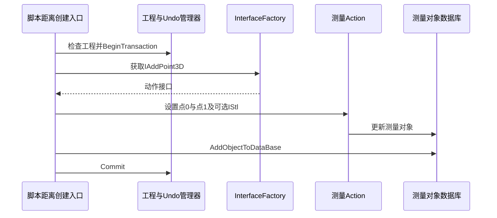

# 测量、文字标注与对象事务

分析对象为本地 Mimics Research 17.0.0.435。这里的“标注”分为两种数据：分割 Mask 决定组织成员关系；Measurement / Annotation 保存几何量或文字。两者不应混为同一标签层。本章操作依据随包帮助，代码依据 Mimics.Script.plugin 与 MimicsBase.dll 的静态反编译；未实际运行软件界面。

证据分级：**D**＝本地帮助直接描述；**B**＝本地二进制符号或反编译直接支持，分别说明是哪一种；**I**＝可实现同类功能的合理算法解释，尚未证实是本版本的精确实现。下列数学式如标 I，不表示已经恢复原始源代码。

## M01 文字标注 Add Text Annotations

**输入与输出。** 输入为二维图像或三维对象上的附着位置、文字及样式；输出为独立 Annotation 对象，包含 Name、Visible、Object、Text。它不会直接增加或删除 Mask 像素。[D：Add Text Annotations、Annotation]

**用户流程。** 激活标注工具 → 在二维/三维结构上左键点选 → Annotation Properties 弹窗填写 Text，设置 Arrow Style、Text Rotation、Text alignment → 完成后显示引线和文字。长文字在视图中显示省略号，悬停显示全文，双击可编辑。右键可 Delete、Hide、Properties、Annotation List；项目列表还有 Duplicate 和 Locate，Locate 会把视图定位到标注处。

**实现解释。** 工具至少需要保留“附着对象引用＋空间位置＋文本＋显示样式”，再由视图将空间锚点投影到屏幕、绘制引线和标签。[I] 帮助直接证明 Object 关联存在，但没有证明内部存储的是世界坐标、三角形重心坐标还是其他锚定方式；对象变形或被删除时的自动跟随规则也未确认。不能据此写成“文字烘焙进 CT 像素”。

**边界。** 隐藏文字与删除文字是不同操作；调整颜色或文字不会改变组织分割。截图上能见到文字不等于 STL 导出包含文字。来源：[文字标注](../../../evidence/help/text/Mimics%20Reference%20Guide/Add%20Text%20Annotations.txt)、[标注列表](../../../evidence/help/text/Mimics%20Reference%20Guide/Annotation.txt)。

## M02 直线距离 Measure Distance

**操作。** Measurements > Measure Distance 或测量工具栏 → 第一次左键设端点 → 移动鼠标显示长度预览 → 第二次左键固定另一个端点；拖动任一端点细调。结果单位 mm；右键可删除、隐藏、进入 Measurements 列表。[D]

**数据与数学。** 两个空间点 p、q 定义距离，等价实现为 `d = sqrt((px-qx)^2+(py-qy)^2+(pz-qz)^2)`。[I：公式；D：两点结构、mm] 三维模型上点选还涉及命中对象引用；二维视图中应先把显示坐标转换为图像/物理坐标，不能直接以屏幕像素距离作为 mm。实际拾取和欧氏距离求值函数在本次未恢复。

**真正恢复的创建路径。** `Mimics.Script.plugin!sub_18004A9A0` 把 `CreateDistanceMeasurement` 绑定到 `sub_180049440`。后者检查工程已加载，开启名为 `Create Distance 3D` 的 Undo transaction，创建测量包装对象，分别以索引 0 和 1 调用 `sub_18003D220` 加入端点，把对象加入数据库后 Commit。[B：反编译]

`sub_18003D220` 从 InterfaceFactory 获得 `Mimics::Measurements::Actions::IAddPoint3D`，校验 Measurement 对象，解析可选 `IStl`，把三个 double 坐标转换为 float，设置点坐标、点序号和关联对象，然后执行 Action。该证据确证这一脚本入口的坐标转换与对象操作，不代表整条软件计算链都只用 float。

**编辑路径。** `sub_18003D500` 对 MovePoint 进行工程校验、坐标转换、对象关联，然后走 `IDocument::GetUndoManagerEx → ManagerEx::Perform`；失败抛出明确的 Cannot move point 错误。因此端点编辑具有对象级操作封装，而非仅修改一行显示文本。[B]

**边界。** 点在不同切片或不同三维对象上时，要识别三维实际位置；二维投影看似重合不等于真实距离为零。脚本入口证据不等价于已经追通所有鼠标事件。来源：[帮助](../../../evidence/help/text/Mimics%20Reference%20Guide/Measure%20distance.txt)、[创建函数](../../../evidence/ida/script-0x180049440.json)、[加点](../../../evidence/ida/script-0x18003d220.json)、[移动点](../../../evidence/ida/script-0x18003d500.json)。

## M03 角度 Measure Angle

**操作。** Measurements > Measure Angle → 连续左键点三个点 → 显示度数；拖动中心点或两端点调整。适用 CT 图像、alignment image 和三维模型。[D]

**实现解释。** 保存三点及对应对象/视图上下文，形成两条从角顶点出发的向量，利用点积或叉积求夹角，再转为 degrees。[I] 例如 `atan2(|u×v|,u·v)` 是可行实现，未确认 Mimics 用 atan2 还是 acos；不能将此式当作其原函数。帮助的 Matlab 对象结构明确 `Mimics.Measurements.Angle` 用三行三维点；脚本插件也含 MeasurementAngleObject / Measurement2dAngleObject / CreateAngleMeasurement 字符串。[D+B：符号]

**边界。** 两个点重合会出现零长度向量；三个点、四点定义两条线的模板角度不是同一工具。拖动改变输入点，应重新求量值。来源：[帮助](../../../evidence/help/text/Mimics%20Reference%20Guide/Measure%20angle.txt)、[脚本符号](../../../evidence/triage/Mimics.Script.plugin.strings.tsv)。

## M04 三点直径 Measure Diameter

**操作。** Measurements > Measure Diameter → 沿目标轮廓左键选三点 → 显示 mm 直径；拖动任意一点调整，支持 CT 与三维对象。[D]

**实现解释。** 三个非共线点在其平面内确定圆，输出两倍半径；可用 `D = abc/(2Δ)`，其中 a、b、c 是三边长、Δ 为三角形面积。[I] 这不是对整个轮廓做自动最佳拟合圆，也不是“点两个端点量最大径”。插件中区分 Measurement2dDiameterObject 和 Measurement3dDiameterObject。[B：字符串]

**边界。** 三点近共线时半径病态放大；三维曲面上的点不一定反映真实横截面。来源：[帮助](../../../evidence/help/text/Mimics%20Reference%20Guide/Measure%20diameter.txt)。

## M05 椭圆 Measure Ellipse

**操作。** Measurements > Measure Ellipse → 两次点击确定长轴两端 → 移动鼠标设置短轴；可拖长短轴端点缩放，拖角旋转，拖中心平移，标签位置可单独拖动。帮助明确此工具没有 context menu；不要套用其他测量工具的右键操作。[D]

**输出。** D1 最大径、D2 最小径、E ellipticity、P 周长、A 面积、DP 周长等效圆直径、DA 面积等效圆直径。A 与长度单位分别为 mm²、mm。[D]

**实现解释。** 保存中心、平面/方向、长短半轴 `a,b`；`A=πab`、`DP=P/π`、`DA=2sqrt(A/π)` 是与帮助定义相符的数学等价表达。[I] 椭圆周长一般需数值积分或近似，具体公式未恢复。E 经核查源帮助公式图片，精确为 `E=sqrt((R1²−R2²)/R1²)`，R1最大半径、R2最小半径。[D：公式定义；二进制求值实现未核查] 圆的E为0，短轴趋近0时E趋近1。

**边界。** 椭圆是人工设定几何对象，不自动保证贴合病灶边缘；二维斜切面上长短轴需按该平面物理尺度计算。来源：[帮助](../../../evidence/help/text/Mimics%20Reference%20Guide/Measure%20Ellipse.txt)、[原公式图](../../../evidence/help/chm/Resources/Images/Measure%20ellipse/03000001.png)、[核查记录](../../../notes/help/ellipse-formula-check.md)。

## M06 多边形面积 Measure Area

**操作。** Measurements > Measure Area → 在单一二维切片上逐点绘制闭合多边形，双击闭合 → 即时显示测量并加入 Measurements。拖动控制点即重算，右键控制点可增删点；支持常规切片及重切 MPR 视图。[D]

**输出。** Area、Perimeter、Da、Dp、Centroid、Lmax，以及与 Lmax 垂直且通过质心的长度 L。[D] 这是闭合二维 ROI，不是体积轮廓，也不是涂抹 Mask。

**实现解释。** 在物理平面中以鞋带公式计算多边形有向面积、逐边长度求周长、面积加权求质心，再计算穿过质心的方向截距；Da、Dp 分别从等面积圆、等周长圆反解直径。[I] Lmax 的方向搜索策略、自交多边形处理规则及像素边界取舍未确认。

**边界。** 自交、未闭合、点重复、斜面采样与物理尺度都会影响结果；不要用包围盒面积替代该轮廓面积。来源：[帮助](../../../evidence/help/text/Mimics%20Reference%20Guide/Measure%20Area.txt)。

## M07 矩形密度 Measure Density in Rectangle

**操作。** 本地帮助给出的入口为 Tools > Measure Density in Rectangle → 点击放置或左键拖动设置矩形 → 松开鼠标显示面积、平均密度与标准差；拖边/角调整大小，拖黄色边框平移；翻切片时数值更新。右键 Delete / Hide / Measurements List。[D：Tools为该旧页记载；Measurements toolbar也提供密度入口，未动态校验菜单位置]

**实现解释。** 把 ROI 投到当前切片 → 枚举被包含像素 → 使用当前 GV 或 HU 标度 → 计算计数、和、平方偏差与面积。[I] 对 N 个采样点，均值为 `ΣI/N`；标准差用 N 还是 N−1、边界像素是否部分加权，均未查证。帮助支持“HU 或 Gray Values”，因此 MRI 灰度不能无条件称作 HU。

**边界。** 滚轮换层会改变采样数据；矩形仍显示不表示沿用上一层结果。窗宽窗位是显示映射，不应直接拿屏幕亮度作原始灰度统计。来源：[帮助](../../../evidence/help/text/Mimics%20Reference%20Guide/Measure%20density%20in%20rectangle.txt)。

## M08 椭圆密度 Measure Density in Ellipse

**操作。** Tools > Measure Density in Ellipse → 放置或拖出椭圆 → 松开显示统计；拖四个标记改变形状，拖非标记黄色边界移动，翻层更新。[D：Tools为该旧页记载，另有Measurements toolbar入口]

**实现解释。** 与 M07 共享 ROI 统计问题，但成员判定变成椭圆内部，如局部坐标满足 `(x/a)^2+(y/b)^2≤1`。[I] 与 M05 的椭圆几何测量不同：本工具主要查询图像强度分布，不只报告椭圆长短轴。

**边界。** 组织混合、部分容积及 ROI 超出有效图像时的处理未恢复。来源：[帮助](../../../evidence/help/text/Mimics%20Reference%20Guide/Measure%20density%20in%20ellipse.txt)。

## M09 曲面最短距离 Measure Distance Over the Surface

**操作。** Measurements > Measure Distance Over the Surface → 在三维表面指示若干路径点 → 显示 mm；拖点调整，在端点上右键显示菜单。[D]

**实现解释。** 输入是表面网格及约束点，求受表面约束的路径长度，而非端点欧氏直线。可以用网格图最短路或连续曲面测地线算法实现，但本次未确认使用哪种，不能直接声称 Dijkstra、Fast Marching 或精确测地线。[I]

**二进制支持。** 脚本插件存在 Measurement3dDistanceOverSurfaceObject、GetValue、MovePoint 与“传入正确 STL 对象”的错误文本，支持其对三维表面对象的依赖。[B：字符串；未反编核心寻路器]

**边界。** 用户指示多个点会约束所沿路线；不能将结果表述为完全无约束的两点全局最短路径。网格孔洞、连通性与粗化可能改变可行路线。来源：[帮助](../../../evidence/help/text/Mimics%20Reference%20Guide/Shortest%20distance%20over%20surface.txt)。

## M10 分割面积导出 2D Mask Area

**操作。** 在工具窗选 Mask → 选视图 Images → 选所有切片、当前切片或指定 Range → 设 Filename / Path → 输出每层 Mask 面积文本。[D]

**实现解释。** 输入已有 Mask，而非重新画多边形；在所选视图平面统计属于该 Mask 的成员面积。[I] 规则正交采样下可近似/等价写成“成员像素数 × 单像素物理面积”，对重切视图如何插值和计边界尚未证实。

**边界。** 面积随视图、层范围改变；不应把单层面积直接当体积。来源：[帮助](../../../evidence/help/text/Mimics%20Reference%20Guide/2D%20Mask%20Area.txt)。

## M11 Mask 属性与体积

**操作。** 项目 Masks 列表选择对象 → Properties；查看下/上阈值、最小/最大/平均灰度、标准差、Number of pixels、Mask volume、GV/HU 标度。[D]

**实现证据。** 脚本 `Mask` 的注册函数 `sub_180032200` 明确注册 GetLowerThreshold、GetHigherThreshold、GetVolume。GetVolume 包装器 `sub_180032580` 将 IObject 转为 IMaskWrapper，调用其虚表偏移 `+0x130`。这证明体积是对象接口结果；不能从此包装器反推出内部计数代码。[B：反编译]

**算法解释。** 等间距轴对齐体素下，Mask 体积通常为 `N·sx·sy·sz`；非均匀采样、重采样与边界定义需要另行处理。[I] 体素 Mask 体积与平滑后封闭三角网格积分体积可能不同；Measure and Analyse 的点集体积又是第三种对象。

**边界。** Mask Clear 会清空成员但保留阈值；因此“阈值属性还在”不表示 Mask 仍包含组织。来源：[帮助](../../../evidence/help/text/Mimics%20Reference%20Guide/Masks.txt)、[GetVolume 包装器](../../../evidence/ida/script-0x180032580.json)。

## M12 地标与模板 Measure and Analyse

**操作。** Simulation > Measure and Analyze；在 Overview 创建或复制模板，先定义 Points，再用已有点/平面定义 Planes，最后配置 Measurements。选择模板后 Indicate 放点，Locate 联动视图，Edit 修改坐标/颜色，Clear 清除点。默认模板不能直接编辑或删除，需要先 Copy。[D]

**输入输出与依赖。** 支持两点距离、点到平面距离、三点角、两条线的角度；至少四点可产生凸几何并计算体积。该体积来自模板地标构造，不等于原始 Mask 体积。[D] 技术上可组织为 `点 → 平面/线 → 测量表达式` 的依赖图：移动上游点后，相关派生对象失效并重算。[I：具体增量更新实现未恢复]

**边界。** 需要先定义依赖对象；未指示的点与已指示点在列表中颜色不同。模板名、点名、导出字段和坐标单位需要保持一致。来源：[帮助](../../../evidence/help/text/Mimics%20Reference%20Guide/Measure%20and%20Analyse.txt)、[Matlab 数据契约](../../../evidence/help/text/Mimics%20Reference%20Guide/Object%20structures.txt)。

## M13 中心线测量

中心线相关测量属于 Analysis Module；操作从已有中心线与分支出发，按控制点、横截面或区段计算，详细工作流见本报告工作流与重建模块。[D]

帮助的导出结构直接列出 BranchSets、BranchSegments、控制点坐标、切线，以及 Dfit、Dmin、Dmax、Curvature、Dh、Xh、Scf、Area 等结果字段。它是带分支拓扑和截面指标的对象，不只是一条屏幕折线。帮助还声明此 Matlab 接口不支持导入 Centerlines。[D]

不能根据 `MatCenterline3D.dll` 文件名断定内部使用骨架细化、Voronoi 或最短路径中的某一个；本轮未完整恢复中心线算法。来源：[菜单](../../../evidence/help/text/Mimics%20Reference%20Guide/Measurements%20Menu.txt)、[结构](../../../evidence/help/text/Mimics%20Reference%20Guide/Object%20structures.txt)。

## M14 Undo、对象提交与数值显示

**操作。** Edit > Undo 撤销最后动作，菜单会显示动作类型；Show Undo List 将最新动作排在最上方。[D] 多个内部步骤是否合并为一个撤销项，要看工具如何组织事务，不能笼统说“每次鼠标移动都是一条Undo”。

**直接证据。** `MimicsBase.dll!MMF::Undo::ManagerEx::Perform`，VA `0x1800C9D90`，检查 MOperationWrapper、构造 MMF::IAction 包装后调用 Perform。`MatMedicalFramework.dll` 导出 `BeginTransaction@0x18002DCD0`、`Commit@0x180030DD0`、`Rollback@0x180030E20`。距离创建函数确实在同一事务中加入两端点与数据库对象后提交，单点移动则走 ManagerEx。这足以支撑“命令/动作＋事务式撤销”架构，尚不足以断言其全部存储策略是整对象快照或体素差分。[B]

**显示不等于精度。** `MimicsBase.dll!IMeasurement::GetValueString`，VA `0x1800C93D0`，先调用虚函数取值；遇 `DBL_MAX` 哨兵显示 `n/a`，否则以 `%.2f` 转为字符串。这是这一基础实现的默认格式，不能推导为所有测量仅精确到 0.01 mm，也不能说所有派生测量必定沿用此显示函数。[B]

证据：[动作包装](../../../evidence/ida/base-0x1800c9d90.json)、[值格式化](../../../evidence/ida/base-0x1800c93d0.json)、[框架导出](../../../evidence/triage/MatMedicalFramework.dll.symbols.tsv)。

图只表达已反编译的脚本创建路径；UI 的鼠标事件连接采用帮助文档解释，未伪装为已追踪的运行时调用。
