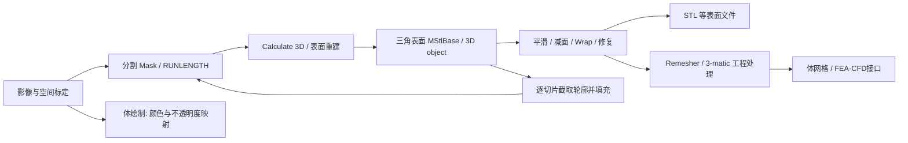
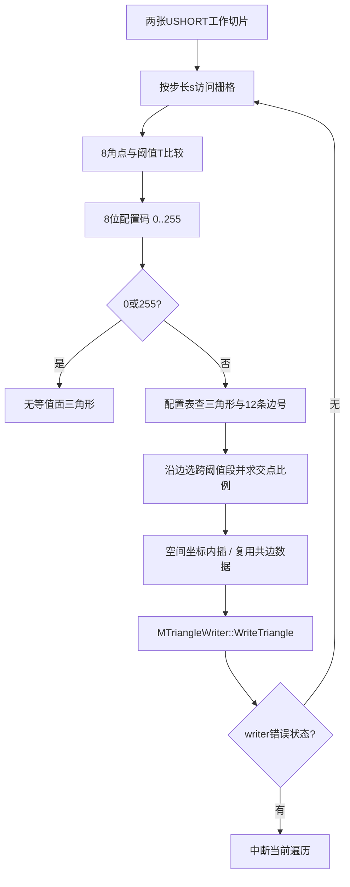

# 三维重建、表面处理与网格接口逆向报告

## RC-R00　结论范围与证据规则

分析对象是本地 `Mimics Research 17.0` 目录中的 x64 PE DLL。原目录只读；没有运行 Mimics、启动器、计算引擎或未知 DLL，没有安装软件，没有接触许可逻辑。为建立 IDA 数据库，仅复制了四个 DLL 到案件工作区。本文将帮助文档的用户操作与原生二进制的实现分别说明，不把函数名字当作已经验证的完整算法。

证据强度约定：**D**＝随附 CHM 明文/说明图；**B2**＝已读关键函数指令或完整反编译及其数据；**B1**＝PE 导入导出、类型/符号和依赖；**I**＝据上述材料作出的推断；**U**＝未验证。D 不代表操作已在本机执行，B2 不代表主程序一定通过该入口调用。`Mimics.exe` 受保护，本文未把 Calculate 3D 对话框到 DLL 的整条 UI 调用链宣称为已追通。

所有地址均为对应 DLL 的**首选 VA**，本批 DLL 的首选基址都是 `0x180000000`；RVA＝VA−基址。它们不能直接当成实际进程中的 ASLR 地址。源码式函数名来自真实 C++ 导出和反编译，并非获得了厂商源代码。

|证据|位置（相对案件根目录）|内容|
|---|---|---|
|E-RC01|`evidence/reconstruction/inventory.json`|18 个 DLL 的 SHA-256、架构、基址、导出数量、导入模块|
|E-RC02|`evidence/reconstruction/<DLL名>.json`、`*-exports.tsv`|完整导入、节熵、原始/解名导出及 VA/RVA|
|E-RC03|`evidence/reconstruction/decompiled/MC-*.c`|Marching Cubes、Wrap、三角形写出全文|
|E-RC04|`evidence/reconstruction/decompiled/IMG-*.c`|影像/Mask 到 STL 的上层调用与不同分支全文|
|E-RC05|`evidence/reconstruction/decompiled/OPS-*.c`|平滑、补偿、减面、修复全文|
|E-RC06|`evidence/reconstruction/decompiled/IO-*.c`|STL 多格式读写分派全文|
|E-RC07|`evidence/reconstruction/disassembly/*.asm`|由原 DLL 字节独立生成的 Capstone 反汇编|
|E-RC08|`evidence/reconstruction/marching-cubes-table.json`|256 项真实配置表、每项边号和三角形数|
|E-RC09|`notes/reconstruction/inventory.py`、`static_evidence.py`|可复现静态提取脚本|
|E-RC10|`notes/reconstruction/journal.md`|阶段记录、工具限制、验证和未完成项|
|H-RC|`evidence/help/text/Mimics Reference Guide/*.txt`|本机 CHM 提取的对应帮助页；原 HTML/图片在 `evidence/help/chm/`|

重点 DLL 导出数：`MatStlMarchingCubes` 660、`MatStlOperations` 6905、`MatMesh` 2144、`MatOperationsStlImages` 173、`MatStlSlicer` 5645、`MatStl` 479。大量导出是容器模板、构造/析构、赋值、同地址别名，不能把数量解释为用户工具数量。`MatSDK.Triangles.DataWrappers.dll` 没有 PE 导出，也不表示没有功能。

## RC-R01　先区分 Mask、3D/Part、STL、体网格和体绘制

Mask 是与项目影像栅格对应的分割标签；3D object/Part 是经重建得到的表面实体；STL 是三角面文件/表面对象语境；FEA volume mesh 才是用于体计算的单元网格。`Calculate mask from 3D.txt` 明确把表面逐切片取轮廓后填成 Mask；`STL STL VRML Parameters.txt` 明确 STL/VRML 接口在所选体积周围生成三角网格。它们不是同一种存储对象。

二进制也有相应层次：影像路径使用 `RUNLENGTH`、`IMAGE<unsigned short>`；表面路径使用 `MStlBase/MStlPoint/MStlTriangle/MStlSurface`；工程网格路径使用 `MMeshBase` 及 tet/element 导入导出操作。注意 `MDataMask<MStlPoint,...>`、triangle scalar/color mask 是**网格属性容器**，不能因为名字中有 Mask 就认作分割 Mask。`MatStlMaskOperations.dll` 的大部分接口处理的正是此类属性掩码。（D+B1，高）

这是数据关系图，不意味着所有箭头都已由主程序的同一执行轨迹验证。尤其体绘制没有自动变成可导出的表面，见 RC-R11。

## RC-R02　Calculate 3D 与质量/自定义参数

**用途、输入、输出。** 输入为一个或多个已分割 Mask，以及像素间距、切片位置和计算设置；输出为列在 3D Objects 中的三角表面。Mask 的可见性、表面透明度、轮廓显示和三角边显示是显示设置，并不等同于几何重算。（`Calculate 3D.txt`、`Calculating a 3D.txt`、`3D objects.txt`，D，高）

**用户顺序。** 在 Masks 页、Segmentation 菜单或工具条点 Calculate 3D；在列表的 Selected 列标记需要的 Mask；选择质量；若用 Custom，进入 Options 修改参数，OK 返回后再点 Calculate。帮助中肝脏示例明确是“Custom→Options→勾 triangle reduction/smoothing→OK→Calculate”。帮助没有给出足够证据证明该对话框具有实时几何预览，因此不能把眼镜图标、显示切换或选中模型视作计算预览。（D，高；实时预览 U）

**High 与 Optimal 的重要区别。** `Quality.txt` 说明：Low/Medium 为缩短时间使用 matrix reduction，会影响尺寸；High **仍在 XY 平面做矩阵缩减**，某些情况下视觉上更平滑；Optimal 给出最准确的重建；Custom 才允许自行选择计算参数。推荐项旁的星号表示按计算机推荐，不是几何质量认证。Calculate 3D 原说明图和 `3D objects.txt` 的质量列表为 Low/Medium/High/Optimal/Custom。另一个独立的 STL+ 参数页列 Low/Medium/High/**Maximum**/Custom：这是两个对话框的命名，本文不主张 Maximum 与 Optimal 的每个数值参数逐项等价，也没有从 DLL 恢复整张预设常数表。（D，高；预设数值 U）

以下是 Calculate 3D 与 STL+ 等相关参数页的对照解释；Calculate 3D 的本地操作例明确确认 Custom 下的 smoothing / triangle reduction。其余详细项主要来自 STL+ 参数页，**不据此宣称这些控件全部同时出现在 Calculate 3D 对话框**。

|参数组|相关参数页定义的控制含义|精度/失败边界|
|---|---|---|
|Method：Contour / Grey value interpolation|帮助称前者在图像平面内插值再向第三维扩展，后者做三维灰度插值|帮助推荐医学 CT 用 contour、技术 CT 用 grey；这是本版本帮助建议，不能推出所有医学数据都必须如此|
|Slices / first-last position|限定参加重建的切片区间，Reset 恢复全范围|截断目标会改变几何范围|
|XY / Z matrix reduction|按栅格尺度分组/重采样，减少计算数据|帮助指出过度缩减会损失细小结构；grey 分支可能出现人造孔，contour 分支可能看起来平滑但尺寸偏大|
|Smoothing iterations / factor / compensate shrinkage|几何平滑次数、局部几何权重和收缩补偿|高 factor 时帮助建议少迭代；体积接近不等于每个局部尺寸不变|
|Triangle reduction mode / tolerance / angle / iterations / buffer|后续减少表面三角形和控制保留细节|与影像矩阵缩减是不同阶段；不能通过加大 tolerance 无损地无限减面|
|Shell reduction|帮助建议清除很小的壳层，属于重建后清理语境|示例数值 1 是特定教程建议，不是所有项目默认值|

这些详细语义见 `STL STL VRML Parameters.txt` 和 `Remesh.txt`。缩放参数在 STL+ 页被定义为**导出时缩放**，不应直接套成 Calculate 3D 默认行为。

**真实内核数据流。** `MatOperationsStlImages.dll!MImageBaseOperatorToStl<unsigned short>::_Operate`，VA `0x180002630`，实读 14,292 字符反编译：

1. 清写出状态并 `_FindBoundingBox`；只有相应成功状态、范围至少三张切片时进入该路径。此条件是此函数的分支条件，不是全部 Mimics 重建入口的普遍限制。
2. 构造 `MMarchingCubes`，设置 writer、阈值/编码、XY 步长和空间间距；源数据有特定分支使用 2048、32000 等中间编码，不能把这些值说成 HU 临床阈值。
3. `_MakeImage` 生成第一张工作图；循环中交换两个图像缓冲，制作下一张，并在 `0x180002B48` **直接调用** `MMarchingCubes::TwoImagesToStl`。
4. 向 writer 通知切片进度；有写出错误时记录错误状态、退出。即使循环执行完成，如果三角形计数为零，还会检查 `RUNLENGTH::IsMaskEmpty` 等情况，而非一律成功。

该函数把设置结构 `+296` 的值 1 映射到 MC 插值 mode 0、值 2 映射到 mode 1；**尚未将这组内部枚举与两个 UI 文本完整交叉映射**。还存在 `MImageBaseOperatorToStlMM<unsigned short>::_Operate`（`0x1800062D0`）与 `MUserOperatorSurfaceMeshFromMask::Operate`（`0x1800135B0`）等独立路径，因此不能把旧的两图像函数说成所有 non-manifold/多材料重建唯一算法。（B2，高；主程序 UI 入口 U）

## RC-R03　Marching Cubes：已经读到的真实实现

**关键函数与证据。** `MatStlMarchingCubes.dll!MMarchingCubes::TwoImagesToStl` VA `0x180017330`、RVA `0x17330`、函数体大小 `0x613`；全文 12,479 字符，另有原字节反汇编。符号原型是两个 `IMAGE<unsigned short>*`、一个 `unsigned long` 与六个 `float`。反编译把两个浮点形参错误显示为 `int`，本文优先采用真实导出原型和浮点指令，不把反编译类型错误当设计事实。

**A. 采样。** `_ReductionSamplingSize` 在 `0x180017320` 直接实现 `(N−1)/s+1`（整数除法）。`TwoImagesToStl` 对图像两个维度采用同样公式。`SetThresholdParameters` 在 `0x180017260` 将阈值放到对象 `+8`、步长放到 `+16`，把物理间距乘以步长缓存于 `+28/+32`；还依据对象 `+44` 的标志翻转一个方向。`SetMarchingCubesInterpolationMethod`（`0x180017240`）写对象 `+52`。这些小 setter 给较大函数中的字段提供了锚点。（B2，高）

**B. 阈值编码与配置复用。** 遍历到相邻 cube 时，代码用 `(旧码 >> 1) & 0x55` 保留共享侧角点，再根据四个新的 unsigned-short 样本是否 `>=T` 设置 `2/8/0x20/0x80` 位；0 和 255 跳过产面。共边插值结果也在相邻格间复制复用。由此可确证是“阈值比较→8位 case→查表→三角形写出”，并非仅依据 DLL 文件名猜测。

**C. 配置表。** 原 DLL RVA `0x142A20` 的 `CubeConfigFull::m_tabel` 为 256 项，步长 19 字节：首字节为三角形数，随后是每三角形三条边的 **1-based** 编号。真实表解析后的分布为：0 三角形 2 项、1 三角形 16 项、2 三角形 50 项、3 三角形 80 项、4 三角形 76 项、5 三角形 32 项；最大为 5。case 0、255 都为 0。`sub_180002310`（`0x180002310`）按 `19*case` 定位表，边号减 1 后调用坐标转换，按反向顶点索引写三个点，再调用 writer 虚函数。表和函数彼此印证。（B2，高）

**D. 内插确实存在两个分支。** `sub_1800011F0` 按边 0..11 分派到 XY/Z 方向求交函数。XY 函数 `sub_180002400`、`sub_1800025C0` 会读取缩减边上原始采样序列，寻找与起点内外方向一致的跨阈值段；若存在多段，保留该方向上灰度变化最大的段，再进入通用内插。它不是简单地只拿缩减后两个端点做平均。

通用函数 `sub_1800013C0` 在内部 mode=0 时可还原为：

`u = p0 + (T−v0)*(p1−p0)/(v1−v0)`，随后限制到 `[0,1]`。

mode=1 时会调用 `sub_180002880` 获取局部平面邻域的统计上下界，按相对边界距离的 0.1 判断修改比例；局部范围小于约 `1.1920929e−7` 时返回 0.5。该通用函数有 Hex-Rays “local variable allocation failed”警告，因此**只把用指令复核清楚的分支/常数及外层数据流列为确证，不把它的整个伪 C 直接当可编译源代码**。mode=0 的阈值线性分支在独立 Capstone 反汇编中可直接复核。（B2；复杂 mode=1 的完整数学模型仍部分 U）

还有一个容易遗漏的实现细节：方向求交函数返回前再次用 DLL 中的 float 常数限制到约 **0.001..0.999**（RVA `0x1C7700/0x1C7704` 实读值为 `0.001000000047...` 和 `0.999000012875...`）。所以内部交点不会严格落在边端点。这是该路径的数值实现特征，不能由普通教科书 MC 公式代替。（B2，高）

**E. 坐标、结果与失败。** `sub_180001610` 对选中边执行 `(1−u)*坐标0+u*坐标1`，同时考虑两个切片的端点坐标。函数末尾返回的是 writer 的三角形计数，**不是完整成功布尔值**；中途 writer 失败也可以带着已写入的计数返回，上层另查错误状态。源码级公式中的 `s=0`、非法图像大小等在此局部函数内没有全面防御；本次未运行异常输入，不据此主张 UI 可触发崩溃或构成漏洞。扫描分辨率、切片间距、阈值、缩减和边界裁剪的误差会进入表面，后续变漂亮并不消除这些误差。（前半 B2；误差传递 I）

## RC-R04　Smoothing：邻域位移、体积补偿和一致性恢复

**用户流程与参数。** `Smoothing.txt` 写明 Tools 菜单或对象列表 context action 可打开此工具，输入为 3D object/STL，输出回到 3D Objects 列表。选择对象、Iterations、Smooth factor、Compensate shrinkage、Keep originals 后执行。Keep originals 控制保留来源。帮助在此项沿用了“cut objects”措辞，不能据此解释为发生切割。`Smoothing1.txt` 另写 Design 菜单，属于帮助中另一上下文；本文不把它混成当前 Mimics 主窗口的第二个必然入口。文档没有足够证据确认实时几何预览及特定提交按钮名称。（D，高；预览/精确按钮 U）

**已读内核链。** `MatStlOperations.dll!MStlOperatorSmooth::Operate`（`0x180414040`）按 `MStlItem::GetType` 分派到整 STL、surface、triangle list、feature 和 marked triangles 容器。整实体分支 `MStlBaseOperatorSmooth<MStlBaseContainer>::Operate`（`0x1804024B0`）做以下事情：

1. 验证输入和 Smooth factor 在 `0..1`。factor=0 或 iteration=0 可直接作为成功的无操作返回。
2. 建邻接/待处理点及边信息；若启用补偿，先记录 `_Volume`。
3. 每轮执行 `_DoGaussianStep`；启用补偿时每轮再执行补偿步骤，并允许用户取消。
4. 按相应标志清除 free points、重排点表、合并重复点并重新计算 normals，恢复 STL 一致性；取消时返回失败状态。

`_DoGaussianStep`（`0x180402DB0`）真正计算邻域 Laplacian，按算法/边界/特征参数选择分支。最直接的一阶均匀邻域函数 `_CalculateNbhdLaplacian1st`（`0x180405180`）实读可还原为：

`L(p) = Σ(q−p)/邻点数`，邻点数为零时失败；随后按平滑系数生成位移并更新点坐标。部分路径先缓存所有位移再应用，部分路径直接写点，不能概括成只有一种更新次序。内部 `MStlPoint` 坐标写入存在整数化，空间量化也是误差来源。（B2，高）

**补偿不是一句“恢复原体积”就结束。** `_CalculateMu`（`0x180404200`）会构造并评价多项式候选值，筛选 `[-1,0]` 区间内的候选，使预测体积与记录体积的差更小，并有接近 −0.95 的限制分支。这支实现说明它是基于几何/体积计算补偿系数，而非简单把包围盒统一放大。帮助只承诺平滑前后体积相似；不能提升为局部边界、孔径或薄壁厚度逐点守恒。（B2+D，高）

库内还存在实读的 `MStlOperatorSmoothTaubin<...>::Operate`（`0x180088FF0`），按迭代交替应用两个系数，并有 `SetTaubinSmoothingParameters(double,double)` 导出。这能证明库具有 Taubin 路径，**不能证明 Mimics 的普通 Smoothing 对话框固定调用 Taubin**，也不能把它和上述体积补偿代码简单等同。（B2/B1，高；UI 算法选择 U）

## RC-R05　Triangle Reduction：三种界面模式与实际边折叠

**用途与操作。** `Triangle Reduction.txt`：对 3D/STL 减面，结果回到 3D Objects；Tools 或对象 action 打开；选 Point / Edge / Advanced Edge、Tolerance、Edge Angle、Iterations 后执行。Tolerance 在帮助中定义为相关三角形加入同一近似平面的最大偏离（mm），Edge Angle 决定应保留的边；不要直接把 Tolerance 宣称为整模型严格的 Hausdorff 距离保证。（D，高）

`STL STL VRML Parameters.txt` 进一步说明 Point 删除点，Edge 删除边；Advanced Edge 往往噪声更少、模型更小，Point/Edge 对技术零件可得较均匀网格。帮助称多次迭代用于更大平面，约 15 次后趋稳，并建议很嘈杂对象先平滑。这里的 15 是帮助的经验描述，不是本次从代码发现的硬编码上限。

**实读路径。** `MStlOperatorReduce::Operate`（`MatStlOperations` VA `0x1804B6150`）把输入容器/动态参数封装后经 `OperatorRegister::Create("MStlBaseOperatorReduceEx",...)` 创建实际操作；不能仅从这个 wrapper 得到全算法。继续读取：

`MStlBaseOperatorReduceEx<MStlBaseContainer>::Operate`（`0x180499140`）→ `_DoPreprocessing`（`0x18049D130`）→ `_DoLocalEdgesCollapses`（`0x180499AD0`）→ `_ProcessPoint`/可选 `_DoBorderEdgesCollapses`。

预处理可建立 `MDataMask<MStlPoint,MStlBaseOperatorReduceExBase::Quadric*>`，局部折叠循环逐点处理、迭代和检查取消。这里能确证**存在用 Quadric 结构辅助的边折叠实现分支**。但目前未完整恢复每种 UI Reducing mode 到内部类/枚举的映射，也未完成 Quadric 权重矩阵、误差函数、所有拓扑/翻转检查的逐条证明，因此不把全工具武断命名为某个标准 QEM 论文算法。（B2，高；完整目标函数与模式映射 U）

输入有噪声、边界非流形、保留角度过低或 tolerance 过大时，减面可能抹掉薄结构/锐边；这些是文档约束和几何推断。减面减少三角形数量，重网格改善单元形状，是两个不同目标；三角形少并不自动适合体网格。（D+I）

## RC-R06　Wrap：影像偏移链与薄壁保护

**用户界面。** `Wrap.txt` 定义为为所选实体创建包裹表面，常用于去小夹杂、封小孔和获得 FEA 包络。Tools 或对象 action 打开；选对象后设置 Smallest Detail（新表面的三角形尺度）、Closing Distance（要包掉的间隙尺度）、Dilate result、Protect thin walls、Keep originals。选薄壁保护会保留薄结构，但模型可能比原来略厚，影响程度随 smallest detail 而变。帮助没有给出“任意大孔均能正确封闭”的保证，也没有证明这种封闭对应原始解剖边界。（D，高）

**真正的执行链。** `MatStlMarchingCubes!MStlBaseOperatorShrinkWrap::_Operate`（`0x1800CEA10`）不是单纯沿法线拉一层三角面，而是：

`MParametersAdvanced::Initialize` → `CreateThickness` → 若干可选中间处理 → `InternalOffset` → 可选 `RestoreSharpFeatures` → `RestoreColors` / 可选 `RestoreSurfaces` → 清理/返回。

`CreateThickness`（`0x1800D1B00`）实际构造 `MStlBaseOperatorOffsetUsingImagesNew` 并调用 `Operate`，把外偏移、解析分辨率、图像类型等传入。`InternalOffset`（`0x1800D1F00`）完成回偏移相关处理。两个主要阶段失败会阻止后续依赖阶段，因此它具有明确的状态/取消传播，不能仅以“函数名叫Wrap”说明成功。（B2，高）

**分辨率与内存不是无关参数。** `MParametersAdvanced::Initialize`（`0x1800CE4D0`）先复制 0x90 字节基础参数；一个分支根据实体扩展包围盒体积、预算和 8 字节/体素因子取三次方根估计栅格尺度，再取整；另一个分支按内部单位换算用户尺度。其内存预算分支对一个参数使用至少 20×1048576 的下限。这里只确证内核可按内存/空间尺寸派生栅格解析度，**不把原始字段强行映射为本版GUI中不存在的控件**。（B2，高）

**偏移公式的可复核部分。** 令 `U=StdBase::MInternalUnits::Get()`；`r=GetResolution_IE()`，`g=GetGapSize_IE()`，`t=GetThicknessCreationUser_IE()`；getter 和指令分别锚定 `r=对象+0x110`、`g=U*(+0x48)`、`t=U*(+0x60)`。外偏移函数 `GetOffsetDistanceOutside_IE`（`0x1800CFBE0`）先取：

`b=ceil(r*0.5*1.42)`，`d=0.5*1.05*g`；再组合 `max(d,b,t')`，其中内核 `+88` 标志打开时 `t'=max(t,b)`，否则 `t'=t`。内偏移 `GetOffsetDistanceInside_IE`（`0x1800CF950`）为 `t'−外偏移`，相等则返回 0。由符号和薄壁相关 getter 可把 `+88` 解释为薄壁保护相关标志；从受保护主程序到该字段的 UI 连线仍未追通。（公式 B2；UI 字段映射 I）

`GetThicknessOfWallsThatCanDissapear_IE`（`0x1800CFA00`）在该标志打开时返回 0；关闭时返回 `max(0,r−2*(外偏移+内偏移))`。`GetMustRestoreSharpFeatures`（`0x1800CFB30`）还要求内部开关开启、内外偏移之和绝对值小于 1，才允许锐特征恢复。可见“恢复锐边”是条件路径，不是 Wrap 后无条件完全还原。（B2，高）

不要把帮助中 Smallest Detail 字段直接说成上述 `r` 的一对一数值复制：算法还存在内部单位、内存驱动尺度、保护薄壁及投影容差。精确 GUI 值到最终网格误差的换算需要运行时验证，本次没有做。

## RC-R07　修补、法线、拼接与补洞：能力与可见工具的边界

`MatStlOperations!MStlBaseOperatorFixer::Operate`（`0x180445F10`）已完整读取，按参数标志依次执行：Normals→Stitch→第一次 NoiseShellRemoval→HoleFill→Unify→SharpTriangles→第二次 NoiseShellRemoval。它是一个可组合的修复管线，顺序有代码依据；**不表示本版 Mimics 一定有名称相同、全部开关可见的“自动修复向导”**。（B2，高；UI U）

`MStlBaseOperatorFixNormals::Operate`（`0x18044CEA0`）存在按位选择的 edge-based、shell raycast、supershell raycast、shell positive-volume 检查，以及 STL positive-volume 检查；它遍历三角形，统计被标记面，并依据另一个标志决定是否真正 `MStlTriangle::Invert`，最后更新成员。这说明“检测/统计”与“应用反转”在内核是可以区分的。（B2，高）

补洞方面，`MatStlMarchingCubes` 导出 `MStlOperatorFillHoleDiffusion`、`MStlOperatorFillHoleReconstruction`、`MStlBaseOperatorGridHolefiller`；其中重建补洞的 vtable 明确包含 `MInterpolatedSurfaceTmpl<RBF_Cubic>`、`MMarchingCubesGrid::IEvaluationFunction`，并导出 `_Interpolate`、`Evaluate`、`_Triangulate`、`_TrimExtrapolatedSurface` 等入口。可确证库中同时存在扩散和隐式曲面/RBF 重建补洞路线；本次未将它们全部反编译到可复现数学求解器，因此不主张任何孔洞形状都可成功修复。（B1，高；完整补洞算法 U）

**用户可据文档采取的顺序。** `Remesh.txt` 的 3-matic/Remesher 工程协议建议先处理薄壁/夹杂、必要时平滑后 Reduce、查看单元质量、Auto Remesh，再检查自交；自交可标记相交三角形、删去适当面并填洞，随后再次检查质量。此顺序属于重网格环境。不能把这些 Fix toolbar 功能直接写成 Mimics 主程序 Tools 菜单的固有项。（D，高）

几何误差包括法线反转改变内外定义、拼接阈值把邻近但不同的面粘在一起、补洞创建推断表面、删除壳层丢失小结构；后两者会改变拓扑。检查“无孔、无自交”与判断结构符合原影像，是不同验证问题。（I）

## RC-R08　Calculate Mask from 3D / Part→Mask

**输入输出与操作。** `Calculate mask from 3D.txt` 明确：在对话框指定 source 3D object/STL 和 target mask；算法在项目每张切片上取该表面的轮廓，再填充轮廓得到 Mask。这不是把表面顶点逐点贴到图像，也不是无损逆转 Calculate 3D。（D，高）

二进制侧 `MatStlSlicer.dll` 有真实导出：`MSliceMediumZ::CalculateIntersection`（`0x1800CC880`）、`MStlOperatorSlicerZ::Operate` 的 compact STL 到 LAYER/CONTOUR_LAYER/VECTOR_LAYER 重载（例如 `0x1800CD700/0x1800CD710/0x1800CD720`），以及 arbitrary-plane slicer、`_SliceFrom`、`_PassContourToTarget` 等。符号结构吻合“网格与切片平面求交→组轮廓→目标层”的设计；本次未把 Mimics 的 target Mask 填充调用直接追到这些 slicer 重载，因此这里只给 B1 支撑，不冒充完整调用链。（B1+与D一致，中高）

逆变换受目标影像分辨率限制，表面移动/缩放后也必须使用正确项目空间。平滑/Wrap 生成的表面再体素化会把这些几何修改带回 Mask；薄壁可能只剩不到一个体素，开放/自交表面的轮廓填充可能有歧义。这些是可解释的几何限制，不是本次对目标软件实际失败测试的结果。（I）

## RC-R09　STL+ 导出与真实三角形写出

**用户顺序。** `STL procedures.txt`：来源可为 `.3dd`、Mask 或 3D Objects；在 STL+ 对话框选择对应 tab，选择来源并 Add 到输出区，必要时重命名输出，再选格式、Next 进入参数页，最后 Finish 开始生成。可以多选 Mask 或多选 3D，帮助明确**不能在同一批中混合添加 Mask 和 3D**。`.3dd` 中间文件不是所有导出必经步骤。`STL.txt` 列出 Binary STL、ASCII STL、DXF、VRML 2.0、PLY。（D，高）

STL+ 的 Quality 页面按其自身文字使用 Low/Medium/High/Maximum/Custom；与 Calculate 3D 的 Optimal 是不同对话框，未证实每档配置逐项对应。导出参数中 Scaling=0.5 会生成半尺寸示例，导出后的尺寸验证必须考虑缩放。影像矩阵缩减、平滑和减面也可能在从 Mask 导出时参与计算，导出绝非只有改文件后缀。

**文件分派层。** `MatStl.dll!MStlFileIOMulti::Save`（`0x180016000`）检查是否有 STL/assembly、文件指针和写模式，再 `SaveHeader`，按 mode 0/1/2/3 分派 STL、Materialise compression mode1、mode2、Materialise STL；未知模式错误、无对象/无文件/非写模式也各有状态。`SaveStlFormat`（`0x180016A80`）最终调用 `MatSDK::Triangles::Data::MStlBaseFileUtilities::Write`；特定标志还先写内存、Compress 后写外层流。**内部压缩/项目序列化模式不应全部等同于标准交换用 STL**。（B2，高）

**直接三角 writer。** 另一路 `MatStlMarchingCubes!MTriangleWriterToFile::WriteTriangle`（`0x18006A0B0`）已读全文：

1. 已有错误状态立即返回；由三个顶点差向量叉积计算法线并归一化，零长度时计入退化三角形计数并拒写。
2. ASCII 分支实际输出 `facet normal`、`outer loop`、三个 `vertex`、`endloop/endfacet`；不是从字符串列表推测格式。
3. binary 分支 `fwrite(Buffer,4,12)` 写 12 个 float（法线3＋顶点9），再写 2 字节 attribute，合计 **50 字节/三角形**。可选单位栅格量化在写顶点前执行。
4. 每次写失败置错误状态；成功才增加计数。`Close`（`0x180069F10`）在 ASCII 追加 `endsolid`，在 binary seek 回计数位置写入最终 triangle count，再关闭流并返回状态。

这证实内核能从流式产面直接写标准 STL 记录。它与 `MTriangleWriterToStlDirectly::WriteTriangle`（`0x18006AA90`，写内存实体）是两类 writer，因此“重建出三角形”和“文件成功保存”应分别检查。（B2，高）

失败边界包括退化面、写入中断、无输出权限/空间不足、只计算出部分三角形。帮助 `STL1.txt` 也列出输出目录权限、隐藏扩展名和磁盘空间排查。STL 记录本身不包含原 CT 灰度体、分割历史或一般工程材料；保存 STL 不是保存完整 Mimics 项目。（前半D+B2；格式语义为标准结构与本次记录布局一致的推论）

## RC-R10　Non-Manifold、Remesh 与 3-matic/MatMesh 边界

**Non-Manifold 的输入与含义。** `Calculate Non Manifold.txt` 说明用于两个或多个体共享界面，例如相接组织/材料。先完成各 Mask 分割，在 Assembly 列添加；第一个加入的 Mask 保持，后加入与之相交的 Mask 会被扣除交叠区。随后 FEA/CFD→Create Non-Manifold，设置 Pre-smoothing、Matrix reduction、Post-smoothing。Pre 在 Mask 层处理孤立体素/薄区，Post 尽量保细节；帮助的 `[1,1]` 是常见 matrix reduction 建议，非不变默认。（D，高）

`MatOperationsStlImages!MUserOperatorSurfaceMeshFromMask::Operate`（`0x1800135B0`）实读可见 RUNLENGTH 尺寸/切片距离、可选 `_ReduceZDistances`、空间生成、取消清理和最终输出 STL；其内部大量模板/未命名过程尚未全解释。加上 `MImageBaseOperatorToStlMM`，足以说明多 Mask/共享面路径不能粗暴套成“对每个 Mask 分别跑旧 MC 再叠起来”，但**尚不能把该特定函数认定为 UI 的 Create Non-Manifold 唯一入口**。（B2；后半 U）

**Remesh 的用户顺序与环境。** `Remesh.txt`：选一个或多个 3D/STL，OK 后自动启动 remesher；`Remeshing the 3D Object.txt` 明说随后进入 **3-matic interface**。`3-matic.txt` 明确其菜单会选对象、OK 后启动 3-matic 并加载对象。`General preferences.txt` 还有关联的 3-matic 版本/路径设置。因此教程把某些环境称作“Mimics Remesher”，不代表所有工程操作在 Mimics.exe 内部完成。（D，高）

帮助的典型工程顺序是：检查闭合/薄壁→必要 Wrap→Smooth→Reduce→inspection 场景看边长与单元形状→Auto Remesh→quality-preserving reduction→自交与局部修复→volume mesh→质量验证。`Auto remesh.txt` 教程用 Height/Base (N)、quality threshold 0.4、geometry error 0.2、3 iterations、关闭 edge-length control；`Quality preserving triangle.txt` 的示例用 threshold 0.4、3次、max geometry error 0.3 mm、max edge length 5 mm。**这些是特定教程参数，不能推广为所有人体模型的合格标准。**

`Creating a volume mesh.txt` 的例子在重网格界面用 Init and Refine、控制最大边长，并明确把 mesh 从 3-matic 复制回 Mimics。`MatMesh.dll` 中真实导出也支持工程网格层：`MMeshGeneralImportExportOperator::Export`（`0x1800CEBC0`）、Abaqus/Ansys/Fluent/Patran 等导出类、`MMeshOperatorCreateFromMask`、表面提取与 tet 单元相关接口。这些为架构能力证据，不是本次已经反编译验证所有体网格生成算法，更不能由 DLL 同时存在就推断本机每个 UI 功能都可用。（B1，中高）

## RC-R11　Volume rendering 是显示管线，不是重建/导出

`Volume rendering.txt` 明确：不必分割即可把 2D 数据快速显示成体绘制；依灰度/HU 控制不透明度；它是纯可视化工具，不能用于导出。用户在 Volume rendering 页的直方图上拖动 opacity 控制点，左键在线上添点、右键删点；颜色图控制点可改色，控制点间插色；可选/保存 CT 的 bone/soft-tissue 预设。（D，高）

输入是灰度体和颜色/不透明度函数，输出是显示结果。与 RC-R02/03 的三角形 writer 链不同，调整 opacity 并未生成 `MStlBase`。本次未反编译 GPU 光线投射或纹理采样 shader，因此不把具体 GPU 算法名称、采样步长、early termination 等行业常识当成本版本实现确证。（U，明确保留）

## RC-R12　RP slicing 与表面切片输出

`RP Slice STL to CLI SLI SLC.txt` 说明另一种输出是面向 RP 系统的 CLI/SLI/SLC/IGES 向量/轮廓，可能包含内填 hatchings。可设置 first/last slice、ascending/descending、标签和 cubic/linear inter-slice interpolation。帮助称 linear 默认更快，小间距常可用；切片间距达到约 2 mm 或更大时建议试 cubic 以更平滑。这是 RP slice 页的建议，**不能把其 cubic 选项搬成 Calculate 3D 的 MC 插值 mode 1 的同义词**。（D，高）

`MatStlSlicer.dll` 的 source/medium/target 模板、Z 切片与任意平面重载，以及创建 slice stack、CLI/SLI/SLC 等文件/容器类型吻合此层职责。这里只提取导入导出，没有完整逆向全部 RP 格式和制造补偿路径；实际机器适配、支撑、扫描策略、误差预算未验证。（B1，中；后半 U）

## RC-R13　精度与置信度汇总

|工具/结论|文档操作|二进制实现|尚未证明的部分|
|---|---|---|---|
|Calculate 3D 与 High/Optimal|D，明确|B2，影像工作缓冲到 MC 调用|受保护主程序 UI 完整调用栈、预设常数表|
|MC 双切片、case表、线性分支、写出|—|B2，函数、指令、原表三方一致|复杂局部修正分支的完整数学重建/运行验证|
|Smoothing|D，参数明确|B2，邻域平均Laplacian、补偿与一致性恢复|普通 UI 具体算法枚举、是否调用Taubin|
|Triangle Reduction|D，三模式明确|B2，ReduceEx分派、预处理、局部边折叠/Quadric结构|三模式逐项映射、完整误差度量与拓扑保证|
|Wrap|D，作用和参数明确|B2，影像偏移链、尺度/偏移/保护分支|GUI参数到最终内核字段全链、实际误差曲线|
|修复/补洞|D，Remesher协议|B2修复顺序/法线；B1补洞家族|所有可见UI入口、RBF/扩散完整求解过程|
|3D→Mask|D，逐切片轮廓填充|B1，匹配的slicer类型/入口|Mimics填充调用与slicer的完整连线|
|STL导出|D，来源/步骤/格式|B2，文件分派和50字节记录/ASCII/错误状态|受保护导出向导到这些writer的全链|
|Non-Manifold/体网格|D，Assembly与工程流程|B2部分Mask生成；B1 MatMesh接口|共享面/四面体求解器细节|
|体绘制/RP切片|D，边界明确|B1相关模块能力|GPU内核/全部RP格式与机型算法|

本报告没有“实机操作已成功”的结论。可复现的是样本哈希、PE 结构、导入导出、关键函数/指令和配置表解析；临床/工程尺寸误差、性能和所有失败表现均未做运行测量。最关键的使用原则来自本版帮助本身：**看起来更光滑不等于尺寸更准确，High 不等于 Optimal；表面质量、单元质量和影像真实性需要分别验证。**
