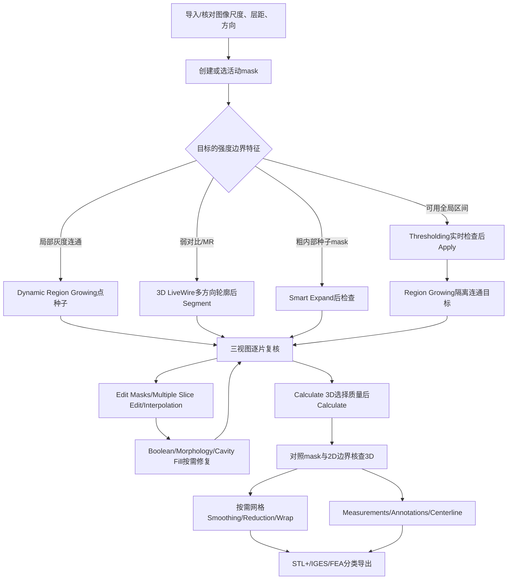

# Mimics Research 17.0：官方本地帮助驱动的用户操作逻辑

本报告只整理用户提供安装目录内 `Help/Mimics.chm`。未启动 Mimics、启动器或任何许可工具；未操作患者数据或修改原文件。帮助说明的软件行为属于文档证据，不等同于本机许可证实际开放功能，也不等同于逐项实机复现。

## 证据与复现

- 原文件：`C:\Users\wwulli\Desktop\mimics\Mimics Research 17.0\Help\Mimics.chm`，96,654,283字节，SHA256 `be16fa266f1f1eeb8fe705ced35a7da7c461512650354fe184cd7709af902b59`。
- 现有系统 `C:\Program Files\7-Zip\7z.exe` 26.01仅作CHM归档解包，未安装新工具、未改共享tool-index。两次 `hh.exe -decompile` 输出为空后切换。执行命令与计数见 [extraction.json](../../../evidence/help/extraction.json)。
- 解包 2,775文件/25目录，总展开111,781,942字节；其中562个HTML主题。HTML原页和PNG/JPG原图保留，纯文本由Python标准库HTMLParser生成；表格、公式图片需回原HTML/图核对。
- [全帮助索引TSV](../../../evidence/help/help-index.tsv)、[全文/链接/图片JSON](../../../evidence/help/help-index.json)、[目录树索引](../../../evidence/help/toc-index.json)、[工具清单TSV](../../../evidence/help/tool-catalog.tsv)、[结构化操作JSON](../../../evidence/help/tool-catalog.json)。提取脚本在 [notes/help](../../../notes/help/extract_help_text.py)。

## 先理解对象与交互

图像是强度数据；mask是分割体素集合；polyline是切片轮廓；3D object/STL是表面三角网格；CAD centerline是中心线与分支；measurement/annotation另作可编辑项目对象。Project Management各tab列出同类对象，底部Action列相关操作。选中活动mask决定大多数分割工具目标；眼镜只控制可见性，不等于删除或活动对象切换。

`Masks > New`同时打开阈值栏；`Duplicate`保留副本；`Clear`清空mask但保留阈值。mask属性报告范围、像素数、体积、平均/标准差及HU/GV尺度。3D Objects属性另报体积、面积、外形尺寸、点/三角数。两类体积来自不同离散表示，不能不经核对当作同一数值。

共同撤销为Ctrl+Z、重做Ctrl+Y；Edit菜单会显示可撤销动作名称，Preferences > General设Maximum Undo Disk Space。帮助没有逐项证明所有计算都进入撤销栈；Close不等于Cancel，导出产生的外部文件也不能假设可撤销。以下每项均写出文档确认的提交时刻，未列出的按钮/默认值明确保留缺口。

## 17.0版本与产品边界

1. 当前包的 `Centerline properties.htm`明确写“Mimics 17”，且Cubic spline为默认；旧图文件夹/HTML文件名含15.0是帮助沿用旧资源，不是把整个包判成15。截图数值仅是示例配置，只有正文明确default者才当默认。
2. 本地562页全文未检出名称“Smart Fill”“Split Mask”“CT Bone”或“Advanced Thresholding”。Bone(CT)可见于阈值预设截图。实际为Cavity Fill、Smart Expand，以及mask的Region Growing/3D Separate；Simulation的Split作用于已Cut的3D对象。不能据此断言后续版本无同名功能。
3. Interpolation在Multiple Slice Edit临时mask中；View > Interpolated Images仅改变XZ/YZ灰度显示，明确不改mask。
4. [H097 Tools Menu](../../../evidence/help/chm/Mimics%20Reference%20Guide/Tools%20Menu.htm)明确Smoothing/Triangle Reduction/Wrap需Simulation模块；中心线测量需Analysis模块；STL+也有模块前提。报告记载功能，不更改许可。
5. 同帮助包含Mimics与3-matic工作流。Mimics减面依据`Triangle Reduction.htm`的Tools路径；`Reduce.htm`是Fix toolbar示例，不能把其参数当Mimics默认。`Smoothing1.htm`和`Triangle Reduction1.htm`的Design路径与Tools页并存，需保留上下文，不混成单一菜单。
6. 文档存在旧菜单、例图与正文不一致：密度页写Tools，而Tools Menu页只列网格三项；Split正式页写Apply而教程写OK。报告照录并标注，实机重现前不宣称按钮完全相同。

## 核心工作流

阈值是初始定义而非解剖真值。普通连通生长前先断开错误细桥；三视图逐片确认归属；重建后若见漂浮颗粒，回到mask清理/连通提取后再算。量测用于具体几何量；线、面、密度ROI、中心线与沿表面距离都应保留各自定义。

帮助原页证据编号为H001起，见 [H编号映射](../../../evidence/help/reference-map.md)；这些编号只指文档页，不表示代码地址或运行验证。完整检索清单见 [catalog.json](catalog.json)。

## 工具级步骤与参数

下列清单按分割、重建导出、测量标注、中心线与模块专用工具分组。每项原始HTML链接指向当前本地CHM解包内容；对应纯文本在同名 `evidence/help/text`。通用撤销边界见前文，结构化JSON也为每项保存。

### S01 Thresholding（全局阈值）

**入口：** Segmentation > Thresholding；Segmentation toolbar；Masks > New。

**输入：** 活动 mask，图像强度及 HU/GV 单位。

1. 在 Masks 选活动 mask 或 New。
2. 打开 Thresholding。
3. 选预定义组织或拖 Min/Max 滑块。
4. 必要时双击数值/用微调箭头并 Enter。
5. 在三正交视图翻片检查。
6. 点 Apply。

**关键参数：** Min/Max：包含区间内体素；单下限时包含所有不低于下限者；预设可继续修改；边界限制在项目实际最小/最大强度。截图还显示 Fill holes、Keep largest，正文未解释其算法或作用域。

**预览/提交：** 滑块有实时颜色反馈；Apply 才使用阈值；截图存在 Cancel。

**默认与快捷键：** 预设依组织和项目；不提供通用 HU 数值。图中 Bone(CT)、226/1613 是截图状态。

**限制/易错点：** 改变全局阈值会丢失此前分割编辑；先阈值后 Region Growing。270 HU、538 HU、211 HU、-444 HU 等分别为教程病例数值，并非通用阈值。

**原页：** [H095 Thresholding1](../../../evidence/help/chm/Mimics%20Reference%20Guide/Thresholding1.htm)；[H101 With the thresholding toolbar](../../../evidence/help/chm/Mimics%20Reference%20Guide/With%20the%20thresholding%20toolbar.htm)；[H100 With a Profile Line](../../../evidence/help/chm/Mimics%20Reference%20Guide/With%20a%20Profile%20Line.htm)；[H078 Region growing2](../../../evidence/help/chm/Mimics%20Reference%20Guide/Region%20growing2.htm)。

### S02 Region Growing（已有 mask 连通域提取）

**入口：** Segmentation > Region Growing；Segmentation toolbar。

**输入：** 先有非空 source mask；种子必须在其中。

1. 设 Source。
2. 设 Target 为 New Mask 或已有 mask。
3. 设 Multiple Layer 和6/26-connectivity。
4. 决定 Leave Original Mask。
5. 左键单击对象内部。
6. 检查各切片后 Close。

**关键参数：** Multiple Layer off=单片，on=全体3D；6连接只邻面；26连接含面/边/顶点。Target 可累加；双箭头交换已有 source/target。

**预览/提交：** 单击即生长和写入 target，无独立 Apply。

**默认与快捷键：** 正文未规定固定默认值。截图所示为文档示例状态，不能据此认定安装默认值。 Ctrl+R

**限制/易错点：** Leave Original Mask 勾选=复制粘贴；不勾=剪切粘贴，源体素会移除。残余细桥会把结构连在一起，必须先编辑断开。

**原页：** [H077 Region Growing1](../../../evidence/help/chm/Mimics%20Reference%20Guide/Region%20Growing1.htm)；[H078 Region growing2](../../../evidence/help/chm/Mimics%20Reference%20Guide/Region%20growing2.htm)；[H035 Editing Thresholding](../../../evidence/help/chm/Mimics%20Reference%20Guide/Editing%20Thresholding.htm)。

### S03 Edit Masks：Draw / Erase / local Threshold

**入口：** Segmentation > Edit Masks；Segmentation toolbar。

**输入：** 仅活动 mask；选当前切片。

1. 选 Square/Circle/Lasso/Flood-Fill/LiveWire。
2. 设 Width/Height。
3. 选 Draw、Erase 或 Threshold。
4. 在图像按住左键画/擦。
5. 逐片或跨视图复核。
6. 需要时 Update Polylines 后 Close。

**关键参数：** Same Width & Height 锁宽高；Lasso 按住左键描绘，松开结束；Flood-Fill 按住生长到边缘，Tolerance 越高需越锐利边界才阻止增长，Impatience 控制扩张速度；local Threshold 有三组区间，中间=活动mask原阈值不可改，自定义组双击数值后 Enter。

**预览/提交：** 编辑直接改变 mask；右键 Erase full slice 清整片；local Threshold 在刷到区域内按强度加入或移除体素。

**默认与快捷键：** local Threshold 中间组继承活动 mask 阈值；不是固定 226/1613。截图刷子50×50不是经正文确认的默认。 Ctrl+D / Ctrl+E / Ctrl+T；编辑内 D/E/T；Alt 切 Draw/Erase；Ctrl+左拖改刷子大小；Shift+左键临时1-click导航

**限制/易错点：** local Threshold 只当前图像局部，不能当全数据集阈值。刷子包含并不代表都加入：已有但超区间的体素也会删去。

**原页：** [H032 Edit Masks](../../../evidence/help/chm/Mimics%20Reference%20Guide/Edit%20Masks.htm)；[H034 Edit](../../../evidence/help/chm/Mimics%20Reference%20Guide/Edit.htm)；[H036 Editing](../../../evidence/help/chm/Mimics%20Reference%20Guide/Editing.htm)。

### S04 Multiple Slice Edit（临时 mask 批量编辑）

**入口：** Segmentation > Multiple Slice Edit；Segmentation toolbar。

**输入：** 活动 mask + 由工具自动创建的临时 mask。

1. 选 Copy to slices 方向 Axial/Coronal/Sagittal。
2. 用 Select/Deselect 在临时 mask 选区域。
3. 填 Number of slices。
4. 点击向上/下箭头复制到其他层。
5. 按需在目标层再改再复制。
6. 选 Operation on active mask。
7. Apply。

**关键参数：** Type/刷子尺寸/Tolerance/Impatience 同编辑工具；临时与原mask交集用第三色显示；Operation=Remove/Add/local Threshold；右键 Select full slice；复制数量0代表向该方向所有层，非0会跳到最后复制层。

**预览/提交：** 临时 mask 是预选，Apply 才将所选操作写回活动mask；截图提供 Close。

**默认与快捷键：** 正文未规定固定默认值。截图所示为文档示例状态，不能据此认定安装默认值。 菜单截图显示 Ctrl+M

**限制/易错点：** 确定方向和层数后再复制。不要把临时色、交集色误认为已改动源mask；Close 的未应用选择处理正文未详述。

**原页：** [H064 Multiple slice edit](../../../evidence/help/chm/Mimics%20Reference%20Guide/Multiple%20slice%20edit.htm)；[H094 The multiple slice edit interface](../../../evidence/help/chm/Mimics%20Reference%20Guide/The%20multiple%20slice%20edit%20interface.htm)。

### S05 Interpolation（Multiple Slice Edit 内）

**入口：** Multiple Slice Edit 对话框的插值按钮。

**输入：** 在不同切片已画出的临时 mask 轮廓/区域。

1. 先按 S04 选择方向并在间隔层画临时区域。
2. 点击插值按钮。
3. 检查各中间层。
4. 选择 Add/Remove/local Threshold。
5. Apply。
6. 完成当前插值后再处理另一组选区。

**关键参数：** 插值方向取 Copy to slices 当前方向；正文没有给插值次数、数学方法或独立默认参数。

**预览/提交：** 插值作用于临时mask；需 Apply 才进入下一轮其他区域插值。

**默认与快捷键：** 正文未规定固定默认值。截图所示为文档示例状态，不能据此认定安装默认值。

**限制/易错点：** View > Interpolated Images 只插值XZ/YZ灰度显示，mask不变；它与此工具不是同一功能。

**原页：** [H094 The multiple slice edit interface](../../../evidence/help/chm/Mimics%20Reference%20Guide/The%20multiple%20slice%20edit%20interface.htm)；[H064 Multiple slice edit](../../../evidence/help/chm/Mimics%20Reference%20Guide/Multiple%20slice%20edit.htm)；[H045 Interpolated images](../../../evidence/help/chm/Mimics%20Reference%20Guide/Interpolated%20images.htm)。

### S06 Dynamic Region Growing

**入口：** Segmentation > Dynamic Region Growing。

**输入：** 原图强度；不要求先全局阈值。

1. 设 Target。
2. 设 Fill Cavities/Multiple Layer。
3. 设 Deviation Min/Max。
4. 在目标内部左键选种子。
5. 需要第二种子时 Ctrl+单击。
6. 检查新mask。
7. Close。

**关键参数：** 比较邻域灰度，正文规则 |平均灰度-候选灰度|<d；Target 可新建或已有，其已有体素灰度也参与；Multiple Layer off=单片、on=全数据；Seed point显示最后种子HU/GV；偏差相对灰度范围。

**预览/提交：** 选种子即开始生成，未描述独立预览/Apply。结果mask以已选体素最小/最大灰度设阈值。

**默认与快捷键：** 文档截图 Target=<New Mask>、Fill Cavities/Multiple Layer 勾选、Deviation Min=50 HU Max=50 HU；仅可证明截图状态。

**限制/易错点：** 与普通Region Growing不同，它直接看灰度连通性。正文沿用平均灰度公式又将界面Min/Max描述为相对种子偏差，不能据此伪造精确内部实现；需与代码证据互证。

**原页：** [H030 Dynamic Region Growing](../../../evidence/help/chm/Mimics%20Reference%20Guide/Dynamic%20Region%20Growing.htm)。

### S07 Boolean Operations（mask布尔）

**入口：** Segmentation > Boolean Operations。

**输入：** Mask A、Mask B。

1. 选择A和B。
2. 选 Minus/Intersection/Union。
3. 设Result。
4. Apply。
5. 检查。
6. Close。

**关键参数：** A-B的结果阈值沿用A；交集low=max(lowA,lowB),high=min(highA,highB)；并集low=min(lowA,lowB),high=max(highA,highB)。

**预览/提交：** Apply 写结果mask；截图 Result 可 New Mask。

**默认与快捷键：** 正文未规定固定默认值。截图所示为文档示例状态，不能据此认定安装默认值。

**限制/易错点：** 减法顺序不可交换。教程下颌骨去两侧假体需要连续两次减法，不是一次同时选3个输入。

**原页：** [H009 Boolean Operations](../../../evidence/help/chm/Mimics%20Reference%20Guide/Boolean%20Operations.htm)；[H010 Boolean Operations1](../../../evidence/help/chm/Mimics%20Reference%20Guide/Boolean%20Operations1.htm)。

### S08 Morphology Operations

**入口：** Segmentation > Morphology Operations。

**输入：** Source mask。

1. 选Source。
2. 选Erode/Dilate/Open/Close。
3. 设Target。
4. 按需Limited to另一个mask。
5. 设Number of pixels和8/26-connectivity。
6. Apply。

**关键参数：** Erode减边缘，Dilate加边缘；Open先腐蚀后膨胀；Close先膨胀后腐蚀；8连接逐平面邻域但执行完整数据集；26连接3D，仅层距≤pixel size×number of pixels时才能体现跨层作用；target阈值继承source。

**预览/提交：** Apply 生成目标mask；Close退出。

**默认与快捷键：** 图示Number of pixels=1、8-connectivity、Limited to=None，非正文保证的固定默认。

**限制/易错点：** 不能把这里8连接与Region Growing的6连接混写。Limited to配合Erode会执行布尔交集，不能简单当一般几何裁剪。

**原页：** [H063 Morphology Operations](../../../evidence/help/chm/Mimics%20Reference%20Guide/Morphology%20Operations.htm)。

### S09 Cavity Fill

**入口：** Segmentation > Cavity Fill。

**输入：** 包围腔体的Source mask。

1. 先Duplicate源mask。
2. 设Source/Target。
3. 设Multiple Layer。
4. 用桶形光标左键单击腔体。
5. 检查外溢及各切片。

**关键参数：** Multiple Layer决定3D或单片2D；结果可放新mask。

**预览/提交：** 单击选腔后执行；帮助没有单独预览说明。

**默认与快捷键：** 正文未规定固定默认值。截图所示为文档示例状态，不能据此认定安装默认值。

**限制/易错点：** 腔体必须各方向被mask封闭，否则会向周围外溢。可先Edit Masks封口。

**原页：** [H017 Cavity Fill](../../../evidence/help/chm/Mimics%20Reference%20Guide/Cavity%20Fill.htm)。

### S10 Cavity Fill from Polylines

**入口：** Segmentation > Cavity Fill from Polylines。

**输入：** polyline set。

1. 选Source polyline set。
2. 设Target mask。
3. 执行填充。
4. 检查与原mask边界。

**关键参数：** 逐条封闭polyline填充成mask。正文未写具体提交按钮名称。

**预览/提交：** 结果为mask；按钮及Cancel语义不补造。

**默认与快捷键：** 正文未规定固定默认值。截图所示为文档示例状态，不能据此认定安装默认值。

**限制/易错点：** polyline在计算时经过插值，回填mask可能比原mask大；需要原mask精确范围时用Cavity Fill。

**原页：** [H016 Cavity Fill from Polylines](../../../evidence/help/chm/Mimics%20Reference%20Guide/Cavity%20Fill%20from%20Polylines.htm)。

### S11 2D LiveWire（Edit Masks 类型）

**入口：** Edit Masks > Type: LiveWire。

**输入：** 当前切片；活动mask；当前 Draw/Erase/Threshold 操作。

1. 在Edit Masks选LiveWire。
2. 沿目标边界点若干点。
3. 检查吸附轮廓。
4. 以当前编辑操作作用于轮廓区域。

**关键参数：** 连接线吸附图像边缘；它是编辑光标类型，非独立3D自动轮廓工具。

**预览/提交：** 正文未给2D LiveWire专门闭合/提交手势，不能把3D LiveWire双击步骤无证据移植。

**默认与快捷键：** 正文未规定固定默认值。截图所示为文档示例状态，不能据此认定安装默认值。

**限制/易错点：** 与3D LiveWire不同；文档缺失的手势需后续运行验证，不写成已确认。

**原页：** [H032 Edit Masks](../../../evidence/help/chm/Mimics%20Reference%20Guide/Edit%20Masks.htm)；[H094 The multiple slice edit interface](../../../evidence/help/chm/Mimics%20Reference%20Guide/The%20multiple%20slice%20edit%20interface.htm)。

### S12 3D LiveWire

**入口：** Segmentation > 3D LiveWire。

**输入：** 原图；在另外两正交方向勾轮廓。

1. 选Target和Automatic contour方向，例如Axial。
2. 在Coronal/Sagittal沿边界点选。
3. 双击闭合。
4. 多层重复。
5. 查看自动方向turtle map。
6. 拖点或加约束线修正。
7. Segment生成mask。

**关键参数：** Gradient magnitude 0%偏暗边界、100%偏亮边界；Attraction近-3包含小凹陷、近3排除；Apply parameters to all contours控制全体或当前轮廓；Start/Stop指定应用层范围；Ctrl+鼠标移动可画直线。

**预览/提交：** 自动轮廓可视反馈；Segment才计算mask。生成后选此mask重开工具仍能改控制点。

**默认与快捷键：** 截图显示Automatic contour=Axial、Gradient magnitude=60%、Attraction=0；正文未声明通用默认。

**限制/易错点：** turtle线至少与另一线相交，否则不用于分割；约束线只修当前层。右键可删当前层/全视图轮廓或construction line。

**原页：** [H002 3D LiveWire](../../../evidence/help/chm/Mimics%20Reference%20Guide/3D%20LiveWire.htm)；[H093 The 3D LiveWire Interface](../../../evidence/help/chm/Mimics%20Reference%20Guide/The%203D%20LiveWire%20Interface.htm)。

### S13 Edit Mask in 3D

**入口：** Segmentation > Edit Mask in 3D。

**输入：** 活动mask；ROI内3D预览。

1. 在2D移动/缩放ROI。
2. 在3D预览用Square/Circle/Lasso框选。
3. Select/Deselect修正。
4. 必要时Grow只保留所点模型、Invert反选。
5. Hide/Show辅助观察。
6. 选Removes或Separate。

**关键参数：** ROI大小可在Preferences > Masks设；Ctrl+左拖调刷子；Removes删除选中体素；Separate把选区移入新mask。

**预览/提交：** 自带3D预览；选区不等于提交，Remove/Separate才改变mask。

**默认与快捷键：** 正文未规定固定默认值。截图所示为文档示例状态，不能据此认定安装默认值。

**限制/易错点：** ROI保证速度，不能把ROI外不可见部分当成不存在。Separate是mask分离，与Simulation > Split的3D对象分裂不同。

**原页：** [H031 Edit Mask in 3D](../../../evidence/help/chm/Mimics%20Reference%20Guide/Edit%20Mask%20in%203D.htm)；[H049 Masks preferences](../../../evidence/help/chm/Mimics%20Reference%20Guide/Masks%20preferences.htm)。

### S14 Smart Expand

**入口：** Segmentation > Smart Expand；Segmentation toolbar。

**输入：** 粗略内部Source mask。

1. Masks > New设阈值。
2. Clear得到空mask。
3. 用Draw在间隔Axial/Sagittal层只画目标内部。
4. 选Smart Expand。
5. 设Source/Target及Maximum Expand Distance。
6. Apply。
7. 检查结果，必要时再次Apply。
8. 按需Smooth Mask。

**关键参数：** 沿源mask外扩，遇图像灰度梯度边界停止；Maximum Expand Distance限制搜索区域且越大越慢；Target可New或覆盖已有mask。

**预览/提交：** Apply执行。教程建议再次运行可改善肝脏结果，不代表所有病例都必须两次。

**默认与快捷键：** 正文未规定固定默认值。截图所示为文档示例状态，不能据此认定安装默认值。

**限制/易错点：** 源mask不要画到邻接解剖。教程10pixels对应其约每10片绘制的病例，998/1394是该教程阈值。没有本地证据表明此功能名叫Smart Fill。

**原页：** [H085 Smart Expand](../../../evidence/help/chm/Mimics%20Reference%20Guide/Smart%20Expand.htm)；[H025 Creating the source mask](../../../evidence/help/chm/Mimics%20Reference%20Guide/Creating%20the%20source%20mask.htm)；[H044 Initialize the source mask](../../../evidence/help/chm/Mimics%20Reference%20Guide/Initialize%20the%20source%20mask.htm)；[H047 Launch smart expand](../../../evidence/help/chm/Mimics%20Reference%20Guide/Launch%20smart%20expand.htm)；[H087 Smooth mask2](../../../evidence/help/chm/Mimics%20Reference%20Guide/Smooth%20mask2.htm)。

### S15 Smooth Mask

**入口：** Segmentation > Smooth Mask。

**输入：** 活动mask。

1. 先选mask。
2. 点Smooth Mask。
3. 检查边界/细枝。
4. 需要时重复。
5. 再Calculate 3D。

**关键参数：** 滤除手工分割产生的离群点和伪影，尽量保持重要边界；文档未给可调参数对话框。

**预览/提交：** 点击即应用；教程说明重复点击会增加平滑。

**默认与快捷键：** 正文未规定固定默认值。截图所示为文档示例状态，不能据此认定安装默认值。

**限制/易错点：** 这是体素mask平滑，区别于Tools > Smoothing对三角网格的后处理。

**原页：** [H086 Smooth Mask](../../../evidence/help/chm/Mimics%20Reference%20Guide/Smooth%20Mask.htm)；[H087 Smooth mask2](../../../evidence/help/chm/Mimics%20Reference%20Guide/Smooth%20mask2.htm)。

### S16 Crop Mask

**入口：** Segmentation > Crop Mask。

**输入：** 活动mask与ROI。

1. 选择mask。
2. 打开Crop Mask。
3. 选定ROI。
4. 检查范围。
5. 执行裁剪。

**关键参数：** 删除ROI外mask；灰度图像保留。正文未写按钮名和ROI交互细节。

**预览/提交：** 根据ROI限制mask；不补造Apply/OK步骤。

**默认与快捷键：** 正文未规定固定默认值。截图所示为文档示例状态，不能据此认定安装默认值。

**限制/易错点：** 不同于Crop Project；后者影响项目图像。

**原页：** [H026 Crop Mask](../../../evidence/help/chm/Mimics%20Reference%20Guide/Crop%20Mask.htm)。

### S17 Calculate Polylines / Update Polylines

**入口：** Segmentation > Calculate Polylines；Segmentation > Update Polylines。

**输入：** 选中mask。

1. 打开Calculate Polylines。
2. 选需计算的mask。
3. Calculate。
4. 检查高分辨率轮廓。
5. 改单片mask后用Update。
6. 多片改变先逐片编辑再全部重算。

**关键参数：** 轮廓与STL+使用的分割轮廓一致；可辅助确定阈值。

**预览/提交：** Calculate计算集合；Update只更新当前层。

**默认与快捷键：** 正文未规定固定默认值。截图所示为文档示例状态，不能据此认定安装默认值。 Ctrl+U 更新（菜单截图）

**限制/易错点：** 阈值改变后整个polyline集合都须重算，单层Update不够。

**原页：** [H012 Calculate Polylines](../../../evidence/help/chm/Mimics%20Reference%20Guide/Calculate%20Polylines.htm)；[H099 Update Polylines](../../../evidence/help/chm/Mimics%20Reference%20Guide/Update%20Polylines.htm)。

### S18 Calculate Polylines from 3D

**入口：** Segmentation > Calculate Polylines from 3D。

**输入：** 3D object或STL。

1. 选择源3D/STL。
2. 执行轮廓计算。
3. 在每片检查输出polyline。

**关键参数：** 按项目各切片与3D/STL相交形成轮廓。正文未列数值参数。

**预览/提交：** 输出polyline set；按钮名未给出。

**默认与快捷键：** 正文未规定固定默认值。截图所示为文档示例状态，不能据此认定安装默认值。

**限制/易错点：** 它不是由mask计算polyline；空间采样依项目切片。

**原页：** [H014 Calculate polylines from 3D](../../../evidence/help/chm/Mimics%20Reference%20Guide/Calculate%20polylines%20from%203D.htm)。

### S19 Calculate Mask from 3D/object

**入口：** Segmentation > Calculate Mask from object（toolbar名称）；正文页称 Calculate Mask from 3D。

**输入：** 3D object或STL、项目切片。

1. 打开工具。
2. 设Source 3D object/STL。
3. 设Target mask。
4. 执行。
5. 检查填充。

**关键参数：** 逐项目切片取对象轮廓再填充为mask。

**预览/提交：** 写入目标mask；正文未给按钮名。

**默认与快捷键：** 正文未规定固定默认值。截图所示为文档示例状态，不能据此认定安装默认值。

**限制/易错点：** 注意菜单/正文称呼差异；从离散网格回到离散体素，不承诺与原mask完全相同。

**原页：** [H013 Calculate mask from 3D](../../../evidence/help/chm/Mimics%20Reference%20Guide/Calculate%20mask%20from%203D.htm)；[H082 Segmentation toolbar](../../../evidence/help/chm/Mimics%20Reference%20Guide/Segmentation%20toolbar.htm)。

### S20 Label（写入mask的实体文字）

**入口：** Segmentation > Label。

**输入：** 目标mask、文字。

1. 输入Label文字。
2. 选Mask/Font/Size/Depth。
3. 设2D slice-able及方向。
4. 左拖到位置。
5. 需要修改/删去时右键Properties/Delete。

**关键参数：** Size/Depth单位mm；Depth从当前层向上，若到顶则向下复制；2D slice-able限定水平/垂直且不能改font；View from Top/Bottom指图像堆栈上下。

**预览/提交：** 标签可随STL导出；正文未列提交按钮。

**默认与快捷键：** 正文未规定固定默认值。截图所示为文档示例状态，不能据此认定安装默认值。

**限制/易错点：** 这不是Add Text Annotations。若需切层导出可见，必须勾2D slice-able；Mimics3D显示外观可能不正确。

**原页：** [H046 Label](../../../evidence/help/chm/Mimics%20Reference%20Guide/Label.htm)。

### S21 Predefined Thresholds（组织阈值预设）

**入口：** Options > Preferences > Predefined Thresholds（帮助设置页）。

**输入：** 预定义阈值列表。

1. 选条目后Edit名称和上下限。
2. Add或Delete增删。
3. Move Up/Down调顺序。
4. Reset恢复原设置。

**关键参数：** 上下限采用General preferences所选HU/GV单位；当前Thresholding可选预设再微调。

**预览/提交：** 设置页动作会更改预设；不等同于已给当前mask Apply。

**默认与快捷键：** 正文未规定固定默认值。截图所示为文档示例状态，不能据此认定安装默认值。

**限制/易错点：** Bone(CT)在阈值截图是预设名称；本地帮助没有证实独立CT Bone工具或Advanced Thresholding。

**原页：** [H065 Predefined Thresholds](../../../evidence/help/chm/Mimics%20Reference%20Guide/Predefined%20Thresholds.htm)；[H042 General preferences](../../../evidence/help/chm/Mimics%20Reference%20Guide/General%20preferences.htm)；[H101 With the thresholding toolbar](../../../evidence/help/chm/Mimics%20Reference%20Guide/With%20the%20thresholding%20toolbar.htm)。

### R01 Calculate 3D

**入口：** Segmentation > Calculate 3D；Masks > Calculate 3D；Segmentation toolbar。

**输入：** 非空mask，可多选。

1. 打开Calculate 3D。
2. 选mask行。
3. 选Low/Medium/High/Optimal/Custom。
4. Custom时Options设参数。
5. Calculate。
6. 在3D Objects检查、命名、与2D轮廓比较。

**关键参数：** Quality控制矩阵降采样/计算；星号是按电脑推荐。Custom参数可涉及插值、矩阵、平滑、减面；具体详见STL+参数页。

**预览/提交：** Calculate开始计算并自动显示3D；Close退出。

**默认与快捷键：** 没有统一质量默认；星号表示机器推荐。截图High被选、Optimal带*，两者不可混同。

**限制/易错点：** 空mask不能计算。正文说Optimal最准确，High仍有XY矩阵减少；Low/Medium尺寸不精确。重建只生成网格，不代替mask质检。

**原页：** [H011 Calculate 3D](../../../evidence/help/chm/Mimics%20Reference%20Guide/Calculate%203D.htm)；[H048 Listed masks](../../../evidence/help/chm/Mimics%20Reference%20Guide/Listed%20masks.htm)；[H075 Quality](../../../evidence/help/chm/Mimics%20Reference%20Guide/Quality.htm)；[H015 Calculate](../../../evidence/help/chm/Mimics%20Reference%20Guide/Calculate.htm)；[H003 3D objects](../../../evidence/help/chm/Mimics%20Reference%20Guide/3D%20objects.htm)；[H079 STL STL VRML Parameters](../../../evidence/help/chm/Mimics%20Reference%20Guide/STL%20STL%20VRML%20Parameters.htm)。

### R02 Smoothing（三角网格）

**入口：** Mimics Tools > Smoothing；3D Objects > Action > Smoothing。

**输入：** 3D object或STL。

1. 选对象。
2. 打开Smoothing。
3. 设Iterations、Smooth factor。
4. 选择Compensate shrinkage、Keep originals。
5. 检查结果。

**关键参数：** Iterations为循环数；Smooth factor决定强度；Compensate shrinkage抵消体积收缩；Keep originals不勾会删除源对象。

**预览/提交：** 正文没有逐字说明预览/提交按钮；不写未经证实的Preview/Apply名称。结果进入3D Objects。

**默认与快捷键：** 正文未规定固定默认值。截图所示为文档示例状态，不能据此认定安装默认值。

**限制/易错点：** Tools菜单需Simulation module。不要将Design菜单同名页或3-matic Fix教程步骤替代此路径。

**原页：** [H088 Smoothing](../../../evidence/help/chm/Mimics%20Reference%20Guide/Smoothing.htm)；[H097 Tools Menu](../../../evidence/help/chm/Mimics%20Reference%20Guide/Tools%20Menu.htm)。

### R03 Triangle Reduction（Mimics减面）

**入口：** Mimics Tools > Triangle Reduction；3D Objects > Action > Triangle Reduction。

**输入：** 3D object或STL。

1. 选对象。
2. 选Point/Edge/Advanced Edge based。
3. 设Tolerance、Edge Angle、Iterations。
4. 执行并检查三角数和形状。

**关键参数：** Tolerance单位mm，平面合并最大偏差；Edge Angle界定需保留的棱边；Iterations为迭代数。STL+文档建议容差关联像素尺寸、约15次迭代收敛，不是默认值。

**预览/提交：** 结果进入3D Objects；本页未逐字列提交按钮。

**默认与快捷键：** 正文未规定固定默认值。截图所示为文档示例状态，不能据此认定安装默认值。

**限制/易错点：** 噪声大先平滑；容差过大损失关键几何。Reduce.htm是3-matic Fix toolbar案例，15°/0.1/5是案例参数，不能当Mimics默认。

**原页：** [H098 Triangle Reduction](../../../evidence/help/chm/Mimics%20Reference%20Guide/Triangle%20Reduction.htm)；[H079 STL STL VRML Parameters](../../../evidence/help/chm/Mimics%20Reference%20Guide/STL%20STL%20VRML%20Parameters.htm)；[H097 Tools Menu](../../../evidence/help/chm/Mimics%20Reference%20Guide/Tools%20Menu.htm)；[H076 Reduce](../../../evidence/help/chm/Mimics%20Reference%20Guide/Reduce.htm)。

### R04 Wrap

**入口：** Mimics Tools > Wrap；3D Objects > Action > Wrap。

**输入：** 选中3D object/STL。

1. 选对象。
2. 设Smallest Detail与Closing Distance。
3. 选择Dilate result/Protect thin walls/Keep originals。
4. 执行。
5. 检查细壁、孔洞和包络。

**关键参数：** Smallest Detail≈新表面三角形尺寸；Closing Distance决定闭合缝隙尺度；Dilate result纳入mask极值附近像素；Protect thin walls防薄壁塌陷但可能使模型变厚。

**预览/提交：** 创建包络表面；正文未逐字列预览/提交按钮。

**默认与快捷键：** 正文未规定固定默认值。截图所示为文档示例状态，不能据此认定安装默认值。

**限制/易错点：** Tools菜单需Simulation。保护薄壁改变厚度；Keep originals不勾会删源对象，表述“only cut objects”是原文模板措辞，不代表Wrap就是Cut。

**原页：** [H102 Wrap](../../../evidence/help/chm/Mimics%20Reference%20Guide/Wrap.htm)；[H097 Tools Menu](../../../evidence/help/chm/Mimics%20Reference%20Guide/Tools%20Menu.htm)。

### R05 Cut（三种切割）

**入口：** Simulation > Cut > Cut with Polyplane / Cut with Curve / Cut Orthogonal to Screen。

**输入：** 3D object/STL与切割路径。

1. 先选对象。
2. Polyplane在2D/3D画切割路径并Properties调深度厚度延伸。
3. Curve在3D沿对象点选路径，双击或右键结束。
4. 检查黄色延伸不穿过对象。
5. 按各工具执行。

**关键参数：** Keep originals保护原对象；Curve的Extensions设外延；Cutting path Properties有Preview；Orthogonal需先从列表选对象方可预览/应用。

**预览/提交：** Curve检查后OK会同时cut和split；Polyplane等路径可Preview。

**默认与快捷键：** 正文未规定固定默认值。截图所示为文档示例状态，不能据此认定安装默认值。

**限制/易错点：** Curve全部延伸都须浮在模型外才完成切割。普通Split前需先Cut，不能用Split直接任意切面。

**原页：** [H028 Cut](../../../evidence/help/chm/Mimics%20Reference%20Guide/Cut.htm)。

### R06 Split（3D cut parts）

**入口：** Simulation > Split（教程也写CMF/Simulation）。

**输入：** 已经Cut过的3D对象。

1. 先Cut。
2. 打开Split。
3. 选Objects to Split。
4. 选All parts/Largest part/Two largest parts。
5. 选择Keep originals。
6. Preview。
7. Apply（教程写OK）。

**关键参数：** 保留全部、最大或两大部分；Keep originals保留原对象。

**预览/提交：** 正式页明确Preview和/或Apply；教程写Preview再OK，属于帮助内部按钮文字差异。

**默认与快捷键：** 正文未规定固定默认值。截图所示为文档示例状态，不能据此认定安装默认值。

**限制/易错点：** 不是Split Mask：本地mask分离靠Region Growing或Edit Mask in 3D > Separate。源页文件名虽含15.0，当前CHM目录仍将它用作Split页。

**原页：** [H062 Mimics 15.0 Reference Guide_track_v2_no_numbers2](../../../evidence/help/chm/Mimics%20Reference%20Guide/Mimics%2015.0%20Reference%20Guide_track_v2_no_numbers2.htm)；[H090 Splitting](../../../evidence/help/chm/Mimics%20Reference%20Guide/Splitting.htm)；[H084 Simulation Menu](../../../evidence/help/chm/Mimics%20Reference%20Guide/Simulation%20Menu.htm)。

### R07 STL+ triangulated export

**入口：** Export > Binary STL / ASCII STL / DXF / VRML / PLY；File > STL+；Masks或3D Objects > Action > STL+。

**输入：** mask、3D、3dd、CAD或FEA之一类。

1. 选择输入类别与对象。
2. 选Output directory/Output format。
3. Add入队。
4. 可改Output Filename或Remove。
5. 设Scale factor。
6. mask/3dd点Next进入计算参数。
7. 已建3D/CAD/FEA点Finish导出。

**关键参数：** 不能将不同类别混入同一queue；支持Binary/ASCII STL、DXF、VRML2、PLY、single PLY；单PLY能保留多对象颜色；mask/3dd路径会重新计算网格。

**预览/提交：** Add只入队；Next设参数或Finish实际导出。

**默认与快捷键：** 正文未规定固定默认值。截图所示为文档示例状态，不能据此认定安装默认值。

**限制/易错点：** STL+是模块功能；本次不操作许可。若只想导出现有网格，选Start from 3D以避免从mask另算。导出文件不适用Ctrl+Z保证。

**原页：** [H039 Exporting triangulated files](../../../evidence/help/chm/Mimics%20Reference%20Guide/Exporting%20triangulated%20files.htm)；[H080 STL mask 3D or file selection](../../../evidence/help/chm/Mimics%20Reference%20Guide/STL%20mask%203D%20or%20file%20selection.htm)；[H079 STL STL VRML Parameters](../../../evidence/help/chm/Mimics%20Reference%20Guide/STL%20STL%20VRML%20Parameters.htm)。

### R08 STL+ custom reconstruction参数

**入口：** STL+ > mask/3dd > Next；Calculate 3D的Custom另有Options。

**输入：** mask/3dd以及所选输出。

1. 选插值方法。
2. 设Slices范围。
3. 设XY/Z matrix reduction。
4. 按需Smoothing及Triangle Reduction。
5. 核对Scaling。
6. 开始计算/导出。

**关键参数：** Contour interpolation偏医疗，Gray value偏技术；灰度法需层厚=层距，改Z分辨率可能破坏此条件；XY/Z代表体素分组；平滑Iterations/Factor/Compensate shrinkage；减面模式、容差、角度、迭代、buffer。

**预览/提交：** 页面说明参数意义，没有给Calculate3D Custom所有控件与STL+完全一致的保证。

**默认与快捷键：** STL+ Slices默认首末图像台位、覆盖全部分割；Reset恢复该范围。其他固定默认未给。

**限制/易错点：** 不要把STL+的Maximum quality命名套成Calculate3D的Optimal；它们在帮助中分别出现。过度矩阵减少损细节，轮廓法可能尺寸变大；灰度法薄结构可能破孔。

**原页：** [H079 STL STL VRML Parameters](../../../evidence/help/chm/Mimics%20Reference%20Guide/STL%20STL%20VRML%20Parameters.htm)；[H075 Quality](../../../evidence/help/chm/Mimics%20Reference%20Guide/Quality.htm)。

### R09 IGES导出

**入口：** Export > Iges（mask/3dd轮廓）；MedCAD > Export all Objects to Iges（CAD）。

**输入：** mask/3dd轮廓或CAD objects。

1. 根据目标选Export或MedCAD路径。
2. mask路径选择对象及轮廓参数。
3. 需保持原坐标时First Layer height=first table position。
4. 若只需原层轮廓Layer thickness=slice distance。
5. 导出。

**关键参数：** 轮廓IGES entity type106 form12；mask路径可增加插值层与过滤小轮廓/数据点；CAD可一次导出全部或在CAD Objects各自导出。

**预览/提交：** 选参数后导出；按钮细节正文未列。

**默认与快捷键：** 正文未规定固定默认值。截图所示为文档示例状态，不能据此认定安装默认值。

**限制/易错点：** IGES轮廓不等于封闭三角STL；First Layer height改变会平移坐标。

**原页：** [H092 Starting from the Export menu](../../../evidence/help/chm/Mimics%20Reference%20Guide/Starting%20from%20the%20Export%20menu.htm)；[H091 Starting from MedCAD menu](../../../evidence/help/chm/Mimics%20Reference%20Guide/Starting%20from%20MedCAD%20menu.htm)。

### R10 FEA网格/材料导出

**入口：** FEA > Export（CHM目录树 FEA/CFD > FEA Menu > Export 确认）。

**输入：** 3D/STL/volume mesh及可用材料赋值。

1. 选对象与格式。
2. 按需Edit选择element types及是否含surface。
3. 决定导网格连材料或仅材料。
4. 导出。

**关键参数：** Patran Neutral、Abaqus、ANSYS、Fluent、Nastran等；材料存在时随FEA mesh输出；默认element类型按格式/单元形状不同，详源表。

**预览/提交：** 导出写文件，不能以Undo视为删除外部文件。

**默认与快捷键：** 正文未规定固定默认值。截图所示为文档示例状态，不能据此认定安装默认值。

**限制/易错点：** colored STL为帮助明确标注的invalid STL，只供材料可视化，不能作为通用有效STL网格。

**原页：** [H038 Export](../../../evidence/help/chm/Mimics%20Reference%20Guide/Export.htm)；[H040 FEA menu1](../../../evidence/help/chm/Mimics%20Reference%20Guide/FEA%20menu1.htm)。

### A01 Measure Distance

**入口：** Measurements > Measure Distance；Measurements toolbar。

**输入：** 2D图像或3D模型。

1. 选工具。
2. 左键首点。
3. 移动看mm长度。
4. 左键第二点固定。
5. 拖端点微调。
6. 右键Hide/Delete或Measurements列表。

**关键参数：** 长度单位mm；端点随拖动重算。

**预览/提交：** 第二点固定结果；右键删除为明确撤销途径。

**默认与快捷键：** 正文未规定固定默认值。截图所示为文档示例状态，不能据此认定安装默认值。

**限制/易错点：** 普通直线长度与沿表面/沿中心线长度不可混同。

**原页：** [H058 Measure distance](../../../evidence/help/chm/Mimics%20Reference%20Guide/Measure%20distance.htm)。

### A02 Measure Angle

**入口：** Measurements > Measure Angle。

**输入：** CT图像、alignment image或3D模型。

1. 选工具。
2. 左键依次三点。
3. 读角度。
4. 拖中心或端点调整。
5. 右键上下文管理。

**关键参数：** 单位degree。

**预览/提交：** 三点定义后显示；点可拖动。

**默认与快捷键：** 正文未规定固定默认值。截图所示为文档示例状态，不能据此认定安装默认值。

**限制/易错点：** 必须核对选点与视图，2D角度和3D角度不能凭相同标签互换。

**原页：** [H054 Measure angle](../../../evidence/help/chm/Mimics%20Reference%20Guide/Measure%20angle.htm)。

### A03 Measure Diameter

**入口：** Measurements > Measure Diameter。

**输入：** CT图像或3D object。

1. 选工具。
2. 沿结构轮廓点三点。
3. 读mm直径。
4. 拖任一点微调。
5. 右键管理。

**关键参数：** 三点定义圆形直径。

**预览/提交：** 第三点后得到直径。

**默认与快捷键：** 正文未规定固定默认值。截图所示为文档示例状态，不能据此认定安装默认值。

**限制/易错点：** 该三点圆径不同于centerline最小/最大/拟合直径。

**原页：** [H057 Measure diameter](../../../evidence/help/chm/Mimics%20Reference%20Guide/Measure%20diameter.htm)。

### A04 Measure Ellipse

**入口：** Measurements > Measure Ellipse。

**输入：** 图像或3D模型。

1. 点长轴首点。
2. 再点长轴末点。
3. 移动鼠标定义短轴。
4. 拖轴端点调整。
5. 拖角旋转、拖中心平移、拖标签位置。

**关键参数：** D1/D2长短径，P周长，A面积，DP周长等效圆径，DA面积等效圆径，E椭圆性；单位按量纲mm/mm²。

**公式原图核查：** E = sqrt((R1²−R2²)/R1²)，R1最大半径、R2最小半径，无量纲。已直接查看 [CHM公式PNG](../../../evidence/help/chm/Resources/Images/Measure%20ellipse/03000001.png)，该图在HTML中被重复插入两次。核查记录见 [ellipse-formula-check.md](../../../notes/help/ellipse-formula-check.md)。

**预览/提交：** 实时显示；正文没写短轴最后确认点击，保留该文档缺口。

**默认与快捷键：** 正文未规定固定默认值。截图所示为文档示例状态，不能据此认定安装默认值。

**限制/易错点：** 此测量明确没有context menu；不要套用其他测量右键删除流程，可在Measurements tab管理。公式在HTML以图片等表示，纯文本漏式时不补造。

**原页：** [H052 Measure Ellipse](../../../evidence/help/chm/Mimics%20Reference%20Guide/Measure%20Ellipse.htm)；[H061 Measurements](../../../evidence/help/chm/Mimics%20Reference%20Guide/Measurements.htm)。

### A05 Measure Area

**入口：** Measurements > Measure Area。

**输入：** 单个2D平面，包括普通及MPR reslice。

1. 选工具。
2. 沿闭合多边形逐点。
3. 双击闭合。
4. 读取结果和Measurements tab。
5. 拖控制点即时更新。
6. 右键控制点增/删点。

**关键参数：** Area、Perimeter、Da/Dp等效直径、Centroid、Lmax过质心最大距离、L与其垂直且过质心。

**预览/提交：** 双击闭合才显示。

**默认与快捷键：** 正文未规定固定默认值。截图所示为文档示例状态，不能据此认定安装默认值。

**限制/易错点：** 这是2D截面多边形面积，不是3D模型表面积。

**原页：** [H051 Measure Area](../../../evidence/help/chm/Mimics%20Reference%20Guide/Measure%20Area.htm)。

### A06 Measure Distance Over the Surface

**入口：** Measurements > Measure Distance Over the Surface。

**输入：** 3D surface。

1. 选工具。
2. 沿所需路径点若干点。
3. 读mm结果。
4. 拖点微调。
5. 右键端点管理。

**关键参数：** 在3D表面求路径最短距离，并由所给点指引路径。

**预览/提交：** 正文未给结束绘制专用手势。

**默认与快捷键：** 正文未规定固定默认值。截图所示为文档示例状态，不能据此认定安装默认值。

**限制/易错点：** 不能把欧氏距离当此值；用户点的路径约束会影响所测路径。

**原页：** [H083 Shortest distance over surface](../../../evidence/help/chm/Mimics%20Reference%20Guide/Shortest%20distance%20over%20surface.htm)。

### A07 Measure Density in Rectangle

**入口：** Tools > Measure Density in Rectangle（单页记载）；Measurements toolbar提供测量入口。

**输入：** 2D图像ROI。

1. 选工具。
2. 单击放框或左拖同时放框调尺寸。
3. 松开读数。
4. 拖边角调大小、黄边拖动平移。
5. 翻片看更新。
6. 右键Hide/Delete。

**关键参数：** 面积mm²，平均密度及标准差HU或GV。

**预览/提交：** 释放鼠标重算；翻片也更新。

**默认与快捷键：** 正文未规定固定默认值。截图所示为文档示例状态，不能据此认定安装默认值。

**限制/易错点：** Tools Menu页又只列网格三项，而密度页沿用Tools路径，属帮助内部菜单记载不一致；应优先Measurements工具栏/菜单实机核对。

**原页：** [H056 Measure density in rectangle](../../../evidence/help/chm/Mimics%20Reference%20Guide/Measure%20density%20in%20rectangle.htm)；[H060 Measurements toolbar](../../../evidence/help/chm/Mimics%20Reference%20Guide/Measurements%20toolbar.htm)；[H097 Tools Menu](../../../evidence/help/chm/Mimics%20Reference%20Guide/Tools%20Menu.htm)。

### A08 Measure Density in Ellipse

**入口：** Tools > Measure Density in Ellipse（单页记载）；Measurements toolbar。

**输入：** 2D图像ROI。

1. 选工具。
2. 单击或左拖放椭圆。
3. 松开读数。
4. 拖四标记调形状、黄边其他处平移。
5. 翻片。
6. 右键Hide/Delete。

**关键参数：** 面积mm²，平均密度及标准差HU或GV。

**预览/提交：** 松开/翻片更新。

**默认与快捷键：** 正文未规定固定默认值。截图所示为文档示例状态，不能据此认定安装默认值。

**限制/易错点：** 同矩形密度页存在旧Tools路径记载；量的是灰度统计，不是经材料标定后的物理密度。

**原页：** [H055 Measure density in ellipse](../../../evidence/help/chm/Mimics%20Reference%20Guide/Measure%20density%20in%20ellipse.htm)；[H060 Measurements toolbar](../../../evidence/help/chm/Mimics%20Reference%20Guide/Measurements%20toolbar.htm)。

### A09 Add Text Annotations

**入口：** annotation tool；Project Management > Annotation > New。

**输入：** 2D/3D图像或对象上锚点。

1. 选annotation工具或New。
2. 左键所指结构。
3. 在Annotation Properties填Text。
4. 设Arrow Style/Text Rotation/Text alignment。
5. 双击文本再编辑。
6. 右键Properties/Hide/Delete。

**关键参数：** Annotation tab记录Name/Visible/Object/Text，支持Duplicate/Locate；Options中可改字体与框背景。

**预览/提交：** 选锚点弹属性；正文未列确定按钮名称。长文本显示省略号，悬停看全文。

**默认与快捷键：** 正文未规定固定默认值。截图所示为文档示例状态，不能据此认定安装默认值。

**限制/易错点：** 这是附着对象的说明，不会像Segmentation > Label那样成为mask实体。

**原页：** [H006 Add Text Annotations](../../../evidence/help/chm/Mimics%20Reference%20Guide/Add%20Text%20Annotations.htm)；[H007 Annotation](../../../evidence/help/chm/Mimics%20Reference%20Guide/Annotation.htm)；[H008 Annotation1](../../../evidence/help/chm/Mimics%20Reference%20Guide/Annotation1.htm)。

### A10 Profile Line / 阈值剖面

**入口：** Tools toolbar > Profile line。

**输入：** 图像强度剖面。

1. 左键首点和末点画线。
2. 打开Profile graph。
3. Start Thresholding。
4. 拖上下阈值线。
5. End Thresholding保存（教程有保存确认）。
6. 关窗。

**关键参数：** 显示沿线HU/GV强度；上下线代表阈值。

**预览/提交：** 用图形实时调阈值，再End Thresholding并确认。

**默认与快捷键：** 正文未规定固定默认值。截图所示为文档示例状态，不能据此认定安装默认值。

**限制/易错点：** 病例阈值是辅助选择示例；剖面线不是组织分割边界。

**原页：** [H066 Profile line](../../../evidence/help/chm/Mimics%20Reference%20Guide/Profile%20line.htm)；[H100 With a Profile Line](../../../evidence/help/chm/Mimics%20Reference%20Guide/With%20a%20Profile%20Line.htm)；[H095 Thresholding1](../../../evidence/help/chm/Mimics%20Reference%20Guide/Thresholding1.htm)；[H096 Thresholding4](../../../evidence/help/chm/Mimics%20Reference%20Guide/Thresholding4.htm)。

### A11 3D Histogram

**入口：** Measurements toolbar > 3D Histogram。

**输入：** 完整数据集强度分布。

1. 打开3D Histogram。
2. 设X/Y范围、Y对数或十进制。
3. Update。
4. 按需保存Text。

**关键参数：** X=HU/GV，Y=像素数；可自动或用户设范围。

**预览/提交：** Update才应用图表设置；可导出txt。

**默认与快捷键：** 正文未规定固定默认值。截图所示为文档示例状态，不能据此认定安装默认值。

**限制/易错点：** 原文说明GV0即-1024HU不纳入直方图，以免背景峰淹没其余分布；不能将图表计数视为含该背景的全体体素计数。

**原页：** [H001 3D Histogram](../../../evidence/help/chm/Mimics%20Reference%20Guide/3D%20Histogram.htm)；[H060 Measurements toolbar](../../../evidence/help/chm/Mimics%20Reference%20Guide/Measurements%20toolbar.htm)。

### A12 2D Mask Area（逐切片分割面积导出）

**入口：** Export > 2D Mask Area（CHM目录树确认）。

**输入：** 已有mask、所选视图及切片范围。

1. 选择Mask。
2. Images中选视图。
3. Range选所有切片、当前切片或指定范围。
4. 设Filename和Path。
5. 导出文本。

**关键参数：** Range按选定视图定义；本页未写面积的显示/导出单位，不据常识补成文档原值。

**预览/提交：** 导出写text文件；本页未给执行按钮文字。

**默认与快捷键：** 正文未给固定默认范围或路径。

**限制/易错点：** 与Measure Area人工多边形不同；单片面积不是体积。Path字段原文误称gray values file，按页首mask area定义解释。

**原页：** [H105 2D Mask Area](../../../evidence/help/chm/Mimics%20Reference%20Guide/2D%20Mask%20Area.htm)。

### C01 Fit Centerline

**入口：** MedCAD > Centerline > Fit Centerline。

**输入：** 血管等管状3D object。

1. 选3D object。
2. 设Smooth factor。
3. 通常保持自动解析参数。
4. 需要时Show Params再切Manual。
5. 选Resolving resolution及Control point distance Variable/Fixed。
6. 执行。
7. 在CAD Objects检查。

**关键参数：** Resolving resolution小可识别更细管；Control point distance小捕捉更多细节；Variable推荐。平滑用Fourier，停止阈值mm=smooth factor×average branch radius。

**预览/提交：** 输出分支集合；执行按钮名正文未明确。

**默认与快捷键：** Mimics17 centerline spline明确默认Cubic，可改Quadratic；自动算法设置解析分辨率及控制点间距，非固定全局数值。

**限制/易错点：** 急弯平滑过强会使线跑到管外，需降低factor重算。分支集合按估计平均体积排序，非纯长度。

**原页：** [H023 Centerline](../../../evidence/help/chm/Mimics%20Reference%20Guide/Centerline.htm)；[H022 Centerline properties](../../../evidence/help/chm/Mimics%20Reference%20Guide/Centerline%20properties.htm)。

### C02 Edit Centerline Control Points

**入口：** CAD Objects > 选centerline > Action > Edit Centerline Control Points。

**输入：** 已有centerline。

1. 点控制点变绿。
2. 检查黑色影响边界。
3. 改Influence distance或重新选边界点。
4. 拖绿色点。
5. 双击Apply。
6. 可继续改下一点。
7. Esc/Close/换工具退出。

**关键参数：** Influence distance是控制点到限制点的最小距离；无恰好距离时用更远最近点；branch point可选三个分支边界。

**预览/提交：** 双击提交该次修改。

**默认与快捷键：** 正文未规定固定默认值。截图所示为文档示例状态，不能据此认定安装默认值。

**限制/易错点：** 改中心线会改变各中心线测量，应在CPR截面校正位置后再读数。

**原页：** [H033 Edit centerline control points](../../../evidence/help/chm/Mimics%20Reference%20Guide/Edit%20centerline%20control%20points.htm)；[H019 Centerline measurements](../../../evidence/help/chm/Mimics%20Reference%20Guide/Centerline%20measurements.htm)。

### C03 Centerline Post Processing

**入口：** CAD Objects > centerline > Action > Centerline Post processing。

**输入：** 已有centerline。

1. 选线。
2. 设Additional smoothing。
3. 按需Filter short branches。
4. 检查枝长和几何后执行。

**关键参数：** Fourier平滑0到1低到高；短枝过滤只删外围单端连树或离散枝，长度低于阈值；阈值可从Properties查看噪声枝长后决定。

**预览/提交：** 正文未给专门预览/提交按钮。

**默认与快捷键：** 正文未规定固定默认值。截图所示为文档示例状态，不能据此认定安装默认值。

**限制/易错点：** 过强平滑降低几何准确度；不是按所有短的主干段随意删除。

**原页：** [H021 Centerline post processing](../../../evidence/help/chm/Mimics%20Reference%20Guide/Centerline%20post%20processing.htm)。

### C04 Split Centerline

**入口：** CAD Objects > centerline > Action > Split centerline。

**输入：** 已有centerline控制点。

1. 左键选分割控制点。
2. 需要时再点另一控制点。
3. 双击确认。

**关键参数：** 按控制点分裂centerline。

**预览/提交：** 双击确认。

**默认与快捷键：** 正文未规定固定默认值。截图所示为文档示例状态，不能据此认定安装默认值。

**限制/易错点：** 与3D object的Simulation Split、mask Separate是三种不同对象操作。

**原页：** [H089 Split centerline](../../../evidence/help/chm/Mimics%20Reference%20Guide/Split%20centerline.htm)。

### C05 Delete Centerline Part

**入口：** CAD Objects > centerline > Action > Delete centerline part。

**输入：** 已有centerline。

1. 左键首控制点。
2. 再点第二控制点。
3. 点已选点可取消。
4. 双击确认删除。

**关键参数：** 两点定义待删除部分。

**预览/提交：** 双击执行。

**默认与快捷键：** 正文未规定固定默认值。截图所示为文档示例状态，不能据此认定安装默认值。

**限制/易错点：** 先检查点序及所指分支，防删错管段。

**原页：** [H029 Delete centerline part](../../../evidence/help/chm/Mimics%20Reference%20Guide/Delete%20centerline%20part.htm)。

### C06 Cut Centerline Ending

**入口：** CAD Objects > centerline > Action > Cut Centerline Ending。

**输入：** centerline及关联STL。

1. 打开工具。
2. Indicate。
3. 在3D线末端区选一或多个截面。
4. 执行。
5. 检查平坦入口出口。

**关键参数：** 截面垂直于centerline；只能置于endpoint到branchpoint之间，不能两branchpoint之间。

**预览/提交：** 原STL保留并生成新STL；原centerline被cut版本替换。

**默认与快捷键：** 正文未规定固定默认值。截图所示为文档示例状态，不能据此认定安装默认值。

**限制/易错点：** 该操作可移除提取末端偏向血管壁的不正确部分。保留STL不等于保留原centerline。

**原页：** [H027 Cut centerline endings](../../../evidence/help/chm/Mimics%20Reference%20Guide/Cut%20centerline%20endings.htm)。

### C07 Grow Segment / Add Branch to Centerline

**入口：** MedCAD centerline tools；CAD Objects中centerline右键。

**输入：** 已有centerline及STL。

1. Grow：选centerline，再指STL上希望延伸到的点。
2. Add Branch：在STL上指期望新枝的位置。
3. 检查生成分支。

**关键参数：** 用户选STL点作为引导。

**预览/提交：** 点选后显示增长线或自动添加枝。

**默认与快捷键：** 正文未规定固定默认值。截图所示为文档示例状态，不能据此认定安装默认值。

**限制/易错点：** 它们是管线编辑，不是从mask执行Region Growing。

**原页：** [H043 Grow Segment of the Centerline](../../../evidence/help/chm/Mimics%20Reference%20Guide/Grow%20Segment%20of%20the%20Centerline.htm)；[H005 Add Branch to the Centerline](../../../evidence/help/chm/Mimics%20Reference%20Guide/Add%20Branch%20to%20the%20Centerline.htm)。

### C08 Centerline Measurements

**入口：** Measurements menu / toolbar；Measurements tab > New。

**输入：** 已校验centerline和关联3D object；Analysis Module。

1. 先File > Reslice Along Curve进入CPR检查中心位置。
2. 选所需中心线测量。
3. 按工具点一个线点或两个线点。
4. 在CPR对照截面。
5. 需要时修线后重测。

**关键参数：** Dfit最小二乘拟合圆径；Scf截面周长；Area正交面积；Dmin/Dmax为线点到轮廓的最小/最大半径×2；C曲率；T=1-直距/沿枝距；Dh=4Area/Scf；Xh=Dh/Dmax；Dd沿枝距离；E拟合椭圆性；Triad为T/N/B方向；另有Twist Angle。

**预览/提交：** 单点/两点依工具；实际确认手势并非各页全列。

**默认与快捷键：** 正文未规定固定默认值。截图所示为文档示例状态，不能据此认定安装默认值。

**限制/易错点：** Dfit自MIS16起改成least squares；不是MIS15及更早的平均半径×2。不同页对T局部窗和两点定义写法不同，应按当前工具界面核对，不强行统一。

**原页：** [H059 Measurements Menu](../../../evidence/help/chm/Mimics%20Reference%20Guide/Measurements%20Menu.htm)；[H019 Centerline measurements](../../../evidence/help/chm/Mimics%20Reference%20Guide/Centerline%20measurements.htm)；[H018 Centerline Measurements 2](../../../evidence/help/chm/Mimics%20Reference%20Guide/Centerline%20Measurements%202.htm)；[H020 Centerline measurements3](../../../evidence/help/chm/Mimics%20Reference%20Guide/Centerline%20measurements3.htm)。

### C09 Centerline Export

**入口：** CAD Objects > centerline Properties > 选branch sets > Export。

**输入：** centerline分支集合。

1. Properties选需导出的branches。
2. Export。
3. 设Output directory/File name/Save as type。
4. 选择输出测量列。
5. 导出。

**关键参数：** Text按branch segment分组，含Px/Py/Pz、T/N/BN向量及Dfit/Dmin/Dmax/C/Dh/Xh/Scf/Area/E；IGES导控制点连接，可附best/min/max径。

**预览/提交：** 写Text或IGES文件。

**默认与快捷键：** 正文未规定固定默认值。截图所示为文档示例状态，不能据此认定安装默认值。

**限制/易错点：** 单位按列含义，不能把Text全当mm；IGES不是三角网格。

**原页：** [H022 Centerline properties](../../../evidence/help/chm/Mimics%20Reference%20Guide/Centerline%20properties.htm)；[H037 Export of centerline properties](../../../evidence/help/chm/Mimics%20Reference%20Guide/Export%20of%20centerline%20properties.htm)。

### M01 Measure and Analyse / Anthropometric Analysis

**入口：** Simulation > Measure and Analyze / Anthropometric Analysis。

**输入：** 分析模板、landmarks、planes。

1. 选择模板。
2. 按列表Indicate各点（2D/3D）。
3. 如模板需面，依提示指点。
4. 选测量并Indicate。
5. Details查看pre/post 2D/3D。
6. Export CSV或Print。

**关键参数：** 自建模板：Overview > New，先建点再建面再建测量；距离点点/点面，角3点或2线，体积≥4点形成凸多边体。模板默认名称不可改，用Copy后编辑。

**预览/提交：** 点可Locate/Edit/Clear；拖动需Indicate模式；Details输出。

**默认与快捷键：** 正文未规定固定默认值。截图所示为文档示例状态，不能据此认定安装默认值。

**限制/易错点：** 默认模板不能直接修改或删除；斜扫描需Change sagittal plane修正。它不是Measurements菜单的简单三点角工具。

**原页：** [H053 Measure and Analyse](../../../evidence/help/chm/Mimics%20Reference%20Guide/Measure%20and%20Analyse.htm)。

### P01 Pulmonary Threshold Region Growing

**入口：** Pulmonary模块 > Threshold Region Growing（具体子菜单图片未复核）。

**输入：** 种子、强度区间和Cylinder bounds。

1. 设Target。
2. 设Threshold。
3. 设Fill Cavities及Multiple Layer。
4. 设Bounds圆柱范围。
5. 点种子。
6. 检查增长。

**关键参数：** 仅取连通且在阈值和边界内体素；Target可新建或已有；Multiple Layer决定单片/3D。

**预览/提交：** 点种子生长；正文未列独立提交按钮。

**默认与快捷键：** 正文未规定固定默认值。截图所示为文档示例状态，不能据此认定安装默认值。

**限制/易错点：** 不同于普通Region Growing只在source mask连通域里提取；也不同于Dynamic基于动态灰度范围。

**原页：** [H074 Threshold Region Growing](../../../evidence/help/chm/Mimics%20Reference%20Guide/Pulmonary/Threshold%20Region%20Growing.htm)。

### P02 Pulmonary Dynamic Region Growing

**入口：** Pulmonary模块 > Dynamic Region Growing。

**输入：** 原图、种子、圆柱距离界限。

1. 设Target/Deviation。
2. 设Fill Cavities和Multiple Layer。
3. 设Distance圆柱范围。
4. 点种子。
5. Ctrl+第二种子。
6. 复核。

**关键参数：** 一般Dynamic Region Growing参数加Distance限制圆柱。

**预览/提交：** 点种子后计算。

**默认与快捷键：** 正文未规定固定默认值。截图所示为文档示例状态，不能据此认定安装默认值。

**限制/易错点：** 不要把Pulmonary页独有Distance字段写成普通Dynamic Region Growing对话框参数。

**原页：** [H068 Dynamic Region Growing Pulmonary](../../../evidence/help/chm/Mimics%20Reference%20Guide/Pulmonary/Dynamic%20Region%20Growing%20Pulmonary.htm)。

### P03 Segment Airway

**入口：** Pulmonary模块 > Segment Airway。

**输入：** 吸气或呼气扫描、气管入口两点。

1. 设Leakage detection等。
2. Start。
3. 任意2D视图在气管起点指两点。
4. 检查2D/3D预览。
5. 缺枝处指起点再Continue。
6. 错枝右键Delete/Delete with children。
7. 泄漏处Put leakage marker或Subdivide in parts后删除并Accept current setting。
8. Calculate 3D。

**关键参数：** Weak leakage detection枝更多但漏更多；Strong枝短漏少；noise preprocessing只在不能启动/缺枝很多时用；3D post processing改善网格。

**预览/提交：** 显式2D/3D预览；手动修正后Calculate3D。

**默认与快捷键：** 正文未规定固定默认值。截图所示为文档示例状态，不能据此认定安装默认值。

**限制/易错点：** 同样重建输出的官方复现参数：Gray Value插值；smooth 0.7×3、compensate on、减面off、matrix1×1；Wrap薄壁on、closing0.35、smallest detail=pixel size。这是此工具复现配方，非全局默认。

**原页：** [H070 Segment Airway](../../../evidence/help/chm/Mimics%20Reference%20Guide/Pulmonary/Segment%20Airway.htm)。

### P04 Segment Lungs / Segment Lung Lobes

**入口：** Pulmonary模块相应工具。

**输入：** 肺3D模型、airway centerline。

1. Lungs选airway centerline后Calculate。
2. Lobes选左右肺3D。
3. Detect Fissure。
4. 编辑fissure控制点。
5. Cut lung lobes。

**关键参数：** Lungs输出左右mask和3D；Lobes用拟合自由曲面分割肺裂再切分肺叶。

**预览/提交：** 显式Calculate或Detect Fissure推进阶段；更细编辑参见Segment Lung & Lobes。

**默认与快捷键：** 正文未规定固定默认值。截图所示为文档示例状态，不能据此认定安装默认值。

**限制/易错点：** 不能当成通用一键分割任何器官的功能。

**原页：** [H073 Segment Lungs](../../../evidence/help/chm/Mimics%20Reference%20Guide/Pulmonary/Segment%20Lungs.htm)；[H072 Segment Lung Lobes](../../../evidence/help/chm/Mimics%20Reference%20Guide/Pulmonary/Segment%20Lung%20Lobes.htm)；[H071 Segment Lung & Lobes](../../../evidence/help/chm/Mimics%20Reference%20Guide/Pulmonary/Segment%20Lung%20%26%20Lobes.htm)。

### P05 Label Centerline（肺支气管命名）

**入口：** Pulmonary模块 > Label Centerline。

**输入：** airway 3D或已有centerline。

1. New选airway3D再Next生成标签线。
2. 核对红枝。
3. 右键枝选标签或双击列表标签改dropdown。
4. Edit选已有线再Next修改。

**关键参数：** IKEDA命名；绿=较高概率，红=需人工核验。

**预览/提交：** 自动线进入CAD Objects，标签可再编辑。

**默认与快捷键：** 正文未规定固定默认值。截图所示为文档示例状态，不能据此认定安装默认值。

**限制/易错点：** 与Segmentation Label实体文字、Annotation文本是三个不同对象。

**原页：** [H069 Label Centerline](../../../evidence/help/chm/Mimics%20Reference%20Guide/Pulmonary/Label%20Centerline.htm)。

### CV01 Cardiac Mask Morphing

**入口：** C&V Segmentation tab > Cardiac Mask Morphing。

**输入：** 同一患者心脏CT相位项目；源相位准确mask。

1. 导入各相位并核对顺序/方向。
2. 双击或Go to phase选Source。
3. 在Morph列勾最多10mask。
4. 设Bounds批处理范围和参数。
5. Next开始，过程中按钮变Stop。
6. 完成后Show segments，右键重分类/删除，再Accept。
7. 最后才普通mask编辑。
8. 检查后再下一相位。

**关键参数：** Dilation voxels决定ROI；Leak threshold百分比控制边界灰度允许变化；Hole patch size按体素封孔；Enable orientation preprocessing补方向；Fill holes按体素体积阈值填完全封闭孔；Constrain to threshold按同阈值约束已勾mask。

**预览/提交：** Next只在已选mask后可用；Show segments提供分类编辑；Next/Stop控制批处理。

**默认与快捷键：** Compress images in memory建议勾选。Leak threshold噪声数据20-30%、干净数据8-15%是建议范围非固定默认。

**限制/易错点：** 批处理以前一结果当下一Source，会积累错误；普通手工mask编辑会丢segment信息，应先做segment级编辑。相位像素尺寸/层距/层数不兼容会报错；64位更适合。原文Deviation coefficient未提供说明，不填补。

**原页：** [H004 4D mask morphing](../../../evidence/help/chm/Mimics%20Reference%20Guide/4D%20mask%20morphing.htm)。

### CV02 Frame Mask Morphing

**入口：** C&V Segmentation tab > Frame morphing。

**输入：** 支架frame手工mask及同患者相位项目。

1. 导入相位。
2. 双击选Source。
3. Morph列选源mask。
4. 设Connectivity/Intensity threshold/Radius。
5. Apply，必要时Stop。
6. 查看skeleton/frame/threshold三套输出。
7. 按需Rebuild frame。
8. Add link放两点后双击。
9. Remove link选link再双击。

**关键参数：** Connectivity控制节点邻接；Intensity threshold与距骨架位置决定纳入强度；Radius控制从骨架生长范围与厚度；Add link时Esc取消。

**预览/提交：** Apply执行；Add/Remove link后mask和STL重算。

**默认与快捷键：** 正文未规定固定默认值。截图所示为文档示例状态，不能据此认定安装默认值。

**限制/易错点：** 各目标都用初始手工mask，次序不限，与Cardiac链式累积不同。threshold输出不能用Add/Remove link；改变Connectivity后Rebuild会丢手工link更改。

**原页：** [H004 4D mask morphing](../../../evidence/help/chm/Mimics%20Reference%20Guide/4D%20mask%20morphing.htm)。

### CV03 Coronary Segmentation

**入口：** C&V Segmentation menu / toolbar > Coronary Segmentation。

**输入：** 增强CT；aorta点、冠脉起止点及心脏ROI。

1. 缩放白框ROI含心腔/心肌/冠脉。
2. Indicate aorta或a指定主动脉点。
3. Add或s指定冠脉起点。
4. 该行+或e指定对应终点。
5. 等待绿色路径和红色模型预览。
6. 调参数后Apply。
7. 需要钙化分离时Calcifications启用并Apply。
8. Save所需points/aorta/coronary/calcification masks。

**关键参数：** 路径参数Average myocardium intensity、Air gray value、Radius范围/step；mask参数Intensity deviation(GV)、Localization radius(mm)、Smoothing coefficient 0-1、Number of iterations；Calcification threshold(GV)。Reset回前值，Defaults回默认，二者之后均需Apply。

**预览/提交：** 先路径再mask/3D预览，保存只保留所选点和mask；coronary path和预览模型不保存，需从mask另算3D。

**默认与快捷键：** 正文明确default示例：Localization radius2mm、iterations20、smoothing0.5、path radius0.5-2mm step0.5mm；默认钙化分离关闭。其他默认未给。 a=主动脉，s=起点，e=终点；原文一处把e误称start point，按上下文记录为终点

**限制/易错点：** 起点不可落在aorta mask内，终点必须关联正确起点；阻塞处可在前方放终点、后方另起点。狭窄可能是真实或欠分割，必须回图像检查。

**原页：** [H024 Coronary Segmentation](../../../evidence/help/chm/Mimics%20Reference%20Guide/Coronary%20Segmentation.htm)。

### X01 X-ray registration measurements

**入口：** X-ray > Contour-based Measurement / Measure Matching Points Distance。

**输入：** 配准轮廓或两个同几何3D对象。

1. Contour-based：比较对应轮廓点并读Accuracy/SD/Average/point count。
2. Matching points：两列表选相同几何的两模型，OK后在一个模型点选，结果进Measurements。
3. 重按OK加多项。
4. Cancel结束。

**关键参数：** Accuracy是可建立对应测量的投影轮廓比例；Matching points单位距离mm。

**预览/提交：** Matching points的OK开始点选，Cancel退出。

**默认与快捷键：** 正文未规定固定默认值。截图所示为文档示例状态，不能据此认定安装默认值。

**限制/易错点：** 用于评估配准，不是直接检查分割mask的真值准确率。

**原页：** [H103 Contour-based Measurement](../../../evidence/help/chm/Mimics%20Reference%20Guide/X-ray/Contour-based%20Measurement.htm)；[H104 Measure Matching Points Distance](../../../evidence/help/chm/Mimics%20Reference%20Guide/X-ray/Measure%20Matching%20Points%20Distance.htm)。

## 可直接照做的三条路线

### 骨组织：阈值→连通隔离→修边→3D

1. 在Masks新建并命名基础mask；核对HU/GV。用Profile Line跨骨和软组织看强度，设全局Min/Max，三视图翻片后Apply。
2. 需要保留基础结果时Duplicate，或Region Growing勾Leave Original Mask。设3D Multiple Layer、New Mask、选择连接性，在目标骨内部点种子。
3. 若两个结构一起长出，回基础mask编辑细桥/整片分离，再生长。用Multiple Slice Edit临时选区批量擦除散射；必要时局部Threshold恢复正确骨边缘。
4. 逐片核对活动mask，必要时最后做一次连通生长清漂浮粒；Calculate 3D按用途选Optimal或Custom，Calculate。
5. 在3D Objects查看网格和2D轮廓；若做几何测量，不以Low/Medium的快预览代替准确重建。按需在副本网格平滑/减面，再从Start from 3D导出。

### 肝脏/弱对比：粗内部mask→Smart Expand或3D LiveWire

1. Smart Expand路线按官方肝脏例先New mask设其范围再Clear，仅画目标内部间隔层，形成3D内部支架；最大扩展距离须与遗漏区域相匹配，Apply后检查外溢和孔洞。
2. 3D LiveWire路线选自动方向，在另外两方向多层勾边并双击闭合；调整Gradient magnitude/Attraction；检查每条turtle线与其他线相交后Segment。
3. 两路线都返回三视图，Edit Masks修误区；如需Smooth Mask应比较边界与细枝损失，再Calculate 3D。教程数值不能无条件用于另一病例。

### 血管：分割→3D→中心线→截面测量与导出

1. 根据图像选Dynamic Region Growing（灰度连通）或已有mask Region Growing；检查泄漏、连通与端部。3D重建后再Fit Centerline。
2. 先自动提线；若漏细枝再查看Resolving resolution/Control point distance；急弯外逸降低Smooth factor。保留Mimics17默认Cubic spline，除非有明确比较需求。
3. File > Reslice Along Curve进入CPR核对线是否居中；用Edit Control Points限制影响范围，拖动后双击提交。必要时过滤噪声短枝或Cut Centerline Ending。
4. 选择具体截面量或沿中心线量，不混淆Dfit/Dmin/Dmax、直距与Dd；再在Properties选branch sets，Export Text/IGES与所需测量列。

## 自带界面截图定位（仅原路径，不重新生成）

以下五张已查看，足以对应阈值选择、批量mask编辑、三维轮廓分割和3D生成的主要阶段。数值与勾选仅证明图中状态，不证明固定默认。

|用途|从case根的相对路径|所在原页|
|---|---|---|
|阈值直方图、Min/Max、Apply/Cancel|`evidence/help/chm/Resources/Images/Thresholding.png`|With the thresholding toolbar等|
|刷子与局部阈值模式|`evidence/help/chm/Resources/Images/EditMasks.png`|Edit Masks|
|临时mask、多层复制、插值图标、Apply|`evidence/help/chm/Resources/Images/MultipleSliceEdit.png`|Multiple slice edit / interface|
|自动方向、Gradient/Attraction、Segment|`evidence/help/chm/Resources/Images/3DLiveWire.png`|3D LiveWire / interface|
|mask列表、Quality、Options、Calculate|`evidence/help/chm/Resources/Images/Calculate3D_common.png`|Calculate 3D|

另已核对Segmentation Menu旧图以确认Ctrl+R、Ctrl+M、Ctrl+U；DynamicRegionGrowing、MorphologyOperations、BooleanOperations图支持相应对话框字段。所有页面图片完整路径可从help-index.json解析，不仅局限这五张。

## 证据强度与未验证项

- 高：帮助明确叙述的对象输入输出、菜单、参数含义、点击/双击/Apply动作；截屏可见的控件文字；17默认Cubic spline。
- 中：工具在本机可用性取决于版本、模块及有效许可；本次只完成文档重建，不运行软件验证。
- 待验证：帮助未写的终止手势、某些工具提交按钮、所有工具Undo覆盖范围、截图是否对应出厂初始状态；未据此填入现代版本经验。
- 公式：HTML内的公式图片在纯文本中可能缺失。原页可核对；椭圆性公式已通过原图直接核对（A04）；其他未恢复出的公式未臆造。中心线T及曲率在重复页的叙述存在差异，已保留具体来源。
- 功能缺失的表述仅限本地帮助检索结果，并不等同于二进制没有该能力。内部算法、函数地址和数据结构应与其他模块的静态代码证据交叉验证。
