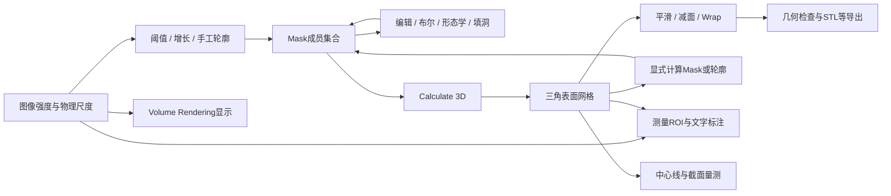

# Mimics Research 17.0 标注与三维重建：工具级实现和操作分析

分析日期：2026-11-04。目标：用户提供的本地 Mimics Research 17.0 安装目录及随包帮助。主程序文件版本 **17.0.0.435**，x64，Visual C++ 2010 系列编译线索。分析采用 reverse-skill-router → R0；三个 GPT‑6.1 Sol xhigh 子代理分别分析分割内核、三维内核、官方帮助，主代理进行补充反编译、交叉核查与汇总。

## 2026-11-05 后续进展：正文为11月4日静态快照

**下文保留2026-11-04的静态分析快照及各章证据日期。** 当时的“未确认”需要结合以下后续材料阅读；后续独立实现也不代表原版数值等价或完整验收。

- [Smart Expand后续内核深挖](../../mimics-vue-reconstruction/notes/native-segmentation-depth.md#new-confirmed-smart-expand-chain)已从延迟调用推进到Random Walker、Jacobi预条件共轭梯度（Jacobi-PCG）以及严格的“概率大于70%”结果判定，补充了原报告当时尚未确认的算法链。
- [LiveWire后续恢复与高斯缺口](../../mimics-vue-reconstruction/notes/native-segmentation-depth.md#remaining-exactness-gap-in-zero-crossing-preprocessing)补充了强度/梯度归一化及零交叉取边规则；离散高斯的系数生成与截断细节仍未完全恢复，自动预处理保留近似边界。
- [三维插值与体积补偿深挖](../../mimics-vue-reconstruction/notes/native-geometry-depth.md)补充了局部插值分段公式、5×5邻域与粗边采样，以及平滑体积补偿的三次多项式设计；GUI字段映射和逐位数值一致性仍有未确认项。
- [当前Vue实现与验收进度](../../../docs/mimics-reconstruction-progress.md)记录后续实现、回归和验收状态；这些更新不改变本报告旧章的证据日期，也不把独立实现冒充为完整原生内核恢复。

## 先读这几个结论

Mimics 的主链是 **图像强度 → Mask 分割 → 表面重建 → 网格处理与测量/导出**。标注既可能指组织分割，也可能指文本、测量或实体文字 Label；它们分别修改不同对象。所谓“三维重建”也至少有三种含义：由 Mask 求三角表面、由图像灰度做体绘制、为 FEA/CFD 生成体网格。本包能直接证实前两者的操作区别，第三类常与 3-matic 协作。

本次并非只根据工具名称讲算法：分割部分核查到区间阈值、扫描行区段的区域增长、动态区域增长的队列及在线均值；三维部分核查到相邻切片组成立方体、查表、插值并写三角面的 Marching Cubes 路径，以及平滑、减面、Wrap 等代表函数。测量部分核查到创建端点、加入对象数据库、提交 Undo 事务的调用链。

**证据边界必须保留：Mimics.exe 受 Wibu CodeMeter 保护。** 主程序多数业务节高熵，主程序静态 IAT 和随机字符串不能完整反映其业务。未运行本软件或附带启动器，也未尝试改变其许可。报告中的操作步骤来自本地 17.0 帮助；外围 DLL/插件算法来自可读代码；不能把“DLL 中存在算法”升级成“已逐个观察到 UI 调用了该算法”。

分析成果采用三个层次：先看本总览建立对象与工作流，再按工具阅读实现模块，最后用帮助工作流模块查菜单、参数、提交时机和原图。所有地址均附模块名；不同 DLL 默认基址相同，不能只看裸 VA。截图、参数例图、旧教程文字与实际本机开放模块之间也做了区分。

## 证据等级与阅读方式

| 标记/表述 | 代表什么 | 不代表什么 |
|---|---|---|
| 文档 D / H编号 | 提供目录内 CHM 明确描述的功能、操作或约束 | 已在当前机器逐次点击复现；当前许可证一定开放 |
| 二进制 B：导入/导出/字符串 | 模块接口、类名、参数或诊断文本存在 | 算法每条分支已恢复；UI必定走该函数 |
| 二进制 B：反编译/反汇编 | 特定地址的控制流、参数、循环和调用实际可见 | 自动恢复类型全部正确；运行时效果已量化验证 |
| 推断 I / 候选 | 与证据相容的实现解释或数学等价模型 | Mimics源码原样实现 |
| 未确认 | 证据不足、受保护调用边界、版本描述冲突 | 不存在该能力 |

模块编号有独立命名空间：分割实现 A、重建实现 R、测量实现 M；官方工作流另用 S/R/A/C/P/X 等编号。不要仅凭相同数字把两章工具直接配对，以名称为准。

## 数据对象与修改边界

| 对象 | 主要内容 | 哪些工具修改它 | 关键区别 |
|---|---|---|---|
| Image / Volume | 原始灰度、层序、像素尺度、方向、HU/GV转换信息 | 图像导入、过滤、重采样等 | 窗宽窗位通常是显示映射，不能当作原始灰度 |
| Mask | 体素/像素成员集合，颜色、名称、阈值等元信息 | Threshold、Region Growing、Edit、Morphology、Boolean等 | 阈值属性不是成员集合本身；Clear可清成员而保留阈值 |
| Polyline | 单层或多层有序轮廓 | LiveWire、Calculate Polylines、轮廓编辑 | 轮廓需转为成员集合或参与重建，不能等同完整体积 |
| 3D Object / Part / STL | 顶点、三角形及对象属性 | Calculate 3D、Smooth、Reduce、Wrap、Cut、Split等 | 改网格不会自动证明原Mask同步改变；需显式反算Mask |
| Measurement | 点、线、ROI、对象关联、量值 | Distance、Angle、Diameter、Area、Density等 | 独立于分割；显示小数位不等于实际测量精度 |
| Annotation | 附着对象、文字、引线、样式和可见性 | Add Text Annotations | 注释不会直接改Mask，也不天然写入STL |
| Label | 写入Mask的实体字符形状 | Label | 与Annotation不同，可经重建成为几何文字 |
| Centerline | 分支、控制点、切线、截面量 | Fit/Edit/Grow/Split Centerline及测量 | 不是任意自由手绘折线；相关测量有Analysis模块前提 |
| FE volume mesh | 体单元、材料及求解器格式 | FEA/CFD、3-matic配合 | 表面STL仅是壳；不等于四面体/体网格 |

Mask 的底层并非必然是每个体素一个独立字节。本包 `MatImageOperations.dll` 的已核查分支使用带成员位的扫描行区段（run-length）结构：连续区间用起止位置与mask位描述。阈值、布尔、编辑和形态学可以沿区段操作；另一些算法为局部遍历建立临时体素访问状态。**“整体用RLE”不意味着所有模块只存在RLE一种表示。**

物理坐标解释应始终考虑像素间距、切片间距与方向。一般可写作 `p = origin + direction × diag(spacing) × index`；这是几何解释模型，未宣称已恢复本包完整 DICOM 仿射实现。二维、MPR、三维拾取、测量和STL导出需要统一物理坐标；厚层插值能改善连续外观，不能创造真实采集分辨率。

## 从用户操作到内部处理

大多数工具可按以下状态理解：选择目标对象 → 输入参数/点/轮廓 → 预览或临时结果 → 应用/计算 → 将动作写入工程 → 更新视图和Undo历史。具体提交时机因工具而异：Threshold 的 Apply、LiveWire 的 Segment、Multiple Slice Edit 的临时mask与Copy/Apply，以及单次点击即执行的 Region Growing 不能混成同一个“确定按钮”。

已核查的分割插件与脚本插件通过 `Mimics::InterfaceFactory` 请求动作接口，再对工程对象执行；框架提供 `MMF::Undo::Manager / Transaction`、`Mimics::IDocument`、`NotificationCenter` 等导出。由此可确证其具有对象接口、命令动作与撤销事务机制。对于未追踪的工具，是否采取相同的预览隔离、取消回滚及增量刷新实现，仍需单独验证。



这是对象数据流图，并非已经逐个动态跟踪的函数调用图。Volume Rendering 的分支来自图像透明度/颜色映射，不会自然产生可导出的三角网格。

## 主要代码模块如何分工

| 模块 | 本次可见职责 | 依据与边界 |
|---|---|---|
| Mimics.exe | 应用主程序，版本17.0.0.435 | CodeMeter保护，主业务UI事件链没有完整静态恢复 |
| Mimics.Segmentation.plugin | Threshold、Dynamic Region Grow等工具控制、校验与动作组装 | 反编译与RTTI；它不直接导入MatImageOperations，连接到具体内核的部分由工厂/主程序隐藏 |
| MimicsBase.dll | IObject、IMask、IMeasurement、IDocument、InterfaceFactory、Undo扩展 | 129文件分诊库中的导出/依赖及代表函数反编译 |
| MatMedicalFramework.dll | 工程对象、动作、事务、通知 | BeginTransaction/Commit/Rollback等导出；被多个插件导入 |
| MatImageOperations.dll | 阈值、RLE区域增长、布尔、形态学、掩码填洞和编辑算子 | 有代表性代码核查，分割实现章详述 |
| Mat2D.dll / Mat2DSlices.dll | 图像及切片/区段相关结构和操作 | 大量导出；不把每个泛型符号都当成UI功能 |
| MatLiveWire.dll | LiveWire代价图、交互路径与相关分割实现 | 对应帮助与代码证据，见分割章 |
| MatOperationsStlImages.dll | 体素/Mask与STL的转换及重建调度 | 实际导入MatImageOperations、MatStlMarchingCubes、MatStlOperations |
| MatStlMarchingCubes.dll | 相邻图像层到三角面、插值、Wrap等实现 | TwoImagesToStl、阈值参数、插值模式与Wrap代码已核查 |
| MatStlOperations.dll / MatSDK.Triangles.* | 三角网格数据、平滑、减面、修复等 | 算子实现和多模块依赖证据 |
| MatIVRender*.dll | 图像与表面显示相关层 | 文件/导出线索；未据此认定特定GPU ray casting实现 |
| Mimics.Script.plugin | 操作和对象的脚本封装 | Distance创建/移动、Mask GetVolume等入口已反编译 |
| MatCenterline3D.dll | 中心线相关结构与操作 | 导出、被脚本/Base引用；本轮没有恢复全部中心线内核 |
| MatStlMaskOperations.dll | 网格上的scalar/vector mask操作 | **不能仅因名称有Mask，就当作CT分割的形态学内核** |

“导入”是模块链接证据，“动作工厂”是可见动态分派方式；未见的连接在报告里保持推断。ITK、Qt、MFC等库出现也只说明依赖，不等于全部分割都是ITK或全部窗口都是Qt。

## 工具分组与阅读顺序

| 任务 | 优先读的工具模块 | 输出检查重点 |
|---|---|---|
| 得到组织初始分割 | Threshold / Region Growing / Dynamic Region Growing | 灰度标度、种子、连通性、局部泄漏 |
| 逐片或跨片修边 | Edit Masks / Multiple Slice Edit / Interpolation / LiveWire | 临时mask、起止层、轮廓拓扑和漏层 |
| 修复成员集合 | Boolean / Morphology / Cavity Fill / Smart Expand / Smooth Mask | 是否误接两结构、填掉真实腔隙、丢失薄壁 |
| 生成可加工几何 | Calculate 3D / 质量与插值参数 | 输入分辨率、边界定位、三角数、方向和单位 |
| 优化表面 | Smoothing / Triangle Reduction / Wrap / Cut / Split | 体积偏差、拓扑变化、孔洞与法向 |
| 做量测 | Distance / Angle / Diameter / Ellipse / Area / Density / Surface distance | 量的定义、物理坐标、附着对象、采样范围 |
| 写注释或实体文字 | Annotation / Label | 是否改变Mask、是否需要进入最终几何 |
| 做血管/气道分析 | Centerline及截面测量、肺模块专用工具 | 分支拓扑、端点、截面位置、模块许可 |

## 版本与文档冲突的处理

1. 本报告只把已确认的本包行为归于17.0。文档全文中未找到 Smart Fill 或 Split Mask 名称；实际存在 Cavity Fill、Smart Expand、Region Growing / 3D Separate，以及对3D对象操作的Split。这是本包检查结果，不是对以后版本的否定。
2. Multiple Slice Edit 的 Interpolation 修改临时Mask成员；View > Interpolated Images 是图像显示相关功能，两者不同。
3. Calculate 3D 的原图、`Quality.htm` 和 `3D objects.htm`使用 **Optimal**；独立的 `STL+ - STL/VRML Parameters` 对话框说明使用 **Maximum**。这是不同对话框的预设命名，尚未证实逐项等价，不能合并成一个菜单。帮助明确 Calculate 3D 的 **High 仍有 XY matrix reduction**，更平滑或更好看不等于最高几何精度。
4. 同一 CHM 包含Mimics与3-matic协作教程。Mimics `Tools > Smoothing / Triangle Reduction / Wrap` 与教程 `Design / Fix / Remesh` 的操作不能合并成同一软件菜单。Tools三项有Simulation模块前提，中心线测量有Analysis模块前提。
5. 截图中的HU、半径、迭代次数、网格误差是当时示例状态，除非正文或反编译明确其默认初始化，不能标成通用默认值。源帮助本身存在旧菜单和图片沿用，工作流章逐条保留。

## 如何判断结果是否正确

分割首先回到原始切片检查，而不是只旋转三维外观：检查目标每一层的归属、薄桥、分叉、空腔、局部灰度变化及闭合情况。阈值误分造成的结构错误通常不能靠后续平滑消除。

三维重建后将表面叠回二维切片检查边界，再检查孤立壳、开放边、法向、退化/非流形三角及尺寸尺度。平滑、减面和Wrap是不同操作：平滑移动几何，减面降低离散复杂度，Wrap可能重新包络并改变拓扑。三者即使让模型“更整齐”，也可能改变测量与体积。

测量需明确对象与量的定义：直线距离、曲面路径长度、三点圆直径、截面等效直径互不替代；Mask体积、网格体积、地标凸体体积也互不替代。报表小数格式与底层计算精度不同，源图像分辨率和人工点位误差仍决定可信程度。

## 本次分析范围与可复现性

范围契约：[scope.md](../scope.md)。阶段记录：[timeline.md](../timeline.md)。只读分析原始目录，副本、IDB、提取文本和报告保存在本案例；没有修改当前项目业务代码、原始软件或患者数据。

分诊覆盖 Mimics 主安装目录下129个 PE 文件（不含另行排除的附带启动器及递归子目录）：共记录131,917项导出、55,831项导入。这是符号盘点规模，**不表示逐一反编译了13万函数**。CHM 解包得到562个HTML主题。深度核查聚焦分割、重建及测量事务的代表路径，具体地址与原始反编译文件见各章。

主程序SHA256：`faed50f99e74926de007299db0bdf58470213b1ee79654d06ea2b9b1ee6e6004`。帮助SHA256：`be16fa266f1f1eeb8fe705ced35a7da7c461512650354fe184cd7709af902b59`。文件版本来自资源，不能据此单独证明安装包供应链真实性。

工具链：已安装的 IDA Professional 9.3 / Hex-Rays MCP、Python 3.12.7（pefile、Capstone等）、Detect It Easy 3.21，以及子代理使用的 radare2/rabin2。CHM 经系统现有7-Zip 26.01解包，作为文档容器工具记录，不安装新依赖。工具索引和脚本执行限制已按用户独立完成要求在本案例内落实。

最小复现命令（PowerShell；只写案例目录）：

```powershell
& 'C:\Users\wwulli\Tools\reverse-skill-python\Scripts\python.exe' 'C:\Users\wwulli\Desktop\deepmark\work\mimics-17-analysis\notes\triage.py'
& 'C:\Users\wwulli\Tools\detect-it-easy\diec.exe' 'C:\Users\wwulli\Desktop\mimics\Mimics Research 17.0\Mimics.exe'
```

反编译复核：将模块副本打开到IDA，用报告给出的 `模块名!VA` 定位；默认DLL ImageBase通常是`0x180000000`，RVA=`VA-ImageBase`。原始证据JSON保存反编译地址标记和引用，导入导出TSV有精确符号和IAT/入口地址；ASLR下运行时地址需要重新加实际模块基址。

本轮没有进行实机UI逐工具复现、真实病例效果评估、主程序解保护、中心线全算法恢复、所有专业模块深挖或医学准确性认证。上述未验证部分已逐模块标明，不影响对已取得文档和外围代码证据的使用。
