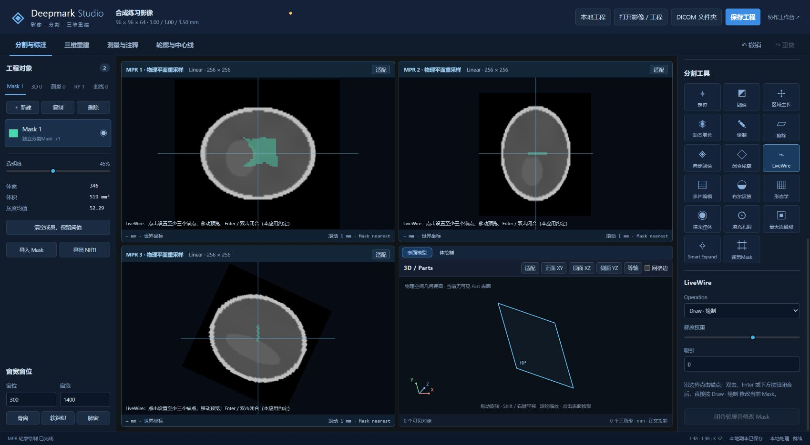
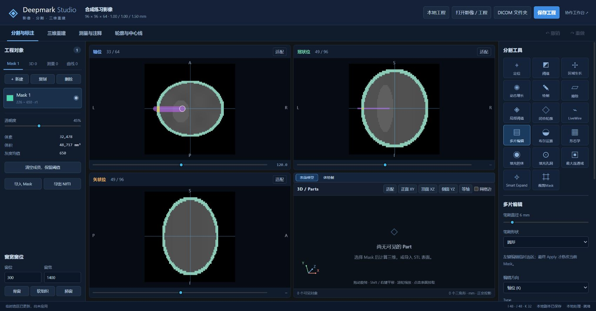

# 分割工具操作指南

适用对象：DeepMark 当前 Mimics 风格工作台。核对日期：2026 年 11 月 5 日。

本指南按当前界面和实现说明操作，不把原版 Mimics 的帮助文档直接当作当前软件的功能保证。不展开“定位、阈值、绘制、擦除、闭合轮廓”五个基础工具。保留独立按钮“局部阈值”，共介绍其余 **12 项分割工具**。多片编辑中的 Select、Deselect 和最终 Operation 属于该工具的必要步骤，仍在对应章节解释。

## 先按目的选择工具

| 你要完成的任务 | 选择工具 | 什么时候真正修改 Mask |
| --- | --- | --- |
| 从已有 Mask 中取出某个相连部件 | 区域生长 | 在源 Mask 成员内点击种子，计算完成后提交 |
| 从一个点出发，按影像灰度寻找区域 | 动态增长 | 点击种子，计算完成后提交到指定输出 |
| 只在刷过的位置按灰度筛选成员 | 局部阈值 | 一笔结束、松开鼠标时 |
| 沿影像边缘逐点吸附，形成分割区域 | LiveWire | 完成并闭合轮廓时 |
| 把选区复制到多层，或在两层之间插值 | 多片编辑 | 最后的“Apply · 应用到活动 Mask” |
| 合并两个 Mask、取交集或做相减 | 布尔运算 | 点击“应用到 Mask A” |
| 扩张、收缩、清理小突起或小间隙 | 形态学 | 点击“应用形态学” |
| 指定一个背景腔体，把它填进去 | 填充腔体 | 在背景腔体内点击种子，计算完成后 |
| 自动填充与外界不连通的内部背景 | 填充孔洞 | 点击“填充封闭孔洞” |
| 只留下体素数量最多的一个相连区域 | 最大连通域 | 点击“保留最大连通域” |
| 从已有分割种子向周边相似结构扩展 | Smart Expand | 检查预览后点击“应用扩展” |
| 只保留指定 I/J/K 范围内的成员 | 裁剪 Mask | 点击“裁剪当前 Mask” |

## 开始前的共同准备

1. 打开“分割与标注”页，在左侧 Mask 列表选择要操作的对象，确认名称、颜色和当前体素数量。当前选中对象称为“活动 Mask”。
2. 对需要在图像上交互的工具，先确认活动 Mask 可见；使用带毫米尺寸的工具前，确认影像空间单位已识别或已确认。
3. 第一次尝试破坏性操作时，用 Mask 列表的“复制”保留一份对照。已有三维 Part 不会随着 Mask 修改自动重新计算。
4. 注意作用范围：原始 I/J/K 三视图、当前单层、整卷三维，以及临时选区，是不同的操作对象。
5. 一次计算完成后再进行下一项操作。计算中可使用“正在计算”提示上的“取消”；不要把仍在计算的画面当成最终结果。

大多数已提交操作可用右上角“撤销／重做”，或在图像获得焦点时用 Ctrl+Z、Ctrl+Y。输入框正在编辑时，快捷键可能由输入框处理。未提交的笔画、轮廓和预览，应使用对应取消入口或 Escape；已经提交的修改则使用撤销。

Mask 是体素分割；Part 是独立三角表面。修改 Mask 后出现“源 Mask 已修改”的模型提示，表示模型保留了之前的几何，需要重新 Calculate 3D。

## 1. 区域生长：从已有 Mask 提取连通区域

**适用场景：** 一个 Mask 中有多个分离的骨块或器官区域，只想取出其中一块。它只沿源 Mask 中已有的成员生长，不会因相邻灰度相似而自动纳入背景。

### 操作步骤

1. 点击“区域生长”。
2. 在“Source · 源 Mask”选择包含目标结构的 Mask。
3. 在“Target · 目标 Mask”选择“New Mask · 新建 Mask”，或选择另一个已有 Mask。
4. 设置“Multiple Layer · 跨切片”和连通性，初次处理完整结构通常先检查跨切片是否开启。
5. 勾选“Leave Original Mask · 保留源成员”可复制；取消勾选则把所选连通区域从 Source 移到 Target。
6. 在 **Source 已分割的内部** 左键单击种子。点击即开始计算，没有额外的预览／Apply 步骤。
7. 检查源、目标的体素数量和跨层连通情况。若要继续编辑新结果，手动在左侧选中它；完成后点击“Close · 关闭区域生长”。

### 参数怎么选

| 参数 | 含义及操作影响 |
| --- | --- |
| 跨切片开启 | 在三维体积内寻找与种子相连的成员 |
| 跨切片关闭 | 只在种子所在的原始切片平面内寻找 |
| 6 连通 | 只承认共面相邻；单层时相当于四邻接 |
| 26 连通 | 面、边、角相邻都可连通；单层时相当于八邻接 |
| 保留源成员 | 勾选为复制；不勾选为移动，源和目标一起提交 |
| 交换 Source / Target | 仅在两个不同的已有 Mask 之间交换输入输出角色，不立即修改成员 |

**要点：** Source 与当前活动 Mask 可以不同，操作依据下拉框中的 Source。New 模式下每次非空点击都会产生独立目标，且不会自动激活新 Mask；若想多次追加到同一结果，请明确选择该已有 Target。种子落在 Source 背景时不会产生新的空 Mask。

**常见问题：** 目标没有被分开，通常因为源 Mask 中仍有细桥连接。切换 6／26 只能改变相邻判定，不能切断真实的面连接；应先处理细桥，再重新提取。

## 2. 动态增长：从种子按灰度寻找结构

**适用场景：** 目标在影像上较连续，但已有 Mask 尚未包含完整区域。与普通区域生长不同，它读取原始影像灰度，不要求候选位置已经属于活动 Mask。

### 操作步骤

1. 选择一个活动 Mask，再点击“动态增长”。即使准备输出新 Mask，也需要先有活动 Mask。
2. 将“输出”设为新建 Mask、累加到当前 Mask，或另一个已有 Mask。
3. 设置跨切片、6／26 连通，以及“下偏差”“上偏差”。
4. 首次比较时可关闭“随接受体素更新均值”，先观察固定种子灰度作为基准时的结果；再按需要开启自适应均值。
5. 在结构内部、远离边缘和噪声的位置单击。等待结果，然后检查所有相关切片。
6. 发生泄漏时撤销，缩小偏差或换一个更有代表性的种子，再计算。

### 参数怎么理解

- **下／上偏差：** 当前参考均值分别向下、向上允许的灰度变化。若基准为 100，下偏差 20、上偏差 30，当前候选采用严格的 `80 < 灰度 < 130` 判定；种子本身会纳入结果。
- **更新均值：** 开启后，已接受成员会影响后续参考均值，可能沿缓慢变化的灰度继续生长，也可能出现漂移。结果不等于一个固定的全局灰度区间。
- **生长后填孔：** 在增长结果上继续做封闭孔洞填充；先关闭更容易判断泄漏来自增长还是填孔。
- **输出到已有 Mask：** 采用并入方式，保留目标原有成员。

当前界面初始下／上偏差均为 30，更新均值开启；这些是软件初始值，不是适用于所有影像的推荐参数。灰度单位取决于影像元数据，不能把所有输入都当作 HU。

**容易混淆：** 当前实现的 Ctrl+单击会把本次动态增长直接累加到活动 Mask，即使“输出”仍选 New。初学时使用普通左键单击，并在每次计算后重新确认活动 Mask 与输出对象。

## 3. 局部阈值：只重判刷过的区域

**适用场景：** 某一小块区域需要按灰度补全或清理，又不希望重算整卷分割。本节对应独立按钮“局部阈值”，不是被排除的全局“阈值”工具。

### 操作步骤

1. 选中并显示目标 Mask，点击“局部阈值”。
2. 在三组范围中，选择“Mask 默认”或一组自定义范围。
3. 如需修改范围，先选“自定义 1”或“自定义 2”，再编辑 Threshold 1／Threshold 2。中间的 Mask 默认行只读。
4. 设置笔刷宽高、是否宽高相同，以及圆／椭圆或方／矩形形状。
5. 在需要重判的位置按住左键拖动，松开后提交一笔。按 Escape 可取消尚未提交的一笔。
6. 查看边界并翻片检查；局部修改不合适时撤销这一笔。

**结果规则：** 只对触及位置重新判断。灰度在包含上下限的区间内则加入 Mask，区间外则从 Mask 移除；没有触及的位置保持原样。因此它既可能增加，也可能减少体素，不是只添加满足阈值的成员。

中间范围跟随 Mask 保存的阈值；Mask 没有保存阈值时，界面显示应用回退值，不能据此认为该范围经过组织标定。切换 Mask 或其阈值时，自定义范围会重置，继续操作前应重新检查。局部范围不会回写全局阈值或 Mask 的已保存阈值属性。

本工具支持原始三视图及任意 MPR。改变窗宽窗位不会改变原始灰度判定。斜面编辑写回原始三维体素，不保证只影响一个原始 I/J/K 层。

## 4. LiveWire：沿边缘吸附的轮廓分割

**适用场景：** 边缘可辨认，但完全自由手绘不容易贴合。用户指定锚点，软件在锚点之间寻找影像边缘路径。

### 操作步骤

1. 选择并显示活动 Mask，点击“LiveWire”。
2. 在 Operation 中选择 Draw、Erase 或 Threshold。Threshold 模式还需选择局部灰度范围。
3. 在边界上点第一个锚点，移动鼠标观察候选路径，再逐个点击后续锚点。弯曲或弱边缘附近适当增加锚点。
4. 等待当前路径计算完成，再放下一个锚点。检查每一段是否沿着预期边界走。
5. 至少形成三个不同锚点并围成有效区域后，按 Enter、双击，或点击“闭合轮廓并修改 Mask”。
6. 闭合后才提交分割；未闭合时可用“取消当前轮廓”或 Escape 放弃。

### Operation 的区别

| Operation | 对闭合区域内部的作用 |
| --- | --- |
| Draw | 加入活动 Mask |
| Erase | 从活动 Mask 移除 |
| Threshold | 按所选局部范围重新决定成员，区间外的已有成员也会移除 |

**梯度权重**控制路径代价中梯度信息的占比；**吸引**影响边缘吸附。可先从界面初始的权重 0.6、吸引 0 开始，每次只改一项并重新检查路径。不要仅因轮廓已经闭合就认定边缘正确。

本工具支持原始切片和任意 MPR。切片、平面、Mask、工具或有效参数改变时，当前未提交轮廓可能取消，宜先完成或主动放弃。遇到“不可达”应调整锚点或平面；软件不会用一条直线替代缺失的边缘路径。这里的双击／Enter 完成方式是当前应用约定。

图 1：已有浏览器验证截图，显示闭合后 Mask 在三幅 MPR 中的结果。截图中的体素数只对应当时合成数据与操作，不是通用目标值。

## 5. 多片编辑：临时选区、复制与层间插值

**适用场景：** 多层重复编辑、沿同一方向批量应用一个区域，或在两个已定义选区之间补出中间形状。它先编辑“临时选区”，最后才作用到活动 Mask。

### 建立临时选区

1. 选中目标 Mask，点击“多片编辑”。当前工具使用原始切片；若此前在任意 MPR 中，会返回原始三视图。
2. 在“编辑方向”选择 I、J 或 K 对应的原始切片方向。只在该方向的视图中编辑，其他视图用于观察和导航。
3. 选择 Type：Brush、Lasso 或 LiveWire。用 Select 添加临时成员，用 Deselect 从临时选区移除。
4. 编辑后看“临时选区”体素数，而不是把颜色变化当成已修改活动 Mask。活动 Mask 原色保留，临时独有区域为紫色，与原 Mask 重叠的位置为黄色。

### 复制到相邻层

1. 把当前层切到已画好临时选区的来源层。
2. 设置 Copy to slices。输入 2 表示复制到该方向的两个目的层，不含来源层；0 表示该方向剩余的全部层。
3. 点击 −I／+I、−J／+J 或 −K／+K 对应按钮。
4. 检查目的层。非零复制层数会把当前层移到最后目的层，超出影像边界时截到边界。

**复制会替换目的层的整张临时选区，包括来源层的零值区域，不是只追加有色部分。** 目的层若已有不同临时选区，可能被覆盖；活动 Mask 此时仍没有变化。

### 在两层之间插值

1. 在同一编辑方向的两层上分别建立临时选区，作为起始和结束形状。
2. 输入“插值起始层”“结束层”。这两个输入框使用 **从 1 开始的层号**。
3. 点击“预览选区插值”，逐层检查中间形状。
4. 点击“应用插值预览”才把结果接入临时选区；不合适则“取消插值预览”。存在未处理预览时，其他编辑被阻止。

### 最终应用到活动 Mask

1. 在 Operation on active mask 选择 Draw、Erase 或 Threshold。
2. Draw 把临时选区并入 Mask；Erase 只移除两者重叠部分；Threshold 只在临时选区覆盖位置按局部灰度重新判断。
3. 点击 **“Apply · 应用到活动 Mask”**。这是修改活动 Mask 的最终步骤；有变化时一次提交，可一次撤销。
4. Apply 后临时选区仍可保留。完成后使用“清除临时选区”或“Close · 关闭多片编辑”，避免后续误用。

清除、关闭或切出多片编辑会丢弃尚未应用的临时工作，不会撤回已经 Apply 的结果；已提交结果要用撤销。临时选区及插值预览不作为已提交工程内容保存。

图 2：已有浏览器验证截图，紫色为临时独有区域，黄色为与活动 Mask 重叠的区域。需要区分“选中了多少”与“最终实际增减了多少”。

## 6. 布尔运算：两个 Mask 的集合运算

**适用场景：** 合并两次分割、扣除排除区，或只留下两个分割重叠的部分。

### 操作步骤

1. 在左侧选中要接收结果的 Mask，它就是 Mask A。建议先复制 A 留作对照。
2. 点击“布尔运算”，确认面板上的 Mask A 名称。
3. 选择运算，再从 Mask B 下拉框选择另一个对象。
4. 点击“应用到 Mask A”，检查体素数量及边界。

| 运算 | 结果 | 例子 |
| --- | --- | --- |
| 并集 A ∪ B | 在 A 或 B 中的成员都保留 | 合并两段分别分割的结构 |
| 交集 A ∩ B | 只保留同时属于 A、B 的成员 | 用一个区域约束另一个结果 |
| 相减 A − B | 从 A 中扣掉 B 覆盖的位置 | 去掉手工建立的排除区域 |

结果替换 A，B 保持原样。A−B 与 B−A 不同；A−A 会清空 A，交集也可能合法地产生空结果。界面没有单独预览步骤，点按钮即提交；选错方向时撤销。

## 7. 形态学：按邻域改变 Mask 形状

**适用场景：** 小范围增厚或变薄、去除小突起、填补小间隙。它处理分割成员，不依据影像灰度自动识别组织。

### 操作步骤

1. 选中目标 Mask，点击“形态学”。
2. 选择腐蚀、膨胀、开操作或闭操作。
3. 从较小半径开始，例如 1，并选择 8·平面处理或 26·三维处理。
4. 点击“应用形态学”。检查薄壁、窄桥和相邻结构是否被误删或粘连。
5. 不合适时撤销，调整参数后再试；没有额外的 Apply 确认层。

| 操作 | 直观效果 | 特别需要检查 |
| --- | --- | --- |
| 腐蚀 Erode | 缩小成员区域 | 细结构可能断开或消失 |
| 膨胀 Dilate | 扩大成员区域 | 邻近结构可能连接 |
| 开操作 Open | 先腐蚀，再膨胀 | 小点、细桥及小突起可能被去除 |
| 闭操作 Close | 先膨胀，再腐蚀 | 小间隙可能闭合，也可能错误粘连 |

**当前作用范围：** “8·平面处理”在整卷各个原始 I/J 平面内分别处理，不是只处理屏幕上正在看的单层；“26·三维处理”把 K 方向也纳入。此面板不使用区域生长的“跨切片”开关。

“半径（像素）”会结合体素间距换算为各方向邻域，不等于所有方向都增加同样层数。例如 I/J 间距 1 mm、K 间距 1.5 mm 时，半径 1 的三维操作可能尚不影响相邻 K 层。当前采用独立的盒形邻域策略，不应当作精确球形核；对剪切网格也不能据此假设完整物理球距离。

## 8. 填充腔体：点击指定的背景空间

**适用场景：** 外壳已分割，想填入其中某个指定背景腔体。需要用户点击种子，与“自动填全部封闭孔洞”不同。

### 操作步骤

1. 选中作为边界的活动 Mask，点击“填充腔体”。
2. 选择输出：New Mask、累加到当前 Mask，或已有目标。
3. 设置跨切片与 6／26 连通。若想填三维腔体，应检查跨切片是否开启。
4. 在 **不属于源 Mask 的腔体内部背景** 单击。落在源 Mask 成员上会被拒绝。
5. 等待填充，检查是否从小开口连到了外部背景；发生大范围泄漏时撤销。

**当前结果约定：** 计算结果包含“源 Mask 原有成员＋种子所连通的背景腔体”。因此输出到 New 时，新对象不是只有腔体本身；输出到已有目标时，还会把这份合成结果并入目标。需要仅得到新增腔体时，可在保留原源 Mask 的前提下，用新结果减去原源 Mask。

单层看似封闭的环，沿其他层可能开口。三维填充会沿开口进入外部，不能只检查点击的那张图。新建输出后还应重新确认活动 Mask，避免下一次以意外对象作为边界。

## 9. 填充孔洞：自动填入封闭的内部背景

**适用场景：** 希望一次补上 Mask 内部多个封闭孔洞，不逐个放种子。

### 操作步骤

1. 选中目标 Mask，点击“填充孔洞”。
2. 选择是否“跨切片处理”。开启时判断三维封闭背景；关闭时只处理当前活动的原始切片平面。
3. 点击“填充封闭孔洞”。
4. 检查内部空腔是否应当保留，误填时撤销。

本工具从图像边界识别外部背景，只填与外部不连通的背景。连到外部的缺口不会自动被当成孔洞填上；需要封口时可先小范围修补或谨慎使用闭操作。

关闭跨切片时，当前实现保留其他层原有成员，只在所选层填孔。二维封闭不代表三维封闭，因此单层填充和三维填充可能得到不同结果。本面板没有单独的 6／26 参数，当前调用使用默认连通规则。

该按钮对应封闭孔洞填充，不代表原版 Mimics 其他名为 Flood-fill 的专用交互已经完整恢复。

## 10. 最大连通域：只留下最大的一个部件

**适用场景：** 一个 Mask 中有一个明显主体，周围散落较小孤岛，希望快速清理。

### 推荐操作步骤

1. 先复制目标 Mask，再选中待处理副本。
2. 点击“最大连通域”，**保持“跨切片处理”勾选**。
3. 点击“保留最大连通域”。
4. 检查保留下来的确是目标主体，而不是扫描床、另一块骨或其他较大对象。选错时撤销。

“最大”按体素数量判断，不是最亮、最接近点击处或临床最重要的区域。本工具不用种子；若需要保留的是较小部件，使用区域生长更合适。当前该按钮使用默认 6 连通，不能通过之前区域生长面板的 26 选项改变它。

**当前版本的重要限制：** 关闭跨切片后，算法只提取当前层的最大区域，而控制器会用这份结果替换整个活动 Mask，其他层成员也会清空。这与“只清理当前层，保留其他层”的理解不同。请优先按上面的三维步骤使用；若必须查看单层结果，只在已复制的副本上尝试并逐层检查。本指南记录该行为，不代表其应作为最终产品设计保留。

## 11. Smart Expand：以已有分割为种子智能扩展

**适用场景：** 已有一块可信的前景，希望在有限邻域内利用灰度边缘扩展，减少简单膨胀对邻近结构的误并入。

### 操作步骤

1. 选中具有有效成员的 Mask，点击“Smart Expand”。输入不应是空 Mask，也应避免把明显错误的成员当作可信种子。
2. 设置最大扩张距离，初次可从当前初始值 3 像素开始。
3. 先保留初始边缘敏感度 10000、最大迭代 200、前景概率 70%，点击“计算扩展预览”。
4. 等待计算，翻看相邻层和边缘。预览尚未修改 Mask。
5. 满意后点击“应用扩展”或预览横幅的“应用预览”；不满意则取消预览，调整一项参数后重新计算。

| 参数 | 调整时关注什么 |
| --- | --- |
| 最大扩张距离 | 限定候选邻域；加大会增加可搜索范围和计算量，不保证所有位置都扩到该距离 |
| 边缘敏感度 | 改变灰度差对相邻连接权重的影响；数值大并不等于结果一定更准确 |
| 最大迭代 | 求解允许的迭代上限；出现未收敛提示时，可增加后重新计算并比较 |
| 前景概率 % | 概率筛选门槛；同一概率场下，提高门槛更严格 |

当前距离按源网格的像素／层距规则确定候选范围，不是界面上画一个各向同性毫米球。概率采用严格大于门槛的判定，100% 不能理解为“完整保留所有前景”，不宜随意设到极端值。

出现“计算未达到收敛”时，得到的是需复查的候选预览，不应只因为按钮可点就直接接受。它也不等同于均匀膨胀、自动分割任意器官或已经验证的临床结果。

## 12. 裁剪 Mask：保留体素索引范围内的成员

**适用场景：** 去掉指定范围外的误分割，例如只保留中段扫描区域。

### 操作步骤

1. 选中待裁剪 Mask，建议先复制。
2. 点击“裁剪 Mask”。
3. 分别填写 I、J、K 起点与终点，使用整数体素索引，不能填写毫米坐标。
4. 确认每个起点不大于终点，且都在影像尺寸以内。
5. 点击“裁剪当前 Mask”。框内原有成员保留，框外成员移除；不合适时撤销。

范围使用 **从 0 开始的索引，且包含两个端点**。例如 96×96×64 影像的完整范围是 I=0～95、J=0～95、K=0～63。输入 I=20～60、J=10～70、K=5～30 时，边界上的成员也会保留。

裁剪不会把框内所有体素自动变成成员，也不会缩小原始影像数组、改变体素间距或生成新影像工程。它只改变当前 Mask 的成员。这里的零起始索引，与多片插值输入框的一起始层号不同。

## 组合使用的三个例子

### 从多个相邻／分离区域中整理出一个目标

1. 复制已有 Mask 留作对照。
2. 用区域生长提取需要的连通部件；不确定时先选择复制而非移动。
3. 对局部不完整边界使用局部阈值或 LiveWire。
4. 有确切封闭孔洞时再填孔；不要把应保留的空腔一并填实。
5. 检查三视图后，再由最终 Mask 重新计算三维表面。

### 在一段连续切片中做相同区域的修正

1. 进入多片编辑，确定 I/J/K 编辑方向。
2. 建立临时选区，再复制到所需层；结构形状变化明显时，使用两个端层的选区插值。
3. 逐层检查临时结果，处理好插值预览。
4. 最终选择 Draw、Erase 或 Threshold，再 Apply 到活动 Mask。
5. 清除临时选区或关闭多片编辑，检查真实增减的体素与边界。

### 从可信的小区域向外扩展

1. 对灰度较均匀且连续的区域，尝试动态增长，先输出新 Mask。
2. 已有可信分割、又需要边缘约束时，尝试 Smart Expand 并检查预览。
3. 泄漏到不需要的部位时，撤销并缩小条件；也可建立排除 Mask 后对结果做 A−B。
4. 保留原始输入与最终结果，不把“更多体素”直接当成更好分割。

## 常见问题速查

| 现象 | 优先检查 |
| --- | --- |
| 区域生长点了没反应 | 是否点在所选 Source 成员内，Source／Target 是否有效且不同 |
| 新结果出现了，后续编辑却仍改旧 Mask | 普通区域生长不自动激活新目标；在列表中手动选择结果 |
| 动态增长或填腔体突然扩得很大 | 灰度条件过宽、均值漂移，或腔体与外部连通；先撤销 |
| 局部阈值把原有成员删掉了 | 它在覆盖区内重新判定，范围外成员会移除 |
| LiveWire 候选路径绕路或不闭合 | 检查锚点、弱边缘、计算等待状态以及是否形成有效区域 |
| 多片编辑有颜色但 Mask 统计没变 | 仍是临时选区，尚未执行最终 Apply |
| 已“应用插值预览”却没改 Mask | 该步骤只更新临时选区，还需最终 Apply 到活动 Mask |
| 形态学影响了多层 | 8 为整卷逐平面处理，26 为三维处理；不是只改当前画面 |
| 最大连通域留下了错误对象 | 最大只按体素数；改用种子区域生长提取特定结构 |
| Smart Expand 不满意却已切换工具 | 工具切换会清理预览；回到工具重新计算，未应用预览不算已提交 |
| Mask 改好了，三维模型仍是旧样子 | 原 Part 不自动重建；检查来源提示，再 Calculate 3D |
| 刷新后临时选区或撤销历史不见了 | 当前工程恢复不包含未提交临时选区及 Undo 历史 |

## 保存与结果检查

1. 先完成或取消所有临时操作；尤其确认 Smart Expand 已应用、多片编辑已最终 Apply。
2. 核对活动 Mask 名称、体素数量、三视图边界和关键连通处；不要只看单张切片。
3. 修改过来源 Mask 的三维模型应重新计算，避免导出旧表面。
4. 用“保存工程”保存完整对象；也可“下载工程副本”。只有“已发起下载”文案时，仍应在下载位置确认文件存在。
5. 需要交换分割时导出该 Mask 的 NIfTI；需要表面时导出对应 Part 的 STL。STL 不能替代包含影像与 Mask 的工程。

## 本指南的依据与验证边界

本次只核对界面、控制器、算法实现及已有验收记录，没有重新操作浏览器逐项验收，也没有更改功能代码。所有步骤描述的是当前独立工作台，不声明与原版 Mimics 数值或交互完全等价。

- 当前 17 个分割工具按钮逐项核对后，排除指定 5 项，正文覆盖剩余 12 项。
- 区域生长的复制／移动／交换、多片选区复制／Apply、斜切 LiveWire 的部分流程已有各自版本的浏览器记录；这不代表本指南每个参数组合都在浏览器实测过。
- 局部阈值、动态增长、布尔、形态学、填孔、填腔体、最大连通域、Smart Expand 和裁剪的完整浏览器验收仍需按具体版本逐项检查。
- 自由轮廓、插值、MPR 写回、形态学邻域等存在明确独立实现策略；原版未恢复的细节不写成已确认行为。

主要核对文件如下，均为本机项目中的现有资料：

| 资料 | 本机路径 |
| --- | --- |
| 当前界面、工具名称与按钮接线 | `C:/Users/wwulli/Desktop/deepmark/src/mimics/Workbench.vue` |
| 提交、Source/Target、临时选区和撤销逻辑 | `C:/Users/wwulli/Desktop/deepmark/src/mimics/useWorkbench.ts` |
| 连通、形态学、填孔、裁剪与选区算法 | `C:/Users/wwulli/Desktop/deepmark/src/mimics/segmentation.ts` |
| 局部阈值三范围 | `C:/Users/wwulli/Desktop/deepmark/src/mimics/useLocalThreshold.ts` |
| Smart Expand | `C:/Users/wwulli/Desktop/deepmark/src/mimics/smartExpand.ts` |
| 区域生长操作契约 | `C:/Users/wwulli/Desktop/deepmark/work/mimics-vue-reconstruction/notes/foundation-region-workflow.md` |
| 多片编辑浏览器记录 | `C:/Users/wwulli/Desktop/deepmark/work/mimics-vue-reconstruction/notes/foundation-browser-multiple-2026-11-05.md` |
| MPR 轮廓与 LiveWire 整合记录 | `C:/Users/wwulli/Desktop/deepmark/work/mimics-vue-reconstruction/notes/foundation-mpr-contour-integration.md` |
| 斜切 LiveWire 浏览器记录 | `C:/Users/wwulli/Desktop/deepmark/work/mimics-vue-reconstruction/notes/foundation-browser-mpr-contour-2026-11-05.md` |

插图直接复制已有合成影像截图，未改图。图 1 来自 `browser-mpr-livewire-draw.jpg`，图 2 来自 `browser-multiple-colors.jpg`；两者对应各自记录中的历史构建，仅用于说明操作结果和颜色含义。
