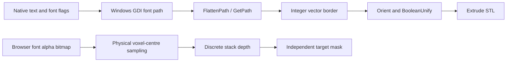

# Contours, solid Label, 3D LiveWire and Smooth Mask depth pass

This stage inherits the granted offline/read-only scope from `../scope.md` and the already selected R0 route. Original Mimics binaries were only read. IDA databases were created or copied under `../evidence/contours-depth/`; no target executable, launcher, license operation or native GUI was run. Other agents' IDA sessions were not closed. The stage's MatLabelCreation, Mat2DSlices and copied Script-plugin sessions were closed after use. `binary-manifest.json` identifies the three analyzed workspace samples.

Implementation is isolated in `src/mimics/contours.ts` and `tests/mimics-contours.test.ts`. Existing shared UI, project schema and previously delivered segmentation/LiveWire/SmartExpand files were not changed by this stage.

## Implemented functionality and exactness boundary

| Feature | Delivered behavior | Attribution |
| --- | --- | --- |
| Calculate Polylines | Extract each requested slice into closed outer/inner rings; retain disconnected components and nesting hierarchy | Independent voxel-cell boundary tracing, explicitly tagged `independent-half-voxel-cell-boundary` |
| Subvoxel boundary coordinates | Voxel centres are integral; boundary vertices are at ±0.5, with collinear vertices removed exactly | Exact for the selected voxel-cell union; not claimed to reproduce native intensity-interpolated STL+ boundaries |
| Holes/islands | Immediate containing-ring index, hole parity, four-connected foreground component, signed area | Independent deterministic topology convention; diagonal foreground contact remains separate |
| Physical metrics | Area via cross product of the affine's two plane basis vectors; perimeter via their vector metric | Supports affine rotation/shear; translation does not affect metrics |
| Contours→mask | Even-odd scanline filling at voxel centres, preserving holes and nested islands | Independent half-open edge-hit convention; all extracted masks round-trip exactly |
| Update Polylines | New set replaces one slice; all other layer objects and source mask remain unchanged | Matches documented current-layer update concept; this kernel extends to all orthogonal axes |
| Solid Label | One-byte alpha bitmap→physical in-plane sample footprint→stack extrusion→independent target mask | Browser-font rasterization/voxel extrusion is an explicit independent implementation, not native GDI glyph geometry |
| Smooth Mask fallback | `independentSmoothMask` requires `majority-6` or `majority-26` explicitly; synchronous centre-inclusive majority iterations | Native Smooth Mask backend is unresolved. This function is named/tagged independent; it is not silently substituted as the original filter |
| 3D LiveWire fusion | No fabricated fusion implementation | Documentation and concrete dispatch/constraint boundaries are preserved below |

### Contour data contract

```ts
interface ContourRing {
  points: [number,number][]; // u/v voxel coordinates, closed implicitly
  hole: boolean;
  parent: number | null;    // immediate containing ring index in layer
  component: number;       // four-connected foreground component, zero-based
  signedArea: number;       // voxel-coordinate squared area
  areaMm2: number;          // absolute physical ring area; hole flag supplies subtraction
  perimeterMm: number;
}
interface ContourLayer { plane; rings; componentCount; provenance }
interface ContourSet { axis; dims; layers; provenance }
```

u/v axes are the two remaining volume axes in ascending order. Ring orientation is positive for an extracted outside boundary and negative for an extracted hole. Parent hierarchy can also place a disconnected foreground island inside an existing hole. A right-turn rule at an ambiguous diagonal corner keeps four-connected foreground components separate. Input image intensities are irrelevant to this binary extraction, including when they contain NaN.

Native Calculate Polylines help says the result corresponds to STL+ segmentation contours. This cannot establish a particular voxel-cell or marching-squares algorithm. The delivered half-voxel geometry is therefore clearly identified as an independent reproducible model, rather than presented as recovered native subpixel interpolation.

### Stable APIs

```ts
extractSliceContours(grid, mask, plane, control?) -> ContourLayer
calculatePolylines(grid, mask, {axis?:2, slices?, ...control}?) -> ContourSet
updatePolylines(grid, mask, set, index, control?) -> ContourSet
contoursToMask(grid, layerOrSet, {source?, operation?:'replace'|'add'|'remove', ...control}?) -> MaskResult
bitmapToMask(grid, {width,height,data:Uint8Array|Uint8ClampedArray}, {
  origin:Vec3, axis?:2, pixelSizeMm:[number,number], depthMm,
  direction?:'up'|'down'|'auto', flipU?, flipV?, alphaThreshold?:128,
  source?, operation?:'replace'|'add'|'remove', ...control
}) -> BitmapLabelResult
independentSmoothMask(grid, source, {
  strategy:'majority-6'|'majority-26', iterations?:1, plane?, ...control
}) -> MaskResult & {strategy,iterations,provenance:'independent-neighborhood-majority'}
```

All returned masks are fresh. Contour update returns a new set/list and a fresh edited layer; unchanged layers intentionally retain their existing immutable-reference identity. Invalid sizes, slice indices, nonfinite vertices, incompatible grids and malformed alpha inputs throw clear errors. Algorithms periodically poll shared cancellation and throw `AbortError`, without publishing a partial mutation.

`contoursToMask` replacement clears only supplied slice planes, preserving all other source planes. Exact edge hits use left-inclusive/right-exclusive, lower-inclusive/upper-exclusive voxel-centre sampling; half-integer extracted boundaries do not hit integer centres. Ring winding/hole metadata does not override parity; this makes nested islands and holes round-trip regardless of input winding.

For Label, `origin` is the voxel coordinate corresponding to bitmap pixel(0,0)'s centre; its normal-axis coordinate is an integer slice. `pixelSizeMm` specifies each bitmap pixel's physical footprint, independently along u/v. Default alpha threshold is128 and fully transparent alpha0 remains background. Physical thickness occupies `ceil(depthMm/normalSpacing)` slices. `up`/`down` clip at the stack edge. `auto` fills upward first, then uses remaining lower slices when it reaches the top. Result metadata exposes `layers`, `clipped`, `requestedDepthMm`, `actualDepthMm` (occupied voxel-span thickness) and `labelVoxelCount`; `count` includes any retained source-mask voxels. The exact native depth rounding/top-edge copy policy is not recovered, so these are explicit implementation conventions.

Independent majority smoothing includes the centre, uses full 7/27-voxel neighborhoods in3D and 5/9 in an explicit plane, treats image exterior as background, and preserves other slices. It acts in voxel neighborhoods; it is not a physical-mm Gaussian or a topology-preserving filter, and is not claimed to be native Smooth Mask.

## Native Label: actual font/geometry backend

The original code uses vector font paths, not bitmap alpha as its core text geometry. `MatLabelCreation.dll` exports and the following decompilations make the path concrete:

| Address | Confirmed behavior | Evidence |
| --- | --- | --- |
| `0x180005E30` | FontToPolyline Operate validates output and positive maximum-edge setting, creates compatible GDI DC, prepares desired height, searches font height, subdivides edges | `label-0x180005e30.c` |
| `0x180005C40` | Prepares desired text height; can calibrate desired height through glyph “o” and the whole text | `label-0x180005c40.c` |
| `0x180005AC0` | Binary searches GDI font height between10 and10000; rescales resulting integer border, shifts it to zero origin; uses a15% too-long-edge decision | `label-0x180005ac0.c` |
| `0x180006CD0` | `CreateFontW`, `BeginPath`, `DrawTextW`, `EndPath`, `FlattenPath`, `GetPath`, then `_ProcessPath` | `label-0x180006cd0.c` |
| `0x180005EE0` | Splits edges longer than requested maximum using `ceil(length/maxEdge)` and interpolated integer points | `label-0x180005ee0.c` |
| `0x1800070F0` | FontToStl builds border, calls `AU::OrientBorder2D` and `AU::BooleanUnify`, converts it to curves, then calls `MStlBaseOperatorExtrude` | `label-0x1800070f0.c` |
| `0x180005A20`, `0x180006FB0` | Internal parameter constructors initialize Arial; STL-depth field initializes10000 | corresponding `label-*.c` files |

`_BuildTextWithGivenFontHeight!0x180006D34–0x180006D76` chooses GDI weight400 or700 according to the bold flag and passes italic/underline/strikeout flags to CreateFontW. Text layout uses `DrawTextW` with `DT_NOPREFIX` (0x800), first querying the rectangle with `DT_CALCRECT|DT_NOPREFIX` (0xC00). `FlattenPath` converts curve outlines to straight path segments; its point decoder is the specific next function **`MatLabelCreation!0x180006560`** (`_ProcessPath`). No proprietary font assets were extracted or needed by the new bitmap kernel.

FontToStl's extrusion setup at `0x18000750E` uses `intDepth/10000.0` and the +Z axis. Internal constructor defaults and scale units do **not** establish Label UI default size/depth or that the segmentation Label GUI always takes this exact STL route. The complete GUI Label→mask sampling/action connection remains unverified. Native font shape and browser Canvas/GDI text shaping/hinting can differ, so our browser bitmap path is deliberately not described as byte-identical font reconstruction.



The two demonstrated paths are distinct. The Vue path creates actual mask voxels, so it can participate in mask operations, Undo and later Calculate3D/STL export; it is not merely Add Text Annotations.

## Native 2D contour infrastructure: confirmed and excluded meanings

`Mat2DSlices.dll!M2DSliceOperatorHatching::Operate@0x180051150` calls `_AddContours@0x1800511D0`, then the imported `MHatcherBase::_DoLineSweep` and writes hatch extremes. `_AddContour@0x180051290` iterates polygon points, applies `MHatchDirection::InverseTransform`, constructs temporary directed edge elements and accumulates bounds. This confirms a native contour→hatch sweep infrastructure, but it does not identify the Calculate Polylines mask-tracing function or prove the new rasterizer's exact vertex inclusion matches native filling.

`M2DSliceUtilities::OrientBorder@0x1800567B0` directly forwards to `AU::OrientBorder2D`. Saved evidence: `2dslices-hatching.c`, `2dslices-add-contours.c`, `2dslices-add-contour.c`, `2dslices-orient-border.c`.

The geometry specialist independently confirmed that its known `MatOperationsStlImages` path is working-mask→paired-slice Marching Cubes; it must not be repurposed as proven2D mask contour tracing. Likewise, `MatStlSlicer!MSliceMediumZ::CalculateIntersection@0x1800CC880` and slicer operators `0x1800CD700/710/720` are **STL→slice layers**, not the inverse mask→polylines operation. These are precise neighboring routes and not substitutes for the missing original trace.

## Native menu IDs and the protected dispatch boundary

The new `resource_command_anchors.py` parses PE menu resources and string tables from the original read-only MimicsENU.dll. It records standard/extended menu structure, numeric command IDs, paths and raw language IDs, and reports no parse errors. Results are in `resource-command-anchors.json`:

| Menu command | Native command ID | Additional relevant evidence |
| --- | ---: | --- |
| Smooth Mask |36137| Main Segmentation and Masks context menu; same tooltip string ID |
|3D LiveWire|36140| Main Segmentation and Masks context menu; same tooltip string ID |
|Calculate Polylines|33275| Main Segmentation and Masks context menu |
|Update Polylines|33276| Main menu includes Ctrl+U; Masks context alias33835 |
|Label|33205| Main Segmentation menu; Masks context alias33836 |
|Calculate Polylines from3D|33428| Other object-specific aliases33663/33691 |

String-table ID**1693** says **“Switch to the axial view to update polylines”**. Therefore the native UI update path may be restricted to Axial, even though the new independent kernel supports all three axes. This restriction was sent to the integrating parent; cross-axis support is described as an extension rather than falsely attributed to the original UI.

`inspect_message_maps.py` then searched Mimics.exe, MimicsBase.dll and Mimics.Segmentation.plugin for strict x64 `AFX_MSGMAP_ENTRY` command/update patterns, `WM_COMMAND` or update-UI message, code0, identical ID/lastID and an in-image function pointer. **No candidate map entry was found.** Smooth36137 and LiveWire36140 do not even occur as plain32-bit command words in those three business images. This result is narrowly scoped; it is not proof that no dynamic handler exists. It is consistent with the already documented protected main-image boundary. Evidence is `message-map-candidates.json`, including per-file occurrence counts rather than an invented function address.

## 3D LiveWire constraints and fusion status

The original CHM is explicit:

1. Choose the automatic-contour direction; if Axial, draw closed contours in Coronal and Sagittal views.
2. Place several points on each contour; native2D paths snap to boundaries. Ctrl requests straight lines; double-click closes3D-tool contours.
3. Multiple source slices contribute turtle lines in the automatic view.
4. **A turtle line must intersect at least one other line to participate.** An isolated line is ignored.
5. A manually inserted constraint line adjusts only its current automatic slice.
6. Start/Stop bounds and parameter application scopes matter; Segment creates a new mask, whose original control points/contours can be reopened later.

Those semantics cannot be reduced to arbitrary-axis signed-distance interpolation or “run Dijkstra through the entire volume.” The existing native MatLiveWire exports support2D contour sets, seed/path matrices and serialization; they do not expose a verified3D turtle-map fusion kernel. No synthetic fusion implementation has been mislabeled3D LiveWire.

This pass found a concrete script/action bridge in the copied `Mimics.Script.plugin` database:

- **`0x180087E00`** registers the script operation named `LiveWire` with callback **`0x180086370`** (`script-0x180087e00.c`).
- **`0x180086370`** requires a loaded project, resolves/creates a target object, obtains an action through InterfaceFactory helper **`0x18008A070`**, assigns project/mask/settings context and executes it through `MMF::Undo::ManagerEx::Perform` (`script-0x180086370.c`).
- **`0x18008A070`** explicitly builds the raw RTTI key for **`Mimics::Segmentation::Actions::IRunLiveWireWithSettings`** at type descriptor `0x18017B870`, searches the InterfaceFactory registry tree by name, obtains a callable, then invokes it (`script-0x18008a070.c`). It throws “Interface was not registered before” on failed registration.
- The next exact callable-copy/invocation helpers are **`0x18008D4C0`** and **`0x18008AD70`**; the decisive algorithm address is the registry's runtime concrete factory target, which is not resolved by this static wrapper. Following the named interface's registration/callable target is the next justified path. The script bridge name alone does not prove it is every3D LiveWire GUI mode.

Thus the actual native cross-plane boundary fusion remains unresolved behind a named, address-backed dispatch boundary. Source-contour intersection selection, automatic-plane fusion mathematics and constraint weighting are explicitly still needed before calling that feature a native reconstruction. The delivered contour/bitmap tools are usable independently and do not silently fill this gap.

## Smooth Mask status

Native Smooth Mask existence is now supported by exact menu/string ID36137, in addition to the original help page. There is still no recovered GUI handler→filter chain. Neither font-border subdivision, mesh smoothing nor Mat2DSlices hatching is a valid substitute. Native Smooth Mask cannot be asserted Gaussian, median, majority or a composition from these observations.

The only delivered smoothing path is the explicitly named `independentSmoothMask` with required strategy. The integrating parent was told to display “独立多数滤波” if it exposes this fallback. The missing native path should next be pursued by resolving command36137 after legitimate main-module code/registration becomes available; no license modification, target execution or unsupported unpacking was attempted in this stage.

## Validation

Executed only this stage's tests and its focused strict type check:

```powershell
& 'C:\Program Files\nodejs\node.exe' --experimental-strip-types --test tests/mimics-contours.test.ts
& 'C:\Program Files\nodejs\node.exe' node_modules/typescript/bin/tsc --noEmit --strict --skipLibCheck --target ES2022 --lib ES2022,DOM --module ESNext --moduleResolution Bundler --allowImportingTsExtensions src/mimics/contours.ts
```

**16/16 tests passed**, strict TypeScript check passed. The suite checks all 512 binary 3 × 3 masks for contour→mask round trip and area identity, plus nested hole/island hierarchy, diagonal components, three orthogonal orientations, affine shear/large translation invariance, current-layer-only update, raster add/remove/replace, explicit edge-hit convention, solid glyph holes, anisotropic physical size/depth, top-edge fallback and clipping, sagittal mirrored placement, alpha thresholds, malformed input, cancellation and explicit independent smoothing. No proprietary program outputs were used as a native equivalence oracle.
