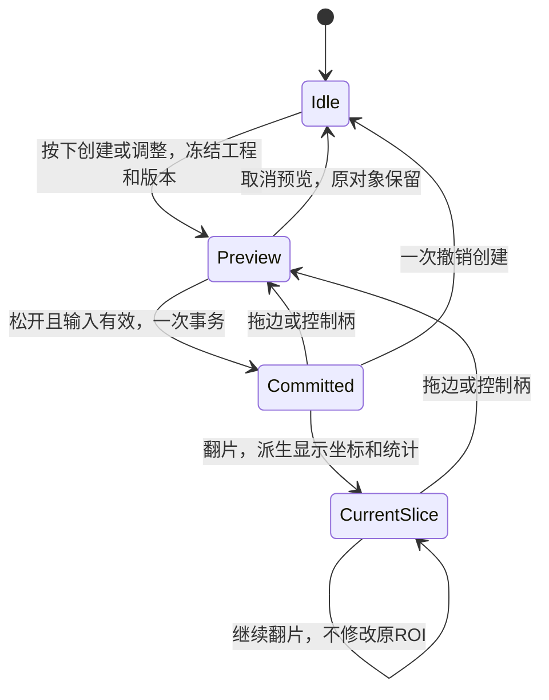

# 基础测量链路：主代理整合审核

本文件记录390阶段的Density ROI与逐点来源整合。后续436阶段已实现文末所列Area/Ellipse专用交互及实时预览，详`foundation-measurement-native-editing.md`。两阶段均未获得新增浏览器通过证据，完整目标仍未完成。

## 原生操作与实现

依据本地17.0帮助，Density Rectangle/Ellipse支持拖放创建、边角/四标记调整、边框移动、释放时重算，以及翻片后更新统计。切片视口和Workbench已接入这些密度交互；默认10×10 image px、像素中心包含规则与总体标准差为应用明确约定，不宣称恢复了原版默认值或采样内核。密度ROI属于影像工具，Part视口不应把两个对角参数误画成距离线。

`useWorkbench.ts`新增`createDensityROI`与批量`updateMeasurementGeometry`。两个角点一次提交、一次撤销；局部拖动预览不进入工程。过期volume/revision、非法切片、角点不共面、零宽高输入不提交。单点旧接口对密度使用当前显示层的两角一起更新，避免一角留在历史层。

Density以保存的原始ROI为横向形状模板，用`displayMeasurements`映射到当前`point[axis]`；完整affine中的法向shear也被保留。翻片只改变显示及统计，不修改原ROI、不加Undo或dirty。窗宽窗位、颜色和显隐不修改原始灰度。

`measurementDetails`与选中详情面板显示：Ellipse的D1/D2/E/P/A/DP/DA和中心；Area的面积、周长、面积/周长等效直径、质心、Lmax与垂直弦长；Density的有效/排除采样数、均值、总体标准差、最小/最大、采样覆盖面积与几何面积。无有效结果明确显示原因及“—”。

## 来源与对象边界

普通距离、角度、三点直径和椭圆可以在不同切片或不同Part取点。逐点`pointPartIds`保留`Part ID|null`，只有全部来自同一Part才写统一`partId`。三维每个控制柄分别约束到它自己的Part；混合来源不绑定最后点击的Part。Area和Density保持同一切片。

新建中的测量若任一来源Part被删除，则取消未完成点串；已提交对象保留历史来源和世界坐标。属性、复制、Undo/Redo和ZIP都保留来源数组。Part→Mask经真实Worker计算，新增Mask记录实际来源`sourcePartId`。这些字段及孤立附件政策是应用独立数据合同，不是原版私有工程格式证明。

## 验证与限制

控制器专项`tests/mimics-measurement-workflow.test.ts`18/18通过，含独立斜切affine/灰度梯度oracle、原始影像/所有Mask/Part保持不变、一次事务、取消、旧手势不改新工程、跨Part及实际Worker/ZIP。翻片不改revision，因此带UI快照的旧plane事件也单独拒绝；无快照的显式程序API仍可修改其他合法切片。独立数值与帮助公式冲突见`foundation-measurement-contract.md`；来源严格验证见`foundation-measurement-attachments.md`。

首轮全量387项中386通过，唯一失败为视口新测试将73.49999999999997严格比较73.5；这是应使用浮点容差的oracle问题，不修改几何实现来凑精确等号。首轮失败日志保留为`measurement-roi-first-regression.log`。最终完整项目回归**390/390通过**，生产构建通过（`index-23O3WbXY.js`），日志为`measurement-roi-regression.log`与`measurement-roi-build.log`。视口/体绘制定向56/56及来源/属性相关44/44通过，不能把测试数量视为原生工具数量。

## 本轮浏览器观察未完成

此前静态preview进程11063在本轮通过`write_stdin`确认仍运行，没有重启。CUA成功恢复文档后，列标签、访问已保留tab1501583374以及完整连接状态均先后观察超时，工具报告kernel reset。没有观察到页面最终状态，没有把超时解释为页面错误或验证通过。已提交`Stopped browser verification`结束本轮UI阶段；未调用原生窗口、未扩大扩展权限，未换用其他自动化方式规避连接限制。

因此本轮新增的Density ROI/其余几何测量、跨Part控制柄和新详情面板仍缺真实浏览器证据。此前已验证的区域生长/文字标注/IndexedDB恢复仍按各历史构建证据保留，不能升级为这些新增功能已验收。

完整原生Ellipse四轴端点、中心平移、旋转和label拖动、Area右键增删点、拖动中即时数值仍有具体缺口，见`foundation-measurement-interaction-gaps.md`。完整62工具+16跨链路范围及基础gate保持未完成。
