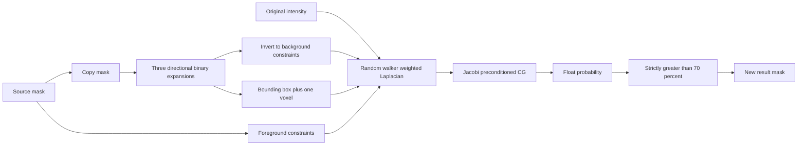

# Native segmentation depth: Smart Expand and LiveWire

Scope: inherited `../scope.md` (granted, offline, read-only original software), checked again with `case-guard.ps1`; R0 route inherited and verified. No target program, launcher, license component, debugging hook or patient project was executed. IDA operated only on workspace copies. Original samples remain unchanged. The three owned IDA sessions were saved/closed as appropriate and released; no service or MCP configuration was changed.

Primary new evidence is in `../evidence/native-segmentation/`. `binary-manifest.json` records SHA256 and length of MatLiveWire.dll, Mimics.Segmentation.plugin and MatSparse.dll. Code listings retain native virtual addresses and exact saved decompilation. Full disassembly is also saved for the LiveWire initialization because Hex-Rays omits floating-point arguments at several incorrectly typed virtual calls. Class names such as `Concurrency::details::ThreadScheduler` in some decompilations are **incorrect inherited IDA types**; the actual written ITK vtable identifies the filter. They must not be used as algorithm identities.

## New confirmed Smart Expand chain

The previous report stopped at a delayed callable. This pass resolves it through `Mimics.Segmentation.plugin!0x18014F850` and downstream filters:



| Address | Confirmed role | Saved evidence |
| --- | --- | --- |
| Segmentation `0x18014F750` | Produces undoable mask update action after deferred work | `smart-action.json`; old report's saved action |
| Segmentation `0x18014F850` | Actual Smart Expand computation/parameter assembly; catches allocation/ITK exceptions and records success | `smart-prepare.c` |
| `0x1801498F0 → 0x180149B30` | Copy input bitset mask through `UnarySliceFunctorImageStackFilter<...,Copy>` | `smart-0x1801498f0.c`, `smart-0x180149b30.c` |
| `0x180150170 → 0x180151900` | `FastMorphologyImageFilter<...,IsTrueFunctor>` | corresponding `smart-*.c` files |
| `0x180150490 → 0x180152DB0` | Invert copied/expanded mask into background | corresponding `smart-*.c` files |
| `0x1801505A0 → 0x180153BB0` | Wrapper is explicitly `itk::RandomWalkerImageFilter<...,ConjugateGradientSolver,...>` | `smart-0x180153bb0.c` |
| `0x180153CD0` | Wrapper crops inputs to the complement-of-background bbox, pads by one, calls probability filter, thresholds result | `rw-wrapper-generate.c` |
| `0x180150FB0 → 0x1801556F0` | Internal `itk::RandomWalkerAlgorithmImageFilter` produces `Image<float,3>` | `rw-internal-factory.json`, `rw-internal-constructor.c` |
| `0x180155890` | Packs intensity and constraints, assembles sparse system, configures CG and writes float output | `rw-algorithm-generate.c` |
| `0x180158330` | Counts unknowns and finds maximum positive packed short intensity | `rw-neighborhood.c` (historical filename; it is statistics, not neighbor enumeration) |
| `0x180158460` | Actual 6-neighbor weight/diagonal/RHS/off-diagonal assembly | `rw-matrix-row.c` |

### Distance and morphology

The Smart Expand action sets directional radii to:

```text
rx = maximumExpandDistancePixels
ry = maximumExpandDistancePixels
rz = trunc(float(pixelSize / sliceDistance) * float(maximumExpandDistancePixels))
```

`smart-prepare.c!0x18014F9E4–0x18014FA93` establishes the ratio, integer conversion and radius array. This recovers the specific axial pixel-to-slice mapping; it does not justify replacing X/Y radii with a generic Euclidean millimetre sphere.

`FastMorphology!0x180069F20` executes its three directional filters. `0x180150E00 → 0x180151C00` constructs `SingleDirectionMorphologyImageFilter<...,IsTrueFunctor>`, whose `0x180151CC0` scans a line forward and backward, resets a counter when it meets a true pixel, and writes true while the radius counter remains. The value at +288 is **DefaultPixelValue**, the value to write, not the outside-image boundary condition. `UseOuterFrame` is +320 in the parent and +308 in a directional filter; it remains false in this Smart Expand setup. Initial counters at the image boundary therefore remain zero.

Z has a separate logical-view path at `0x180152260`, now saved in `morph-axis-z-generate.c`. It uses a logical-to-image-slice lookup and prevents already written mapped slices from resetting the propagation radius. For this application’s regular unique-slice VolumeGrid the implementation uses equivalent separable axis expansion. Duplicated/logically resampled native slice maps are not represented by VolumeGrid and remain an explicit compatibility gap.

The complement of the resulting expanded source is background. The random-walker wrapper finds its non-background bbox and expands it by one voxel per axis, clipped to the image (`rw-wrapper-generate.c!0x180154671–0x180154833`). It copies intensities/foreground/background into that subvolume before invoking the core. Outside the subvolume no output is produced.

### Native parameter mapping: important correction

Several virtual setters had unhelpful decompiler types. Reading their bodies establishes:

| Internal field / vtable slot | Meaning | Smart Expand configured value |
| --- | --- | --- |
| +280, setter slot600 at `0x1800DF270` | EdgeSensitivity | **10000** |
| +284, setter slot616 at `0x1800DF290` | NumberOfIterations | **200** |
| Wrapper +280 | ForegroundPercentage | **70** constructor value (`0x4051800000000000`) |
| CG Parameters +8 | Absolute residual tolerance | **1e-6** (`0x3EB0C6F7A0B5ED8D`) |
| CG Parameters +16 | Enable preconditioning | **true** |

An early progress message had incorrectly called 10000 the iteration count. This was corrected as soon as setter bodies and logged field names were matched. The implementation uses the corrected mapping. The internal random-walker constructor has different generic defaults (sensitivity5000 / iterations200); this specific action overrides sensitivity to10000.

### Recovered constraints, weights and sparse equations

The packed working image is `itk::Vector<short,2>`: first short is the input unsigned16 intensity reinterpreted as signed short; second is its constraint label. Original foreground has priority on overlaps, label1; otherwise background is label−1; otherwise unknown is label0 (`0x180156234–0x1801562E5`). Known foreground probability is1, background0, and unknown solution starts at0.5 (`0x18015690D`, `0x180156AB0`).

For every unknown voxel, `0x180158460` enumerates `+X,+Y,+Z,−X,−Y,−Z`, with no diagonal and no edge beyond the processing volume. No spacing factor appears in these weights. Let `M` be the largest positive signed-short intensity in the cropped working image, replaced by1 if zero:

```text
u_i = float(I_i) / float(M)
w_ij = expf(-float(EdgeSensitivity) * float((u_i-u_j)^2))
A_ii = sum of weights to all existing neighbors
A_ij = -w_ij for unknown neighbors
b_i = sum of weights to foreground neighbors
```

Native intermediate difference, square, exponential result and degree/RHS accumulation use floats, then the sparse matrix/vector store doubles. **There is no added epsilon to keep weak edges alive.** Thus high contrast can produce float-underflow zero edges; this matters for isolated unknown components. Unknowns begin at0.5 and may remain0.5 in an unforced zero-weight component. Original foreground/background are Dirichlet constraints rather than a repeatedly updated seed threshold. This is strong direct evidence for a random-walker harmonic-probability model, beyond class-name inference.

After solve, output is Float32. Wrapper code `0x1801552E2` selects `probability > ForegroundPercentage/100`, strictly; equality is excluded. Native solver-return boolean is not checked before the probability map is consumed. The reconstruction returns `converged`, `iterations` and `residualNorm` so the UI can disclose an unfinished solve.

### Recovered conjugate-gradient implementation

`MatSparse.dll!0x180001220` selects symmetric/non-symmetric solve. The assembled Laplacian is symmetric. `SolveSymmetric` body at `0x180001460` uses the supplied initial vector when its length matches, and flag+16 chooses the preconditioned routine `0x180001AD0`.

`0x180001AD0` limits steps to `min(numberOfUnknowns, maxIterations)` and checks the **unpreconditioned absolute L2 residual** against tolerance with a strict `<` before a step (`0x180001D75–0x180001D84`). It is not a relative residual scaled by RHS norm. `0x180004980` constructs/applies a diagonal preconditioner. `0x180005350` divides1 by extracted diagonal; if `abs(diagonal) <= Number.EPSILON`, the inverse is replaced by1 (`0x180004A6E`). Native degeneracy fallbacks use coefficient1 when a CG denominator is exactly0. The reconstruction retains these defaults and exposes actual final residual after the last permitted step. Floating-point reduction order, sparse assembly ordering and implementation-specific expf rounding are not asserted bit-identical.

## Smart Expand implementation and verification

`src/mimics/smartExpand.ts` exports:

```ts
smartExpand(grid, source, {
  maximumDistance,             // positive integer pixels
  edgeSensitivity?: 10000,
  foregroundPercentage?: 70,
  maxIterations?: 200,
  tolerance?: 1e-6,
  intensityEncoding?: 'float' | 'native-uint16',
  cancelled?, progress?
})
randomWalker(grid, foregroundMask, backgroundMask, options?)
```

Results include `{mask,count,probabilities,iterations,residualNorm,converged,normalizationMaximum,intensityEncoding,roi,unknownCount}`. Masks/probability arrays are fresh. Inputs are not modified. A cancelled operation throws `AbortError` and publishes no partial mask.

`native-uint16` validates integers0..65535 and preserves the recovered signed-short packing/max normalization. **`float` is the explicit default extension for this Vue app’s HU/NIfTI Float32 input**, preserving real values with the recovered maximum normalization. The HU→native stored-unsigned-gray offset/slope is not fully recovered, so no hidden offset is invented. Nonfinite non-foreground Float32 voxels are barriers; nonfinite foreground is an error. These are documented extensions, not claims about a native unsigned image containing NaNs. A user wanting native storage semantics can explicitly choose native-uint16. Full sheared-affine metrics/logical repeated-slice maps remain out of scope for the regular VolumeGrid representation.

New independent tests validate analytic linear Dirichlet probabilities; hand-solved 2D Kirchhoff equations; strict probability equality; foreground precedence; a weighted intensity jump; edge-length spacing independence; native signed packing vs Float32 HU extension; NaN barriers; zero-weight0.5 components; Smart Expand output differing from its dilation; exact ROI padding; thick-slice truncation; honest nonconvergence and cancellation. These checks do not compare against another copy of the sparse assembly code.

## LiveWire normalization now recovered

`MatLiveWire!0x180007560` previously decompiled as multiple unknown ITK filters. Factory and constructor inspection plus full assembly resolves:

1. `0x180009AD0 → 0x18000CD50`: unsigned16 StatisticsImageFilter obtains minimum/output1 and maximum/output2.
2. `0x180009CC0 → 0x18000E150`: ShiftScale<unsigned16,double>, shift=−minimum and scale=1/(maximum−minimum); scale0 for a constant image. Virtual setter arguments are visible in `init-head.json`, not accurately rendered in the old pseudocode.
3. `0x180009DF0`: GradientMagnitude<double,double>, UseImageSpacing=true at +232.
4. `0x180009F50 → 0x18000F6C0`: Statistics<double> obtains gradient maximum Gmax.
5. `0x18000A150 → 0x180010240`: second ShiftScale, shift=−Gmax, scale=−1/Gmax only when Gmax>epsilon; otherwise scale0.
6. The ShiftScale pixel loop `0x180010570!0x1800106C2` confirms `(value+shift)*scale`. Gradient cost is therefore `1−G/Gmax`, with **zero** cost everywhere for Gmax<=epsilon. `0x180378970` contains `0x3CB0000000000000` = Number.EPSILON.

`livewire.ts` now implements these intensity/gradient normalizations and correctly handles flat/sub-epsilon fields. Its final preprocessing metadata is `recovered-gradient-crossing-independent-gaussian`. New regression tests cover a hand-computed ramp, flat input, sub-epsilon physical derivatives and affine intensity-scale invariance. The existing orthogonal `k=1/sqrt(2)` vs diagonal `k=1` edge formula remains unchanged and verified.

### Remaining exactness gap in zero-crossing preprocessing

`0x18000A280 → 0x18000B190` constructs `ZeroCrossingBasedEdgeDetectionImageFilter<double,double>` (the bogus ThreadScheduler label is disproven by its actual vtable). `_InitImage` sets the two variance values to **first in-plane spacing squared**, foreground value0 and background value1 (arguments at `0x180007960`, `0x180007978`, `0x18000798D`). Constructor maximum approximation-error entries are0.01.

`0x180010940` establishes three internal filter stages. A final targeted pass resolved their factories: **`0x1800149E0 → 0x180015BF0`** constructs `DiscreteGaussianImageFilter` (maximum kernel width32, UseImageSpacing=true, two dimensions); **`0x180014BF0`** constructs `LaplacianImageFilter` with spacing enabled; **`0x180014D60`** constructs `ZeroCrossingImageFilter`. The factory listings and Gaussian constructor are saved as `lw-internal-*.c` / `lw-gaussian-constructor.json`.

The zero-crossing threaded loop at **`0x18001A820`** is also saved and recovered. It considers exactly four face neighbors, `−X,−Y,+X,+Y`; a sign change or zero/nonzero transition places the edge at the endpoint with the smaller absolute Laplacian. Equal-magnitude opposite signs use the positive-direction endpoint test (`direction>=2`) to produce one reproducible side. Two zeros are not an edge. ZeroFluxNeumann boundary sampling clamps at the image edge. `zeroCrossingCosts()` now reconstructs this stage, with independent regression examples for unequal magnitude, exact tie, zero pixel and a 2D cross.

The remaining concrete next function for the discrete-Gaussian kernel is **`0x180018EE0`**, obtained from DiscreteGaussian's GenerateData vtable slot448 (`lw-gaussian-generate-slot` query). Until its coefficient generation/truncation is fully reproduced, automatic preprocessing uses an unsmoothed finite-difference Laplacian with the recovered crossing rule and remains explicitly approximate. Next gradient derivative/boundary inspection is **`0x180016A00`** (derivative operator setup), with saved `0x18000E7F0` already showing spacing normalization and ZeroFluxNeumann boundaries.

## Interpolation and Smooth Mask: precise unresolved boundary

The targeted export/string pass checked MatImageOperations, ImageOperations, Mat2DSlices, MimicsBase and the Segmentation plugin. No verified native temporary-mask interpolation or Smooth Mask action entry was identified. `ImageOperations.dll` is mainly MMask/MMaskArray/slicing settings, not a hidden smoothing library. The plugin's unrelated acquisition/DICOM strings containing “Interpolation” and “Smoothing” must not be misattributed to these tools.

Concrete existing interpolation addresses to distinguish and inspect next are **MatImageOperations `0x180004F60`** (`GetImageSliceOfMaskSliceInterpolated[Raw]`) and **`0x180024120`** (`_GetInterpolateMaskPixelOnImagePixel<unsigned short>`). Their exported purpose is mask/image sampling alignment; it is **not verified** that either is the Multiple Slice Edit selection interpolation button. The current signed-distance selection interpolation therefore remains labeled independent. A caller chain from a true GUI interpolation action is still required.

For Smooth Mask, inventing a Gaussian/median/majority filter or declaring it equivalent to Calculate3D mask smoothing would be unsupported. No exact Smooth Mask algorithm address can honestly be supplied from the current exports. The protected main image has base0x140000000 and entry **0x1413341D0** (`Mimics.exe` SHA256 `faed50f99e74926de007299db0bdf58470213b1ee79654d06ea2b9b1ee6e6004`); its `__wibu00`/`__wibu01` sections have entropy8 and do not expose the action strings/import chain. This is a concrete protected boundary, not an assertion that smoothing is absent. Under the current no-target-execution scope, no unpacked GUI action or licensed runtime behavior is fabricated. The native Smart Expand and LiveWire advances above are usable without resolving that protected entry.

## UI API review sent to parent

`useWorkbench` was read without editing shared UI files. Two issues were reported to the integrating parent:

- Existing-target DRG commits replaced the target and erased earlier seed results. The documented extra-seed path needs an explicit accumulation policy/union; results must preserve earlier target voxels when adding a seed.
- `finishDrawing` could close LiveWire while a last seed-tree request was pending. Async completion lacked tool/plane/revision/request-generation validation, allowing a cancelled or switched tool to acquire an old tree. Parent was advised to guard completion and finishing with those identities and busy state.

The parent owns resulting shared UI/worker changes. No browser fallback was attempted after the parent reported an origin approval rejection.

## Validation record

```powershell
& 'C:\Program Files\nodejs\node.exe' --experimental-strip-types --test tests/mimics-segmentation.test.ts tests/mimics-livewire.test.ts tests/mimics-smart-expand.test.ts
& 'C:\Program Files\nodejs\node.exe' node_modules/typescript/bin/tsc --noEmit --strict --skipLibCheck --target ES2022 --lib ES2022,DOM --module ESNext --moduleResolution Bundler --allowImportingTsExtensions src/mimics/segmentation.ts src/mimics/livewire.ts src/mimics/smartExpand.ts
```

**38/38 scoped tests passed**, strict three-file TypeScript check passed. Native-result equivalence remains untested because the original target was not executed. UI/worker end-to-end verification belongs to the integrating parent. This closes the previously unknown Smart Expand algorithm-family/weight/CG chain, LiveWire normalization and zero-crossing placement gaps while preserving the stated remaining Gaussian boundary.
